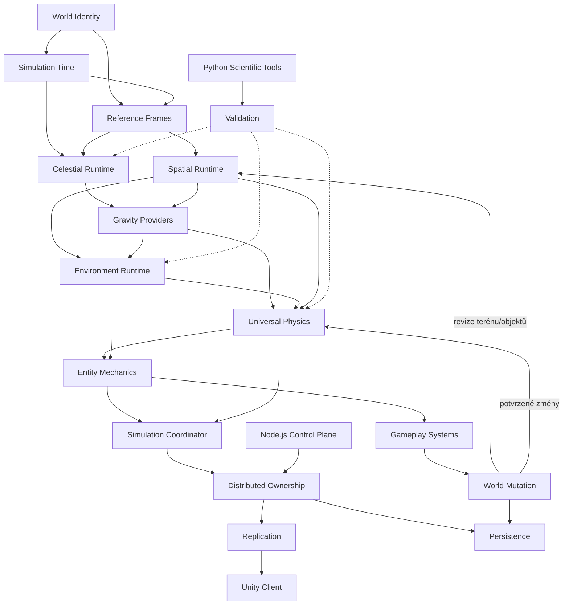

# Worker 10 – Cross-system validation audit v0.1

> **Zdroj:** výstup GPT „Worker 10 – finální validátor“ (2026-11-16), vložen do repa beze změny obsahu.
> **Úpravy správce repa:** odstraněny zbytky z kopírování z ChatGPT UI (favicony, obrázkové karusely, nesouvisející odkaz na worldscience.cn v §9), zdrojové značky převedeny na `*(zdroj: …)*`, rozpadlý mermaid graf v §7 zrekonstruován (hrany odvozeny z textu – viz poznámka v §7).
> **Navazuje:** `audit/CONFLICTS.md` (stav řešení CONFLICT-001..008), `research/worker-0N/w0N-supplement-01.md` (doplňující výzkumy podle tabulky v §12).

## 0. První kontrola repozitáře

Repozitář obsahuje všech devět výzkumných souborů a zatím má jeden commit. Budu proto považovat jejich obsah za původní výzkumnou základnu, nikoliv za schválenou architekturu.

Audit rozdělím na dvě úrovně:

- Lokální validace: zda jednotlivé návrhy dávají technicky smysl.
- Cross-system validace: zda všechny návrhy mohou současně fungovat v jednom distribuovaném simulačním světě.

## 1. Executive summary – první výsledky auditu


Základní architektura je konzistentní

Několik kritických kontraktů chybí


Po prvním průchodu všemi devíti dokumenty vidím, že pracovníci se překvapivě dobře shodují na základních architektonických principech.

To ale ještě neznamená, že jejich návrhy lze přímo implementovat.

### Potvrzené architektonické směry

| Rozhodnutí                                   | Hodnocení                  |
| -------------------------------------------- | -------------------------- |
| Rust jako autoritativní simulation runtime   | Přijmout                   |
| Node.js jako control plane                   | Přijmout                   |
| Unity pouze jako prezentační klient          | Přijmout                   |
| Hierarchické souřadnicové systémy            | Přijmout                   |
| Specializované fyzikální solvery             | Přijmout                   |
| Oddělení fyzikálního LOD a vizuálního LOD    | Přijmout                   |
| Hierarchická simulace astronomického vesmíru | Přijmout                   |
| Environmentální model jako sdílená autorita  | Přijmout                   |
| Regionální vlastnictví simulace              | Přijmout jako cílový model |
| Hybridní persistence                         | Přijmout jako směr         |

Podstatná shoda existuje mezi Worker 01, 02, 03, 04, 07 a 08: všechny subsystémy musí používat jeden fyzický svět, ale nemusí používat stejný numerický solver ani stejnou výpočetní frekvenci.

To je správný základ.

## 2. Zjištěné architektonické rozpory

Zde už začíná skutečná práce Worker 10.

### CONFLICT-001: Globální čas versus lokální simulační tick

Kritická priorita

Problém:

- Worker 01 definuje simulační čas a astronomické časové standardy TAI, UTC, UT1, TT a TDB.
- Worker 02 používá celočíselný tick a racionální timestep.
- Worker 03 navrhuje různé frekvence pro jednotlivé fyzikální modely.
- Worker 04 zavádí společnou časovou osu a možnost akcelerace času.
- Worker 08 používá výrazně pomalejší environmentální aktualizace.
- Worker 09 uvádí regionální `simulation_tick`.

Tyto návrhy nejsou samy o sobě neslučitelné. Chybí ale definice, jak se jejich časové systémy propojují.

Moje rozhodnutí:

Zavést tři oddělené časové koncepty:

1. `WorldInstant` – kanonický okamžik ve světě, reprezentovaný přesnou celočíselnou časovou hodnotou.
2. `DomainTick` – lokální pořadové číslo aktualizace konkrétního simulačního subsystému.
3. `WallClock` – skutečný čas serveru, používaný pro plánování a provozní monitoring.

Astronomické časové standardy budou konverzními reprezentacemi `WorldInstant`, nikoliv alternativními herními hodinami.

Například:

- Vozidlo: 120 fyzikálních aktualizací za simulovanou sekundu.
- Drone controller: 500 interních aktualizací za simulovanou sekundu.
- Regionální počasí: jedna aktualizace za několik simulovaných sekund.
- Orbitální mechanika: adaptivní numerické kroky.
- Všechny výsledky ale musí odpovídat jednoznačnému `WorldInstant`.

Důležitá nuance: akcelerace času nesmí znamenat, že se bez kontroly násobí všechny numerické timesteps. Musí být zachována stabilita integrátorů a definovaná pravidla pro přeskakování či dopočítávání intervalů.

### CONFLICT-002: Kdo skutečně vlastní gravitaci?

Kritická priorita

Tohle je jeden z nejdůležitějších problémů.

Worker 01 definuje planetární gravitační pole jako součást environmentální autority.

Worker 03 požaduje, aby entity používaly centrálně poskytované gravitační hodnoty.

Worker 04 současně definuje vlastní gravitační modely pro astronomické objekty, N-body interakce a extrémní prostředí.

Worker 02 vlastní integraci fyzikálního stavu.

Pokud se hranice nevymezí, hrozí dvojí započítání gravitačních sil.

Navrhované řešení:

Rozdělit gravitační systém na:

- `Celestial Gravity Provider` – gravitační vlivy astronomických těles.
- `Planetary Gravity Provider` – lokální gravitační pole planety včetně nepravidelností a harmonických modelů.
- `Environmental Acceleration Provider` – další zrychlení, například rotující soustavy a lokální environmentální vlivy.
- `Physics Runtime` – jediný vlastník aplikace výsledných sil a integrace pohybu.

Gravitace tedy nebude samostatným vlastníkem entity. Bude poskytovatelem fyzikálních polí.

Zároveň musí být jasné, zda gravitační model již zahrnuje odstředivé efekty v rotující soustavě. Jinak může dojít k jejich dvojímu započítání.

### CONFLICT-003: Entity state není jednotně definován

Kritická priorita

Worker 01 a Worker 02 pracují s hierarchickými souřadnicemi, referenčními rámci a lokálními fyzikálními soustavami.

Worker 04 vyžaduje, aby každý astronomický stav obsahoval referenční rámec, epochu a časovou škálu.

Worker 09 ale předkládá zjednodušený kontrakt:

- `frame_id`
- `x`, `y`, `z`
- `orientation`
- `linear_velocity`
- `angular_velocity`
- `simulation_tick`
- `owner_region`
- `owner_epoch`

To není dostatečné pro univerzální entity pohybující se mezi planetou, orbitou a mezihvězdným prostorem.

Moje rozhodnutí: Worker 09 musí svůj entity kontrakt rozšířit.

Kanonický stav musí obsahovat minimálně:

- Entity ID a typ.
- World ID.
- Reference Frame ID.
- Epoch / WorldInstant.
- Hierarchickou prostorovou pozici.
- Orientaci s definovaným rámcem.
- Lineární a úhlovou rychlost s definovanými rámci.
- Aktivní simulační doménu.
- Stavovou verzi.
- Authority epoch.
- Verzi fyzikálního modelu.

Dále musí podporovat transformaci kompletního šestidimenzionálního stavu, nikoliv jen rotaci pozičního vektoru.

To je důležité zejména při přechodu mezi rotující planetární soustavou a inerciální astronomickou soustavou.

### CONFLICT-004: Region ownership versus physical constraint islands

Kritická priorita

Tady je potenciálně zásadní problém distribuované fyziky.

Worker 02 definuje constraint islands: propojené fyzické objekty, které musí být řešeny jako jeden fyzikální systém.

Worker 09 definuje regionální autoritu a migraci entit mezi regiony.

Představme si automobil:

- Chassis vlastní region A.
- Jedno kolo překročí hranici regionu B.
- Zavěšení kol zůstává propojeno s chassis.
- Kontaktní síly působí přes hranici.

Samostatná migrace kola by mohla rozdělit jeden fyzikální systém mezi dva autoritativní procesy.

Moje rozhodnutí:

Musíme rozlišovat:

1. Spatial region – geografická nebo prostorová oblast.
2. Ownership region – oblast autoritativního vlastnictví.
3. Physics island – propojený fyzikální systém.
4. Execution partition – výpočetní rozdělení práce.

Tyto čtyři struktury nesmějí být automaticky totožné.

Fyzikální constraint island musí mít jednoznačného vlastníka. Pokud zasahuje do sousedního regionu, sousední proces může poskytovat boundary data, ale nesmí nezávisle řešit stejný constraint.

Pro extrémně rozsáhlé fyzikální systémy bude nutné definovat zvláštní distribuované řešení.

Worker 09 sám označuje cross-region physics za kritické riziko.

*(zdroj: GitHub +2)*

### CONFLICT-005: Jeden globální čas versus regionální časové osy

Kritická priorita

Worker 04 požaduje jednu univerzální simulační časovou osu.

Worker 09 navrhuje, aby jednotlivé regiony měly vlastní časovou osu, vlastní tick a vlastní časový stav.

To není nutně rozpor, pokud správně rozlišíme:

- Globální fyzikální čas.
- Lokální průběh simulace.
- Poslední potvrzený čas regionu.

Moje rozhodnutí:

Jeden globální `WorldInstant`, ale žádný povinný globální synchronní tick.

Každý region může mít jinou výpočetní frekvenci a jiný `DomainTick`.

Při interakci dvou regionů musí být stanoven časový okamžik, ke kterému se jejich stavy porovnávají.

Pokud region A simuluje do času T a region B pouze do T−Δ, nesmí se jejich stavy bez dalšího považovat za současné.

Musí existovat explicitní pravidla pro:

- Boundary synchronization.
- Interpolaci a extrapolaci.
- Maximální přípustný časový rozdíl.
- Zpožděné zprávy.
- Projektily a rychlé objekty.
- Pozastavení a akceleraci času.

### CONFLICT-006: World Mutation versus fyzikální autorita

Vysoká priorita

Worker 06 navrhuje World Mutation System jako jednotnou cestu pro změny světa.

Worker 02 přitom vlastní fyzikální stav.

Worker 05 rozděluje gameplay transakce a fyzikální runtime.

Tady je potřeba jednoznačně oddělit změnu fyzikálního modelu od požadavku na změnu světa.

Například stavba mostu:

1. Gameplay systém odešle `PlaceBridge`.
2. Mutation System ověří oprávnění, materiály a umístění.
3. Transakce vytvoří nový objekt.
4. Fyzikální runtime obdrží potvrzenou změnu.
5. Vytvoří kolizní geometrii a fyzikální vlastnosti.
6. Navigation, environment a replication aktualizují své odvozené reprezentace.

Zásadní pravidlo:

Úspěšná transakce vytvoření objektu nesmí automaticky znamenat, že už je objekt fyzicky použitelný.

Musíme rozlišit stav:

- `Committed`
- `PhysicsIntegrated`
- `DerivedSystemsSynchronized`
- `Replicated`

Worker 06 už navrhuje revision vector, což je správný směr. Chybí ale jednotný lifecycle a přesná pravidla, kdy lze objekt považovat za plně aktivní.

*(zdroj: GitHub +2)*

### CONFLICT-007: Environmentální LOD a fyzikální konzistence

Vysoká priorita

Worker 08 správně navrhuje hierarchické environmentální modely.

Problém není samotný LOD. Problém je přenos fyzikálních veličin mezi úrovněmi.

Například:

- Globální klimatický model.
- Regionální meteorologický model.
- Lokální proudění.
- Okamžitý vítr působící na letadlo.

Tyto vrstvy mohou mít různá rozlišení a frekvence.

Nesmí ale nezávisle generovat protichůdné hodnoty.

Moje rozhodnutí:

Každý environmentální vzorek musí obsahovat:

- Source model.
- Model version.
- Spatial resolution.
- Temporal resolution.
- Validity interval.
- Interpolation method.
- Uncertainty.
- World revision.
- Reference frame.
- SI units.

Dále musí existovat conservation-aware coupling mezi vrstvami, minimálně pro hmotnost, hybnost, energii a vodní bilanci tam, kde se dané veličiny přenášejí.

Důležitá poznámka: konzervace nemusí být požadována od každého vizuálního nebo fenomenologického modelu. Musí být ale přesně určeno, které modely jsou fyzikálně konzervativní a které jsou pouze aproximace.

*(zdroj: GitHub +1)*

### CONFLICT-008: Determinismus versus distribuovaná simulace

Vysoká priorita

Worker 02 požaduje determinismus D1 jako základ a D2 jako cíl.

Worker 03 požaduje reprodukovatelnost fyzikálních modelů.

Worker 05 navrhuje replay a obnovu ze snapshotů a eventů.

Worker 09 připouští asynchronní komunikaci mezi regiony.

Tady je potřeba odmítnout představu, že samotný fixed timestep zajistí deterministickou simulaci.

Moje rozhodnutí:

Determinismus definovat samostatně pro každou simulační doménu.

Reprodukovatelný výsledek vyžaduje minimálně:

- Stejný počáteční stav.
- Stejné vstupy.
- Stejnou verzi modelů.
- Stejné environmentální vstupy.
- Stejnou konfiguraci solverů.
- Řízené pořadí operací.
- Zaznamenané náhodné seed hodnoty.
- Definovanou politiku paralelního výpočtu.

Pro distribuovanou simulaci navíc potřebujeme zaznamenávat pořadí potvrzených cross-region událostí.

Nepovažuji bitovou identitu napříč všemi platformami za nutnou podmínku celé architektury.

*(zdroj: GitHub +3)*

## 3. Doporučená architektura – Worker 10 baseline

Následující schéma je moje konsolidace návrhů. Zatím jde o doporučený architektonický baseline, nikoliv o schválenou implementační specifikaci.

UNIVERSAL WORLD FOUNDATION

World identity · WorldInstant · Reference frames · Units · Entity identity

Spatial & Environment

Planetary geometry · Gravity fields · Atmosphere · Oceans · Terrain

Celestial Runtime

Orbits · N-body · Gravity sources · Astronomical time

Universal Physics

Physical state · Integration · Collision · Constraints

Entity Mechanics

Characters · Vehicles · Aircraft · Rockets · Spacecraft

SIMULATION COORDINATION

Domain scheduler · Time coordination · Fidelity transitions · Region boundaries

World Mutation

Commands · Transactions · Revisions · Events

Distributed Runtime

Ownership · Migration · Recovery · Replication

Node.js

Control plane · Sessions · Accounts · Orchestration

Persistence

Snapshots · Journals · Recovery · Durable records

UNITY CLIENT

Rendering · Input · Prediction · Interpolation · Presentation

Python zůstává samostatnou vědeckou a validační vrstvou mimo autoritativní vysokofrekvenční runtime.

Jedno důležité upřesnění: World Mutation, Distributed Runtime a Persistence nejsou nutně tři samostatné procesy. Jde o logické architektonické hranice.

## 4. Matematické a výpočetní modely – sjednocená pravidla

| Oblast               | Doporučený model                              |
| -------------------- | --------------------------------------------- |
| Globální prostor     | Hierarchický graf referenčních rámců          |
| Lokální fyzika       | Lokální kartézské soustavy                    |
| Planetární geometrie | Cube-sphere / geodetický model                |
| Astronomie           | Inerciální a barycentrické soustavy           |
| Fyzikální čas        | Integer/fixed-point WorldInstant              |
| Simulační plánování  | Nezávislé DomainTick                          |
| Fyzika               | Specializované integrátory                    |
| Gravitační pole      | Sjednocené poskytování gravitačních příspěvků |
| Distribuce           | Ownership + fencing + boundary protocols      |
| Persistence          | Snapshot + journal + replay                   |
| Environment          | Multi-fidelity modely s metadaty kvality      |

### Důležitá matematická vlastnost

Transformace mezi referenčními rámci musí zachovat nejen polohu, ale také rychlost a správné časové derivace transformace.

Pro rotující soustavu:

\\[ \mathbf v_I = R(t)(\mathbf v_R+\boldsymbol\omega\times\mathbf r) +\mathbf v_O \\]

To musí být společná matematická služba pro astronomy, fyziku, environment a entity.

Worker 01 tento princip správně identifikuje a odkazuje na NASA SPICE.

*(zdroj: GitHub +1)*

## 5. Unified module structure

Doporučuji konsolidovat moduly podle odpovědnosti, nikoliv podle původních devíti workerů.

```
planetary_engine/
│
├── foundation/
│   ├── world_identity/
│   ├── simulation_time/
│   ├── reference_frames/
│   ├── units/
│   ├── entity_identity/
│   └── state_contracts/
│
├── spatial/
│   ├── planetary_geometry/
│   ├── celestial_frames/
│   ├── spatial_index/
│   ├── coordinate_transforms/
│   └── local_origins/
│
├── environment/
│   ├── gravity/
│   ├── atmosphere/
│   ├── ocean/
│   ├── terrain/
│   ├── climate/
│   ├── materials/
│   └── fidelity_coupling/
│
├── celestial/
│   ├── ephemeris/
│   ├── orbital_dynamics/
│   ├── nbody/
│   ├── gravity_sources/
│   └── relativistic_models/
│
├── physics/
│   ├── physical_state/
│   ├── rigid_body/
│   ├── collision/
│   ├── constraints/
│   ├── integration/
│   └── physics_islands/
│
├── entity_mechanics/
│   ├── character/
│   ├── vehicle/
│   ├── aircraft/
│   ├── drone/
│   ├── rocket/
│   └── spacecraft/
│
├── simulation/
│   ├── coordinator/
│   ├── domain_scheduler/
│   ├── fidelity_manager/
│   ├── boundary_protocol/
│   └── deterministic_execution/
│
├── world/
│   ├── mutation/
│   ├── transactions/
│   ├── revisions/
│   ├── events/
│   └── gameplay/
│
├── distributed/
│   ├── ownership/
│   ├── fencing/
│   ├── migration/
│   ├── replication/
│   ├── fault_recovery/
│   └── load_balancing/
│
├── persistence/
│   ├── snapshots/
│   ├── event_journal/
│   ├── checkpoints/
│   └── replay/
│
├── client/
│   └── unity/
│
├── control_plane/
│   └── nodejs/
│
└── scientific/
    └── python/
```

Toto je logická struktura. Neznamená to automaticky desítky samostatných Rust crates.

## 6. Unified API a data contracts

Za nejdůležitější výstup Worker 10 považuji jednotné kontrakty.

Nedoporučuji začínat implementaci jednotlivých systémů, dokud nejsou vyřešeny minimálně následující rozhraní.

| Contract                | Producent             | Konzument                     |
| ----------------------- | --------------------- | ----------------------------- |
| WorldInstant            | Time Authority        | Všechny subsystémy            |
| ReferenceFrameTransform | Spatial Runtime       | Všechny fyzikální subsystémy  |
| EntityPhysicalState     | Physics Runtime       | Entity Mechanics, Replication |
| GravitySample           | Gravity Providers     | Physics Runtime               |
| EnvironmentSample       | Environment Runtime   | Entity Mechanics              |
| SimulationStep          | Domain Scheduler      | Simulační domény              |
| RegionOwnership         | Ownership Coordinator | Distributed Runtime           |
| WorldMutation           | Mutation System       | World Runtime                 |
| StateSnapshot           | Simulation Runtime    | Persistence                   |
| ReplicationSnapshot     | Distributed Runtime   | Unity                         |

### Kanonický Entity State

Navrhuji následující logickou strukturu:

```
EntityPhysicalState
│
├── world_id
├── entity_id
├── entity_type
├── state_version
│
├── timestamp
│   ├── world_instant
│   └── domain_tick
│
├── spatial_state
│   ├── reference_frame_id
│   ├── anchor_id
│   ├── cell_coordinates
│   ├── local_position
│   ├── orientation
│   ├── linear_velocity
│   └── angular_velocity
│
├── physical_state
│   ├── mass
│   ├── inertia
│   ├── forces
│   └── constraints
│
├── simulation
│   ├── domain_id
│   ├── fidelity_level
│   ├── model_version
│   └── solver_state_version
│
└── authority
    ├── owner_region
    ├── owner_node
    └── owner_epoch
```

Toto není definitivní serializační schéma. Je to požadovaný informační model.

Důležité: `EntityPhysicalState` nesmí být zaměňován za kompletní persistovaný stav entity. Inventář, ekonomické vlastnictví, gameplay komponenty a historie mají vlastní lifecycle.

### Environment Sample

Každá environmentální odpověď musí mít společnou hlavičku:

```
EnvironmentSample
│
├── query_id
├── world_instant
├── reference_frame_id
├── world_revision
│
├── provider_id
├── model_version
├── spatial_resolution
├── temporal_resolution
│
├── validity_interval
├── interpolation_method
├── uncertainty
│
└── values
    ├── gravity
    ├── atmosphere
    ├── wind
    ├── water
    ├── surface
    └── materials
```

### Region Ownership

Musí být definováno:

- Region ID.
- Owner Node.
- Monotónně rostoucí Authority Epoch.
- Lease expiration.
- Committed WorldInstant.
- Last committed DomainTick.
- State version.
- Checkpoint ID.
- Migration status.

Worker 05 už má správný fencing princip a Worker 09 poskytuje základní regionální kontrakt. Musíme je sloučit.

*(zdroj: GitHub +2)*

## 7. Dependency graph

Toto je moje konsolidovaná závislostní mapa.

> **Poznámka správce repa (2026-11-16):** původní mermaid graf se při kopírování z ChatGPT rozpadl – zůstalo jen CSS a seznam 19 uzlů, **hrany se ztratily**. Níže je rekonstrukce: uzly jsou původní, hrany jsou odvozené z textu tohoto auditu (kritická cesta v §7, cykly v §7, vrstvy v §3, tabulka kontraktů v §6). Čitelná verze s vysvětlením je v `integration/DEPENDENCY_GRAPH.md`.



### Kritická závislostní cesta

Nejvyšší priorita

`World Identity → Simulation Time → Reference Frames → Spatial Runtime → Physics → Entity Mechanics → Distributed Runtime`

Bez této cesty nemá smysl implementovat komplexní gameplay.

### Zjištěné cyklické závislosti

Logicky problematické jsou zejména:

1. Physics potřebuje Environment.
2. Environment potřebuje Gravity a astronomické podmínky.
3. Astronomy potřebuje Reference Frames a Time.
4. World Mutation může měnit Terrain a tím ovlivnit Physics.
5. Physics následně vytváří události, které mohou spustit další World Mutations.

Řešení: definovat explicitní fáze aktualizace a event-driven změny s revision trackingem. Žádný subsystém nesmí přímo volat interní implementaci jiného subsystému a obcházet jeho autoritu.

## 8. Performance a scalability

Zde je potřeba odlišit matematickou složitost, návrhové předpoklady a skutečně změřený výkon.

Žádný z dokumentů neprokazuje, že cílových 10 000 hráčů bude dosažitelných. Worker 09 správně označuje své workloady jako validační cíle, nikoliv benchmarky.

### Hlavní výkonnostní rizika

| Oblast               | Riziko                             | Priorita |
| -------------------- | ---------------------------------- | -------- |
| Physics islands      | Silně propojené constraint systémy | Critical |
| Region boundaries    | Komunikace mezi vlastníky          | Critical |
| Environment queries  | Vysoká frekvence dotazů            | High     |
| Celestial simulation | Adaptivní numerické výpočty        | High     |
| Persistence          | Snapshot a event backlog           | High     |
| Replication          | Bandwidth a AOI                    | High     |
| World mutation       | Transakční contention              | High     |
| Unity streaming      | GPU a paměťové limity              | Medium   |

### Doporučený model škálování

Souhlasím s Worker 05: nejprve jeden Rust proces, následně multithreading a až potom distribuované procesy.

1. Stage 1 – Single-process runtime

   Jeden autoritativní Rust proces, více logických regionů.
2. Stage 2 – Parallel execution

   Paralelní physics islands, ECS/SoA benchmarky a domain scheduling.
3. Stage 3 – Multi-process

   Region ownership, fencing, migrace a recovery.
4. Stage 4 – Distributed universe

   Dynamické rozdělení simulační zátěže mezi servery.
5. Stage 5 – Geographic distribution

   Více datacenter, síťová optimalizace a dlouhodobá dostupnost.

Předčasné zavedení distribuované architektury by výrazně zvýšilo složitost vývoje bez prokázaného přínosu.

*(zdroj: GitHub +2)*

## 9. Testing and validation plan

Navrhuji zavést architektonické acceptance gates.

Nejde jen o jednotkové testy. Každá zásadní architektonická hranice musí mít vlastní validační scénář.

| Test ID | Scénář                      | Kritérium                                 |
| ------- | --------------------------- | ----------------------------------------- |
| VAL-001 | ECEF ↔ inertial transform   | Správná poloha a rychlost                 |
| VAL-002 | Rotující planeta            | Správné Coriolisovy a rotační efekty      |
| VAL-003 | Earth → orbit transition    | Kontinuita fyzikálního stavu              |
| VAL-004 | Atmosphere → vacuum         | Bez skokové změny stavu                   |
| VAL-005 | Gravity composition         | Žádné dvojí započítání                    |
| VAL-006 | Multirate simulation        | Konzistentní WorldInstant                 |
| VAL-007 | Constraint island migration | Zachování vazeb                           |
| VAL-008 | Region ownership failure    | Nikdy dva autoritativní vlastníci         |
| VAL-009 | World mutation              | Atomické commit/reject                    |
| VAL-010 | Snapshot + replay           | Obnovitelný stav                          |
| VAL-011 | Environment LOD transition  | Zachování definovaných bilancí            |
| VAL-012 | Client prediction           | Korektní reconciliation                   |
| VAL-013 | 1 000 region boundaries     | Bez ztracených nebo duplicitních událostí |
| VAL-014 | Long-running simulation     | Bez nekontrolované numerické divergence   |

### Zvlášť důležitý integrační test

Navrhuji jeden referenční scénář:

VAL-REFERENCE-001 – Complete Physical Journey

1. Postava stojí na povrchu planety.
2. Nastoupí do automobilu.
3. Automobil přejede do sousedního regionu.
4. Vozidlo se dostane do vody.
5. Postava přestoupí do letadla.
6. Letadlo proletí atmosférou.
7. Raketa opustí planetu.
8. Kosmická loď přejde do orbitální mechaniky.
9. Loď provede gravitační manévr.
10. Vrátí se na planetu.

Požadovaný výsledek: Stejná identita světa, kontinuita fyzikálního stavu, jednoznačné vlastnictví, správná časová osa a žádné přepnutí do samostatného fyzikálního světa.

Tento scénář by se měl stát dlouhodobým integračním testem celého enginu.

## 10. Risk register

| ID  | Riziko                         | Dopad                        | Priorita |
| --- | ------------------------------ | ---------------------------- | -------- |
| R01 | Nejednotný časový model        | Nekonzistentní simulace      | Critical |
| R02 | Dvojí gravitační příspěvek     | Chybná fyzika                | Critical |
| R03 | Neúplný Entity State           | Ztráta kontinuity            | Critical |
| R04 | Rozdělení Physics Island       | Nestabilní fyzika            | Critical |
| R05 | Split-brain ownership          | Dvojí autorita               | Critical |
| R06 | Boundary time divergence       | Nekonzistentní interakce     | Critical |
| R07 | LOD discontinuity              | Fyzikální artefakty          | High     |
| R08 | Mutation revision lag          | Nekonzistentní svět          | High     |
| R09 | Neúplný deterministic replay   | Nemožná reprodukce           | High     |
| R10 | Předčasná distribuce           | Vývojová složitost           | High     |
| R11 | Falešná přesnost environmentu  | Nesprávné fyzikální výsledky | High     |
| R12 | Příliš velká abstrakce runtime | Výkon a složitost            | High     |

## 11. Open architectural decisions

Toto jsou otázky, které bych před implementací ještě neuzavíral.

| ID      | Rozhodnutí                   | Doporučený směr                               |
| ------- | ---------------------------- | --------------------------------------------- |
| ADR-001 | Kanonická reprezentace času  | Integer/fixed-point WorldInstant              |
| ADR-002 | Astronomické časové konverze | Centralizovaná služba                         |
| ADR-003 | Gravity composition          | Sjednocený field provider                     |
| ADR-004 | Physics backend              | Benchmark Rapier / Avian / vlastní řešení     |
| ADR-005 | ECS                          | Benchmark Bevy / Flecs / SoA                  |
| ADR-006 | Region boundary physics      | Physics island ownership + boundary protocols |
| ADR-007 | Environment grid             | Cubed-sphere / hybrid                         |
| ADR-008 | Persistence                  | Hybrid journal + snapshots                    |
| ADR-009 | Ownership coordinator        | Fenced ownership s konzistentním registry     |
| ADR-010 | Distributed time             | Globální čas + regionální committed watermark |
| ADR-011 | Networking                   | QUIC / datagramy podle typu provozu           |
| ADR-012 | Wire format                  | Verzované binární kontrakty                   |
| ADR-013 | World mutation               | Revision-based transakční model               |
| ADR-014 | Environment fidelity         | Conservation-aware coupling                   |
| ADR-015 | Cross-platform determinism   | Po doménách, ne globálně                      |

Zvlášť bych chtěl samostatný výzkum distribuované fyziky a časové koordinace. To jsou dvě oblasti, které mohou rozhodnout o životaschopnosti celého projektu.

## 12. Recommended next steps

Navrhuji následující pořadí dalšího výzkumu:

## Worker 10 – Review roadmap

1. Dokončeno – první průchod

   Inventura Workerů 01–09

   Kontrola všech devíti dokumentů, jejich odpovědností a základních návrhů.
2. Probíhá

   Cross-system contradiction audit

   Sjednocení času, souřadnic, gravitace, fyziky, ownershipu a persistence.
3. Interface consolidation

   Finální logické kontrakty pro všechny subsystémy.
4. Technical source verification

   Ověření zásadních algoritmů a knihoven proti primárním zdrojům.
5. Architecture baseline

   Vytvoření jednotné architektury a závislostního grafu.
6. Implementation gates

   Definování testů, které musí být splněny před zahájením jednotlivých implementačních fází.

### Co potřebuji ještě od Workerů 01–09

Nedoporučuji zatím spouštět implementaci.

Nejdříve bych zadal cílené doplňující výzkumy:

| Worker | Dodatečný úkol                                  |
| ------ | ----------------------------------------------- |
| 01     | Finální prostorový a časový kontrakt            |
| 02     | Physics islands přes regionální hranice         |
| 03     | Přechody mezi fyzikálními doménami              |
| 04     | Sjednocení gravitačních poskytovatelů           |
| 05     | Fencing, ownership a fault recovery             |
| 06     | World Mutation lifecycle a revision consistency |
| 07     | Unity prediction při akcelerovaném čase         |
| 08     | Conservation-aware LOD coupling                 |
| 09     | Distributed time a boundary synchronization     |

# Závěrečný verdikt Worker 10 – první audit

Architektura je perspektivní

Nenašel jsem důvod zamítnout základní koncepci Planetary Engine. Naopak, devět výzkumů vytvořilo poměrně soudržný základ.

Ale našel jsem několik míst, kde by přímá implementace současných návrhů vedla k problémům:

1. Chybí definitivní společný časový kontrakt.
2. Není definitivně vymezena autorita gravitačních modelů.
3. Entity State není dostatečně obecný pro astronomické měřítko.
4. Regionální distribuce není dostatečně propojena s fyzikálními constraint islands.
5. Chybí kompletní pravidla časové konzistence mezi regiony.
6. World Mutation potřebuje definovaný lifecycle fyzikální integrace.
7. Determinismus a replay potřebují společnou specifikaci.

Moje hlavní doporučení:

Nezačínal bych implementací planety, vozidel, počasí ani multiplayeru.

Začal bych implementací a validací pěti fundamentálních kontraktů:

- World Identity & WorldInstant.
- Reference Frame & Coordinate Transform.
- Universal Entity Physical State.
- Environment & Gravity Provider.
- Simulation Ownership & Boundary Protocol.

Tyto kontrakty budou společným základem všeho ostatního.

A ještě jedno zásadní rozhodnutí: Planetary Engine by neměl být navržen jako jeden obrovský simulátor, který se snaží všechno počítat stejným způsobem. Má to být federace specializovaných fyzikálních a environmentálních simulátorů, které sdílejí jeden autoritativní svět, čas a identitu objektů.

To je podle mě nejperspektivnější cesta k univerzálnímu What-If Simulation Platform.

Stav dokumentace: Worker 10 / Audit v0.1 – předběžná validace aktuálního obsahu main větve. Nejde ještě o finální schválení technických kontraktů ani o nezávislé ověření všech externích benchmarků a citovaných implementací.

Další krok: Pošli výstupy doplňujících výzkumů zpět do repozitáře. Na jejich základě provedu druhý audit a uzavřu finální Master Architecture Baseline.