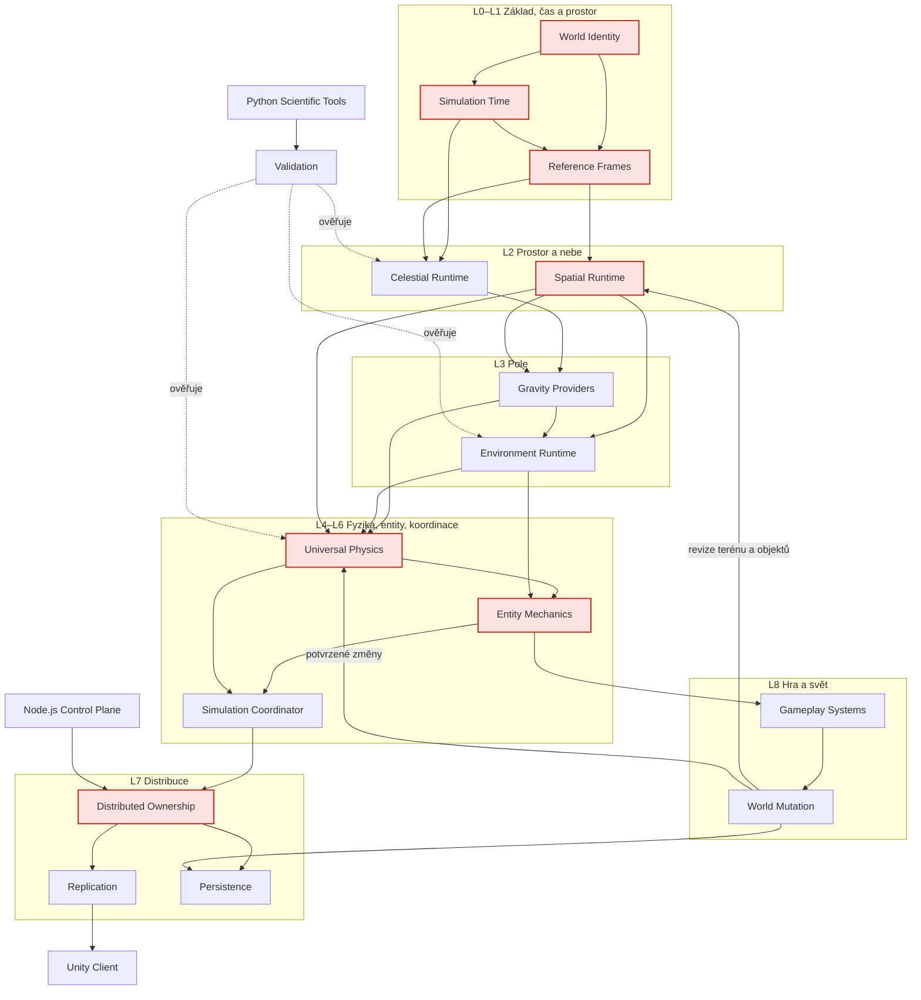

# Graf závislostí Planetary Engine

Stav: **návrh v0.1** (2026-11-16), konsolidace W10 §3 a §7.

> Původní graf ve W10 §7 se při kopírování z ChatGPT rozpadl. Přežil jen seznam 19 uzlů, šipky se ztratily. Uzly níže jsou původní. **Hrany jsou rekonstrukce** z textu W10: kritická cesta (§7), cykly (§7), vrstvy (§3) a tabulka kontraktů (§6). Po druhém auditu W10 je potřeba je potvrdit.

## 1. Jak graf číst

Šipka `A → B` znamená: **B potřebuje A**. A musí existovat (aspoň jako kontrakt) dřív, než B může fungovat. Čím výš je vrstva, tím dřív se musí stavět.

## 2. Vrstvy (shora dolů = pořadí stavby)

| Vrstva | Uzly | Potřebuje | Kontrakt, který vrstva dodává (W10 §6) |
| --- | --- | --- | --- |
| **L0 Základ** | World Identity | – | world_id, entity_id |
| **L1 Čas a prostor** | Simulation Time, Reference Frames | L0 | `WorldInstant`, `ReferenceFrameTransform` |
| **L2 Prostor a nebe** | Spatial Runtime, Celestial Runtime | L1 | geometrie planety, efemeridy |
| **L3 Pole** | Gravity Providers, Environment Runtime | L2 | `GravitySample`, `EnvironmentSample` |
| **L4 Fyzika** | Universal Physics | L2, L3 | `EntityPhysicalState` |
| **L5 Entity** | Entity Mechanics | L3, L4 | auta, letadla, rakety, postavy |
| **L6 Koordinace** | Simulation Coordinator | L4, L5 | `SimulationStep` |
| **L7 Distribuce** | Distributed Ownership → Replication, Persistence | L6 | `RegionOwnership`, `StateSnapshot`, `ReplicationSnapshot` |
| **L8 Hra a svět** | Gameplay Systems → World Mutation | L5 | `WorldMutation` |
| **Okraj** | Unity Client, Node.js Control Plane, Python Scientific Tools → Validation | viz graf | klient, orchestrace, validace |

## 3. Graf

Červeně zvýrazněné uzly tvoří **kritickou cestu** (W10 §7):

`World Identity → Simulation Time → Reference Frames → Spatial Runtime → Universal Physics → Entity Mechanics → Distributed Runtime`

Bez ní nemá smysl stavět složitý gameplay.

## 4. Cykly a jak je W10 rozpojuje

Graf má dvě zpětné hrany. Obě vedou z World Mutation (L8) zpátky dolů:

1. **Physics → Environment → Gravity → Astronomy → Frames/Time.** Tohle není cyklus, je to řetěz. Vypadá jako cyklus jen proto, že Physics potřebuje Environment a Environment potřebuje Gravity.
2. **Mutation → Terrain → Physics → událost → další Mutation.** Tohle je skutečný cyklus (zřícení mostu, výbuch, eroze).

Řešení W10: explicitní fáze ticku a změny řízené událostmi s revizemi. Žádný subsystém nevolá vnitřek jiného subsystému. Mutace vytvořená fyzikou v ticku *N* se projeví nejdřív v ticku *N+1*. Podrobnosti dodá `research/worker-06/w06-supplement-01.md`.

## 5. Co ještě chybí

- Potvrdit nebo opravit hrany po druhém auditu W10.
- Doplnit závislosti z doplňujících výzkumů W01–W09 (sekce 5 „Rozhraní na ostatní workery“).
- Rozhodnout, jestli Celestial Runtime patří pod Spatial Runtime, nebo vedle něj (W01 vs. W04).
