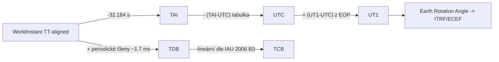
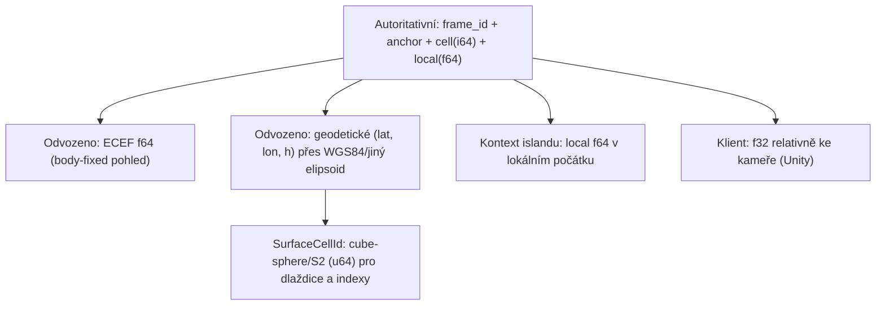
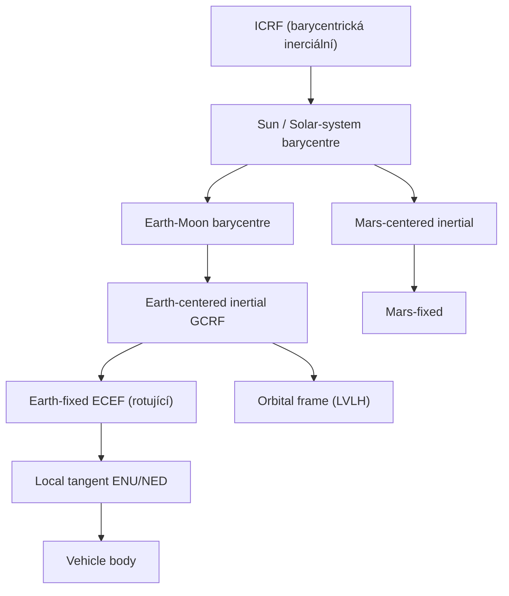
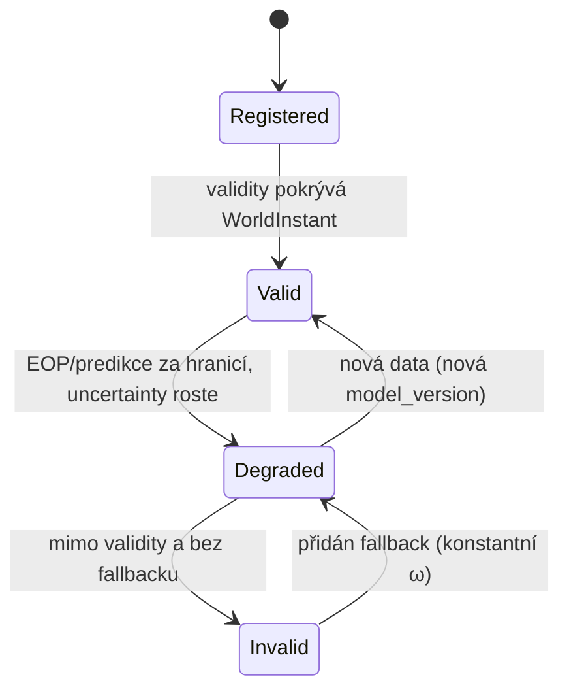

# W01 Supplement 01 – Finální prostorový a časový kontrakt

Autor: Worker 01. Fáze: architektonický výzkum, žádná implementace (kód jen jako ilustrační datové struktury).
Značení: **ověřeno** = potvrzeno primárním zdrojem nebo původním výzkumem, **návrh** = moje rozhodnutí, **odhad** = nepodložená hodnota k měření.
Vstupy: `audit/WORKER_10_REVIEW.md` (§2 CONFLICT-001/003, §4, §6, §9, §12), `research/worker-01/w01-original.md` (§2.4–2.8, §3.2), cizí výzkumy w02, w04, w05, w07, w09 jen grepem.

---

## 1. Shrnutí rozhodnutí

| ID | Rozhodnutí | Stav |
| --- | --- | --- |
| D-01 | `WorldInstant` = signed 128bitový celočíselný počet kvant `q = 1/1 440 000 000 s` (≈ 0,694 ns) od epochy `J2000.0 TT` (2000-01-01 12:00:00 TT). Rozsah ±1,2·10^29 s (prakticky neomezený). | návrh |
| D-02 | Časová škála `WorldInstant` je **TT-zarovnaná** (SI sekunda, spojitá). TAI = TT − 32,184 s (pevný offset). TDB, TCB, UTC, UT1 jsou jen konverze. | ověřeno (definice TT/TAI), návrh (volba TT) |
| D-03 | Kvantum `q` je zvoleno tak, aby periody všech zamýšlených DomainTick (1/24, 1/30, 1/60, 1/90, 1/120, 1/240, 1/500, 1/1000 s) byly **celočíselné násobky `q`**. Doména s frekvencí nedělící `1,44·10^9` musí mít explicitní racionální periodu a pravidlo zaokrouhlení (zakázáno v autoritativní doméně). | návrh |
| D-04 | Přestupné sekundy žijí výhradně v `TimeScaleTable` (verzovaná data, ne kód). Vnitřní fyzika je nikdy nevidí. UTC↔`WorldInstant` je jediné místo, kde se s nimi pracuje. | ověřeno (princip z w01 §2.8), návrh (tabulka) |
| D-05 | Graf referenčních rámců (DAG ve tvaru stromu s verzovanými uzly); transformace je vždy **6D** (poloha+rychlost) a pro orientaci i `ω` a `α`. Transformace se skládá jako 6×6 matice stavu (SPICE `sxform` styl). | ověřeno (princip), návrh (struktura) |
| D-06 | Pozice entity = `(frame_id, anchor_id, cell:[i64;3], local:[f64;3])`. Kanonický kvantizační krok mřížky `L = 2^15 m = 32 768 m`. ECEF `f64` je **odvozený pohled** (cell·L + local), ne autoritativní uložení. | návrh |
| D-07 | Adresace povrchu / dlaždic = **cube-sphere se S2-kompatibilním mapováním** (6 stěn, quadtree, Hilbertova křivka, `u64` ID). H3 jen jako vstup/výstup dat a analytický index, nikdy jako simulační prostor ani vlastnické hranice. | návrh (shoda w01+w05) |
| D-08 | SI typová kontrola: typované veličiny (`Quantity<Dim>`) ve Rustu, na drátě a v persistenci jen SI base jednotky bez prefixů, Python vrstva přes jednotkovou knihovnu s povinným převodem na hranici. | návrh |
| D-09 | Floating origin je výlučně vlastnost **kontextu** (physics island, Unity klient), nikdy autoritativního stavu. Posun origin = přepočet z `(cell, local)`, nikoliv mutace stavu. | ověřeno (w01, w07 shodně) |
| D-10 | `DomainTick` je `i64` počet period domény od `domain_epoch` (WorldInstant). `WorldInstant(tick) = domain_epoch + tick·period_q`. Opačně: `tick = floor((wi − domain_epoch)/period_q)` + zbytek explicitně. | návrh |

---

## 2. Řešené konflikty W10

### CONFLICT-001 (čas) a CONFLICT-005 (regionální časové osy)
**Rozhodnutí:** viz D-01..D-04, D-10.
**Odůvodnění:**
- w02 požaduje celočíselný tick a racionální timestep (`t_n = n/60`) – **ověřeno** v w02 (sekce „Proposed initial timing configuration“). Nejnižší kvantum musí tedy být dělitelné periodou. `1/60 s = 24 000 q` přesně.
- Pouhý `i64` v nanosekundách pokryje jen ≈ ±292 let a 1/60 s není celé číslo ns (16 666 666,67 ns). Obojí je pro „what if“ simulaci (geologické a astronomické škály, zrychlení času) nevyhovující. `i128` je cena 16 B na instant; v horkých smyčkách se pracuje s `i64` delty vůči lokální epoše domény (viz §3.2).
- Volba TT-zarovnané škály: spojitá, SI, bez přestupných sekund; s TAI je spojena pevným offsetem, s TDB periodickou funkcí (amplituda ≈ 1,7 ms, **ověřeno** – PINT/IERS zdroje, TDB je lineární přeškálování TCB dle IAU 2006 B3). Efemeridy (JPL DE) jsou v TDB; chyba záměny TT/TDB je ≤ ~2 ms (IAU 2006 B3 uvádí < 2 ms pro tisíciletí kolem současnosti), pro hru zanedbatelná, pro vědecké validace nikoli – proto konverze existuje, ale je explicitní.
- Vliv na W10 tabulku: „Fyzikální čas: Integer/fixed-point WorldInstant“ ✔.

### CONFLICT-003 (stav entity) – část W01
Do `EntityPhysicalState` (W10 §6) dodávám konkrétní typy pro `timestamp` a `spatial_state` (viz §3.4). Transformace zahrnuje celý 6D stav (D-05). Nechávám bez změny: `physical_state`, `simulation`, `authority`.

---

## 3. Kontrakty

### 3.1 `WorldInstant`

```rust
// ILUSTRAČNÍ datová struktura, ne implementace
struct WorldInstant(i128);          // počet kvant q od J2000.0 TT
const Q_PER_SECOND: i128 = 1_440_000_000;   // q = 1/1.44e9 s

struct WorldDuration(i128);         // téhož typu, signed; trap při přetečení v i64 kontextu
```

Vlastnosti:
- Pouze celočíselná aritmetika; žádné `f64` v autoritativním čase. Převod na `f64` sekundy jen pro zobrazení / fyzikální vzorce (`dt = (wi_b − wi_a) as f64 / Q_PER_SECOND`), a to vždy z **rozdílu**, ne z absolutní hodnoty (precision).
- Rozsah ověření: `2^127 / 1.44e9 ≈ 1,2·10^29 s ≈ 3,7·10^21 let` (**ověřeno** výpočtem).
- Kvantum `q ≈ 0,694 ns` je jemnější, než jakákoli doména potřebuje. `1,44·10^9 = 2^11·3^2·5^7`: bezezbytku dělí frekvence 24, 30, 60, 90, 120, 240, 500, 1000 Hz i 2^k Hz do 2^11 (1/2048 s = 703 125 q). Nedělí 7, 11, 13 Hz ani 4096 Hz. Pravidlo: **period_q musí být celé číslo, jinak je doména odmítnuta při registraci** (fail fast).
- Serializace: 16 B big-endian two's complement v journalu a snapshotu; v ReplicationSnapshot pro klienta stačí `i64` delta vůči `snapshot_base_instant` (viz W07).

Alternativa zvažovaná a zamítnutá: `i64` ns od epochy (rozsah ±292 let, 1/60 s není přesné) a `f64` sekundy (kumulativní chyba, zakázáno W02 i W10).

### 3.2 `DomainTick` a mapování

```rust
struct DomainClock {
    domain_id: DomainId,
    epoch: WorldInstant,        // instant, kdy tick == 0
    period_q: i64,              // celé kvantum, > 0
    tick: i64,                  // aktuální tick
}
// wi(tick) = epoch + tick * period_q
// Rozdělení: committed_watermark je WorldInstant, ne tick (W09 ho hlídá)
```

Pravidla:
1. Tick se mění jen na hranici kroku domény. Žádný tick nesmí překročit `committed_watermark` regionu (závisí na **W09**).
2. Interakce mezi doménami s různými `period_q` se děje v `WorldInstant`: starší doména se interpoluje / extrapoluje na instant mladší (konkrétní algoritmus: **W09**, **W03**).
3. Časová akcelerace (viz §4.5): mění pouze vztah `WallClock → WorldInstant` a **počet** kroků na wall-sekundu, nikoliv `period_q` autoritativních domén. Na přeskoku dodává doména jiný integrátor (adaptivní, on-rails) – to je věc **W03**.

### 3.3 `TimeScaleTable` a konverze

```rust
struct TimeScaleTable {
    version: u32,
    leap_seconds: Vec<LeapEntry>,     // (utc_date, tai_minus_utc_after)
    eop_series: EopSeries,            // UT1-UTC, polární pohyb, validity do data X
    tdb_model: TdbModelId,            // např. Fairhead-Bretagnon / ERFA dtdb
    epoch_offset_tt_tai_q: i128,      // pevně 32.184 s
}
```

Konverzní graf (jednosměrně definované funkce, ostatní odvozeny):



Ověřená fakta:
- TT − TAI = 32,184 s (definice). TAI − UTC = 37 s od 2017-01-01 (platí i dnes; poslední přestupná sekunda 2016-12-31 – **ověřeno** znalostí IERS Bulletin C; v tomto kole neověřováno webem).
- Přestupné sekundy se vkládají podle IERS Bulletinu C; |UT1−UTC| < 0,9 s je současné pravidlo. **CGPM 2022 rez. 4** (BIPM, **ověřeno**) rozhodla, že max. povolený rozdíl UT1−UTC se do roku 2035 zvětší; sekundární zdroje tvrdí konkrétnější plán (UTC bez přestupných sekund od 2027, tolerance 1 h) – **neověřeno**, primární text BIPM jsem nenašel. Důsledek pro návrh: tabulka přestupných sekund musí být verzovaná a **volitelně prázdná do budoucna**; UTC konverze nesmí předpokládat periodické vkládání.
- Přestupné sekundy do budoucna nejsou předpověditelné → pro budoucí UTC datum je konverze `UTC → WorldInstant` neurčitá o `Δ` sekund. Pravidlo: simulační scénáře udávají start jako TT/TAI instant, UTC jen jako vstup uživatele s `table_version`.
- UT1−UTC pochází z EOP (IERS) s predikcí; mimo pokrytí EOP je `UT1 ≈ UTC` s uvedenou nejistotou. `EarthRotation` provider vrací `uncertainty` (viz `FrameTransform` níže).

Pro fiktivní planety (what-if): každé těleso má vlastní `RotationModel` (konstantní ω, precese…) vyhodnocované z `WorldInstant`; UT1/UTC jsou pouze pro Zemi.

Pravidla zacházení s přestupnými sekundami:
1. UTC řetězec `YYYY-MM-DDThh:mm:60Z` je validní jen v `TimeScaleTable` (jinak chyba).
2. Konverze `UTC → WorldInstant` je totální jen pro intervaly pokryté tabulkou (jinak `Err(OutsideTable)`).
3. Journal a snapshot ukládají WorldInstant a `time_table_version` – replay (VAL-010) musí použít stejnou verzi.

### 3.4 Prostorová pozice a `EntityPhysicalState.spatial_state`

```rust
struct SpatialState {
    frame_id: FrameId,            // kam patří cell/local
    anchor_id: AnchorId,          // lokální počátek mřížky (planeta, orbit, loď)
    cell: [i64; 3],               // celočíselné mřížové souřadnice, krok L = 2^15 m
    local: [f64; 3],              // m, vždy v rozsahu [-L/2, L/2) po normalizaci
    orientation: UnitQuaternion,  // rámec orientace explicitně = frame_id
    linear_velocity: [f64; 3],    // m/s, v osách frame_id
    angular_velocity: [f64; 3],   // rad/s, v osách frame_id (stav těla vůči frame_id)
}
```

Důvody a vlastnosti (**návrh**, zdroj principu w01 §2.7):
- `P = anchor + cell·L + local`. Normalizace po každé integraci: `if |local_i| > L/2 { cell_i += round(local_i/L); local_i -= ... }`. Přenos je přesný pro mocniny dvou (L = 2^15 → odečítání bez ztráty bitů, **ověřeno** vlastností IEEE-754).
- Přesnost `f64` v buňce: ulp(16 384) = 2^-39 ≈ 1,8·10^-12 m (**ověřeno** výpočtem). Pro Zemi (r ≈ 6,4·10^6 m) by samotné ECEF `f64` mělo ulp 2^-30 ≈ 9,3·10^-10 m – také dostatečné, takže **ECEF `f64` je legitimní pro dotazy a export**, ale ne pro sdílené autoritativní uložení všech škál (galaxie: 10^21 m, ulp ≈ 10^5 m).
- Rozsah `i64` buněk: `9,2·10^18 · 32 768 m ≈ 3·10^23 m ≈ 10^7 pc`. Pro mezigalaktické škály se anchor hierarchicky vnoří (anchor sám má `frame_id` a `cell`).
- Mřížka je vždy definována ve **frame_id** (kartézské osy rámce, ne sférické), proto vlastníkem prostorových dotazů zůstává region (ne cell).

Vztah ke 3 variantám (sjednocení):

| Zdroj | Navrhované použití | Role v kontraktu |
| --- | --- | --- |
| w01 `cell:int64 + local:float64` | **přijato** jako autoritativní tvar | `SpatialState` |
| w01 / w05 S2/cube-sphere | **přijato** pro adresaci povrchu | `SurfaceCellId` (u64), dlaždice terénu, indexace dat |
| w05 H3 | **omezeno** | import/export a analytika (hexová agregace), ne simulace, ne ownership |
| w07 ECEF `f64` + Unity floating origin | **přijato** s upřesněním | ECEF `f64` = odvozený pohled; floating origin = kontext klienta |
| w02 lokální tečná soustava, floating origin v physics island | **přijato** | `LocalPhysicsFrame` (kontext islandu) |



`SurfaceCellId` (**návrh**): `[body_id | face:3 | level:5 | morton/hilbert pos]` v `u64` pro konkrétní těleso (S2 sám nese `face` + 60 bitů pozice; na planetě potřebujeme i `BodyId`, proto samostatné pole v párovém klíči `(BodyId, S2CellId)`, ne v jednom u64). S2 level 30 ≈ 0,48–0,93 cm² (**ověřeno**, s2geometry.io), takže 64bitové ID pokryje centimetrovou adresaci povrchu. Mapování jednou definované a sdílené terénem, kolizí i ingestem (w01 požadavek).

**Latitude/height:** zachovávám rozlišení planetocentric / planetographic / ellipsoidal / orthometric / terrain (w01 §2.6) – v `GeodeticPosition` musí být výslovný `HeightKind`.

### 3.5 Graf referenčních rámců

```rust
struct FrameNode {
    frame_id: FrameId,
    parent: Option<FrameId>,
    kind: FrameKind,            // Inertial | BodyFixed | Orbital | LocalTangent | VehicleBody | Surface
    origin_provider: ProviderRef,   // poloha počátku v rodiči jako fce WorldInstant
    rotation_provider: ProviderRef, // orientace + ω + α v rodiči jako fce WorldInstant
    time_scale_in: TimeScaleId, // v jaké škále provider očekává čas (typicky TDB/UT1) – konverze řeší služba
    validity: (WorldInstant, WorldInstant),
    model_version: u32,
    uncertainty: Option<Uncertainty>,
}
```



Pravidla:
1. Strom, ne obecný graf: každý rámec má právě jednoho rodiče. Cyklus je chyba registrace. Změna rodiče za běhu (SOI přechod, docking) je **explicitní událost** s přepočtem 6D stavu (rozhraní na **W03**).
2. Počátek a orientace jsou oddělené vlastnosti (w01 §2.x „origin and orientation are separate“; **ověřeno** v w01, shodně se SPICE).
3. Cesta `A → B` = výstup do nejbližšího společného předka a dolů; složení 6×6 matic; cache klíč `(A, B, WorldInstant, model_version)`.
4. Hloubka stromu je malá (typicky ≤ 8) → složení je levné; cache jen pro horké páry (Earth ECEF↔GCRF).

### 3.6 Transformace 6D stavu

Bod `p` v rotujícím rámci R, počátek R v inerciálním rámci I: poloha `o`, rychlost počátku `v_o`, rotace `R(t)` (R→I), úhlová rychlost rámce `ω` **vyjádřená v osách R** (konvence – viz nový rozpor N-02):

```
r_I = R(t) · r_R + o
v_I = R(t) · ( v_R + ω_R × r_R ) + v_o          (= vzorec W10 §4 i w01 §2.2)
a_I = R(t) · ( a_R + 2 ω_R × v_R + ω_R × (ω_R × r_R) + α_R × r_R ) + a_o
```

Inverzní směr (inercia → rotující):
```
r_R = Rᵀ (r_I − o)
v_R = Rᵀ (v_I − v_o) − ω_R × r_R
```
Orientace a úhlová rychlost těla:
```
q_I = q_R_to_I ⊗ q_body_R
ω_body_I = R · ω_body_R + R · ω_R          // jen pokud obě ω ve stejných osách; jinak explicitní rotace
```

Maticově (stavový vektor `[r; v]`, `[R]` rotační matice, `[ω×]` kosý symetrický operátor):
```
┌ r_I ┐   ┌ R        0 ┐ ┌ r_R ┐   ┌ o   ┐
└ v_I ┘ = └ R[ω×]    R ┘ └ v_R ┘ + └ v_o ┘
```
(`Ṙ = R[ω_R×]` při ω v osách R, **ověřeno** – SPICE `sxform`/`rav2xf` používají stejnou strukturu `[[R,0],[dR/dt,R]]`, **ověřeno** z NAIF dokumentace rav2xf/xf2rav.)

Poznámky:
- Vzorec platí exaktně jen při konstantním `R`-rámci mezi vzorkováními; poskytovatel rotace dodává `R(t)` a `ω(t)` analyticky (z modelu), ne konečnou diferencí.
- **Kontrola dvojité odstředivosti** (spolupráce s **W04**): transformace `a_R` ↔ `a_I` nezná gravitaci. Pokud W04 poskytuje „gravity“ (WGS84 včetně odstředivé složky), nesmí Physics Runtime v rotujícím rámci přidat odstředivou sílu znovu. Navrhuji pole v transformační službě: `fictitious_forces(frame, state) -> FictitiousForces {coriolis, centrifugal, euler}` a W04 `GravitySample.includes_centrifugal: bool`. Hrana je na W04.
- Přesnost: ω Země ≈ 7,292115·10^-5 rad/s; chyba výpočtu v/ω×r pro r = 6,4·10^6 m je ≈ 466 m/s – ověřuje VAL-101.

```rust
struct FrameTransform {
    from: FrameId, to: FrameId,
    at: WorldInstant,
    rotation: Mat3,             // R
    omega_in_to: [f64;3],       // rad/s v osách "to"
    alpha_in_to: Option<[f64;3]>,
    translation: [f64;3],       // o v osách "to" (po normalizaci do cell/local - viz níže)
    translation_velocity: [f64;3],
    model_version: u32,
    uncertainty: Option<Uncertainty>,
}
```

**Přenos přes velké vzdálenosti:** translace mezi rámci se počítá v `(cell, local)` aritmetice (celočíselný rozdíl cell + `f64` rozdíl local), nikoliv jako jeden `f64` vektor (jinak ztráta bitů). Zpracování: `Δcell = cell_a − cell_b` (i64), `Δlocal = local_a − local_b`, výsledek v `f64` relativní vzdálenosti — to je jediný krok, kde dochází k převodu na `f64`.

### 3.7 SI typová kontrola

```rust
// ILUSTRAČNÍ
struct Quantity<const L:i8, const M:i8, const T:i8, ...>(f64);   // dimenze v typu
type Length = Quantity<1,0,0,..>; type Velocity = Quantity<1,0,-1,..>;
```
Pravidla (**návrh**):
1. Uvnitř Rust runtimu: newtypy (`Meters`, `MetersPerSecond`, `RadiansPerSecond`, `Kilograms`) nebo dimenzová knihovna; žádné holé `f64` ve veřejných rozhraních.
2. Drát/journal/snapshot: pole se jménem **včetně jednotky** (`mass_kg`, `omega_rad_s`) a JSON/protobuf schema s anotací `unit: "m/s"`; jen SI base + rad (úhly vždy v radiánech, stupně jen v UI).
3. Python/validace: každá hodnota přes jednotkovou knihovnu; import dat (WGS84, EGM) deklaruje jednotky v metadatech, ne v komentáři.
4. Úhly: `Angle` oddělený typ (rad), plný úhel vs. normalizovaný; `Latitude` omezená na [−π/2, π/2].
5. Čas: `WorldDuration` (celé q) a `Seconds(f64)` jsou různé typy; konverze jen explicitně.
6. Lint v CI: zákaz literálů `9.81`, `6371000.0` mimo konstanty s typem a zdrojem; kontrola, že každý provider vrací `unit` v metadatech (W10 §6 EnvironmentSample).
Historické ospravedlnění (Mars Climate Orbiter, 1999: záměna lbf·s a N·s) – obecně známý případ, **neověřeno webem v tomto kole**.

---

## 4. Matematika, algoritmy, automaty

### 4.1 Normalizace pozice
```
normalize(cell, local):
  for i in 0..3:
    k = round_half_even(local[i] / L)       // L = 2^15 → dělení přesné
    cell[i] += k;  local[i] -= k * L        // exaktní v IEEE (mocnina dvou, rozsah)
```
Invariant: `|local_i| ≤ L/2`. Test VAL-105.

### 4.2 Čas domény → instant
```
instant(tick)     = epoch + (tick as i128) * (period_q as i128)
tick_floor(wi)    = floor_div(wi - epoch, period_q)
remainder_q(wi)   = (wi - epoch) mod period_q     // zlomek pro interpolaci
```

### 4.3 Konverze UTC → WorldInstant
1. UTC kalendářní → UTC sekundy (podle tabulky přestupných sekund) → TAI = UTC + (TAI−UTC)(tabulka).
2. `TT = TAI + 32.184 s`; `WorldInstant = round_to_q(TT − J2000_TT)`.
3. Opačně: z instant → TAI → UTC; v intervalu přestupné sekundy vrací `second == 60`.
Chyba kvantizace ≤ q/2 ≈ 0,35 ns (**ověřeno** výpočtem).

### 4.4 Stavový automat poskytovatele rotace rámce

V `Degraded` je transformace povolená, ale nese `uncertainty` a metrika `frame_model_degraded_total`.

### 4.5 Time warp a akcelerace (rozhraní)
`WallClock → WorldInstant`: `Δwi = round(Δwall · rate)` s `rate` racionální (`num/den`, ne `f64`) a **commitnuté** do serverového stavu `TimeAuthority { rate, rate_epoch, rate_version }`. Změna rate je událost s `effective_instant`. Doména dostane jen cílový watermark a sama rozhodne o integrátoru (W03). Jeden `WorldInstant` pro všechny klienty (detaily a multiplayer: **W07**, watermarky: **W09**).

---

## 5. Rozhraní na ostatní workery

| Worker | Co poskytuji | Co potřebuji |
| --- | --- | --- |
| W02 | `DomainClock`, `LocalPhysicsFrame`, pravidlo normalizace; floating origin islandu jako přepočet | W02: počátek islandu zadán jako `(frame_id, anchor, cell, local)`; změna origin musí zachovat `v` (w07 failure mode „rigidbody velocity changing during origin shifts“) |
| W03 | `FrameTransform` (6D), událost změny rodiče rámce, `WorldInstant` pro handoff | W03: pravidlo pro přechod fidelity, `on_rails ↔ full`; kdo vyvolá změnu rodiče |
| W04 | `fictitious_forces()`, orientace rámce, kontrakt `includes_centrifugal` | W04: `GravitySample` s příznakem, zda obsahuje odstředivou složku; frame, ve kterém je vektor vyjádřen |
| W05 | `SurfaceCellId`, hierarchie buněk pro mapování vlastnictví (region = množina `SurfaceCellId`/buněk) | W05: fencing token nezávisí na čase; používá `owner_epoch`, ne `WorldInstant` |
| W06 | `WorldInstant` jako časové razítko `WorldMutation` a `world_revision` | W06: revizní vektor |
| W07 | `ReplicationSnapshot` pole: `base_instant:i128`, `delta_q:i64`, `cell/local` nebo kameravý `f32` | W07: čas klienta, prediction, time scale |
| W08 | `EnvironmentSample` nese `frame_id`, `WorldInstant`, SI | W08: mapování regridu na `SurfaceCellId` |
| W09 | Konverze tick↔instant, `period_q` registr, `WorldInstant` pro watermark | W09: GVT/watermark algoritmus, tvrdá pravidla pořadí cross-region událostí |

---

## 6. Validační testy (VAL-1xx)

| ID | Scénář | Kritérium | Vazba |
| --- | --- | --- | --- |
| VAL-101 | Stacionární bod na rovníku: ECEF `v=0` → GCRF | `|v_I| = ω·R_e ≈ 465,1 m/s` ±1e-6 m/s; opačná transformace vrací původní | VAL-001, CONFLICT-003 |
| VAL-102 | Round-trip 6D stavu (ECEF↔GCRF↔ECEF) pro 10^6 náhodných stavů | max chyba polohy < 1e-6 m, rychlosti < 1e-9 m/s | VAL-001 |
| VAL-103 | Srovnání s referenčním SPICE (`sxform`) pro Zemi v 100 epochách | rozdíl polohy < 1 mm (stejný model), < 1 m s jiným EOP modelem | VAL-001/002 |
| VAL-104 | `WorldInstant` ↔ UTC přes přestupnou sekundu (2016-12-31T23:59:60Z) | monotónní, sekunda 60 existuje, rozdíl instantů = 1 s přesně | VAL-006 |
| VAL-105 | Normalizace `(cell, local)` po 10^9 náhodných posunech | žádná ztráta bitů; `cell·L+local` ekvivalentní 128bit referenci | |
| VAL-106 | Domény 24/60/120/500 Hz po 10^9 s (simulované) | žádný drift; `tick·period_q` přesně shodné s referenčním racionálním časem | VAL-006/014 |
| VAL-107 | Přesnost: dva entity 1 mm od sebe v oběžné výšce Marsu / 1 000 pc od počátku | relativní vzdálenost přesná na 1e-9 m díky `Δcell/Δlocal` | |
| VAL-108 | Floating origin shift v islandu a v Unity klientu | autoritativní `(cell, local)` beze změny; velocity bez skoku; hash stavu stejný | w07 failure modes |
| VAL-109 | Změna rodiče rámce (GCRF → Mars-centered) při přeletu | spojitost polohy a rychlosti v inerciálním rámci; ΔE v toleranci integrátoru | VAL-003 |
| VAL-110 | Verze `TimeScaleTable` v journalu; replay se starší a novější tabulkou | starší tabulka dává identický stav; novější odmítnuta nebo explicitně označena | VAL-010 |
| VAL-111 | SI lint: záměna `Seconds`/`WorldDuration`, `Degrees`/`Radians` | kompilace selže nebo test typového systému | |
| VAL-112 | Odstředivá složka: těleso v klidu v ECEF s gravitací WGS84 (W04) | celkové zrychlení = `g`, žádné dvojí započtení (přes `includes_centrifugal`) | VAL-005 (společně s W04) |

---

## 7. Nové rozpory mezi w01–w09, které W10 nemá

| ID | Rozpor | Návrh řešení |
| --- | --- | --- |
| N-01 | **w05** uvádí „S2 nebo H3“ jako globální index, **w01** doporučuje S2-kompatibilní cube-sphere; **w05** Region ownership přes hierarchický partitioning – není jasné, zda hranice regionu = hranice S2 buňky. | D-07: ownership region je množina buněk, ale ownership ID není S2 ID (různý lifecycle). Dohodnout s W05. |
| N-02 | Konvence `ω`: w01 a W10 píší `v_I = R(v_R + ω×r) + v_o`, ale **neříkají**, v jakých osách je `ω` (R nebo I). Odlišné konvence dají jinou matici (`ω` v I: `v_I = R v_R + ω_I × (R r_R) + v_o`). | Zavedl jsem `ω_R` (osy rotujícího rámce); `FrameTransform` ukládá osy explicitně. |
| N-03 | **w07**: ECEF `double` je „Rust authoritative world representation“, **w01**: hierarchické `cell + local`. Pro Zemi ekvivalentní, pro orbitu/interplanet. nikoli. | D-06: ECEF double jako odvozený pohled. |
| N-04 | **w02** používá racionální timestep `1/60`; **w09** `simulation_tick` bez jednotky; **w01** „integer SI time increments“ bez uvedeného kvanta. Bez společného `q` nejsou tick a instant převoditelné. | D-01/D-03/D-10. |
| N-05 | **w04** chce u každého astronomického stavu časovou škálu a epochu; navrhuji, aby ji nenesl stav, ale `FrameNode`/provider (stav nese vždy `WorldInstant` TT-aligned). | Vyžaduje potvrzení W04 (duplicitní pole by se rozešla). |
| N-06 | **w01** používá „double hierarchical“ i „int64 cell“; není definována velikost buňky. Různé volby (1 m, 1 km, 2^k) mění exaktnost normalizace. | D-06: `L = 2^15 m`. |
| N-07 | Rámce a SPICE: **w04** i **w01** odkazují na SPICE; chybí rozhodnutí, zda je SPICE závislost runtime, nebo jen reference pro validaci. | Návrh: SPICE jen referenční/validační (Python, VAL-103); runtime má vlastní provider rámců (licence, determinismus). |
| N-08 | Fiktivní planety / „what-if“ nemají IAU/IERS modely; w01 počítá s reálnou Zemí. | `RotationModel` jako plugin s deklarovanou `validity` a `uncertainty`; UT1/UTC jen pro Zemi. |

---

## 8. Otevřené otázky pro uživatele / ADR

1. **ADR-001:** potvrdit `q = 1/1,44·10^9 s`, `i128`, epochu J2000 TT. Alternativa: `q = 1 ps` + `i128` (rozsah ještě dostatečný), ale bez celých 1/60 s – vyžaduje zaokrouhlování.
2. **ADR-002:** velikost mřížky `L = 2^15 m`; alternativa 2^12 (4 km) pro jemnější region granularitu.
3. Je cílem uživatele reálná Země s reálnými daty (EOP, WGS84, EGM), nebo i fiktivní světy? Ovlivňuje UT1/UTC vrstvu.
4. Politika přestupných sekund: tabulka jen „do poslední známé“, nebo i předpověď? (v návaznosti na CGPM 2022; verifikace plánu po 2026 – **neověřeno**).
5. Je přípustná licence/závislost na SPICE v produkčním runtime (nebo jen validace)?
6. Povolit multi-world s různými epochami (každý svět vlastní `world_epoch`), nebo jeden společný `WorldInstant` pro všechny světy?
7. Přijímáme `i128` v journalu (16 B / událost), nebo je potřeba kompaktní kódování (varint delta)?
8. Max. rozsah scénářů: potřebujeme mezigalaktické vzdálenosti (anchor hierarchie), nebo stačí Sluneční soustava + blízké hvězdy?

---

## 9. Zdroje

| Zdroj | Co plyne |
| --- | --- |
| [BIPM – Resolution 4 of the 27th CGPM (2022)](https://www.bipm.org/en/-/resolution-cgpm-27-4) | Max. UT1−UTC se zvětší nejpozději do 2035; plán má zajistit kontinuitu UTC ≥ 100 let. Sekundární zdroje (nepotvrzeno): konkrétní plán s UTC bez přestupných sekund od 2027. |
| [IAU 2006 Resolution B3](https://iauarchive.eso.org/static/resolutions/IAU2006_Resol3.pdf) | TDB = lineární přeškálování TCB; TDB−TT na zemském povrchu < 2 ms po tisíciletí kolem současnosti. |
| [PINT: pulsar timing software (arXiv 2012.00074)](https://arxiv.org/pdf/2012.00074) | TDB−TT: dominantní roční člen, amplituda ≈ 1,7 ms. |
| [NAIF SPICE rav2xf / xf2rav / eul2xf](https://naif.jpl.nasa.gov/pub/naif/toolkit_docs/C/cspice/twovxf_c.html) (řada funkcí v indexu NAIF) | Stavová transformace má strukturu 6×6 `[[R,0],[dR/dt,R]]` z rotační matice a úhlové rychlosti; `sxform` je pro stavy, `pxform` pro polohy. Přesný text `sxform` stránky v tomto kole neotevřen. |
| [S2 Geometry – cell hierarchy](https://s2geometry.io/devguide/s2cell_hierarchy) | 6 stěn, 30 úrovní, 64bitové ID; level 30 ≈ 0,48–0,93 cm². |
| `research/worker-01/w01-original.md` §2.2–2.8, §3.2 | Zdroj: 6D rotující transformace, hierarchická pozice, floating origin nikdy nemění autoritativní stav, UTC nepoužívat jako fyzikální čas. |
| `research/worker-02/w02-original.md` (timing) | Integer tick + racionální timestep, 60 Hz default. |
| `research/worker-05/w05-original.md`, `worker-07/w07-original.md` | S2/H3 hybrid; ECEF double, floating origin v Unity. |
| `audit/WORKER_10_REVIEW.md` §2, §4, §6, §9 | Baseline, vzorec 6D, struktura EntityPhysicalState, VAL-001..014. |

Poznámka k ověření: webem ověřeny jen čtyři tvrzení (CGPM 2022, struktura SPICE state transformace, S2 level 30, velikost TDB−TT). Hodnota TAI−UTC = 37 s, TT−TAI = 32,184 s, ω Země a výpočty ulp jsou z obecně známých definic a vlastních výpočtů (neověřeno webem v tomto kole).
