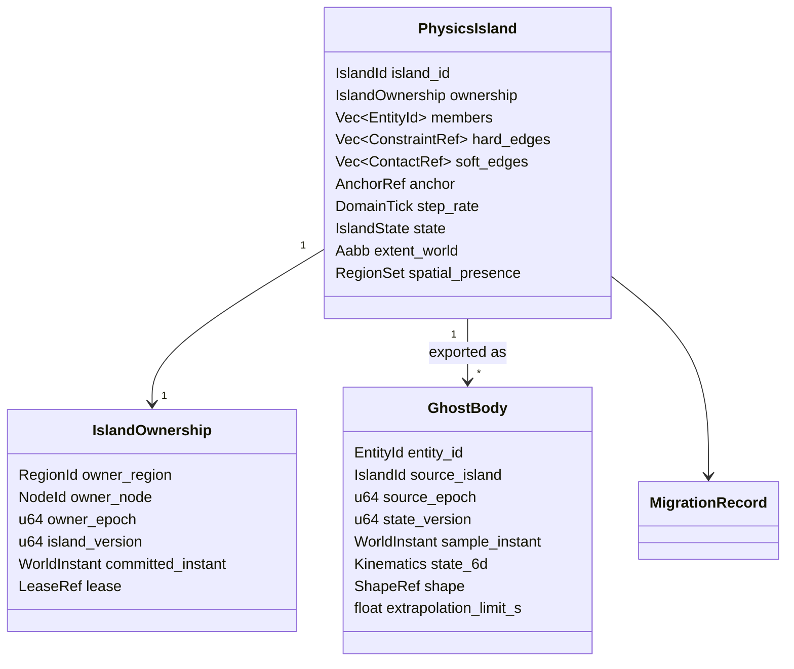
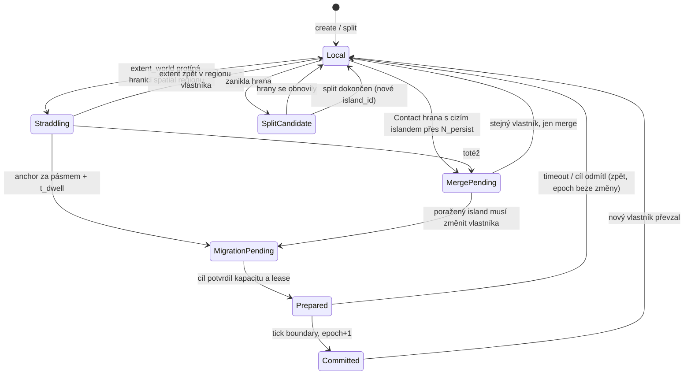
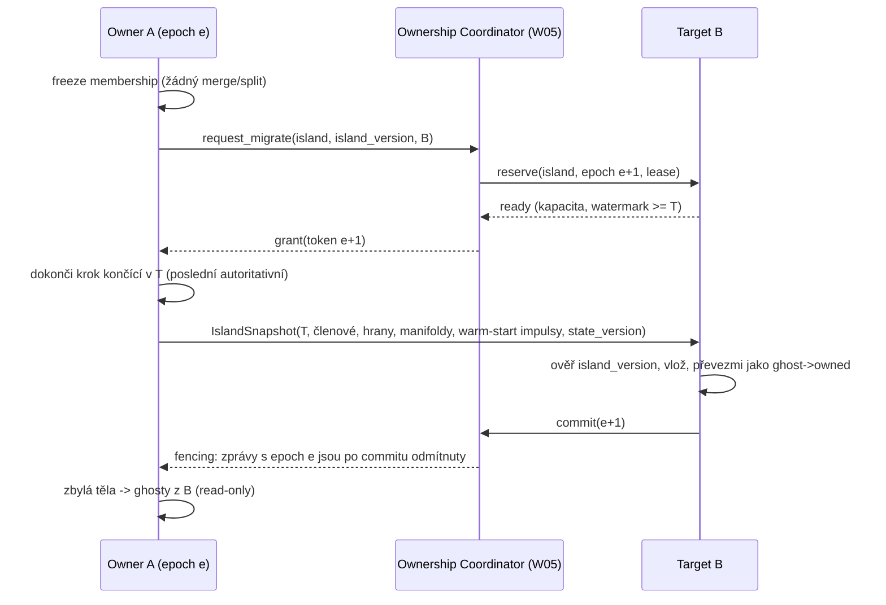

# W02 – Doplňující výzkum 01: Physics islands přes regionální hranice

Stav: architektonický výzkum, žádná implementace. Kód níže jsou jen ilustrační datové struktury.
Vstupy: `research/worker-02/w02-original.md` (§2, §5.4, §7, §9.2, §10.3, §12, §13.1), `research/worker-09/w09-original.md` (§5.3, §11.3, rizika, PERF-012), `audit/WORKER_10_REVIEW.md` (§2 CONFLICT-004, §6, §9, R04, ADR-006).
Značení: **ověřeno** = potvrzeno primárním zdrojem nebo vlastním originálním výzkumem; **návrh** = rozhodnutí tohoto dokumentu; **odhad** = číslo k odladění benchmarkem.

---

## 1. Shrnutí rozhodnutí

| ID | Rozhodnutí | Status |
| --- | --- | --- |
| D-201 | **Jednotkou autority je Physics Island, ne entita.** Entita bez vazeb je singleton island. `owner_region/owner_node/owner_epoch` v `EntityPhysicalState` (W10 §6) jsou odvozeny z islandu, nikoli nezávisle vedeny. | návrh |
| D-202 | Island je souvislá komponenta grafu **tvrdých hran** (klouby, svary, docking, sedadlo/posádka, trvalé kontakty) a **dostatečně dlouhých kontaktů**. Statická tělesa a terén islandy nespojují (stejně jako v Box2D/Avian). | ověřeno (technika) + návrh (prahy) |
| D-203 | Islandy jsou **persistentní** mezi tiky (union-find při merge, odložený split). Island nikdy není dělen hranicí regionu; solver iteruje islandy, ne regiony. | ověřeno (Box2D v3, Avian) + návrh |
| D-204 | Vlastník islandu = region ukotvovacího tělesa (`anchor_body`: nejtěžší těleso, kořen kloubového stromu, při shodě nejnižší `entity_id`). Změna vlastníka jen protokolem migrace islandu s fencing tokenem (W05). | návrh |
| D-205 | Hystereze: **merge okamžitě, split zpožděně; migrace s pásmem a minimální dobou setrvání.** | návrh |
| D-206 | Přes hranici se sousední region účastní pouze jako **dodavatel read-only dat**: statická geometrie (halo dlaždice) a **ghost/proxy tělesa** cizích entit. Ghost není solverem nikdy integrován, jen extrapolován. | návrh |
| D-207 | Kontakt mezi dvěma islandy s různými vlastníky řeší **právě jeden** vlastník (arbitr). Trvalý kontakt → **merge islandů** (migrace menšího k většímu). Přechodný náraz → **impulse exchange** s idempotentním `ImpactEvent`. | návrh |
| D-208 | Obří islandy (vlak, most): tvrdě vázané části mají jednoho vlastníka a překračují hranici jako *prostorová přítomnost*, ne vlastnictví. Měkké vazby (spřáhlo s pružinou) lze řezat na sub-islandy a řešit partitioned couplingem – až od Stage 4. | návrh |
| D-209 | CCD přes hranici provádí vždy vlastník pohybujícího se tělesa proti vlastním datům + halo; platí invariant `halo_width ≥ v_max·Δt + r`. Rychlé objekty nad tímto limitem nejsou islandová tělesa (ballistic/raycast doména, závisí na W03). | návrh |
| D-210 | **Stage 1 už zavádí**: `IslandId`, `IslandOwnership` s epochou, ghost API (`ForeignBodyView`), halo dotaz, migraci islandu jako logickou operaci s journalem a testy VAL-2xx s injektovanou latencí. Fyzicky jde v jednom procesu o přesun vlastnictví bez kopie dat, ale kontrakt je shodný. | návrh |
| D-211 | Island má **jeden DomainTick krok** = požadavek nejrychlejšího člena. Island nemůže obsahovat členy ze solverových domén s různým integrátorem (on-rails × rigid body); přechod řeší W03. | návrh |

---

## 2. Řešené konflikty W10

### CONFLICT-004 – Region ownership vs physical constraint islands

| Otázka | Rozhodnutí | Odůvodnění |
| --- | --- | --- |
| Jak oddělit čtyři struktury? | Spatial region = kde těleso *je* (index, AOI, terén). Ownership region = kdo má *autoritu* (epoch, lease). Physics island = *kdo spolu fyzikálně interaguje* (graf). Execution partition = *kde se to počítá* (vlákno/proces). Vztahy: island → právě 1 ownership region; ownership region → N islandů; island → ≥1 spatial regionů (přítomnost); island → právě 1 execution partition v daném kroku. | W10 §2 CONFLICT-004; w02 §2 už tvrdí, že rozměry nesmí být svázané. |
| Auto: podvozek v A, kolo v B | Celý island (podvozek, kola, zavěšení) vlastní jeden region; kolo ve spatial regionu B je jen *prostorově* přítomné. Region B nedělá nic kromě dodání terénu a ghostů. | Rozdělený island by řešil jeden kloub dvěma procesy se zpožděním → nestabilita (R04). |
| Kdy vlastníka měnit? | Pouze celý island, až těžiště/anchor opustí pásmo hystereze a vydrží tam `t_dwell`. | Brání ping-pongu při jízdě po hranici. |
| Co když island je příliš velký? | D-208 a limity v §4.6. | Distribuované řešení jednoho islandu je explicitně odloženo. |

### Dotčené bez vlastního rozhodnutí (jen rozhraní)

- CONFLICT-003 (stav entity): navrhuji rozšíření o `island_id` a `island_epoch` (§3.1). Závisí na W01 (frame) a W09 (entity kontrakt).
- CONFLICT-005/008 (čas, determinismus): ghosty a impulse exchange potřebují watermark a zaznamenané pořadí událostí. Závisí na W09.

---

## 3. Kontrakty

### 3.1 Informační model



```text
// ilustrační, ne implementace
struct IslandOwnership {
  island_id, owner_region, owner_node,
  owner_epoch: u64,          // monotónní, fencing (W05)
  island_version: u64,       // roste při každém merge/split/členství
  committed_instant: WorldInstant,
  lease_expires: WallClock,
}

enum EdgeClass { Rigid, Compliant, Contact }
// Rigid     : svar, pevný kloub, docking lock, seat/harness  -> vždy stejný island, stejný vlastník
// Compliant : pružinové spřáhlo, lano s napětím, zavěšení s velkým předpětím -> kandidát na řez (Stage 4)
// Contact   : kontakt; trvalý jen po splnění prahu persistence

struct GhostBody {
  entity_id, source_island, source_epoch, state_version,
  sample_instant: WorldInstant,
  state_6d, shape, velocity_bound,   // pro extrapolaci a CCD envelope
  valid_until: WorldInstant,         // po vypršení ghost mizí nebo blokuje (viz §4.5)
}

struct ImpactEvent {                  // přechodný náraz přes ownership hranici
  event_id: Uuid,                     // idempotence
  src_island, src_epoch, dst_island, dst_epoch_expected,
  world_instant, contact_point, normal,
  impulse_on_dst_n_s,                 // opačný impuls aplikuje zdroj lokálně
}
```

### 3.2 Vazba na `EntityPhysicalState` (W10 §6)

Návrh rozšíření sekce `authority`: přidat `island_id` a `island_epoch`. `owner_epoch` entity == `island_epoch` jejího islandu (invariant I-1). Při merge/split se entitám přepíše `island_id`, `state_version` se zvýší. Per-entity migrace z w09 §5.3 / §11.3 se stává migrací *množiny entit* určené islandem; `migration_id` a `entity_ids[]` v w09 kontraktu už množinu připouští, chybí `island_id`, `island_version` a seznam hran (§7, N-203).

### 3.3 Invarianty

| ID | Invariant |
| --- | --- |
| I-1 | Každá entita patří právě do jednoho islandu; `entity.owner_* == island.owner_*`. |
| I-2 | Každý island má v daném `WorldInstant` nejvýše jednoho autoritativního vlastníka (platí s W05 fencingem, VAL-008). |
| I-3 | Každý kontakt/kloub je v daném kroku řešen právě jedním solverem (žádné dvojí započtení, W09 §5.3). |
| I-4 | Ghost se nikdy neintegruje ani nemění; mění se jen příjmem nové verze od vlastníka. |
| I-5 | Statická tělesa a terén nesdílejí island; nemají vlastníka islandu. |
| I-6 | Merge nikdy neodmítne pravdivý kontakt; split nikdy nenastane uprostřed kroku. |

---

## 4. Algoritmy a stavové automaty

### 4.1 Vznik, merge, split (ověřená technika, návrh prahů)

**Ověřeno** (web, sekundárně přes dokumentaci Avian a Box2D): persistentní islandy drží graf mezi kroky; merge při vzniku vazby se provádí union-findem (s kompresí cesty), při zániku vazby je island jen označen jako *kandidát splitu* a split se odkládá (v Avianu DFS, max. jeden island na krok – tuto politiku jsem u Box2D nepotvrdil). Island s čekajícím splitem se nesmí uspat, jinak se tělesa budí nesprávně (komentář ve zdrojích Box2D v3). Box2D v3.0 uvádí persistentní islandy a vláknový split islandů. Jolt naproti tomu islandy staví znovu v každém kroku a velké islandy dělí `LargeIslandSplitter` pro paralelní řešení; kritéria jsem neověřil.

Dopad pro nás (návrh):

1. Hrany třídy `Rigid` mají **okamžitý a trvalý merge**; existují, dokud je kloub existuje.
2. Kontakt se stane `Contact` hranou spojující islandy až po **persistenci** `N_persist` kroků nebo po dosažení impulsu nad prahem (odhad `N_persist = 3`). Do té doby jde o krátký náraz (impulse exchange, §4.4).
3. Split: kandidát po zániku hrany; ověření (DFS/union-find nad hranami) po `t_split_delay` (odhad 0,25–0,5 s herního času) a jen na hranici kroku. Při splitu vzniknou dva islandy se **stejným** vlastníkem a novým `island_id`; teprve potom může každý migrovat samostatně.
4. Merge islandů A (vlastník RA) a B (vlastník RB): vítězný vlastník je ten s větší *cost metrikou* (počet těles × solver iterace, při shodě vyšší `owner_epoch`, pak nižší `region_id` – deterministicky). Poražený island migruje (§4.3).



### 4.2 Přidělení vlastníka a hystereze

Pásmo hranice pro island I (návrh, vzorec; konstanty odhad):

```text
band_enter(I) = max(R_extent(I), v_anchor * (tau_prepare + tau_commit)) + margin
band_exit(I)  = band_enter(I) * 0.5            // asymetrie: návrat k původnímu vlastníkovi je těžší
migrate if  signed_dist(anchor, boundary_owner→neighbor) > band_enter  for >= t_dwell
and         now - last_migration(I) >= t_cooldown
```

- `R_extent` = poloměr obálky islandu: velký island (vlak) má široké pásmo, takže migruje dříve a méně často.
- `tau_prepare + tau_commit` závisí na W05 (protokol) a W09 (watermark); do doby jejich dodání jde o odhad.
- `t_dwell` odhad 1–2 s herního času; `t_cooldown` odhad 5 s. U time warpu se tyto doby měří ve `WorldInstant`, ne ve wall-clock (závisí na W09/W07).
- Kritický rychlostní limit: je-li `v_anchor * (tau_prepare+tau_commit) > velikost regionu`, nelze migrovat po jednom sousedu; island zůstane u vlastníka a halo se rozšíří (§4.5), případně se sníží step (závisí na W09).

### 4.3 Protokol migrace islandu

Rozšiřuje w09 §5.3 (6 kroků) o povinný uzávěr členství.



Zásady:
- Přenos je na **hranici tiku T** (shodný WorldInstant u obou stran; závisí na W09 watermarku). Žádné krokování "půl kroku u A, půl u B".
- Snapshot obsahuje kontaktní manifoldy a akumulované impulsy (warm start). Bez nich je výsledek po migraci jen aproximací (w02 §10.3 pro rollback totéž tvrdí; **návrh**: pro determinismus po doménách je přenos povinný).
- Selhání před commitem: island zůstává u A, epoch se nemění. Selhání A po `grant`, před snapshotem: recovery řeší W05 (journal + snapshot); island se obnoví z posledního checkpointu A, nebo z journalu přiděleného B (W05 rozhodne, nesmí vzniknout dva vlastníci).
- Změnu `island_version` během protokolu (merge/split) migrace zruší a opakuje.

### 4.4 Kontakty mezi islandy s různými vlastníky

Případ: island P (vlastník RA) se dotkne islandu Q (vlastník RB) hned za hranicí.

1. RA vidí Q jako `GhostBody` (halo). Broadphase RA generuje potenciální pár (P, ghost Q).
2. Arbitr kontaktu = vlastník **těžšího** tělesa páru (shoda → nižší `entity_id`). Pouze arbitr smí kontakt zpracovat; druhá strana kontakt ignoruje (I-3). Pravidlo je deterministické na obou stranách, protože znají hmotnosti z ghostu a z vlastních dat.
3. Přechodný kontakt (`< N_persist` kroků): arbitr vyřeší impuls proti ghostu jako proti kinematickému tělesu s rychlostí z ghostu, odešle `ImpactEvent` s opačným impulsem druhé straně, ta jej aplikuje na začátku nejbližšího kroku (idempotence podle `event_id`). Chyba: zachování hybnosti je splněno součtem, ale s **zpožděním do 1 kroku** a energie není zaručena (odhad: akceptovatelné pro nárazy, nikoli pro stohy). Závisí na W09: pořadí událostí a čas doručení.
4. Trvalý kontakt (stoh, náklad na plošině, postava stojící na vozidle): `Contact` hrana → **merge** (§4.1) s migrací menšího islandu k vlastníkovi většího.
5. Problémový případ: dva velké islandy se dotýkají na hranici trvale (dva vlaky vedle sebe). Merge by vytvořil obří island. Řešení: pokud `members(P)+members(Q)` překročí limit (§4.6), kontakt se vyřeší jako *soft coupling* (impulse exchange každý krok, přijímáme zpoždění) a vlastníci zůstanou. **Návrh**, vyžaduje experiment (viz VAL-206).

### 4.5 Ghost/proxy tělesa

| Vlastnost | Návrh |
| --- | --- |
| Co se exportuje | Pouze tělesa v pásmu `halo_width` od hranice vlastníka (lze zúžit podle směru rychlosti). Ne celé islandy: jen tvar, 6D stav, hmotnost pro arbitraci, `velocity_bound`. |
| Čas | Vzorek má `sample_instant`; příjemce extrapoluje na svůj DomainTick lineárně (nebo kvadraticky s `a`). Chyba `≈ ½ a_max τ²`. |
| Platnost | `valid_until = sample_instant + extrapolation_limit`. Po vypršení ghost nesmí být zdrojem kontaktu; těleso blízko takové hranice se označí `BoundaryStale` a přijímač místo bezpečné extrapolace sníží rychlost kroku nebo pozdrží kontakt (závisí na W09 – politika zpožděných zpráv). |
| Verze | `(source_epoch, state_version)`; zprávy se starší epochou po commitu migrace se zahazují (fencing). |
| Statika | Terén/statika se do halo předává jako read-only dlaždice dle prostorového kontraktu W01; není islandovým členem (I-5). Mutace terénu (W06/W08) invaliduje halo dlaždici přes `world_revision`. |
| Zdroj | Ghost se tvoří z committed stavu vlastníka (revize PhysicsIntegrated, W10 CONFLICT-006). |

Stage 1: ghost se materializuje jako pohled (`ForeignBodyView`) na data jiného logického regionu v témže procesu. Rozhraní (včetně `sample_instant`, `valid_until`) je stejné, aby se kód neměnil v Stage 3.

### 4.6 Obří islandy: vlak, most

| Případ | Vlastnosti | Řešení |
| --- | --- | --- |
| Nákladní vlak 600 m, 40 vozů, `Rigid` spojení | Překračuje několik spatial regionů, stovky těles, ale jen ~1 D pohyb | Jeden island, jeden vlastník, přítomnost ve více spatial regionech. Statiku (kolej) čte každý zúčastněný region přes halo vlastníka. Vlastník = region lokomotivy (anchor). Pásmo dle `R_extent` ⇒ migrace vlaku jen když lokomotiva opustí pásmo; zbytek vlaku může být v B, aniž by se měnil vlastník. |
| Vlak se spřáhly `Compliant` | Vozy volně pohyblivé, spojené pružinou/dampery | **Návrh pro Stage ≥ 4:** řez na sub-islandy podél spřáhel; každý sub-island má vlastního vlastníka; spřáhlo = coupling force exchange (explicitní, kroky synchronní; stabilita omezena poměrem hmotností a tuhostí). Pro Stage 1–3 se NEŘEŠÍ: jeden vlastník. |
| Most (dynamický, rozbitelný) | Tuhá tělesa s kloubovými vazbami, kotvení statickou zemí, pár stovek segmentů | Statické kotvy nejsou členy (I-5). Pokud je most jeden island a leží na hranici, vlastník = region s větším těžištěm; nikdy rozpůlený. Při destrukci split podle §4.1 – nové islandy mohou migrovat samostatně. |
| Obří nahodilý stoh (sutina) | Contact hrany, tisíce těles | Limit + deaktivace/uspání islandů, LOD (w02 §12, simulation LOD); může-li zůstat dormantní, nenese zátěž. |
| Limit | `max_island_bodies`, `max_island_extent` (odhad: 2 000 těles, extent ≤ 0,5 × velikost regionu pro Contact-only islandy; Rigid islandy bez extent limitu). Při překročení: degradace (soft coupling §4.4/5, uspání, nebo odmítnutí nové vazby `Rigid`). | Čísla jsou odhad; změřit v benchmarku w02 §11.3. |

Poznámka k paralelizaci uvnitř jednoho velkého islandu (Jolt splitter, `LargeIslandSplitter`; Box2D v3 vláknový split): jde o **Execution partition** uvnitř jednoho vlastníka, nikoli o změnu autority. Je to legitimní cesta pro Stage 2 a nemění tento kontrakt.

### 4.7 CCD přes hranici

Problém: rychlé těleso (auto 80 m/s, kulka) se v jednom kroku přesune z regionu A do B a může zasáhnout cíl, který je vlastněn B.

1. Vlastník pohybujícího se tělesa (A) vždy provede swept test proti: vlastním datům, statice z halo a ghostům z B.
2. Invariant I-CCD: `halo_width ≥ v_max · Δt_island + r_body + margin`. Pro vlak při 100 m/s a `Δt = 1/120 s` je to cca 0,83 m + rozměr; pro raketu 2 km/s je to přes 16 m – běžné dlaždice halo to snesou, ale ghosty v tomto pásmu musí být aktuální (extrapolace).
3. Dojde-li při tomto sweepu ke kontaktu s ghostem, pro dopad platí §4.4 (přechodný náraz → `ImpactEvent`). Čas dopadu (TOI) je zaznamenán v události, ne v kroku příjemce.
4. Přenos vlastnictví pohybujícího se tělesa se děje **až po konci kroku** (hranice tiku), nikdy uprostřed kroku. Těleso tedy může po sweepu stát v B, a přesto být v kroku vlastněno A.
5. Tělesa nad `v_max_island` (kulky, hypersonika) nejsou členy islandu, ale **balistické entity** s raycast/sweep vůči halo i ghostům; jejich zásah generuje `ImpactEvent` (**závisí na W03**: doménový katalog a handoff).
6. Selektivní CCD (w02 §5.4) zůstává; přibývá podmínka: CCD se zapíná, pokud `v·Δt > 0,5 × r_min` **nebo** objekt leží v pásmu hranice a může se v kroku zúčastnit událostí v sousedním regionu.

### 4.8 Krok islandu a čas

- Island má `step_rate` = nejvyšší požadovaný rate členů (w02 §7.2 multi-rate). Pomalejší členové se substepují nebo mají nižší kvalitu – návrh: **nepřevzorkovávat rozhraní**, ale zvýšit rate celého islandu (cena se nese explicitně).
- Time warp (závisí na W09/W07): `Δt_island` se v akceleraci nesmí naslepo násobit (W10 baseline); island se v akceleraci zpomalí na LOD (on-rails) nebo se uspí; při změně LOD island opouští solver doménu (W03 handoff). Pro tento dokument stačí: island v time warp stavu `Frozen/OnRails` nemá ghosty ani kontakty.

### 4.9 Execution partition

Execution partition (vlákno, proces) přiděluje **islandy**, ne regiony. Pro Stage 2 stačí work-stealing nad seznamem islandů; pro Stage 3 se islandy s vlastníkem v jiném procesu liší jen kanálem ghostů. Ownership region se nemění přesunem exekuce (např. rebalance na jiný worker při stejném vlastníku se neprojeví v epoch) – **návrh**: odlišit `owner_epoch` (autorita) od `exec_generation` (jen přesun výpočtu uvnitř uzlu).

---

## 5. Rozhraní na ostatní workery

| Závisí na | Co potřebuji / navrhuji |
| --- | --- |
| W01 | Jednotný frame pro island (lokální origin = anchor; všichni členové v jednom lokálním frame, i když přesahují cell). Konverze ghostu mezi frame sousedních cell. Dlaždice halo se statikou. Návrh: `island.local_frame = anchor frame`, přepočet jen při změně anchor/cell, ne per-krok. |
| W03 | Zda je kompozitní entita (postava ve vozidle, docking) `Rigid` hranou islandu; jak island opouští solver doménu při přechodu na on-rails; balistické entity (kulky) mimo island. |
| W04 | Žádná přímá vazba; gravitační pole se bere z providerů per island (`GravitySample` v poloze anchoru + gradient pro velké islandy; pro vlak 600 m už gradient nemusí být zanedbatelný – otevřená otázka). |
| W05 | `IslandOwnership` jako rozšíření `RegionOwnership` (island_id, island_version). Koordinátor: přidělení/lease/fencing per island, ne jen per region. Migrační protokol §4.3 je podmnožinou jeho protokolu. Recovery islandu ze snapshotu + journalu: musí obnovit celý island atomicky. |
| W06 | `ImpactEvent` a `WorldMutation` (destrukce mostu, terén) musí být idempotentní a ohraničené revizí; mutace statiky v halo invaliduje dlaždici. |
| W07 | Reconciliation klienta po migraci islandu (změna zdroje snapshotů). Island je přirozená replikační jednotka (jeden zdroj). |
| W08 | Halo dlaždice terénu / hydrologie nejsou součástí tohoto dokumentu; konzistence revisí. |
| W09 | Watermarky: migrace a ghosty jen na committed watermark; politika zpožděných/ztracených ghostů; pořadí `ImpactEvent`; kontrakt migrace `entity_ids[]` rozšířit o `island_id`/`island_version`/hrany. Návrh limitu skew mezi sousedy pro ghost extrapolaci: `skew ≤ extrapolation_limit`. |
| W10 | Přijetí D-201 (autorita po islandech) jako dodatek §6 a ADR-006. |

---

## 6. Validační testy (VAL-2xx, navazují na VAL-007)

| ID | Scénář | Kritérium | Stage |
| --- | --- | --- | --- |
| VAL-201 | Auto (podvozek + 4 kola + zavěšení) přejíždí hranici A→B rychlostí 5, 30, 80 m/s | Žádná hrana islandu se nikdy nedělí; jediný autoritativní vlastník v každém kroku; po migraci odchylka stavu (poloha, rychlost, úhlová rychlost) pod toleranci (odhad 1e-6 relativní) proti referenčnímu běhu bez hranice | 1 |
| VAL-202 | Merge dvou islandů přes hranici (box se opře o jiný box ve druhém regionu) | Kontakt zpracován právě jedním solverem (I-3); po merge jediný island; hybnost systému zachována v toleranci | 1 |
| VAL-203 | Split po rozpojení kloubu těsně u hranice | Split pouze na hranici kroku, po `t_split_delay`; oba nové islandy mají validního vlastníka; žádné tělesa bez islandu | 1 |
| VAL-204 | Hystereze: těleso osciluje ±0,5 m kolem hranice po dobu 60 s | Počet migrací ≤ 1 (odhad); žádný ping-pong | 1 |
| VAL-205 | Vlak 40 vozů, `Rigid`, přejezd 3 regionů | Jeden vlastník po celou dobu nebo jediná migrace při překročení pásma; stabilita kloubů bez explozí; frekvence kroku nepoklesne pod požadovanou | 1/2 |
| VAL-206 | Dva velké islandy trvale v kontaktu přes hranici (limit §4.6 překročen) | Nedojde k obřímu mergi; soft coupling stabilní po 10 minutách herního času; zpoždění impulsu ≤ 1 krok | 3 |
| VAL-207 | CCD: kulka (800 m/s) a auto (80 m/s) míří na cíl za hranicí | Zásah detekován s TOI přesností ≤ jednomu kroku; právě jeden `ImpactEvent`; opakované doručení neovlivní stav (idempotence) | 1 |
| VAL-208 | Halo invariant: `v·Δt > halo_width` | Systém detekuje porušení (varování a degradace/zpomalení), nikdy tiché tunelování | 1 |
| VAL-209 | Migrace islandu s injektovanou latencí a ztrátou zpráv (Stage 1 s emulovanou sítí) | Fencing: starý vlastník po commitu neprovede žádnou autoritativní změnu; stará zpráva s `epoch e` odmítnuta; žádné duplicitní/ztracené těleso | 1 |
| VAL-210 | Pád vlastníka uprostřed migrace (před/po `grant`, před/po snapshotu) | Obnova z W05 journal+snapshot: island existuje právě jednou; konzistentní s posledním commitem | 3 |
| VAL-211 | Warm-start přenos: migrace stohu (10 beden) | Stoh nepadá / nevykazuje skokový impuls po migraci vs. kontrola bez warm-start (kvantifikovat) | 1 |
| VAL-212 | Ghost staleness: zpoždění zpráv 0–200 ms mezi sousedy | Ghost bez překročení `valid_until` poskytuje kontakt; po vypršení `BoundaryStale` politika aktivní; žádná dvojí kolize | 3 |
| VAL-213 | 1 000 hranic s 10 000 islandy (součást VAL-013) | Žádný island nepřekročí limit; celkový počet migrací/s omezen; žádné ztracené/duplicitní `ImpactEvent` | 3 |
| VAL-214 | Determinismus po doménách: replay záznamu migrací a ImpactEventů | Stejná sekvence událostí ⇒ stejný stav island po K krocích (hash), vyloučena závislost na pořadí vláken | 2 |

Rozpis relevantní pro referenční scénář W10 §9 (VAL-REFERENCE-001): island jen v prvních úsecích (vozidlo na zemi, přestup z ostrova do raketového stupně); spojení raketových stupňů = `Rigid` hrany, oddělení = split (VAL-203 varianta).

---

## 7. Nové rozpory mezi původními w01–w09 (neřešené ve W10)

| ID | Rozpor | Zdroje | Doporučení |
| --- | --- | --- | --- |
| N-201 | **Granularita autority.** w09 §5.3/§11.3 popisují epoch na entitu (příklad `Entity ID, Owner Epoch 42`), w02 definuje islandy jako jednotku řešení, W10 §6 má `owner_epoch` v `EntityPhysicalState`. Nikdo nedefinuje, kdo je zdrojem pravdy při merge/split. | w02 §2/§9.2, w09 §5.3, W10 §6 | D-201: epoch drží island, entita jej dědí (I-1). |
| N-202 | **Time domain jako "nezávislá" dimenze** (w02 §2) vs. island vynucuje společný krok členů. Tvrzení "dimenze nesmí být svázané" se nedá splnit pro členy jednoho islandu. | w02 §2, §7.2 | D-211: island = společný `step_rate`; W03 definuje, co při přechodu domén. |
| N-203 | **Kontrakt migrace w09 §11.3** má `entity_ids`, `source_epoch`, `target_epoch`, `state_version`, ale ne `island_id`, `island_version`, manifoldy, warm-start impulsy; w02 §10.3 přitom říká, že snapshot bez solver stavu není kompletní. | w09 §11.3, w02 §10.3 | Rozšířit kontrakt (§4.3). |
| N-204 | **Frame uvnitř islandu.** w01 (cell/cube-sphere) i w05/w07 pracují s lokálními souřadnicemi per cell/region; w02 chce lokální origin per physics context. Island přesahující více cell nemá definovaný frame. | w01, w05, w07 vs. w02 §2.1 | Island frame = anchor frame (§5, W01). |
| N-205 | **Rollback (w02 §10.3) vs. distribuce (w09).** Rollback obnovuje solver a znovu přehrává příkazy; s ghosty a odeslanými `ImpactEvent` je rollback regionu nekonzistentní se sousedem. W02 navrhuje rollback pro klientskou predikci; pro server autoritativně není jasné. | w02 §10.3, w09 §5.3 | Server je bez rollbacku; rollback jen klient (W07). Otevřené u rekonstrukce po výpadku (W05). |
| N-206 | **CCD selektivní (w02 §5.4)** předpokládá znalost `v_max` per objekt, ale halo (nový požadavek) vyžaduje garantovaný horní odhad pro všechna tělesa u hranice. | w02 §5.4 | Zavést `velocity_bound` ve stavu / v ghostu a limit `v_max_island` (D-209). |
| N-207 | **Hot-region řešení w09 (PERF-012, "rozdělit region na fyzikální islands")** předpokládá, že islandy lze volně přiřazovat různým workerům; chybí pravidlo, že island nesmí mít dva vlastníky ani při rebalanci exekuce. | w09 PERF-012, řádky ~1161/1198 | Odlišit `exec_generation` od `owner_epoch` (§4.9). |
| N-208 | **Statická tělesa jako sdílená vstupní data** (w02 §9.2 "Island D: Static environment, shared read access") vs. mutace světa (W06) a distribuce: kdo vlastní statiku a jak se invaliduje halo. | w02 §9.2, W06 | Statika není island, platnost podle `world_revision`; rozhraní s W06/W08. |

---

## 8. Otevřené otázky pro uživatele / ADR

1. **ADR-006 (rozšířit):** schválit autoritu po islandech (D-201) a přenesení `island_id` do `EntityPhysicalState`. Dopad na W05 a W09.
2. **Politika obřích islandů:** v prvním vydání se limituje (`max_island_bodies`, uspání, odmítnutí `Rigid` vazby), nebo se jde rovnou na partitioned coupling? Doporučení: limitovat až do Stage 3.
3. **Přijatelná chyba přechodného nárazu přes hranici:** zpoždění impulsu do jednoho kroku a nezaručená energie – stačí to pro hru, nebo existují scénáře (např. realistické srážky vozidel) s vyšším nárokem na konzervaci?
4. **Hranice mezi `Contact` a `Rigid` pro postavu na vozidle** (`závisí na W03`): spojovat postavu s vozidlem trvale (dokud stojí), nebo je hráč dynamický a vozidlo jej nese přes kontakt? Ovlivňuje velikost islandů.
5. **Gradient gravitace pro velké islandy** (vlak, most): stačí `GravitySample` v anchor, nebo je potřeba per-member vzorek? (`závisí na W04`)
6. **Konkrétní prahy** `N_persist`, `t_dwell`, `t_cooldown`, `t_split_delay`, limity islandů jsou odhady; je třeba benchmarkový plán (w02 §11.3) s měřením migrací/s a poklesu kroku.
7. **Jolt vs. Rapier/Avian jako backend:** model persistentních islandů z Box2D v3 / Avian je pro nás výhodný (graf známe po celou dobu), Jolt staví islandy každý krok. Rozhodnutí o backendu (w02 §8.5) tedy ovlivňuje, kdo drží island graf – my (nad backendem), nebo backend. **Návrh:** island graf na úrovni Planetary Engine (nad backendem), backend dostane island jako uzavřenou množinu těles.
8. **Per-island lease**: je únosný počet leases (10 000 islandů × heartbeaty) v Stage 4? Možné řešení: lease na úrovni (region, uzel) a island epoch pouze v journalu. Rozhodne W05.

---

## 9. Zdroje

Web (ověřeno ve smyslu: stránka potvrzuje popsanou techniku; nic z toho není čtení přímo zdrojového kódu Rapier):

- Erin Catto, *Simulation Islands* (2023): https://box2d.org/posts/2023/10/simulation-islands/ – islandy jsou souvislé komponenty grafu těles a vazeb; uspání musí být po celých islandech (jinak se překrývají tvary a rozpojují klouby); union-find jako náhrada DFS (paralelní union-find z GDC 2022, implementace v Jolt).
- Box2D 3.0 release: https://box2d.org/posts/2024/08/releasing-box2d-3.0 – persistentní islandy a vláknový split islandů mezi novinkami verze 3.0.
- Avian (Bevy) dokumentace modulu `solver::islands`: https://idanarye.github.io/bevy-tnua/avian3d/dynamics/solver/islands/index.html – persistentní islandy, merge při vzniku vazby, odložený split, jen jeden island na krok (politika Avianu, nepotvrzeno pro Box2D).
- Zdroje Box2D v3 přes docs.rs `box2d_sys 0.2.1` (`island.c`, `world.h`): https://docs.rs/crate/box2d_sys/0.2.1/source/box2d/src/island.c – union-find s kompresí cesty; island s čekajícím splitem se nesmí uspat (neoficiální zrcadlo, ověřit proti oficiálnímu repozitáři).
- Jolt Physics, `LargeIslandSplitter::Split`: https://jrouwe.github.io/JoltPhysics/struct_large_island_splitter_1_1_split.html – struktura dělení velkých islandů pro paralelní řešení; kritéria dělení **neověřena**.
- Rapier `simulation_structures`: https://www.rapier.rs/docs/user_guides/javascript/simulation_structures – potvrzuje existenci `IslandManager` aktualizovaného v `PhysicsPipeline::step`; interní chování merge/split **neověřeno**.
- PhysX 3.4 Guide, Advanced Collision Detection / CCD: https://gameworksdocs.nvidia.com/PhysX/3.4/PhysXGuide/Manual/AdvancedCollisionDetection.html – cituji pouze z druhé ruky (fórum): CCD je best-effort a rychlé objekty mohou "zpomalovat" celý island; stránku jsem neotevřel. **Nutné ověřit před použitím jako argumentu.**

Interní: `research/worker-02/w02-original.md` (§2, §5.4, §7.2, §9.2, §10.3, §12, §13.1); `research/worker-09/w09-original.md` (§5.3, §11.3, PERF-012, rizika); `audit/WORKER_10_REVIEW.md` (CONFLICT-004, §6, §9, R04, ADR-006).
