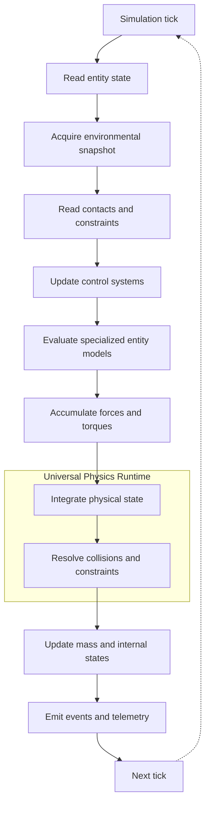

# PLANETARY ENGINE – WORKER 03

## Entity Physics Systems – Technical Architecture Specification

Deep research

Architecture design

Implementation prohibited

Scope: Characters, ground vehicles, aircraft, multirotors, rockets and spacecraft.

Primary objective: Define a unified architecture in which different physical entities operate in one persistent planetary environment, using the same environmental authority and Universal Physics Runtime.

# 1. Executive summary

The most important architectural decision is that entity physics must be modular, but environmental physics must remain centralized.

A car, helicopter, rocket and spacecraft have very different equations of motion. They should not, however, have their own implementations of planetary gravity, atmospheric density, wind, terrain elevation or ocean conditions.

The architecture should have three distinct responsibilities:

Worker 01

Planetary Environment Authority

Supplies gravity fields, atmospheric conditions, wind, terrain, water, surface materials, planetary rotation and environmental state.

Worker 02

Universal Physics Runtime

Owns physical state integration, rigid bodies, collision detection, contact resolution, constraints, coordinate-frame transformations and simulation time.

Worker 03

Entity Physics Systems

Supply specialized physical models: tire forces, suspension, human locomotion, aerodynamic forces, propulsion, rotor dynamics, fuel consumption and orbital maneuvers.

This separation is essential for the long-term objective.

For example, a vehicle driving from a mountain road into a flooded region must transition from terrain contact to water interaction without changing its underlying physical identity.

Similarly, an aircraft climbing through the atmosphere into space must transition between environmental regimes without switching to an unrelated physics implementation.

## 1.1 Architectural principle

Every entity is a composition of physical capabilities rather than an isolated physics implementation.

A spacecraft, for example, can consist of:

- Rigid-body dynamics.
- Variable mass.
- Propulsion.
- Attitude control.
- Reaction wheels.
- RCS thrusters.
- Orbital mechanics.
- Docking constraints.
- Thermal and environmental interaction.

A drone can reuse several of the same components:

- Rigid-body dynamics.
- Propulsion.
- Variable mass.
- Actuator dynamics.
- Attitude control.
- Aerodynamic interaction.

This allows the engine to develop a shared physical component library without forcing all entity types into one overly generic model.

# 2. Technical foundations and architectural boundaries

## 2.1 Evidence classification

The following classification is used throughout this specification.

| Classification    | Meaning                                                                      |
| ----------------- | ---------------------------------------------------------------------------- |
| Established       | Mathematical or physical principle                                           |
| Production-proven | Approach used in established simulation software or real engineering systems |
| Proposed          | Recommended Planetary Engine architecture                                    |
| Experimental      | Technically plausible but requires validation                                |

## 2.2 Common physical representation

All physical entities should share a common underlying representation.

The universal representation must support:

- Translational position and velocity.
- Rotational orientation and angular velocity.
- Mass and center of mass.
- Inertia tensor.
- External forces and torques.
- Internal degrees of freedom.
- Constraints and contacts.
- Variable mass and changing mass distribution.
- Physical material properties.

The fundamental rigid-body equations are:

Translational dynamics

\\[ m\frac{d\mathbf v}{dt}=\sum_i\mathbf F_i \\]

Rotational dynamics

\\[ \mathbf I\dot{\boldsymbol\omega} + \boldsymbol\omega\times(\mathbf I\boldsymbol\omega) = \boldsymbol\tau \\]

Here:

- \\(m\\): mass.
- \\(\mathbf v\\): linear velocity.
- \\(\mathbf I\\): inertia tensor.
- \\(\boldsymbol\omega\\): angular velocity.
- \\(\boldsymbol\tau\\): total external torque.

These equations describe the common physical foundation. They do not prescribe how a particular entity generates its forces.

For example:

- A tire generates contact forces.
- A wing generates aerodynamic forces.
- A rocket engine generates thrust.
- A reaction wheel generates an internal torque exchange.
- A character controller generates locomotion commands and contact constraints.

The Universal Physics Runtime integrates the resulting physical state.

## 2.3 Coordinate systems

The architecture must support the coordinate hierarchy established by the planetary architecture.

Recommended reference-frame hierarchy

1\. Universe inertial frame

Astronomical-scale position and velocity.

2\. Body-centered inertial frame

ECI for Earth, corresponding inertial frames for other celestial bodies.

3\. Body-fixed frame

ECEF / WGS84 for Earth; equivalent rotating planetary frames elsewhere.

4\. Local tangent frame

ENU or NED, used for surface physics and regional simulation.

5\. Entity body frame

Vehicle, aircraft, character, rotorcraft or spacecraft local coordinates.

Recommended conventions:

| Frame            | Convention                           |
| ---------------- | ------------------------------------ |
| Earth global     | WGS84 / ECEF                         |
| Surface local    | ENU                                  |
| Aviation adapter | NED                                  |
| Vehicle body     | ISO 8855: X forward, Y left, Z up    |
| Spacecraft body  | Configurable right-handed body frame |
| Astronomical     | Inertial reference frame             |

The ISO vehicle convention is already used by Project Chrono's vehicle subsystem architecture.

*(zdroj: api.projectchrono.org)*

api.projectchrono.org


Important: Unity's coordinate conventions must be handled by the client adapter. Unity must not define the authoritative physical coordinate system.

## 2.4 Surface-to-orbit transition

This is one of the most important architectural problems.

A vehicle can be on the planetary surface, fly through the atmosphere, enter orbit and eventually dock with a spacecraft.

The entity must not be destroyed and recreated when changing physical regimes.

The recommended approach is:

One physical identity, multiple numerical integration regimes.

The coordinate transformation between a rotating planetary frame and an inertial frame must preserve physical state.

For a rotating frame:

\\[ \mathbf r_I=R(t)\mathbf r_F+\mathbf r_O \\]

\\[ \mathbf v_I=R(t)\mathbf v_F+ \dot R(t)\mathbf r_F+\mathbf v_O \\]

The velocity transformation is especially important. Simply rotating the velocity vector produces an incorrect inertial velocity for an object attached to a rotating planet.

NASA/JPL SPICE explicitly supports six-dimensional state transformations, including the derivative of the rotation matrix for rotating frames.

*(zdroj: naif.jpl.nasa.gov +1)*

Recommendation: Worker 02 should own all frame transformations. Worker 03 must consume already-transformed physical state and must never independently implement planetary rotation corrections.

# 3. Universal entity architecture

## 3.1 Capability-based composition

Instead of implementing six independent physics engines, create a common library of reusable physical capabilities.

Entity composition

Physical Entity

Position · Velocity · Orientation · Mass · Inertia

Dynamics

Rigid body, constraints, articulated bodies

Interaction

Contact, friction, collision, buoyancy

Actuation

Motors, engines, thrusters, controls

Mass properties

Fuel, payload, inertia, center of mass

Specialized Entity Model

Character / Vehicle / Aircraft / Drone / Rocket / Spacecraft

A vehicle can combine suspension, tires, transmission and engine models.

An aircraft combines aerodynamic surfaces, propulsion and control surfaces.

A spacecraft combines orbital dynamics, propulsion and attitude control.

The same components can be reused across different entity categories.

## 3.2 Three architectural layers

| Layer                 | Responsibility                                                 |
| --------------------- | -------------------------------------------------------------- |
| Physical component    | Calculates local physical behavior                             |
| Entity dynamics model | Coordinates components and produces force/torque contributions |
| Universal runtime     | Integrates states, resolves contacts and constraints           |

This separation should also support multiple fidelity levels.

For example, a car can have:

- Simplified wheel forces.
- Semi-empirical tire models.
- Full suspension and driveline dynamics.
- High-fidelity deformable tires.

All four represent the same vehicle type and use the same physical environment.

## 3.3 Proposed execution pipeline

> **Poznámka správce repa (2026-11-16):** diagram se při kopírování z ChatGPT rozpadl na CSS a holé popisky. Zrekonstruováno z popisků uzlů (pořadí zachováno, tok je lineární smyčka).



A critical detail is that entity models should not directly modify the authoritative rigid-body state.

They should provide contributions to the runtime.

This avoids conflicting updates when several systems act on the same entity.

## 3.4 Coupling strategy

Two integration strategies are necessary.

Explicit force-displacement coupling

A subsystem receives the current physical state, computes forces and returns them to the runtime.

Advantages:

- Simple interfaces.
- Good parallelization.
- Low integration complexity.
- Appropriate for aerodynamic and propulsion models.

Disadvantages:

- Can become unstable for stiff systems.
- Delayed coupling can introduce numerical error.

Strongly coupled dynamics

The entity subsystem exposes additional degrees of freedom and constraints to the physics solver.

Advantages:

- Better handling of tightly coupled mechanical systems.
- More accurate contact and suspension behavior.
- Improved energy consistency.

Disadvantages:

- More expensive solver.
- More complicated Jacobians and constraints.
- Harder to parallelize.

Recommendation: Support both. Do not force every entity model into one coupling method.

Project Chrono demonstrates modular vehicle subsystems and a synchronization/advance interface designed for coupling independent models.

*(zdroj: api.projectchrono.org +1)*

# 4. Environmental integration contract

This is a mandatory cross-worker contract.

Worker 03 must not become a second planetary environment implementation.

## 4.1 Environmental information required by entities

| Environmental field             | Used by                                          |
| ------------------------------- | ------------------------------------------------ |
| Gravitational acceleration      | All entities                                     |
| Gravity gradient                | Large spacecraft and precision attitude dynamics |
| Planetary angular velocity      | Surface and rotating-frame dynamics              |
| Atmospheric density             | Aircraft, drones, rockets, spacecraft            |
| Atmospheric pressure            | Aircraft and rocket engines                      |
| Temperature                     | Engines, batteries, materials, thermal models    |
| Wind vector                     | Aircraft, drones, rockets                        |
| Speed of sound                  | Aircraft and rockets                             |
| Atmospheric viscosity           | Advanced aerodynamic models                      |
| Terrain elevation and normal    | Characters and vehicles                          |
| Surface material                | Tires, feet, landing gear                        |
| Surface moisture/snow/ice       | Characters and vehicles                          |
| Water density                   | Buoyancy and hydrodynamics                       |
| Ocean surface and wave velocity | Floating entities                                |
| Water current                   | Swimming and underwater motion                   |
| Solar radiation                 | Spacecraft thermal and radiation-pressure models |
| Magnetic field                  | Magnetic attitude actuators, if supported        |

Some of these fields may require extensions to Worker 01's initial environmental contract.

They should be added to the common environment service rather than recreated inside individual entity systems.

## 4.2 Proposed environmental snapshot

The logical data contract should contain:

Environmental context

- Simulation epoch.
- Celestial body identifier.
- Global position.
- Reference frame identifier.
- Environment version.

Gravity context

- Gravitational acceleration vector.
- Optional gravity gradient tensor.
- Planetary rotation state.

Atmosphere context

- Density.
- Pressure.
- Temperature.
- Wind velocity.
- Speed of sound.
- Viscosity.
- Atmospheric composition where available.

Surface context

- Terrain height.
- Contact position.
- Surface normal.
- Physical material identifier.
- Surface condition.

Water context

- Density.
- Surface elevation.
- Surface normal.
- Current velocity.
- Local wave velocity.

The snapshot is immutable for its defined simulation epoch.

The entity model may request additional samples at different positions, especially for extended bodies and aircraft surfaces.

## 4.3 Gravity ownership

This needs explicit clarification between Worker 01 and Worker 02.

Recommended responsibility:

- Worker 01 supplies the gravitational field and planetary rotation information.
- Worker 02 evaluates the appropriate gravitational acceleration and frame transformations.
- Worker 03 uses the resulting acceleration and does not implement gravity.

There must be no independent `vehicle_gravity`, `aircraft_gravity` or `spacecraft_gravity` parameter in the entity models.

Also, distinguish gravitational acceleration from effective gravity in rotating frames.

Centrifugal and Coriolis terms must be applied exactly once, by the appropriate runtime/frame formulation.

## 4.4 Atmospheric ownership

Aircraft and drone models calculate aerodynamic forces using:

\\[ \mathbf v\_{\mathrm{relative}} = \mathbf v\_{\mathrm{entity}} - \mathbf v\_{\mathrm{wind}} \\]

\\[ q=\frac12\rho V\_{\mathrm{relative}}^2 \\]

Here \\(q\\) is dynamic pressure.

The atmosphere supplies density and wind. The entity supplies its aerodynamic coefficients and geometry.

This makes the same aircraft model usable on Earth, Mars or another world without modifying its physical equations.

NASA's standard atmosphere documentation provides a production reference for atmospheric density, pressure, temperature and sound speed profiles. It also demonstrates why atmospheric properties must be altitude-dependent rather than fixed constants.

*(zdroj: ntrs.nasa.gov +1)*

# 5. Specialized entity systems

## A. Character physics

### A1. Required capabilities

- Walking.
- Running.
- Acceleration and deceleration.
- Jumping.
- Falling.
- Ground contact.
- Slopes and stairs.
- Climbing.
- Swimming.
- Buoyancy.
- Moving platforms.
- Environmental effects.

### A2. Two character physics models

I recommend separating gameplay locomotion from physically articulated characters.

| Model                          | Application                                            |
| ------------------------------ | ------------------------------------------------------ |
| Kinematic character controller | Player characters and ordinary NPCs                    |
| Dynamic articulated character  | Ragdolls, physical interactions, simulation-heavy NPCs |

This is not a compromise in physical consistency. It is a separation of different mechanical requirements.

A player character usually needs reliable navigation and predictable movement. A ragdoll needs actual articulated dynamics.

Jolt documents this distinction explicitly: its virtual character controller is query-driven and can interact with rigid bodies through impulses, while a simulated character is a rigid body configured for constrained motion. It also documents the limitations of virtual character interaction and update ordering.

*(zdroj: GitHub +1)*

### A3. Walking and running

A locomotion controller should receive:

- Desired movement direction.
- Desired speed.
- Acceleration limits.
- Ground contact state.
- Ground normal.
- Surface material.
- Environmental acceleration.

It produces a desired movement or force contribution.

The controller should not directly teleport the character through obstacles.

Ground contact must be evaluated using collision queries.

Important parameters:

- Maximum slope angle.
- Maximum step height.
- Minimum step width.
- Ground snap distance.
- Ground friction.
- Maximum movement acceleration.

For a surface with normal \\(\mathbf n\\), the slope angle relative to local up \\(\mathbf u\\) is:

\\[ \theta=\cos^{-1}(\mathbf n\cdot\mathbf u) \\]

The controller can distinguish walkable slopes from slopes requiring sliding or climbing behavior.

Rapier's character controller documents practical solutions for autostepping, slope detection and snap-to-ground. These are useful implementation references, although the final implementation should follow Worker 02's runtime interface.

*(zdroj: Rapier +1)*

### A4. Jumping and falling

Jumping should be an impulse or controlled takeoff event.

For a simplified jump:

\\[ v\_{0}=\sqrt{2gh} \\]

This equation gives the initial vertical velocity needed to reach height \\(h\\) under constant local gravity.

In the actual planetary simulation, the runtime must use the local gravitational field, not a hardcoded value.

Falling requires no special gravity implementation. It is ordinary physical integration with no supporting contact constraint.

### A5. Climbing

Climbing requires a separate locomotion mode.

The character establishes contact anchors with the environment.

Possible models:

1. Kinematic movement constrained to reachable surfaces.
2. Hand and foot contact constraints.
3. Full articulated body with contact forces.

The first is suitable for gameplay. The second and third are appropriate for high-fidelity physical simulation.

A character should not be able to climb a surface simply because an animation is playing.

### A6. Swimming and buoyancy

Archimedes' principle:

\\[ F_b=\rho\_{\mathrm{water}}gV\_{\mathrm{displaced}} \\]

The buoyant force is determined by displaced water volume.

Water drag can be approximated as:

\\[ F_d=\frac12\rho C_d A v^2 \\]

A swimming model needs:

- Water density.
- Water surface position.
- Local water velocity.
- Body submerged volume.
- Drag coefficient.
- Swimming thrust.

For irregular bodies, buoyancy should be evaluated over multiple volume samples or submerged geometry sections.

A single buoyancy point is acceptable for simplified characters but inadequate for physically accurate large floating objects.

### A7. Environmental effects

The character model should support:

- Ice and snow affecting traction.
- Wet surfaces.
- Water currents.
- Wind affecting movement and balance.
- Temperature affecting stamina or equipment, if gameplay requires it.
- Reduced buoyancy in different fluids.

Recommended implementation tier: Capsule-based kinematic controller first, articulated dynamics as an additional capability.

## B. Vehicle physics

This is one of the largest subsystems.

It should be designed as an independent collection of mechanical models rather than a single vehicle update function.

### B1. Vehicle component architecture

Vehicle chassis

Rigid body, center of mass, inertia

Suspension

Springs, dampers, geometry

Tires

Slip, friction, load

Drivetrain

Engine, clutch, gears

Braking

Brake torque, ABS

Differential

Torque distribution

Aerodynamics

Drag, lift, downforce

Universal Physics Runtime

This modular architecture is supported by Project Chrono's established vehicle subsystem design. Chrono separates suspension, steering, driveline, wheels, brakes, terrain and driver systems.

*(zdroj: api.projectchrono.org +1)*

### B2. Tire models

Three principal implementation levels are recommended.

| Model                     | Complexity | Intended use                       |
| ------------------------- | ---------- | ---------------------------------- |
| Simplified friction model | Low        | Distant vehicles, basic NPCs       |
| Fiala / TMeasy / Pacejka  | Medium     | Gameplay and vehicle handling      |
| Deformable tire FEM       | Very high  | Specialized engineering simulation |

#### Tire slip

Longitudinal slip ratio:

\\[ \kappa= \frac{R\omega-V_x} {\max(|V_x|,\epsilon)} \\]

Where:

- \\(R\\): effective tire radius.
- \\(\omega\\): wheel angular velocity.
- \\(V_x\\): longitudinal ground-relative contact velocity.

Slip angle:

\\[ \alpha=\operatorname{atan2}(V_y,|V_x|) \\]

These definitions require careful sign conventions, especially during reverse movement and braking.

#### Magic Formula

The commonly used Pacejka Magic Formula is:

\\[ F(x)=D\sin\left[ C\arctan \left( Bx-E(Bx-\arctan(Bx)) \right) \right] \\]

The parameters describe the nonlinear relationship between slip and tire force.

The model is semi-empirical and requires appropriate tire parameter sets.

Chrono supports Pacejka 89, Pacejka 2002, TMeasy, Fiala and finite-element tire models. Its documentation also describes transient tire slip states and validation against experimental vehicle measurements.

*(zdroj: api.projectchrono.org +2)*

#### Combined friction

A simplified friction ellipse can limit combined longitudinal and lateral force:

\\[ \left(\frac{F_x}{\mu_xF_z}\right)^2+ \left(\frac{F_y}{\mu_yF_z}\right)^2 \leq 1 \\]

This prevents the tire from producing unlimited simultaneous braking and cornering forces.

The actual friction coefficients must be resolved from tire properties and environmental surface material.

### B3. Suspension

Basic suspension force:

\\[ F_s=kx+c\dot x \\]

Where:

- \\(k\\): spring stiffness.
- \\(x\\): suspension displacement.
- \\(c\\): damping coefficient.
- \\(\dot x\\): suspension velocity.

Advanced models should support:

- Nonlinear spring curves.
- Progressive bump stops.
- Rebound damping.
- Anti-roll bars.
- Suspension geometry.
- Camber and toe changes.
- Wheel travel limits.
- Unsprung mass.

Two approaches are possible:

Raycast suspension

The runtime performs suspension-line queries against the environment.

The suspension model calculates spring compression, damping and resulting wheel load.

Advantages: computationally efficient.

Disadvantages: simplified contact geometry and limitations on obstacle interaction.

Physical suspension assemblies

Wheels and suspension components are represented by rigid bodies and constraints.

Advantages: better physical interaction and mechanical detail.

Disadvantages: more bodies, constraints and solver cost.

A hybrid approach is recommended.

### B4. Wheel rotational dynamics

\\[ I_w\dot\omega= T\_{\mathrm{drive}} - T\_{\mathrm{brake}} - F_xR - T\_{\mathrm{loss}} \\]

The wheel's rotational state must be coupled to the tire contact model.

This is necessary for realistic:

- Wheelspin.
- Locking under braking.
- ABS.
- Traction control.
- Engine braking.
- Drivetrain feedback.

### B5. Drivetrain

The drivetrain should be a collection of components:

- Engine torque curve.
- Electric motor torque curve.
- Clutch.
- Gearbox.
- Transmission ratios.
- Differential.
- Axle shafts.
- Driven wheels.

Differential models:

| Type             | Behavior                                                 |
| ---------------- | -------------------------------------------------------- |
| Open             | Allows speed difference with limited torque distribution |
| Locked           | Forces coupled wheel rotation                            |
| Limited-slip     | Restricts excessive speed difference                     |
| Torque-vectoring | Actively distributes torque                              |

An electric drivetrain should be a separate powertrain implementation using the same wheel and tire interfaces.

### B6. Braking

Support:

- Mechanical brakes.
- Hydraulic braking.
- Regenerative braking.
- ABS.
- Brake bias.
- Parking brake.

Regenerative braking must interact with the drivetrain energy model rather than generating free braking torque.

### B7. Aerodynamics

\\[ F_d=\frac12\rho C_d A v^2 \\]

Vehicle aerodynamic models should support:

- Drag.
- Lift.
- Downforce.
- Crosswind.
- Vehicle orientation.
- Ground-effect approximations.

Air density and wind must always come from Worker 01.

### B8. Vehicle deformation

Three levels:

1. Visual deformation without physical mass changes.
2. Physical damage state affecting collision geometry, mass distribution and mechanical behavior.
3. High-fidelity structural deformation using finite-element methods.

Recommendation: Level 2 for ordinary gameplay vehicles, level 3 for selected engineering or destruction simulations.

Collision impulses and contact resolution belong to Worker 02. The deformation model determines how structural damage changes the vehicle's subsequent physical properties.

### B9. Terrain compatibility

An important architectural dependency:

A semi-empirical handling tire can work with terrain height, normal and friction information. However, it cannot automatically reproduce soil deformation, tire sinkage and granular resistance.

Project Chrono explicitly distinguishes handling tires from rigid and FEA tires for deformable terrain.

*(zdroj: api.projectchrono.org +1)*

Therefore, the terrain system must expose enough information to distinguish:

- Asphalt.
- Concrete.
- Gravel.
- Sand.
- Mud.
- Snow.
- Ice.
- Deformable soil.
- Water.

The vehicle system must select an appropriate contact model.

### B10. Recommended vehicle fidelity


Recommended

Three levels:


| Level | Model                                     | Typical use             |
| ----- | ----------------------------------------- | ----------------------- |
| L1    | Simplified chassis and tire forces        | Distant traffic         |
| L2    | Full tire, suspension and drivetrain      | Player vehicles         |
| L3    | Detailed mechanical and deformable models | Specialized simulations |

## C. Aircraft physics

### C1. Core model

Aircraft require full six-degree-of-freedom rigid-body dynamics.

Three translational and three rotational degrees of freedom.

The aerodynamic force is calculated from:

\\[ L=\frac12\rho V^2SC_L \\]

\\[ D=\frac12\rho V^2SC_D \\]

Where:

- \\(L\\): lift.
- \\(D\\): drag.
- \\(\rho\\): atmospheric density.
- \\(V\\): relative airflow velocity.
- \\(S\\): reference wing area.
- \\(C_L,C_D\\): aerodynamic coefficients.

These are established aerodynamic relationships. NASA Glenn documents both equations and emphasizes that aerodynamic coefficients depend on geometry, flow conditions and angle of attack.

*(zdroj: NASA +1)*

### C2. Aerodynamic surfaces

The aircraft model should contain:

- Main wing.
- Horizontal stabilizer.
- Vertical stabilizer.
- Ailerons.
- Elevator.
- Rudder.
- Flaps.
- Spoilers.

Each surface contributes forces and moments.

Coefficient models should support:

\\[ C_L=f(\alpha,\beta,M,\delta) \\]

\\[ C_D=f(\alpha,\beta,M,\delta) \\]

Where:

- \\(\alpha\\): angle of attack.
- \\(\beta\\): sideslip angle.
- \\(M\\): Mach number.
- \\(\delta\\): control surface deflection.

For an initial implementation, lookup tables derived from aerodynamic data are preferable to an overly ambitious general CFD solution.

### C3. Stall

Stall must be a physical aerodynamic transition, not a gameplay flag.

The model needs to represent:

- Lift coefficient saturation.
- Increased drag.
- Loss of control effectiveness.
- Pitching moment changes.
- Possible asymmetric stall.
- Stall recovery.

A simple model can use nonlinear coefficient curves.

A more advanced model can add dynamic stall and hysteresis.

The critical point: stall behavior must be parameterized by aircraft configuration. There is no universal stall angle valid for every aircraft.

### C4. Engine systems

Support multiple propulsion types:

- Piston propeller.
- Turboprop.
- Turbojet.
- Turbofan.
- Electric motor.
- Rocket-assisted propulsion.

The engine model provides thrust and associated torque.

The aerodynamic model remains independent of the engine.

### C5. Flight stability

Aircraft configuration should include:

- Center of gravity.
- Center of pressure.
- Moment of inertia.
- Stability derivatives.
- Control surface authority.
- Engine thrust location.

This permits realistic:

- Pitch instability.
- Dutch roll.
- Spiral instability.
- Control response.
- Asymmetric engine failure.

### C6. Wind and atmosphere

Wind affects the aircraft through relative airflow.

For example, a plane with a constant ground velocity can experience different aerodynamic forces depending on wind direction.

At high altitude, density decreases and aerodynamic forces naturally decline.

At the atmosphere-to-space boundary, the aerodynamic model should approach negligible forces rather than switching off at an arbitrary altitude.

For accurate hypersonic reentry, continuum aerodynamics eventually becomes insufficient. Rarefied-gas models may be necessary when the Knudsen number becomes large.

### C7. Control systems

Separate:

- Pilot input.
- Autopilot.
- Flight control laws.
- Physical control surfaces.

This allows an aircraft to be manually controlled, autonomously controlled or operated by AI without changing the aerodynamic model.

Recommendation: Six-DOF rigid body plus aerodynamic coefficient tables, dynamic control surfaces and configurable propulsion.

## D. Drone and multirotor physics

A drone is not simply an aircraft with a different shape.

The main difference is how it generates and controls aerodynamic forces.

### D1. Rotor dynamics

For rotor \\(i\\), a simplified thrust model is:

\\[ T_i=k_T\omega_i^2 \\]

Reaction torque:

\\[ Q_i=k_Q\omega_i^2 \\]

Where:

- \\(k_T\\): rotor thrust coefficient.
- \\(k_Q\\): rotor torque coefficient.
- \\(\omega_i\\): rotor angular velocity.

These coefficients depend on propeller geometry and air conditions.

A more detailed model must account for induced airflow and forward flight.

### D2. Motor dynamics

The rotor cannot instantaneously change speed.

A simplified motor model:

\\[ J_r\dot\omega= T\_{\mathrm{motor}}-T\_{\mathrm{aero}} \\]

The motor subsystem should support:

- Motor torque.
- Electrical resistance.
- ESC response.
- Voltage limits.
- Rotational inertia.
- Propeller aerodynamic loading.

### D3. Flight controller architecture

This is an area where established open-source flight-control software provides valuable reference material.

PX4 uses cascaded control loops:

Position controller

Velocity controller

Attitude controller

Angular rate controller

Motor control allocation

Physical rotor and motor dynamics

PX4 documents the cascaded controller, quaternion-based attitude control, PID loops and actuator saturation handling.

*(zdroj: PX4 Guide (main) +1)*

Important architectural distinction: The flight controller is not the physical drone.

The flight controller requests motor outputs. The physical drone determines how those motors actually affect motion.

This separation allows realistic failures, poor tuning, motor damage and wind disturbances.

### D4. Environmental effects

The model must support:

- Wind.
- Gusts.
- Turbulence.
- Ground effect.
- Rotor interference.
- Air density changes.
- Temperature.
- Battery voltage limitations.

Ground effect should depend on rotor-to-ground distance and rotor dimensions.

An empirical approximation is sufficient initially; a high-fidelity model can use actuator-disk or blade-element momentum theory.

### D5. Battery and mass

Battery discharge should modify available voltage, energy and power.

However, battery discharge does not meaningfully reduce physical mass in the way rocket propellant consumption does.

Payload release, on the other hand, must immediately update mass, center of mass and inertia.

### D6. Failure simulation

Support:

- Single motor failure.
- ESC failure.
- Propeller damage.
- Battery voltage drop.
- Rotor obstruction.
- Flight controller instability.
- Communication loss.

Recommendation: Shared aircraft aerodynamic foundations, with a specialized multirotor propulsion and flight-control model.

## E. Rocket physics

Rocket physics introduces an important new requirement:

The physical entity's mass and inertia change during simulation.

### E1. Propulsion

Rocket thrust is determined by momentum transfer through the engine nozzle.

\\[ T=\dot m V_e+A_e(p_e-p_a) \\]

Where:

- \\(\dot m\\): propellant mass flow.
- \\(V_e\\): exhaust velocity.
- \\(A_e\\): nozzle exit area.
- \\(p_e\\): exit pressure.
- \\(p_a\\): ambient pressure.

Specific impulse:

\\[ I\_{sp}=\frac{T}{\dot m g_0} \\]

Ideal rocket equation:

\\[ \Delta v=I\_{sp}g_0 \ln\left(\frac{m_0}{m_f}\right) \\]

NASA documents the thrust equation, mass flow and specific impulse relationships.

*(zdroj: NASA +1)*

The ideal rocket equation is a theoretical performance limit. It does not include gravity losses, aerodynamic drag, steering losses or other trajectory effects.

### E2. Variable mass

The rocket model must track:

- Fuel mass.
- Oxidizer mass.
- Tank distribution.
- Engine mass.
- Structural mass.
- Center of mass.
- Inertia tensor.

Mass flow:

\\[ \frac{dm}{dt}=-\dot m \\]

The mass properties must be updated as propellant is consumed.

A major numerical risk is treating a rocket as an ordinary rigid body with a decreasing scalar mass while leaving its center of mass and inertia unchanged.

That is insufficient for a realistic simulation.

The propulsion model must also avoid double-counting exhaust momentum: either model thrust as the equivalent external force and mass flow, or explicitly exchange momentum with modeled exhaust.

### E3. Staging

Staging is a discrete physical event.

At separation:

1. Propellant flow is stopped or redirected.
2. The stage's mass properties are removed from the remaining vehicle.
3. A new physical entity is created for the detached stage.
4. Separation impulse is applied.
5. Both resulting entities retain physically consistent momentum.
6. The next stage's propulsion becomes available.

This must be an event handled by the simulation runtime, not a visual animation.

### E4. Atmospheric flight

Rockets use the shared atmosphere for:

- Drag.
- Atmospheric pressure.
- Wind.
- Density.
- Temperature.

At different altitudes, the same engine may produce different effective thrust because ambient pressure changes.

This is particularly important for engines with non-vacuum-optimized nozzles.

### E5. Gravity and trajectory

Rocket gravity comes exclusively from Worker 01 through Worker 02.

The rocket model adds propulsion and aerodynamic forces.

It must not contain a hardcoded Earth gravity constant.

### E6. Guidance and orbital insertion

The rocket guidance system should support:

- Vertical ascent.
- Pitch program.
- Gravity turn.
- Dynamic pressure management.
- Stage separation.
- Target orbital inclination.
- Orbital insertion.
- Engine cutoff.

The guidance algorithm should be separate from the rocket's physical propulsion model.

Recommendation: Variable-mass six-DOF rigid body, engine performance models, discrete staging events and numerical trajectory integration.

## F. Spacecraft physics

This subsystem connects planetary physics to astronomical simulation.

### F1. Orbital mechanics

The spacecraft's translational motion is described by:

\\[ \ddot{\mathbf r} = \mathbf a\_{\mathrm{gravity}} + \mathbf a\_{\mathrm{drag}} + \mathbf a\_{\mathrm{propulsion}} + \mathbf a\_{\mathrm{radiation}} + \mathbf a\_{\mathrm{other}} \\]

The gravitational contribution comes from the shared planetary and astronomical environment.

The spacecraft model adds the effects of its own propulsion, attitude-dependent drag and other relevant interactions.

Three propagation approaches should be supported.

| Method                | Use                                           |
| --------------------- | --------------------------------------------- |
| Analytical two-body   | Basic orbital prediction                      |
| Semi-analytical       | Long-duration orbital propagation             |
| Numerical integration | Maneuvers, perturbations and close encounters |

Orekit provides a useful established reference: its numerical propagator separates force models from integration, allowing specialized forces to contribute accelerations without owning the numerical integration process.

*(zdroj: Orekit +1)*

### F2. Multi-body gravitational environments

A spacecraft near Earth is affected primarily by Earth, but Moon and Sun perturbations can become important.

For a simplified point-mass model:

\\[ \mathbf a= \sum\_{i=1}^{N} \mu_i \frac{\mathbf r_i-\mathbf r} {|\mathbf r_i-\mathbf r|^3} \\]

Where \\(\mu_i=GM_i\\).

For a small number of celestial bodies, direct evaluation is practical.

For more complex astronomical systems, gravity evaluation may require hierarchical approximation, cached fields or other specialized methods.

The environment service should own the gravitational sources and ephemerides.

JPL SPICE provides reference implementations for planetary ephemerides, state vectors and coordinate transformations.

*(zdroj: naif.jpl.nasa.gov +2)*

### F3. Attitude dynamics

Spacecraft require independent rotational dynamics.

\\[ \mathbf I\dot{\boldsymbol\omega} + \boldsymbol\omega\times(\mathbf I\boldsymbol\omega) = \boldsymbol\tau\_{\mathrm{external}} \\]

The attitude representation should use normalized quaternions.

Euler angles may be used for configuration and visualization, but should not be the authoritative rotational state.

### F4. Reaction wheels

Reaction wheels store angular momentum.

Accelerating a wheel generates an opposite torque on the spacecraft body.

The model must track:

- Wheel angular velocity.
- Maximum torque.
- Maximum speed.
- Momentum capacity.
- Power consumption.
- Wheel orientation.
- Failure state.

Wheel saturation is essential.

Once a wheel reaches its momentum capacity, it cannot continue providing the same control authority.

NASA's SmallSat technical reference documents this behavior and the need for momentum desaturation through external actuators.

*(zdroj: www.nasa.gov)*

NASA


### F5. Reaction Control System

RCS thrusters provide external forces and torques.

They should be modeled as physical actuators with:

- Thrust magnitude.
- Direction.
- Position relative to center of mass.
- Fuel consumption.
- Minimum impulse bit.
- Valve response.
- Failure probability/state.

The location of the thruster matters because a thrust vector not passing through the center of mass produces torque.

NASA describes the dual translational and rotational role of spacecraft thrusters, including their interaction with reaction-wheel systems.

*(zdroj: www.nasa.gov)*

NASA


### F6. Docking

Docking should be implemented as a specialized physical interaction between two spacecraft.

It requires:

- Relative position.
- Relative velocity.
- Relative attitude.
- Angular velocity.
- Docking port geometry.
- Alignment constraints.
- Capture conditions.
- Contact response.
- Final docking constraint.

A docking sequence should have explicit phases:

1. Orbital rendezvous.
2. Approach.
3. Station keeping.
4. Alignment.
5. Contact.
6. Capture.
7. Mechanical locking.

Clohessy-Wiltshire/Hill equations provide an established approximation for relative motion in the vicinity of a target in a circular orbit.

NASA rendezvous documentation provides an example of their use. They should not be treated as a universal orbital model for arbitrary trajectories.

*(zdroj: ntrs.nasa.gov)*

Paper_RDV_ISSFD_2007.doc


The final physical docking constraint belongs to Worker 02.

Worker 03 provides the docking-port geometry, capture conditions and applicable mechanical parameters.

### F7. Recommended spacecraft fidelity

| Level | Capability                                             |
| ----- | ------------------------------------------------------ |
| L1    | Two-body orbit and simplified attitude                 |
| L2    | Perturbed orbit, propulsion and reaction wheels        |
| L3    | Multi-body gravity, full attitude dynamics and docking |
| L4    | Detailed spacecraft subsystem and mission simulation   |

# 6. Mathematical models and computational considerations

## 6.1 Common physical state

Every dynamic entity should expose a common physical state.

| Property             | Representation                       | Unit          |
| -------------------- | ------------------------------------ | ------------- |
| Position             | 3D vector, double precision globally | m             |
| Linear velocity      | 3D vector                            | m/s           |
| Linear acceleration  | 3D vector                            | m/s²          |
| Orientation          | Quaternion                           | Dimensionless |
| Angular velocity     | 3D vector                            | rad/s         |
| Angular acceleration | 3D vector                            | rad/s²        |
| Mass                 | Scalar                               | kg            |
| Center of mass       | 3D vector                            | m             |
| Inertia tensor       | Symmetric 3×3 matrix                 | kg·m²         |
| Force                | 3D vector                            | N             |
| Torque               | 3D vector                            | N·m           |

Internal subsystem states are additional:

- Wheel angular velocity.
- Rotor angular velocity.
- Suspension displacement.
- Engine rotational speed.
- Fuel mass.
- Battery state of charge.
- Reaction-wheel momentum.
- Flight-control integrator states.

These states must be serializable and restorable for persistence and deterministic replay.

## 6.2 Variable mass and inertia

Variable mass is particularly important for rockets and spacecraft.

A generic mass-property interface should support:

\\[ m=m(t) \\]

\\[ \mathbf c=\mathbf c(t) \\]

\\[ \mathbf I=\mathbf I(t) \\]

Where:

- \\(m\\): total mass.
- \\(\mathbf c\\): center of mass.
- \\(\mathbf I\\): inertia tensor.

The implementation must calculate these from component and propellant distributions.

It should not simply subtract mass from the rigid body while retaining the original inertia tensor.

Mass changes should be event-driven or continuously integrated depending on the subsystem.

Examples:

| Event                   | Physical consequences                                     |
| ----------------------- | --------------------------------------------------------- |
| Rocket fuel consumption | Decreasing mass and changing inertia                      |
| Stage separation        | New entity and mass redistribution                        |
| Payload release         | New entity and changed center of mass                     |
| Vehicle cargo loading   | Increased mass and inertia                                |
| Drone payload drop      | Changed center of mass and inertia                        |
| Battery discharge       | Energy reduction, not significant physical mass reduction |

## 6.3 Integration strategy

Not every physical model has the same numerical requirements.

| Model                | Recommended numerical approach                       |
| -------------------- | ---------------------------------------------------- |
| Character locomotion | Fixed-step controller and collision queries          |
| Vehicle rigid body   | Runtime rigid-body integration                       |
| Suspension           | Coupled solver or substepped force integration       |
| Tire dynamics        | Explicit model with transient slip states            |
| Aircraft             | Six-DOF rigid-body integration                       |
| Drone motors         | Substepped actuator dynamics                         |
| Rocket               | Six-DOF variable-mass integration                    |
| Spacecraft orbit     | Adaptive numerical propagation or analytical methods |
| Spacecraft attitude  | Quaternion rigid-body integration                    |

### Important distinction: simulation time versus model time

A multiplayer world needs a common simulation clock.

However, this does not mean every internal model must be evaluated at precisely the same frequency.

Recommended initial configuration:

| System                         | Proposed update frequency |
| ------------------------------ | ------------------------- |
| Authoritative simulation tick  | 60 Hz                     |
| Standard rigid-body simulation | 60–120 Hz                 |
| High-speed vehicle substeps    | 120–240 Hz                |
| Drone flight-control loop      | 250–1000 Hz               |
| Rocket propulsion              | 60–240 Hz                 |
| Orbital propagation            | Adaptive                  |
| Offline scientific simulation  | Adaptive                  |

These are proposed starting targets, not measured performance results or universal requirements.

The drone controller's internal frequency can be higher than the world tick. Its motor and control states must still be integrated consistently over the world timestep.

For spacecraft, adaptive integration is more appropriate than forcing orbital mechanics into a 60 Hz global loop.

Orekit demonstrates adaptive integration with configurable minimum and maximum step sizes and error tolerances.

*(zdroj: Orekit +1)*

## 6.4 Determinism

The engine should support reproducible simulation.

Required mechanisms:

- Fixed simulation tick.
- Stable entity update order.
- Stable contact and constraint ordering.
- Deterministic event ordering.
- Versioned environmental inputs.
- Versioned entity parameters.
- Recorded external commands.
- Controlled numerical tolerances.

There are different levels of determinism:

1. Repeatable simulation on the same runtime and hardware configuration.
2. Repeatable simulation across server restarts.
3. Cross-platform deterministic simulation.

The third is substantially harder because floating-point operations, parallel execution and numerical solver behavior can differ.

It should be treated as a separate engineering requirement rather than assumed to follow automatically from fixed timesteps.

# 7. Proposed Rust module structure

The following is a logical module architecture, not an implementation plan.

```

entity_physics/
│
├── core/
│   ├── entity_state
│   ├── physical_properties
│   ├── mass_properties
│   ├── reference_frames
│   ├── force_accumulator
│   ├── torque_accumulator
│   ├── simulation_events
│   └── entity_capabilities
│
├── environment/
│   ├── environment_interface
│   ├── gravity_adapter
│   ├── atmosphere_adapter
│   ├── terrain_adapter
│   ├── water_adapter
│   └── material_adapter
│
├── interaction/
│   ├── contact_models
│   ├── surface_friction
│   ├── buoyancy
│   ├── aerodynamic_interaction
│   └── damage_models
│
├── actuation/
│   ├── electric_motor
│   ├── combustion_engine
│   ├── rocket_engine
│   ├── rotor
│   ├── control_surface
│   ├── reaction_wheel
│   └── thruster
│
├── control/
│   ├── control_interface
│   ├── pid
│   ├── actuator_allocation
│   ├── autopilot
│   ├── guidance
│   └── navigation
│
├── character/
│   ├── locomotion
│   ├── jumping
│   ├── falling
│   ├── climbing
│   ├── swimming
│   └── articulated_character
│
├── vehicle/
│   ├── chassis
│   ├── suspension
│   ├── steering
│   ├── tires
│   ├── drivetrain
│   ├── differential
│   ├── braking
│   ├── aerodynamics
│   └── deformation
│
├── aircraft/
│   ├── flight_dynamics
│   ├── aerodynamic_surfaces
│   ├── stall
│   ├── propulsion
│   └── stability
│
├── drone/
│   ├── multirotor
│   ├── rotor_dynamics
│   ├── motor_dynamics
│   ├── flight_controller
│   └── battery
│
├── rocket/
│   ├── propulsion
│   ├── variable_mass
│   ├── staging
│   ├── guidance
│   └── trajectory
│
├── spacecraft/
│   ├── orbital_dynamics
│   ├── attitude_dynamics
│   ├── reaction_control
│   ├── propulsion
│   ├── docking
│   └── orbital_guidance
│
├── integration/
│   ├── physics_runtime_adapter
│   ├── simulation_scheduler
│   ├── event_dispatch
│   └── state_serialization
│
├── telemetry/
│   ├── force_diagnostics
│   ├── energy_diagnostics
│   ├── stability_monitor
│   └── performance_metrics
│
└── validation/
    ├── mathematical_tests
    ├── reference_scenarios
    ├── regression_tests
    └── conservation_tests

```

## 7.1 Module ownership

A strict ownership policy is recommended.

| Module              | Owns                         | Does not own             |
| ------------------- | ---------------------------- | ------------------------ |
| Core                | Entity physical state        | Planetary environment    |
| Environment adapter | Environmental access         | Environmental generation |
| Interaction         | Local interaction models     | Collision solver         |
| Actuation           | Engine and actuator state    | Rigid-body integration   |
| Control             | Commands and control laws    | Physical response        |
| Specialized entity  | Entity-specific dynamics     | Global gravity           |
| Integration         | Runtime connection           | Specialized equations    |
| Telemetry           | Measurements and diagnostics | Physical authority       |

The most important boundary is between `control`, `actuation` and `dynamics`.

A control system may request 80% thrust.

The actuator determines whether 80% thrust is physically achievable.

The dynamics model determines the resulting acceleration.

The runtime integrates that acceleration.

This architecture makes actuator failure and control-system malfunction possible without special-case gameplay code.

# 8. API and data contracts

The interfaces below are logical contracts. Exact Rust type names should be agreed with Worker 02 before implementation.

## 8.1 Universal entity interface

| Operation             | Purpose                                          |
| --------------------- | ------------------------------------------------ |
| Initialize            | Load entity configuration                        |
| Read state            | Obtain current physical state                    |
| Receive commands      | Accept player, AI or autopilot inputs            |
| Evaluate dynamics     | Calculate physical contributions                 |
| Apply events          | Handle staging, damage, release and failures     |
| Update internal state | Update engine, motor, wheel and subsystem states |
| Serialize             | Save simulation state                            |
| Restore               | Reconstruct simulation state                     |

## 8.2 Specialized model contract

Conceptually, every specialized dynamics model needs:

Input

- Current entity state.
- Current internal subsystem state.
- Environmental snapshot.
- Contact and constraint information.
- Control commands.
- Simulation timestep.

Output

- Forces.
- Torques.
- Force application points.
- Mass flow.
- Mass-property changes.
- New constraints or constraint updates.
- Discrete events.
- Diagnostic measurements.

The output should be a contribution, not a replacement physical state.

## 8.3 Force contribution contract

A force should contain:

| Field             | Description                     |
| ----------------- | ------------------------------- |
| Entity ID         | Receiving entity                |
| Force vector      | Newtons                         |
| Application point | Local or world coordinates      |
| Reference frame   | Explicit frame identifier       |
| Source component  | Tire, engine, wing, rotor, etc. |
| Validity interval | Applicable simulation interval  |

Application points are important.

A thrust vector applied away from the center of mass generates a torque.

The runtime should calculate this consistently:

\\[ \boldsymbol\tau= (\mathbf r\_{\mathrm{application}}-\mathbf r\_{\mathrm{COM}}) \times\mathbf F \\]

## 8.4 Environment interface

Proposed logical operations:

| Operation         | Purpose                                      |
| ----------------- | -------------------------------------------- |
| SampleGravity     | Gravitational field at position and epoch    |
| SampleAtmosphere  | Atmospheric state at position and epoch      |
| SampleWind        | Wind vector at position and epoch            |
| SampleTerrain     | Terrain and surface information              |
| SampleWater       | Water surface, density and currents          |
| SampleMaterial    | Physical surface properties                  |
| GetFrameTransform | Reference-frame transformation               |
| GetBodyState      | Planetary position, rotation and orientation |

These operations belong to the shared environment/runtime architecture.

Worker 03 only consumes them.

## 8.5 Contact contract

The vehicle, character and spacecraft models need more than a simple collision notification.

They need contact information such as:

- Contact position.
- Contact normal.
- Relative velocity.
- Penetration or separation distance.
- Other body identifier.
- Material identifiers.
- Contact impulse.
- Resolved friction information.

The contact solver remains Worker 02's responsibility.

Worker 03 may provide additional contact behavior, such as tire-specific friction or docking capture constraints.

## 8.6 Configuration and serialization

Entity configurations should be declarative and versioned.

For example, a vehicle definition contains:

- Mass properties.
- Chassis geometry.
- Wheel configuration.
- Suspension configuration.
- Tire model and coefficients.
- Engine model.
- Transmission.
- Differential.
- Brake configuration.

A drone definition contains:

- Frame geometry.
- Rotor count and positions.
- Propeller parameters.
- Motor parameters.
- Battery properties.
- Flight-controller configuration.

A spacecraft definition contains:

- Mass distribution.
- Propellant tanks.
- Thrusters.
- Reaction wheels.
- Docking ports.
- Attitude control configuration.

Configuration must be separate from runtime state.

This allows the same vehicle definition to be instantiated thousands of times without duplicating static configuration data.

# 9. Integration dependencies

## 9.1 Worker dependencies

Worker 01 – Planetary Environment

Gravity, atmosphere, terrain, water, rotation, planetary data.

Worker 02 – Universal Physics Runtime

Integration, rigid bodies, contacts, constraints, frames and simulation time.

Worker 03 – Entity Physics

All specialized entity dynamics and actuators.

Node.js

Sessions, commands, persistence and authority orchestration

Unity / C#

Visualization, input, presentation and client prediction

Python

Scientific analysis, parameter fitting, reference trajectories and offline validation

## 9.2 Dependency matrix

| Entity subsystem | Worker 01                                          | Worker 02                                            |
| ---------------- | -------------------------------------------------- | ---------------------------------------------------- |
| Character        | Gravity, terrain, materials, water                 | Contacts, movement queries, constraints              |
| Vehicle          | Gravity, terrain, materials, atmosphere            | Rigid bodies, wheel contacts, suspension constraints |
| Aircraft         | Gravity, atmosphere, wind                          | Six-DOF integration, collision                       |
| Drone            | Gravity, atmosphere, wind, terrain                 | Rigid-body dynamics, rotor-body interaction          |
| Rocket           | Gravity, atmosphere, wind                          | Variable mass, integration, staging events           |
| Spacecraft       | Gravity, ephemerides, atmosphere, radiation fields | Orbital integration, attitude, docking constraints   |

## 9.3 Cross-worker decisions required

Before implementation, Workers 01 and 02 must agree on:

1. Global reference-frame identifiers.
2. Units and precision.
3. Gravitational acceleration semantics.
4. Planetary rotation semantics.
5. Atmospheric sample structure.
6. Terrain material representation.
7. Water sampling contract.
8. Contact information.
9. Force application semantics.
10. Variable-mass support.
11. Simulation time and substep ownership.
12. Entity state serialization.

These are blocking interfaces.

Entity-specific algorithms can be developed independently once the contracts are frozen.

# 10. Performance and scalability

## 10.1 Computational complexity

A useful first approximation is:

\\[ C\_{\mathrm{total}} = C\_{\mathrm{integration}} + C\_{\mathrm{contacts}} + C\_{\mathrm{entity}} + C\_{\mathrm{environment}} \\]

For specialized entities:

| Entity     | Approximate computational structure                                     |
| ---------- | ----------------------------------------------------------------------- |
| Character  | O(1) controller plus collision queries                                  |
| Vehicle    | O(W) wheel and suspension evaluations                                   |
| Aircraft   | O(S) aerodynamic surface evaluations                                    |
| Drone      | O(R) rotor and motor evaluations                                        |
| Rocket     | O(E) engine and tank evaluations                                        |
| Spacecraft | O(G) gravitational-source evaluations plus attitude and actuator models |

Where:

- W = wheel count.
- S = aerodynamic surface count.
- R = rotor count.
- E = engine/tank count.
- G = relevant gravitational-source count.

Collision detection complexity is separately owned by Worker 02.

## 10.2 Example workload

Consider 1,000 active four-wheel vehicles at 60 Hz.

This produces:

\\[ 1000\times4\times60 = 240\\,000 \\]

wheel-model evaluations per second.

This is an operation count, not a CPU benchmark.

It excludes collision queries, suspension constraints, tire calculations, driveline updates and integration.

It nevertheless illustrates why entity models must be batchable and why different fidelity levels are necessary.

## 10.3 Multithreading

Recommended execution model:

- Parallel evaluation of independent entity models.
- Shared immutable environmental snapshots.
- Batched collision queries.
- Batched aerodynamic calculations.
- Per-entity temporary force buffers.
- Deterministic reduction of contributions.
- Separate high-frequency control processing where necessary.

Entities interacting through physical constraints must be coordinated by the runtime.

Independent force calculations can be parallelized much more easily than coupled constraint solving.

## 10.4 Fidelity scaling

Thousands of concurrent players do not imply that thousands of nearby entities require full engineering-grade simulation.

Recommended policy:

| Simulation tier | Fidelity                             |
| --------------- | ------------------------------------ |
| Tier 0          | Static or analytical approximation   |
| Tier 1          | Simplified physical behavior         |
| Tier 2          | Standard full entity dynamics        |
| Tier 3          | High-fidelity subsystem dynamics     |
| Tier 4          | Scientific or engineering simulation |

Example:

A distant NPC car can use simplified vehicle dynamics.

A player-controlled car uses detailed tires, suspension and drivetrain.

A vehicle being examined in an engineering scenario can use detailed suspension and tire models.

The transition between tiers must preserve physical state and avoid introducing unexplained impulses.

## 10.5 Memory architecture

Separate immutable and mutable data.

Shared configuration

- Tire coefficients.
- Engine maps.
- Aircraft aerodynamic tables.
- Rotor coefficients.
- Vehicle geometry.
- Spacecraft configuration.

Per-instance mutable state

- Position and velocity.
- Orientation.
- Angular velocity.
- Wheel state.
- Fuel mass.
- Engine state.
- Damage.
- Controller state.

Static configuration should be shared by reference or identifier.

Only mutable state should be duplicated per entity.

Memory sizing should be measured from actual entity structures after the common interface is established. It would be misleading to give a universal memory estimate before knowing the number of articulated bodies, constraints and stored subsystem states.

## 10.6 Server architecture

Rust should own authoritative physical simulation.

Node.js should manage:

- World sessions.
- Entity lifecycle.
- User commands.
- Permissions.
- Persistence orchestration.
- Multiplayer coordination.

Unity should manage:

- Rendering.
- Input.
- Visual interpolation.
- Client prediction.
- Presentation of physical events.

The client must not be the ultimate authority over vehicle speed, projectile trajectories, fuel consumption or collisions.

# 11. Testing and validation plan

The architecture must be validated against physical principles and known reference systems before implementation decisions are finalized.

Testing should be divided into four levels.

1. Mathematical validation.
2. Individual entity validation.
3. Cross-system integration validation.
4. Large-scale performance and reproducibility validation.

## 11.1 Character validation

| Scenario                | Expected result                | Measurement                    |
| ----------------------- | ------------------------------ | ------------------------------ |
| Walking on flat terrain | Stable locomotion              | Velocity and acceleration      |
| Running                 | Correct acceleration limits    | Speed profile                  |
| Jumping                 | Correct ballistic trajectory   | Maximum height and flight time |
| Falling                 | Correct gravitational response | Position and velocity          |
| Walking up slopes       | Correct slope handling         | Maximum walkable angle         |
| Slippery surface        | Reduced traction               | Contact friction               |
| Climbing                | Valid contact constraints      | Anchor stability               |
| Swimming                | Correct buoyancy               | Vertical force balance         |
| Moving water            | Current affects movement       | Relative velocity              |

Cross-planetary test:

Run the same character configuration on Earth, Moon and Mars.

The character's physical model must remain unchanged. Only the environmental inputs should differ.

## 11.2 Vehicle validation

| Scenario                   | Expected result               | Measurement                  |
| -------------------------- | ----------------------------- | ---------------------------- |
| Straight-line acceleration | Correct traction              | Acceleration and wheel speed |
| Emergency braking          | Stable braking response       | Stopping distance            |
| ABS                        | Prevents sustained wheel lock | Slip ratio                   |
| Constant-radius cornering  | Correct lateral forces        | Lateral acceleration         |
| Double lane change         | Stable handling               | Yaw rate and path            |
| Suspension bump            | Correct spring response       | Wheel travel                 |
| Tire on ice                | Reduced friction              | Tire force                   |
| Tire on gravel             | Appropriate traction          | Wheel slip                   |
| Tire on deformable soil    | Sinkage and resistance        | Soil deformation             |
| Vehicle collision          | Momentum-consistent response  | Impulse and energy           |

Important validation cases:

- Pacejka/Fiala force curves against reference datasets.
- Suspension response against mechanical parameters.
- Vehicle handling against experimental data.
- Energy accounting through the drivetrain.

Project Chrono's tire validation documentation provides a useful reference methodology using measured vehicle data.

*(zdroj: api.projectchrono.org +1)*

## 11.3 Aircraft validation

| Scenario                 | Expected result                            |
| ------------------------ | ------------------------------------------ |
| Static aerodynamic model | Correct coefficient lookup                 |
| Takeoff                  | Correct lift development                   |
| Steady level flight      | Lift balances effective weight             |
| Climb                    | Correct thrust and drag balance            |
| Glide                    | Correct descent and lift/drag relationship |
| Stall                    | Nonlinear loss of lift                     |
| Stall recovery           | Correct aerodynamic recovery               |
| Crosswind                | Correct relative airflow response          |
| High-altitude flight     | Reduced aerodynamic forces                 |
| Engine failure           | Correct loss of thrust                     |

Numerical comparisons should include:

- Lift coefficient curves.
- Drag polar.
- Stall speed.
- Glide ratio.
- Pitch and roll response.
- Engine thrust response.

## 11.4 Drone validation

| Scenario             | Expected result                              |
| -------------------- | -------------------------------------------- |
| Hover                | Total rotor thrust balances effective weight |
| Vertical ascent      | Correct thrust response                      |
| Roll command         | Correct angular response                     |
| Pitch command        | Correct angular response                     |
| Yaw command          | Correct reaction torque                      |
| Wind gust            | Correct disturbance response                 |
| Ground effect        | Increased rotor efficiency where appropriate |
| Motor failure        | Reduced control authority                    |
| Battery voltage drop | Reduced motor performance                    |
| Payload release      | Correct mass and inertia change              |

A particularly important test is hover equilibrium:

\\[ \sum_i T_i \approx mg\_{\mathrm{effective}} \\]

The effective gravity here must come from the shared environment/runtime.

The test should be repeated with different planetary environments.

## 11.5 Rocket validation

| Scenario                | Expected result                  |
| ----------------------- | -------------------------------- |
| Constant thrust         | Correct acceleration             |
| Constant Isp            | Correct propellant consumption   |
| Vacuum operation        | Correct nozzle thrust            |
| Atmospheric operation   | Correct ambient-pressure effects |
| Fuel depletion          | Correct changing mass            |
| Stage separation        | Momentum consistency             |
| Center-of-mass movement | Correct attitude response        |
| Gravity turn            | Correct trajectory               |
| Orbital insertion       | Correct target orbit             |
| Engine cutoff           | Correct ballistic continuation   |

The ideal rocket equation should be used as an independent validation reference.

The numerical result should converge toward the theoretical result as gravity and drag losses are removed.

## 11.6 Spacecraft validation

| Scenario                   | Expected result                               |
| -------------------------- | --------------------------------------------- |
| Circular orbit             | Stable orbital propagation                    |
| Elliptical orbit           | Correct orbital period                        |
| Two-body motion            | Energy and angular momentum conservation      |
| Third-body perturbation    | Correct perturbation direction                |
| Planetary frame transition | State continuity                              |
| Reaction wheel             | Angular momentum conservation                 |
| Wheel saturation           | Correct loss of control authority             |
| RCS maneuver               | Correct translational and rotational response |
| Rendezvous                 | Correct relative motion                       |
| Docking                    | Correct capture and constraint response       |
| Fuel depletion             | Correct mass and inertia changes              |

For conservative two-body propagation, the following quantities should remain approximately constant:

\\[ E=\frac{v^2}{2}-\frac{\mu}{r} \\]

\\[ \mathbf h=\mathbf r\times\mathbf v \\]

Where:

- \\(E\\): specific orbital energy.
- \\(\mathbf h\\): specific angular momentum.

The acceptable numerical drift must be defined by the selected integrator and simulation duration.

## 11.7 Cross-system validation

These tests are especially important because the project vision requires all entities to share the same physical world.

Scenario 1 – Planetary environment consistency

- Character walks on terrain.
- Vehicle drives over the same terrain.
- Drone flies above the vehicle.
- Aircraft flies through the same atmosphere.

All entities must receive consistent environmental samples at corresponding positions and epochs.

Scenario 2 – Rocket and spacecraft transition

- Rocket launches.
- Propellant is consumed.
- Stages separate.
- Upper stage reaches orbit.
- Spacecraft attitude control activates.
- RCS performs an orbital maneuver.

Physical identity, momentum and mass properties must remain consistent through every transition.

Scenario 3 – Multi-body interaction

- Two spacecraft approach.
- Relative navigation is performed.
- Thrusters control the approach.
- Docking ports make contact.
- The runtime resolves final capture constraints.

## 11.8 Deterministic replay

For each test:

1. Record initial conditions.
2. Record entity configurations.
3. Record environmental version.
4. Record external commands.
5. Run the simulation.
6. Save the resulting state history.
7. Repeat under the same configuration.
8. Compare physical state and event history.

This is a requirement for debugging, multiplayer authority and scientific reproducibility.

## 11.9 Scalability validation

Proposed test matrix:

| Test              | Workload                                  |
| ----------------- | ----------------------------------------- |
| Character load    | 1,000 active characters                   |
| Vehicle load      | 1,000 vehicles                            |
| Drone load        | 1,000 multirotors                         |
| Mixed entity load | 1,000+ heterogeneous entities             |
| Interaction load  | Dense contact and collision scenarios     |
| Space simulation  | Large number of orbital entities          |
| Multiplayer       | Multiple concurrent authoritative clients |

The actual maximum supported entity count must be established by profiling, not assumed.

Required metrics:

- Simulation tick duration.
- P50/P95/P99 execution time.
- CPU consumption by subsystem.
- Memory per entity.
- Contact count.
- Constraint count.
- Environment query count.
- Missed simulation deadlines.
- State replication bandwidth.
- Numerical drift.

# 12. Risk register

| ID    | Risk                                             | Severity | Mitigation                                         |
| ----- | ------------------------------------------------ | -------- | -------------------------------------------------- |
| EP-01 | Different subsystems implement their own gravity | Critical | Central environment authority                      |
| EP-02 | Incorrect ECEF/ECI velocity transformation       | Critical | Central frame transformation service               |
| EP-03 | Double application of rotating-frame forces      | Critical | Explicit gravity and frame semantics               |
| EP-04 | Variable mass without inertia updates            | High     | Central mass-property contract                     |
| EP-05 | Tire model incompatible with terrain             | High     | Terrain/contact capability negotiation             |
| EP-06 | Unstable stiff suspension                        | High     | Coupled solving and substepping                    |
| EP-07 | Unrealistic aerodynamic coefficients             | High     | Measured data and parameter validation             |
| EP-08 | Incorrect high-altitude aerodynamic assumptions  | High     | Continuum/rarefied-flow fidelity selection         |
| EP-09 | Multirotor controller instability                | High     | Independent controller and actuator validation     |
| EP-10 | Rocket staging violates momentum conservation    | Critical | Runtime-managed separation events                  |
| EP-11 | Orbital integration loses numerical accuracy     | High     | Adaptive integration and error monitoring          |
| EP-12 | Docking constraints cause solver instability     | High     | Dedicated capture and constraint validation        |
| EP-13 | Entity update rates become inconsistent          | High     | Central simulation clock and multi-rate scheduling |
| EP-14 | Determinism breaks under multithreading          | High     | Stable ordering and controlled reductions          |
| EP-15 | Full fidelity becomes computationally expensive  | High     | Simulation fidelity tiers                          |
| EP-16 | Entity state and configuration become coupled    | Medium   | Independent serialization schemas                  |

## 12.1 Most dangerous architectural mistake

The most dangerous mistake would be to implement each entity as a self-contained simulation.

That would initially appear easier.

But eventually:

- Aircraft would calculate their own gravity.
- Vehicles would use their own terrain friction.
- Rockets would have their own atmospheric model.
- Spacecraft would use a different planetary reference frame.
- Character movement would use a separate coordinate system.

The resulting simulation would contain multiple conflicting physical realities.

The entity systems must be specialized in their mechanics, never in their understanding of the universe.

# 13. Open architectural decisions

The following decisions should be resolved by the orchestrator before implementation.

Requires architectural approval

## 13.1 Physics fidelity

Should each entity support three standardized fidelity levels, or should every subsystem define its own levels?

Recommendation: Common external fidelity tiers with subsystem-specific internal implementations.

## 13.2 Character representation

Should ordinary player characters be kinematic, with articulated dynamics reserved for special cases?

Recommendation: Yes.

## 13.3 Vehicle tire architecture

Should the first full vehicle implementation use Pacejka, TMeasy or Fiala?

Recommendation: Evaluate TMeasy and Pacejka against the required handling scenarios. Keep the tire interface model-independent.

Fiala is useful as a relatively compact brush-model option but has limitations in camber and overturning behavior.

## 13.4 Suspension architecture

Should ordinary vehicles use raycast suspension, with physical suspension assemblies available for high-fidelity vehicles?

Recommendation: Hybrid architecture.

## 13.5 Aircraft aerodynamic representation

Should aerodynamic surfaces use coefficient tables or analytical models?

Recommendation: Support both, with coefficient tables as the primary general-purpose approach.

## 13.6 Drone control frequency

Should high-frequency flight control be integrated directly into the main simulation scheduler?

Recommendation: Separate internal controller frequency from authoritative world frequency.

## 13.7 Rocket mass properties

Should all rockets use continuously recalculated center of mass and inertia?

Recommendation: Yes, at least for high-fidelity rocket models. Simplified tiers may use reduced mass-property models with documented error bounds.

## 13.8 Orbital mechanics

Should orbital motion be integrated using the same rigid-body integration loop as surface entities?

Recommendation: No.

Use a shared physical state and time authority, but specialized orbital propagation algorithms.

This preserves common physical semantics without imposing inappropriate numerical methods.

## 13.9 Gravitational environment

Should all gravitational sources be evaluated directly or through precomputed/interpolated gravitational fields?

Recommendation: Both methods should be available behind the Worker 01/02 interface.

## 13.10 Hydrodynamics

Should Worker 03 initially support only simplified buoyancy and drag, or full fluid interaction?

Recommendation: Begin with buoyancy, drag and water currents. Reserve fluid-structure interaction for a separate high-fidelity capability.

## 13.11 Docking

Should docking be represented as a generic rigid-body constraint or a specialized docking subsystem?

Recommendation: Both.

Worker 03 defines docking geometry and capture conditions. Worker 02 resolves the resulting mechanical constraints.

## 13.12 Multiplayer determinism

What level of deterministic reproducibility is mandatory?

Recommendation: Establish same-runtime deterministic replay as the initial requirement. Cross-platform bitwise determinism should be evaluated separately.

# 14. Recommended next steps

No implementation should begin until the cross-worker contracts are agreed.

I recommend the following research sequence.

1. Freeze the common physical state

   Agree on mass, inertia, orientation, velocity, units, precision and reference-frame semantics with Worker 02.
2. Freeze the environmental contract

   Worker 01 must confirm gravity, atmosphere, terrain, water and material interfaces.
3. Complete entity component dependency mapping

   Identify which components are shared between vehicles, aircraft, drones, rockets and spacecraft.
4. Select mathematical fidelity levels

   Establish acceptable physical accuracy and computational complexity for every subsystem.
5. Define reference datasets

   Select experimental vehicle data, aircraft aerodynamic data, drone reference models and orbital reference trajectories.
6. Complete numerical integration review

   Worker 02 must approve the coupling, substepping, variable-mass and orbital integration interfaces.
7. Produce the cross-worker integration specification

   The orchestrator combines Workers 01, 02 and 03 into one consistent simulation architecture.

# 15. Primary research sources and technical references

The following sources were selected because they provide established engineering models, production implementations or scientific reference material.

## 15.1 Vehicle dynamics

| Source                                                                                                                                         | Research relevance                                                |
| ---------------------------------------------------------------------------------------------------------------------------------------------- | ----------------------------------------------------------------- |
| [Project Chrono – Vehicle Overview](https://api.projectchrono.org/vehicle_overview.html)                                | Modular vehicle architecture, suspension, steering and drivetrain |
| [Project Chrono – Tire Models](https://api.projectchrono.org/development/wheeled_tire.html)                             | Pacejka, Fiala, TMeasy and FEA tire models                        |
| [NVIDIA PhysX – Vehicle SDK](https://nvidiagameworks.github.io/PhysX/4.1/documentation/physxguide/Manual/Vehicles.html) | Sprung masses, suspension raycasts and tire forces                |

Repository: [Project Chrono GitHub](https://github.com/projectchrono/chrono).

## 15.2 Character physics

| Source                                                                                                                       | Research relevance                                   |
| ---------------------------------------------------------------------------------------------------------------------------- | ---------------------------------------------------- |
| [Rapier – Character Controller](https://rapier.rs/docs/user_guides/rust/character_controller/)        | Kinematic movement, autostepping and ground snapping |
| [Jolt – Physics Architecture](https://github.com/jrouwe/JoltPhysics/blob/master/Docs/Architecture.md) | Dynamic and virtual character approaches             |

Repositories:

- [Rapier](https://github.com/dimforge/rapier)
- [Jolt Physics](https://github.com/jrouwe/JoltPhysics)

## 15.3 Aircraft and drones

| Source                                                                                                                          | Research relevance                             |
| ------------------------------------------------------------------------------------------------------------------------------- | ---------------------------------------------- |
| [NASA – Lift Equation](https://www1.grc.nasa.gov/beginners-guide-to-aeronautics/lift-equation/)          | Aerodynamic lift                               |
| [NASA – Drag Equation](https://www1.grc.nasa.gov/beginners-guide-to-aeronautics/drag-equation/)          | Aerodynamic drag                               |
| [PX4 – Controller Diagrams](https://docs.px4.io/main/en/flight_stack/controller_diagrams)                | Multirotor and fixed-wing control architecture |
| [PX4 – Multicopter PID Tuning](https://docs.px4.io/main/en/config_mc/pid_tuning_guide_multicopter_basic) | Controller tuning and stability                |

Repository: [PX4 Autopilot](https://github.com/PX4/PX4-Autopilot).

## 15.4 Rockets and atmosphere

| Source                                                                                                                           | Research relevance                    |
| -------------------------------------------------------------------------------------------------------------------------------- | ------------------------------------- |
| [NASA – Specific Impulse](https://www1.grc.nasa.gov/beginners-guide-to-aeronautics/specific-impulse/)     | Rocket thrust and propulsion          |
| [NASA – Thrust Equation](https://www1.grc.nasa.gov/beginners-guide-to-aeronautics/thrust-force/)          | Momentum flow and nozzle pressure     |
| [U.S. Standard Atmosphere 1976](https://ntrs.nasa.gov/archive/nasa%20/casi.ntrs.nasa.gov/19770009539.pdf) | Atmospheric properties up to 1,000 km |

## 15.5 Spacecraft

| Source                                                                                                                                                        | Research relevance                                |
| ------------------------------------------------------------------------------------------------------------------------------------------------------------- | ------------------------------------------------- |
| [Orekit – Propagation Architecture](https://test.orekit.org/site-orekit-development/architecture/propagation.html)                     | Numerical and semi-analytical orbital propagation |
| [JPL NAIF – Reference Frames](https://naif.jpl.nasa.gov/pub/naif/toolkit_docs/C/req/frames.html)                                       | Coordinate transformations                        |
| [JPL SPICE – State Vectors](https://naif.jpl.nasa.gov/pub/naif/toolkit_docs/C/cspice/spkezr_c.html)                                    | Ephemerides and state-vector calculations         |
| [NASA – Spacecraft Guidance, Navigation and Control](https://www.nasa.gov/smallsat-institute/sst-soa/guidance-navigation-and-control/) | Reaction wheels, thrusters and attitude control   |
| [NASA – Rendezvous Algorithms](https://ntrs.nasa.gov/api/citations/20080012645/downloads/20080012645.pdf)                              | Relative orbital motion and docking               |

Repositories:

- [Orekit](https://github.com/CS-SI/Orekit)
- [SpiceyPy](https://github.com/AndrewAnnex/SpiceyPy)

These are research and reference implementations, not mandatory runtime dependencies.

# 16. Final architectural assessment

Research architecture recommended

The proposed entity architecture is compatible with the universal simulation concept.

Its most important properties are:

1. One physical world: Every entity receives environmental information from the same planetary authority.
2. One physical state model: Entities share common rigid-body and mass-property semantics.
3. Specialized mechanics: Each entity implements its own equations, components and control systems.
4. Shared numerical foundation: All entities use Worker 02's integration, contact, constraint and reference-frame services.
5. Variable fidelity: The engine can support thousands of ordinary entities and selected high-fidelity engineering simulations.
6. Continuous physical identity: Surface, atmospheric and orbital transitions do not require unrelated entity implementations.
7. Reproducibility: Entity configurations, environmental versions and simulation events can be recorded and replayed.

## Critical decisions for the orchestrator

Three architectural invariants

1\. Environment ownership

Worker 01 is the only authority for planetary environmental fields.

2\. Physical state ownership

Worker 02 is the only authority for integrating and resolving authoritative physical state.

3\. Entity mechanics ownership

Worker 03 owns specialized equations, actuators, propulsion, locomotion and entity-specific physical behavior.

My recommendation: Do not start by implementing six entity systems independently. First establish the shared physical component interfaces. Then the six systems become compositions of reusable capabilities rather than six separate engines.

This is the foundation that will allow a single persistent universe to support racing, flight simulation, survival, construction, space exploration and engineering simulation without creating incompatible physical worlds.

Worker 03 deliverable status: Architecture proposal complete. Implementation intentionally excluded. Pending cross-worker contract review with Workers 01 and 02.