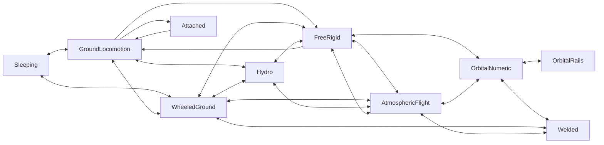
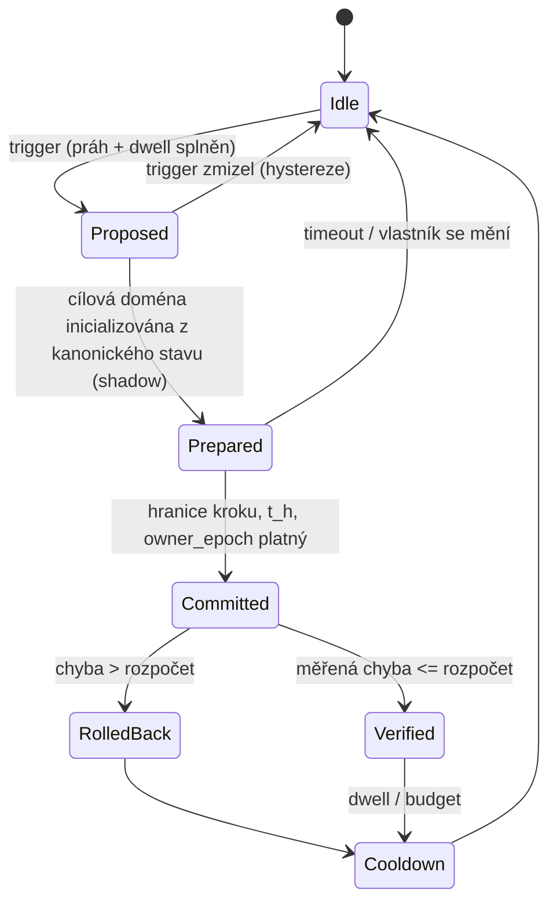
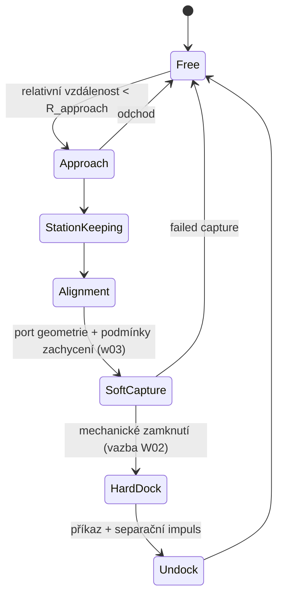

# Worker 03 – Supplement 01: Přechody mezi fyzikálními doménami

Stav: architektonický výzkum, žádná implementace. Kód jen jako ilustrační datové struktury.
Značení: **ověřeno** (primární zdroj nebo původní výzkum), **návrh** (rozhodnutí tohoto dokumentu), **odhad** (číslo bez měření, nutno kalibrovat).
Vstupy: `audit/WORKER_10_REVIEW.md` (§2, §6, §9, R03/R07), `w03-original.md` (§2.4, §3, §5.E3, §5.F6, §6.3, §13), grep v w01, w02, w04, w07, w08, w09.

---

## 1. Shrnutí rozhodnutí

| ID | Rozhodnutí | Status |
| --- | --- | --- |
| D3-01 | Entita má jednu identitu a jeden kanonický `EntityPhysicalState` (W10 §6). **Doména** je výměnná sada modelů sil + integrátor + fidelity nad tímto stavem. Přechod domény nikdy nevytváří ani neničí entitu (výjimky: staging a docking, viz D3-08/09). | návrh |
| D3-02 | Přechod je **explicitní transakce `DomainHandoff`** ve čtyřech fázích: Propose → Prepare → Commit → Verify. Commit se provádí na hranici kroku v jednom `WorldInstant`, v rámci jednoho vlastníka (owner_region/owner_epoch). | návrh |
| D3-03 | Hystereze je **trojí**: prahová (dva prahy enter/exit), dwell time (min. doba v doméně v `WorldInstant`) a rozpočet přechodů (max. N přechodů za okno). Prahy se definují ve fyzikálních veličinách (dynamický tlak, hustota, ponořený podíl, vzdálenost), ne ve výšce nad zemí. | návrh |
| D3-04 | Každý přechod má **chybový rozpočet** `TransitionErrorBudget` (poloha, rychlost, zrychlení, energie, hybnost). Při překročení při Verify se přechod vrací (rollback na stav před Commit) a doména se zablokuje po dobu cooldown. | návrh |
| D3-05 | Tam, kde se fyzikální veličina mění spojitě (hustota prostředí, ponořený objem, tah vs. okolní tlak), **nepřepínáme doménu, ale modely vracejí spojitě se měnící síly**. Diskrétní doména se přepíná jen kvůli ceně/numerice, ne kvůli fyzice. | návrh |
| D3-06 | On-rails (analytická/Keplerova) doména ukládá **stavový vektor + epochu v inerciálním rámci centrálního tělesa**, ne klasické orbitální elementy (singularity e→0, i→0). Propagace univerzálními proměnnými. Elementy jen pro zobrazení. | návrh |
| D3-07 | Složené entity mají tři **zvláštní režimy**: `Attached` (kinematické dítě, relativní stav), `Welded` (jedno integrované těleso, např. zadokovaná sestava), `Constrained` (samostatná tělesa s vazbou, island W02). Mapování a identita v §3.4. | návrh |
| D3-08 | Staging = událost, která z jednoho tělesa vyrobí dvě; ID potomků se odvozují deterministicky z (parent_id, event_seq). Hybnost, moment hybnosti a energie se bilancují explicitně (§4.4). | návrh |
| D3-09 | Docking = stavový automat `Free → Approach → SoftCapture → HardDock(Welded) → Undock`; W03 dodává geometrii a podmínky zachycení, W02 vazbu. Při HardDock zůstanou obě `EntityId`, integruje se jedno `CompositeBody`. | návrh |
| D3-10 | Time warp **nikdy nezvětšuje timestep domény**. Rychlost času je stav serveru (W07); doména deklaruje `max_warp`. Při překročení se entita přesune do domény vyššího warpu (rails), nebo se warp odmítne/ořízne. | návrh |
| D3-11 | Katalog domén D0–D9 (§3.1) s deklarací obálky platnosti (`ModelEnvelope`) a integrátoru. Integrátory jsou **pluginy Physics Runtime** (W02), ne samostatné simulátory. | návrh |
| D3-12 | `VAL-REFERENCE-001` rozepsán na 12 kroků s invarianty a tolerancemi (§6.2). Kroky 5–7 zadání jsou nejednoznačné (kdo nastoupí do rakety) – navržena upřesněná varianta, vyžaduje potvrzení uživatele. | návrh |

---

## 2. Řešené konflikty W10

| Konflikt | Rozhodnutí | Odůvodnění |
| --- | --- | --- |
| CONFLICT-003 (Entity state není jednotný) | Handoff pracuje výhradně nad kanonickým `EntityPhysicalState`. Doménově lokální stav (skluz pneumatik, otáčky rotorů, stav palivových nádrží, stav řízení) žije v odděleném `DomainLocalState`, který se při přechodu **inicializuje z kanonického stavu** nebo **zahazuje**. Nikdy se nepřenáší přímo mezi doménami. | R03 „neúplný Entity State“: ztráta kontinuity vzniká, když se do přechodu vloží stav, který není v kanonickém kontraktu. Oddělení dělá zřejmé, co musí přežít. |
| CONFLICT-001/005 (čas) | Handoff se vztahuje k jednomu `WorldInstant` (`t_h`). Domény mají vlastní `DomainTick`; po Commit má nová doména `domain_tick` odvozený z `t_h` a vlastního kroku. Žádná doména neposouvá `WorldInstant`. | W10 baseline: `WorldInstant` kanonický, `DomainTick` lokální. Přechod mezi doménami s různým krokem (60 Hz ↔ adaptivní orbit) je jinak nedefinovaný. |
| CONFLICT-002 (gravitace) | Při přechodu se mění pouze množina *poskytovatelů zrychlení*, na které se doména dotazuje (např. Planetary → Celestial); aplikaci sil provádí vždy Physics Runtime. Doména na rails používá `GravitySample` jen z centrálního tělesa (+ případně deklarované třetí těleso). Přechody nesmí přidat/odebrat odstředivou složku (§4.2). | W10: Physics Runtime jediný aplikuje síly; riziko dvojí odstředivé složky se projevuje právě při přechodu rotující → inerciální. |
| CONFLICT-004 (regiony vs. islandy) | Handoff a vznik/zánik `CompositeBody` probíhá v rámci jediného vlastníka. Pokud by zahrnutí členů překračovalo hranici ownership, Commit se odloží a požádá W02/W05 o migraci/merge (viz §5). | Island má jednoho vlastníka (W10 baseline). |
| CONFLICT-006 (mutace) | `DomainHandoff` není `WorldMutation`, ale **záznam v journalu entity** (`HandoffRecord`) se stejnou revizní disciplínou (revision vector, idempotence podle `handoff_id`). Mutace terénu pod `Attached`/rails entitou je událost, která může vynutit návrat do plné fyziky. | Brief: pořadí Committed → PhysicsIntegrated → Derived → Replicated; handoff musí do replikace předat změnu domény. |
| CONFLICT-008 (determinismus) | Rozhodnutí o přechodu (prahy, hystereze) musí být **deterministická funkce zaznamenaného stavu** a verzovaných modelů; adaptivní integrátory logují zvolené kroky. | w03 §6.4 chtěl pevný tick; adaptivní orbit je s tím v rozporu, pokud se step control neloguje. |

---

## 3. Kontrakty

### 3.1 Katalog fyzikálních domén (návrh)

Doména = (sada modelů sil, integrátor, rozsah kroku, obálka platnosti). Nad stejnou entitou běží vždy právě **jedna primární doména** (plus případné atribuční režimy §3.4).

| Doména | Obsah | Integrátor (plugin Physics Runtime) | Typický krok (odhad, dle w03 §6.3) | Frame |
| --- | --- | --- | --- | --- |
| D0 `GroundLocomotion` | postava na povrchu, kinematický controller + kolizní dotazy | fixní krok, sweep/depenetration | 60 Hz | lokální tečný (cell-local) |
| D1 `WheeledGround` | vozidlo s koly, odpružení, tření | rigid-body + substepping suspension | 60–240 Hz | lokální / ECEF-kotvený |
| D2 `AtmosphericFlight` | letadlo, dron, raketa v atmosféře, plná aerodynamika | 6-DOF (proměnná hmotnost u rakety) | 60–240 Hz (dron řízení až 1 kHz) | lokální + rotující atmosféra |
| D3 `Hydro` | plavání, plovoucí/ponořená tělesa: vztlak, odpor, proudy | 6-DOF + vzorkování ponořeného objemu | 60–120 Hz | lokální, vodní hladina z W08 |
| D4 `FreeRigid` | volný pád, balistika, vakuum se silami (RCS, tah) | 6-DOF rigid-body | 60–120 Hz | inerciální nebo lokální |
| D5 `OrbitalNumeric` | cowell/adaptivní propagace s tahem, J2.. , třetí tělesa | adaptivní vysokého řádu (typ DOP853/RKF) | adaptivní | inerciální centrálního tělesa |
| D6 `OrbitalRails` | analytická Kepler/univerzální proměnné, bez sil kromě centrální | analytický (Stumpff) | bez kroku, dotaz „stav v čase t“ | inerciální centrálního tělesa |
| D7 `Welded` | sestava pevně spojených těles (docking, připojené přívěsy) | jako doména sestavy (D1/D2/D4/D5) | dle sestavy | dle sestavy |
| D8 `Attached` | kinematické dítě na nosiči (sedící postava, pasažér) | žádný vlastní integrátor | dle nosiče | rámec nosiče |
| D9 `Inactive/Sleeping` | spící těleso, nulové síly, bez integrace | žádný | – | kotvený |

Poznámka (**ověřeno**, w03 §6.3, §13.8): jednotný stav + čas, ale specializované numerické metody; orbit se neintegruje v 60 Hz smyčce. **Návrh:** D5/D6 jsou integrátorové pluginy Physics Runtime (W02), takže zůstává v platnosti „Runtime jediný integruje“.



### 3.2 Ilustrační struktury

```text
// Ilustrační datové struktury, ne implementace.

DomainId        = enum { GroundLocomotion, WheeledGround, AtmosphericFlight, Hydro,
                         FreeRigid, OrbitalNumeric, OrbitalRails, Welded, Attached, Sleeping }

ModelEnvelope {            // obálka platnosti modelu (platí pro doménu i fidelity variantu)
  domain: DomainId
  model_id, model_version
  valid_when: [Predicate]  // např. dynamic_pressure < q_max, submerged_fraction in [0,1]
  max_state_error: ErrorBudget
  max_warp: f64            // max WorldInstant/WallClock poměr, pro který je model platný
  min_step, max_step       // v SI sekundách světového času
  cost_class               // pro rozpočet scheduleru
}

DomainPolicy {             // hystereze + podmínky, verzované
  from: DomainId, to: DomainId
  enter: [ThresholdSpec]   // např. {quantity: "dynamic_pressure", op: "<", value: q_on}
  exit:  [ThresholdSpec]   // vždy s marží vůči enter
  dwell_min: WorldDuration
  budget: { max_transitions: u32, window: WorldDuration }
  cooldown_after_fail: WorldDuration
  error_budget: TransitionErrorBudget
}

TransitionErrorBudget {
  d_position_m, d_velocity_mps, d_accel_rel,       // spojitost
  d_angular_velocity_radps, d_attitude_rad,
  d_momentum_rel, d_angular_momentum_rel, d_energy_declared   // bilance
}

DomainHandoff {            // transakce
  handoff_id             // idempotence
  entity_id, from, to, reason: Cause
  t_h: WorldInstant      // okamžik Commit
  state_version_before, state_version_after
  owner_epoch            // fencing, musí odpovídat aktuálnímu vlastníkovi
  phase: Proposed | Prepared | Committed | Verified | RolledBack
  pre_state_hash, post_state_hash
  measured_error: TransitionErrorBudget
  declared_dissipation   // energie/hybnost, kterou přechod vědomě ruší (např. inelastický dock)
}

DomainLocalState {         // NENÍ součást kanonického stavu
  domain: DomainId
  blob_version
  data: ...                // pneumatiky, rotory, řídicí integrátory, atd.
  init_from_canonical: Fn  // pravidlo inicializace při vstupu
}

CompositeGroup {
  group_id
  kind: Attached | Welded | Constrained
  root: EntityId
  members: [ { entity_id, local_pose_in_root, mass_props, role } ]
  aggregate_mass_props     // m, COM, I (parallel axis)
  integrated_by: EntityId | group_id
}
```

### 3.3 Co je „stejná identita“ při přechodu (**návrh**)

| Pole `EntityPhysicalState` (W10 §6) | Při handoffu |
| --- | --- |
| world/entity id | beze změny |
| state_version | +1, monotónně |
| timestamp (world_instant, domain_tick) | `world_instant = t_h` (beze změny); `domain_tick` přepočten pro novou doménu |
| spatial (frame, anchor, cell, local_position, orientace, rychlosti) | transformováno přes `ReferenceFrameTransform` (W01) jako celý 6D stav; může se změnit frame (např. ECEF-lokální → inerciální) |
| physical (mass, inertia) | beze změny, kromě explicitních událostí (staging, dock, board) |
| simulation (domain, fidelity, model_version) | **jediná pole, která handoff mění přímo** |
| authority (owner_region, owner_node, owner_epoch) | beze změny; pokud se vlastník mění souběžně, handoff čeká (§5) |

---

## 4. Matematika, algoritmy a stavové automaty

### 4.1 Handoff protokol (návrh)



Kroky:

1. **Propose:** doménový dohled (součást Domain Scheduleru) vyhodnotí `DomainPolicy.enter` na stavu v čase `t`. Podmínka musí platit nepřetržitě `dwell_min` (hystereze v čase).
2. **Prepare (shadow):** cílová doména se inicializuje na *kopii* stavu v `t_h`. Spočítá se `DomainLocalState` a **jeden zkušební krok** (shadow step) z `t_h` do `t_h + Δ` v obou doménách; porovná se zrychlení a rychlost (kontrola spojitosti sil).
3. **Commit:** na hranici kroku, atomicky se zvýší `state_version`, nastaví `simulation.domain` a zapíše `HandoffRecord`. Ověří se `owner_epoch` (fencing, závisí na W05).
4. **Verify:** po prvním kroku nové domény se změří skutečný skok. Při překročení `TransitionErrorBudget` → rollback na stav před Commit (stav z journalu), blokace přechodu na `cooldown_after_fail`.

Důsledek (**návrh**): Prepare je dražší (dvojitý výpočet jednoho kroku), ale jen po dobu kandidatury. Rozpočet: kandidáti na handoff jsou typicky jednotky promile entit.

### 4.2 Změna rámce a rotující soustava

**Ověřeno** (w03 §2.4, SPICE): pro rotující rámec s počátkem `r_O` a rotací `R(t)`

```text
r_I = R(t) r_F + r_O
v_I = R(t) v_F + Ṙ(t) r_F + v_O,    Ṙ(t) = [ω]× R(t)
```

SPICE `sxform` vrací 6×6 matici s `R` na diagonále a `dR/dt` v levém dolním bloku; `xf2rav` z ní umí extrahovat `ω` (ověřeno z názvů a popisů funkcí v dokumentaci NAIF, plný text `sxform` se nepodařilo načíst, blok 6×6 je z obecné znalosti – **doporučuji ověřit**).

Pravidla pro handoff (**návrh**):

- Jakýkoli přechod, který mění `frame`, probíhá **jen** voláním `ReferenceFrameTransform` z W01 nad celým 6D stavem. W03 nikdy neimplementuje rotační korekce (potvrzuje w03 §2.4, kde ovšem připisuje vlastnictví „Worker 02“ – viz §7).
- Stav objektu spočívajícího na povrchu: `v_F = 0` → `v_I = ω × r` (rovník Země ~465 m/s, **odhad řádu**; přesnou hodnotu dodá `ω` z W01). Test VAL-311.
- **Zdánlivé síly:** pokud doména běží v rotujícím rámci, dodává Physics Runtime Coriolisovu a odstředivou složku; pokud běží inerciálně, žádnou. Handoff mění *obojí jednou*: Prepare ověří, že součet `a_gravitační + a_zdánlivá` (lokální „tíže“) je před a po přechodu v inerciálním měřítku stejný fyzikální vektor. Pokud je providerem pro pozemní doménu `gravity` (WGS84, obsahuje odstředivou složku), a do inerciální domény přejde entita, musí se **odečíst** odstředivá složka a přepnout na `gravitational` (čistě Newtonovo/EGM pole). Toto je přesně riziko dvojí odstředivé z W10 CONFLICT-002; interface na W04 v §5.

### 4.3 Kontinuita hybnosti a energie (obecně)

Pro přechod domény bez vnějšího zásahu (D2 → D4, D5 → D6, D1 → D3 …) platí

```text
|r_after - r_before| <= ε_r   (cíl: roundoff, tj. ~1e-9 m pro doubles v jednom rámci, odhad)
|v_after - v_before| <= ε_v   (cíl: roundoff)
|a_after - a_before| / |a_before| <= ε_a  (odhad 5 %, jen pro přechody mezi modely sil)
```

Spojitost `r` a `v` je **identita** (stav se přenáší beze změny, jen se mění model). Skok se objeví v zrychlení, pokud se mění sada sil; proto D3-05: modely mají síly, které se spojitě blíží nule na hranici platnosti.

Energie: pro konzervativní přechody (D5 ↔ D6) `ΔE_mech ≈ 0` v mezích chyby integrátoru; pro přechody s disipací (dock, přistání, voda) se energie neregistruje jako chyba, ale jako `declared_dissipation` s ověřenou bilancí `ΔE_kin + ΔE_pot = W_ext − E_disp`.

### 4.4 Specifické přechody

#### a) Plná fyzika ↔ on-rails (D5 ↔ D6)

Podmínky vstupu na rails (**návrh**; všechny současně, s dwell):

1. Žádný tah ani RCS (`|a_nongrav|` pod prahem).
2. Periapsis nad okrajem atmosféry/obálky (žádný odpor) a mimo koule vlivu jiného tělesa, které by vyžadovalo N-body (z W04: `GravityEnvelope`).
3. Žádná jiná entita v interakčním poloměru `R_int` (docking, kolize).
4. Žádný aktivní řídicí systém s autoritou (autopilot s hodnotou ≠ 0).
5. Rychlost času `k` překračuje `max_warp(D5)` **nebo** entita je mimo zájmovou oblast (LOD, w09 L3).

Konverze (**ověřeno matematicky, návrh použití**): stavový vektor (r, v, t_epoch) v inerciálním rámci centrálního tělesa se uloží; propagace v čase `t` univerzálními proměnnými (Stumpffovy funkce `c2, c3`), které pokrývají eliptické, parabolické i hyperbolické dráhy bez singularit. Zpětná konverze: vyhodnoť `(r, v)(t)`. Klasické elementy `(a, e, i, Ω, ω, ν)` jsou jen odvozená reprezentace.

Orientace na rails (**návrh**): bez momentů je rotace volná, analyticky (konstantní moment hybnosti `L`, tělesový rámec s `I`); u osově symetrického tělesa `ω` konstantní kolem osy, u asymetrického Eulerovy rovnice integrované nízkým řádem; alternativně „zamknout“ orientaci na pointing mód (prograde, nadir) deklarovaný v `RailsAttitudeMode`. Rails **musí** zachovat `L` vůči těžišti, jinak se při návratu objeví skok `ω`.

Výstup z rails (D6 → D5): v čase `t_h` vyhodnocení stavu, předání integrátoru; chyba je roundoff + chyba analytického modelu vůči numerickému (tj. perturbace J2, třetí tělesa, které rails ignorovaly). **Důležité:** rails je platné jen pro jednotkové dráhy; chyba akumulovaná perturbacemi (`δr ∼ ½ a_pert t²`) určuje **max. dobu na rails** `T_rails_max = sqrt(2 δr_max / a_pert)` (odhad vztahu, ověřit simulací VAL-304). Pokud `a_pert` není zanedbatelné, rails je nepřípustné nebo se použije D5 s velkým krokem.

Analogie v praxi (**ověřeno pouze částečně**): KSP přepíná mezi „packed (on rails)“ a „unpacked (fyzika)“ podle vzdáleností a používá asymetrické prahy pack/unpack; fórová a bug-tracker data o stock hodnotách jsou však v rozporu (flying pack 25 km vs. unload 22,5 km, landed 200–300 m), proto je beru jen jako **inspiraci pro asymetrické prahy**, ne jako zdroj čísel.

#### b) Atmosféra → vakuum (D2 → D4/D5)

Nejde o diskrétní přepnutí fyziky, ale o spojitý pokles `ρ`:

```text
F_aero = ½ ρ(h,t) |v_rel|² C_d A,   v_rel = v - v_atm(r),   v_atm = ω_planet × r  (korotující atmosféra, návrh pro základní model)
F_thrust = ṁ v_e + (p_e - p_a) A_e   // spojitá v p_a, Isp se mění spojitě s okolním tlakem
```

- Obě síly jdou spojitě k asymptotám; v `ρ → 0` je `F_aero → 0`. Doména D2 se opouští, když **obě**: dynamický tlak `q = ½ ρ v_rel²` < `q_off` a aerodynamické řízení nemá autoritu. Vstup zpět `q > q_on > q_off` (hystereze). **Odhad:** `q_off` řádu 1–10 Pa, `q_on` 2–3× vyšší; kalibrovat podle citlivosti (VAL-308). Hranice „100 km“ (Kármán) je konvence, nepoužívat jako fyzikální práh.
- Co se **změní** diskrétně: aktivní model aerodynamických ploch (nulová autorita → deaktivace), řídicí režim (aero surfaces → RCS) a integrátor/krok. Tyto změny jsou schopnosti (capabilities, w03 §3.1), řízení přepíná řadič, ne fyzika.
- Rotující atmosféra: u povrchu vítr = ω×r; ve výšce se aproximace rozpadá (hustota → 0), takže chyba je zanedbatelná. Vítr z W08 je doplněk.
- Reentry (obráceně): D5/D6 → D2. Entita na rails musí být **před** vstupem do atmosféry vrácena do D5 (podmínka 2 výše). Prepare zavolá predikci periapsis s předstihem `T_lead` (odhad: několik oběžných period nebo `k`-závislé).

#### c) Voda ↔ vzduch (D2/D4/D1/D0 ↔ D3)

- Hladina `η(x,y,t)` a lokální rychlost vody dodává Environment (W08), ne W03. Viz §7 (kdo vlastní vztlak).
- **Spojitý model** (D3-05): ponořený podíl `φ ∈ [0,1]` rigid body. Vztlak `F_b = ρ_w g V_sub`; `V_sub` z diskrétních vzorků objemu pro nepravidelná tělesa (w03 A6); efektivní hustota prostředí pro odpor `ρ_eff = φ ρ_w + (1-φ) ρ_air` jako **návrh**; odpor `F_d = ½ ρ_eff C_d A |v_rel|²`. Při vstupu do vody rychle (slamming) vzniká ještě přídavná hmotnost a impulsní zatížení – w03 §13.10 doporučuje začít jen vztlakem + odporem + proudy, FSI odložit. Slamming/přídavná hmotnost = **odhad, mimo Stage 1**.
- **Diskrétní** doménová změna se týká modelů, které nejsou spojité: postava `Walking → Wading → Swimming` (hloubka prahy, **odhad**: wade při 0,4 výšky, swim při 0,7 výšky, hystereze ±0,1 výšky); vozidlo `WheeledGround → Hydro` (kola ztratí kontakt/ponoří se; model kol přestane dodávat síly spojitě podle zatížení kol → 0).
- Kontinuita: stavy `r, v` se nepřepisují. Změna je tedy jen v sadě sil. Test VAL-309 měří skok `F_total` při pomalém potopení a při rychlém vstupu.

#### d) Postava ↔ vozidlo (boarding) – `Attached`

Rámec nosiče: `T_c(t)` s polohou `r_c`, orientací `R_c`, rychlostí `v_c`, úhlovou rychlostí `ω_c`. Dítě v sedadle:

```text
r_w = r_c + R_c r_rel
v_w = v_c + ω_c × (R_c r_rel) + R_c v_rel        // v_rel = 0 při pevném připoutání
a_w = a_c + α_c × (R_c r_rel) + ω_c × (ω_c × (R_c r_rel)) + ...  // kinematicky odvozeno
```

- **Boarding** = přechod `GroundLocomotion → Attached`. Podmínky: vzdálenost k sedadlu < `d_board`, `|v_rel| < v_board` (**odhad**, např. 1,5 m/s). Při přechodu se `r_rel, v_rel` spočítají z aktuálního světového stavu postavy vůči nosiči (inverzní transformace), takže světový stav se nezmění (spojitost). Pokud `v_rel` není nulová, doména `Attached` ji postupně tlumí (animovaná/kinematická interpolace) – **rozhodnutí o tom je herní pravidlo**, fyzikálně jde o nepružnou vazbu.
- **Bilance hybnosti** (**návrh**): nastupující postava s hmotností `m_p` a relativní rychlostí `v_rel` předá nosiči impuls `Δp = m_p v_rel` (nepružné spojení): `v_c' = (m_c v_c + m_p v_p)/(m_c + m_p)`. Pro `m_p ≪ m_c` zanedbatelné, ale **musí být zaznamenáno** (declared_dissipation, ztráta kin. energie `½ μ |v_rel|²`, `μ = m_c m_p/(m_c+m_p)`). Alternativa „zero-impact“ (nosič nereaguje) je přípustný zjednodušující režim, pokud je hmotnostní poměr pod `ε_m` (odhad 1e-3) a je to **explicitně konfigurací**.
- **Hmotnostní vlastnosti nosiče:** po nastoupení se přepočítají agregáty: `m = Σ m_i`, `r_com = Σ m_i r_i / m`, `I = Σ (I_i + m_i(|d_i|² 1 − d_i d_iᵀ))` (Steinerova věta). Aktualizace je událost na hranici kroku.
- **Interiér pohyblivého nosiče (postava chodí v letadle/lodi):** postava zůstává v D0, ale její lokální rámec je rámec nosiče (non-inertial). Controller počítá v tomto rámci, zdánlivé síly (Coriolis, odstředivá, Eulerova) přidává Physics Runtime podle `ω_c, α_c`. Pro typická plavidla je to zanedbatelné; pro rotující stanici zásadní. **Odhad:** rozhodnout fidelitu přes parametr `interior_frame_fictitious_forces: bool`. Závisí na W01 (graf rámců) a W02 (island).

#### e) Staging (D2/D5 raketa)

Událost (w03 §5.E3). Bilance (**ověřeno matematicky, návrh formulace**): těleso (m, r_com, v, ω, L) se rozdělí na tělesa 1 a 2 s hmotami `m_1 + m_2 = m` (palivo odtékající do výfuku se odečte předem), s polohami COM `r_1, r_2`:

```text
v_i = v + ω × (r_i − r_com) + (J / m_i) n_i,   n_1 = −n_2,   J = separační impuls
Σ p_i = p            (musí platit do roundoff; separační impuls je vnitřní a ruší se: m_1 v_1' + m_2 v_2' = m v)
E_sep = ½ J² (1/m_1 + 1/m_2)      // uložená energie pružin/pyrotechniky (deklarovaná)
L = Σ [ I_i ω_i + m_i (r_i−r_com) × v_i ]  // zachovat vůči společnému COM
```

- Součet hybností je zachován **jen pokud se zahrnou oba objekty ve stejném `t_h`**. Událost proto zapíše jak změnu parent, tak vznik child v jednom journal záznamu.
- Nová entita získá `EntityId` deterministicky (`H(parent_id, event_seq)`), vlastní ownership zdědí od rodiče (W05). Replay musí generovat shodné ID (VAL-313).
- Od `t_h` vzniká dvojice těles; rakety přepínají `D2/D5` nezávisle (horní stupeň do vakua, spodní zpět do atmosféry). Oba jsou stále v jednom islandu, dokud se nerozletí (W02).

#### f) Docking (D5/D4 → D7)

Stavový automat (**návrh**, fáze dle w03 §5.F6):



- **Vzdálená fáze** (rendezvous) lze řídit pomocí Clohessy-Wiltshire/Hill rovnic jako **aproximace relativního pohybu** blízko kruhové dráhy cíle (ověřeno: lineární aproximace, platí pro malé vzdálenosti vůči poloměru dráhy a kruhový cíl; přesnost klesá s excentricitou a se vzdáleností). W03 §F6 to správně nepovažuje za obecný model. **Návrh:** CW je *navádění/predikce*, ne integrátor: fyzikální integrace relativního pohybu běží v D5 v inerciálním rámci.
- **Přechod na D7:** po `HardDock` se ze dvou těles stane `Welded` sestava: stav sestavy = těžiště, hybnost `p = m_1 v_1 + m_2 v_2`, moment hybnosti `L = Σ(I_i ω_i + m_i d_i × v_i)`, `ω` sestavy z `I_tot^{-1} L_rel`; `I_tot` Steinerovou větou.
- **Energie:** nepružné spojení ztrácí `ΔE = ½ μ |v_rel|² + rotační část`. Musí se zapsat jako `declared_dissipation`. Pokud je `v_rel` pod toleranční mezí zachycení (v řádu cm/s, **odhad** – kalibrovat podle typu portu), je ztráta zanedbatelná.
- **Identita:** obě `EntityId` zůstávají (hráč může stále adresovat modul), vzniká `CompositeBody` se `group_id`; integruje se jedno těleso. Undock obnoví dvě tělesa s `v_i = v_com + ω × d_i ± J/m_i`.

#### g) Time warp

- `time_scale` (W07/W09) je stav serveru, ne vlastnost entity. Scheduler žádá interval `Δt_world`, integrátor jej dělí na kroky podle stability (**ověřeno** w04 §E: žádost o interval a skutečný krok jsou odlišné pojmy; w04 také zmiňuje rozdíl mezi konzervativním a disipativním časem – zpětný chod nelze pro disipativní modely).
- Deklarace `max_warp` doménou (návrh, **odhad**): D0 ~ 1–2×, D1 ~ 2–5×, D2 ~ 5×, D3 ~ 5×, D4 ~ 10×, D5 (adaptivní) až stovky ×, D6 libovolně (analytické). Čísla jsou řád; skutečné určí benchmark rozpočtu CPU (počet kroků za wall frame).
- Algoritmus: `effective_warp = min(requested, min_over_entities_in_scope(max_warp(domain)))`. Pokud požadovaný warp přesahuje `max_warp` entity: (a) pokud entita splňuje podmínky rails (§4.4a) → přesune se do D6; (b) jinak se warp **ořízne** a uživateli se zobrazí důvod (která entita blokuje). Obnova: při poklesu warpu se entity vracejí z rails po *dwell*.
- **Zásadní bezpečnostní pravidlo:** časový krok domény se **nezvětšuje**; roste počet kroků na wall frame, omezený rozpočtem. Tím je splněno W10 „akcelerace času nesmí naslepo násobit timestepy“.
- Multiplayer: slučitelnost s jedním `WorldInstant` je otázkou W07/W09; W03 dodává jen `max_warp` a deterministickou funkci `effective_warp`. Viz §8 (otevřená otázka: warp je globální, nebo per-region/instance?).

### 4.5 Hystereze – formální pravidlo (návrh)

Pro veličinu `x(t)` (např. `q`, `φ`, `d`) a dvojici prahů `x_on < x_off` s marží `Δ = x_off − x_on`:

```text
stav A → B při  x(t) < x_on  nepřetržitě po dwell_min
stav B → A při  x(t) > x_off nepřetržitě po dwell_min
```

Marže se volí aspoň rovná očekávanému šumu veličiny na době dwell: `Δ ≥ 3 σ_x`, **odhad** (kalibrovat). Dodatečně rozpočet přechodů: max. `N` za okno `T_w` (odhad N = 4, T_w = 10 s světového času). Překročení = incident (log), doména „zamrzne“ v konzervativnější variantě (ta s větší platností obálky).

---

## 5. Rozhraní na ostatní workery („závisí na W0X“)

| Worker | Co W03 potřebuje / dodává | Rozhraní (návrh) |
| --- | --- | --- |
| W01 (čas, rámce, prostor) | Závisí na W01: `WorldInstant`, `ReferenceFrameTransform` (6D), `ω` planety, graf rámců včetně rámců nosičů. W03 dodává seznam rámců, které potřebuje (lokální tečný, ECEF, inerciální centrální těleso, rámec nosiče). | `transform_state(state6, from, to, t) -> state6`; `frame_angular_velocity(frame, t)` |
| W02 (physics runtime, islandy) | Závisí na W02: integrace sil, kolize, vazby, island merge/split při `Welded/Constrained`, spící tělesa. W03 dodává model sil a podmínky přechodu. | `IntegratorRegistry`; `register_composite(group)`; island se vytvoří před Commit dockingu |
| W04 (gravitace) | Závisí na W04: `GravitySample` s příznakem `includes_centrifugal: bool` (nebo oddělené složky). Přepínání poskytovatelů při přechodu nesmí dát skok. | `sample(r, t, frame) -> {a, gradient, validity, uncertainty, includes_centrifugal}` |
| W05 (ownership) | Závisí na W05: handoff i vznik skupiny vyžadují platný `owner_epoch`; migrace během `Prepared` odloží Commit. Staging vytváří entitu u stejného vlastníka. | `check_epoch(entity, epoch)`; událost `OwnershipChanging` → handoff zruší Prepared |
| W06 (mutace) | Závisí na W06: mutace terénu/vody pod entitou může vynutit návrat z `Attached/Rails/Sleeping`. `HandoffRecord` do journalu stejným mechanismem revizí. | `on_world_revision_changed(region)` → re-evaluace domén |
| W07 (Unity, warp) | Závisí na W07: `time_scale` jako stav serveru; replikace `domain` a `fidelity` v `ReplicationSnapshot`; predikce se musí přepnout se změnou domény (klient nesmí predikovat rails jako rigid-body). | pole `simulation.domain` v `ReplicationSnapshot`; `WarpRequest`/`effective_warp` |
| W08 (prostředí) | Závisí na W08: `EnvironmentSample` (hustota, tlak, teplota, vítr; hladina vody, rychlost vody, hustota vody). Vlastnictví vztlaku viz §7. | sample na pozici/čas, validity, nejistota |
| W09 (distribuce, LOD) | Závisí na W09: pořadí cross-region událostí a handoffu na hranici; L0–L3 fidelity entity vs. W03 fidelity variant (§7). | `HandoffRecord` jako zaznamenaná událost se stabilním pořadím |

---

## 6. Validační testy

### 6.1 Nové testy VAL-3xx (navazují na VAL-003/004/011/014)

| ID | Scénář | Kritérium (tolerance = odhad, nutno kalibrovat) |
| --- | --- | --- |
| VAL-301 | Handoff bez změny sil (identity handoff): přepnout doménu se stejnou sadou modelů | `r, v, ω, q` shodné do roundoff, `state_version` +1, žádná jiná pole nezměněna |
| VAL-302 | Hystereze: veličina osciluje kolem prahu (sinus + šum) | nejvýš 1 přechod za `dwell_min`, žádný chatter, počet přechodů ≤ rozpočet |
| VAL-303 | Round-trip D5 → D6 → D5 (kruhová, eliptická, hyperbolická, e→0, i→0) | `|Δr|/r ≤ 1e-9`, `|Δv|/v ≤ 1e-9` (odhad) při nulových perturbacích; žádná singularita |
| VAL-304 | Rails vs. numerika s perturbací (J2) po N oběhách | chyba polohy ≤ rozpočet; `T_rails_max` odpovídá predikci vztahu |
| VAL-305 | Boarding (různé hmotnostní poměry, nenulová `v_rel`) | součet hybnosti zachován do roundoff; ztráta energie = deklarovaná; agregát `m, COM, I` odpovídá Steinerově větě |
| VAL-306 | Staging s excentrickým těžištěm a rotací | `Σp` a `L` zachovány; `E_sep` odpovídá; ID potomka stejné při replay |
| VAL-307 | Docking: příjem se `v_rel` v toleranci; následný undock | `p, L` sestavy; deklarovaná ztráta; po undock `v_i` odpovídá očekávání; obě EntityId zachovány |
| VAL-308 | Atmosféra → vakuum: sweep `ρ` a `q` kolem prahů | `F_aero` a `F_thrust` spojité; `|Δa|/|a| ≤ 5 %` na hranici; žádný skok orientace |
| VAL-309 | Voda ↔ vzduch: pomalé a rychlé ponoření, plovoucí těleso | `F_total` spojitá v `φ`; rovnovážná ponor odpovídá Archimedovi do 1 %; žádný skok `v` |
| VAL-310 | Time warp: kroky domény při různých `k` | velikost kroku nezávislá na `k`; entita překračující `max_warp` je přesunuta na rails nebo je warp oříznut |
| VAL-311 | Povrch → inerciální: objekt klidný na rovníku, šířka 45°, 90° | `v_I = ω × r`; po přechodu a zpět `v_F = 0` do roundoff; žádná dvojitá odstředivá složka |
| VAL-312 | Postava v pohybujícím se nosiči (konstantní `v_c`, pak rotace) | světový stav postavy odpovídá kinematice; při rotující stanici odpovídají zdánlivé síly |
| VAL-313 | Replay handoffu a stagingu | stejné handoffy ve stejných `t_h`, stejné `EntityId`; stav po replay bit-shodný v rámci domény (CONFLICT-008) |
| VAL-314 | Verify selže (umělá chyba) | rollback na stav před Commit; cooldown; žádná ztráta hybnosti |
| VAL-315 | Handoff při migraci ownership (W05) | nikdy dva autoritativní vlastníci; handoff odložen nebo opakován s novým `owner_epoch` |
| VAL-316 | Mutace terénu pod `Attached`/rails/`Sleeping` entitou | entita se vrátí do plné fyziky ve stejném kroku, ve kterém se mutace stane viditelná |

### 6.2 VAL-REFERENCE-001 (alias VAL-300) – krok po kroku

Zadání W10 má 10 kroků. Kroky 5 až 7 jsou nejednoznačné: kdo se dostane do rakety a jak se dostane z letadla do rakety. **Návrh upřesnění** (vyžaduje potvrzení, viz §8): postava přestoupí do letadla, letadlo přistane na kosmodromu, postava nastoupí do rakety (jako posádka). Tím vznikají kroky 5b, 6b.

Invarianty (musí platit po každém kroku):
- **I1 Identita:** `world_id`, `entity_id` postavy i každého vozidla beze změny (kromě definovaného stagingu).
- **I2 Spojitost:** `|Δr|, |Δv|` ve světovém inerciálním rámci ≤ rozpočet přechodu.
- **I3 Bilance:** hybnost, moment hybnosti, energie: změna = vnější impuls/práce + `declared_dissipation`.
- **I4 Vlastník:** v každém okamžiku právě jeden autoritativní vlastník (W05).
- **I5 Čas:** jediný `WorldInstant`, monotónní; všechny `HandoffRecord` mají `t_h` v něm.
- **I6 Hmotnost:** `Σ m` konzistentní s agregáty a spotřebou paliva.

| Krok | Událost | Domény | Typ přechodu | Specifická kritéria |
| --- | --- | --- | --- | --- |
| 1 | Postava stojí na povrchu | `GroundLocomotion` | – | v povrchovém rámci `v_rel = 0`; ve světovém inerciálním `v = ω×r` (VAL-311) |
| 2 | Nastoupí do automobilu | D0 → D8 (`Attached`), nosič D1 | boarding (§4.4d) | světová poloha/rychlost postavy se nezmění; agregát `m, COM, I` auta přepočten; hybnost zachována |
| 3 | Auto přejede do sousedního regionu | D1 (+ D8) | beze změny domény; změna ownership/islandu | W02/W05: migrace islandu; handoff domény neprobíhá během migrace; `owner_epoch` se změní, stav ne (VAL-315) |
| 4 | Vozidlo se dostane do vody | D1 → D3 | spojitý (φ) + diskrétní vypnutí modelu kol | `F_total` spojitá, kola → bez zatížení; postava stále `Attached` (kinematicky na nosiči) (VAL-309) |
| 5 | Postava opustí vozidlo a přestoupí do letadla | D8 → D0/D3 → D8 (nosič D2) | unboarding + boarding | postava přechází přes vodu/břeh; vyžaduje upřesnění (seaplane vs. dok) – v testu předpokládáme břeh/mol; kroky 4→5 mají odstup, aby postava prošla D3 nebo D0 |
| 5b | Letadlo (s postavou) vzlétne a přistane na kosmodromu | D2 | přechody D1 (rozjezd) → D2 → D1 | spojitost při lift-off; modely kol se vypínají s `load → 0` |
| 6 | Letadlo proletí atmosférou | D2 | – | konzistentní `EnvironmentSample` (w03 §11.7 Scenario 1) |
| 6b | Postava vystoupí, nastoupí do rakety | D8 → D0 → D8 (nosič D2/raketa) | unboard + board | nosič je raketa s proměnnou hmotností; agregát se mění spotřebou |
| 7 | Raketa opustí planetu | D2 | staging (jeden nebo více) | bilance hybnosti i hmotnosti; odvozené `EntityId` potomků (VAL-306) |
| 8 | Loď přejde do orbitální mechaniky | D2 → D4 → D5 | atmosféra → vakuum (§4.4b), změna rámce na inerciální | `F_aero → 0` spojitě; změna rámce přes W01; žádná dvojitá odstředivá složka (VAL-308/311) |
| 9 | Gravitační manévr | D5 (případně D6 mimo manévr) | D5 ↔ D6 při coastu; N-body při blízkém průletu (W04) | VAL-303/304; změna poskytovatele gravitace bez skoku (W04) |
| 10 | Návrat na planetu | D5 → D2 → D1/D0 | reentry (§4.4b obráceně), přistání | predikce periapsis → D5 předem; `q` hystereze; přistání = D2 → D1 (kontakt) |
| 11 | Postava vystoupí | D8 → D0 | unboard | konzistentní s krokem 1 (stejná identita světa) |
| 12 | Závěrečná kontrola | – | – | stejná identita světa, kontinuita stavu, jednoznačné vlastnictví, správná časová osa; **žádné přepnutí do samostatného fyzikálního světa** (W10 požadavek) |

Pozn.: kroky 4 a 5 mají dvě fyzikální oblasti (voda a pozemní břeh), které zadání W10 nespecifikuje. Číslování v tabulce je navrhované a **nezmění** původních 10 bodů zadání W10, pouze je rozšiřuje o 5b, 6b, 11, 12.

Test lze spouštět ve třech variantách warpu: `k=1` (plná fyzika všude), `k` vysoké během orbitální fáze (kroky 8–9, vyžaduje D6) a s injektovanými poruchami (migrace ownership v kroku 3, selhání Verify v kroku 8).

---

## 7. Nové rozpory mezi původními w01–w09, které W10 nemá

| ID | Rozpor | Navržené řešení |
| --- | --- | --- |
| NC-301 | **Vlastnictví transformací rámce.** w03 §2.4 a §9.3 přisuzuje transformace rámců „Worker 02“ a gravitační interface „Worker 01/02“, kdežto W10 baseline a zadání mají rámce/čas u W01 (Spatial Runtime) a gravitaci u W04. Číslování workerů v původním w03 neodpovídá finálnímu zadání. | Použít W10 baseline: rámce = W01, gravitační providery = W04, integrace = W02. W03 se nikdy neopírá o původní číslování. |
| NC-302 | **Fidelity ve dvou osách.** w03 používá varianty modelů (4 úrovně vozidlového modelu: zjednodušené síly, semi-empirické pneumatiky, plný drivetrain, deformovatelné pneumatiky), kdežto w09 §8.2 používá L0–L3 (plná dynamika → časově rekonstruovaný stav) a w04 má L0–L3 pro orbitální modely. Obě osy se mísí pod jedním slovem „fidelity“. | `FidelityLevel = (SimTier ∈ L0..L3 [w09], ModelVariant [w03])`. `SimTier` rozhoduje, zda se entita simuluje; `ModelVariant` jak. Změna kterékoli osy je `DomainHandoff` s rozpočtem. |
| NC-303 | **Pevný tick vs. adaptivní integrace.** w03 §6.4 žádá pevný simulační tick pro reprodukovatelnost, ale §6.3 a §13.8 žádají adaptivní orbit; w04 dtto. Determinismus adaptivního kroku není popsán. | Step controller je deterministický (stejné vstupy → stejné kroky), zvolené kroky se logují do journalu domény, tolerance verzována (`model_version`). |
| NC-304 | **Kdo vlastní vztlak a odpor ve vodě.** w03 A6 počítá vztlak a odpor v entitě, w08 (§ovlivnění Ocean→Ships) uvádí proud, vlny, vztlak jako vazbu z Oceánu na lodě; hrozí dvojí započtení nebo mezera. | W08 dodává `WaterSample` (hladina, rychlost, hustota, vlny); W03 počítá síly z geometrie; Physics Runtime je aplikuje. Vztlak z W08 se **nedodává jako síla**. Rozhraní ověřit s W08. |
| NC-305 | **Staging vytváří entity.** w03 E3 „nová fyzická entita“ vs. identita a ownership (W05) i mutace světa (W06): není definováno, kdo vytváří ID a jak se replikují. | Deterministické ID odvozené z (parent_id, event_seq); vznik je součást `HandoffRecord`/journal události; vlastník = vlastník rodiče (W05 ověří). |
| NC-306 | **Orbit v rails vs. kolizní a interakční scope.** w09 L3 (rekonstruovaný stav / Kepler) a w04 (solver promotion) popisují přechody, ale ne to, co se stane, když se do cesty dostane jiná entita (nebo hráč). | `R_int` (interakční poloměr) jako povinná podmínka vstupu na rails a spouštěč návratu (§4.4a); rails entita je viditelná v kolizním dotazu jako analytická predikce (W02 rozhoduje). |
| NC-307 | **Rotace atmosféry.** w03 C6 a W08 (vítr) nespecifikují základní model: korotující atmosféra jako výchozí. Bez něj je v inerciálním přechodu `v_rel` špatně. | Výchozí `v_atm = ω × r`, vítr jako odchylka (W08). Přepnutí rámce nesmí změnit `v_rel`. |
| NC-308 | **Interiér nosiče.** Žádný původní dokument neřeší postavu uvnitř pohybujícího se vozidla (non-inertial frame, vstup/výstup, island). | Režimy `Attached`/interiérový rámec (§4.4d); závisí na W01 (rámec) a W02 (island, kolize interiéru). |

---

## 8. Otevřené otázky pro uživatele / ADR

1. **VAL-REFERENCE-001, kroky 5–7:** postava přestoupí do letadla a pak do rakety? Jak se dostane do rakety (letadlo přistane, nebo `Attached` na vzdušném nosiči, nebo pouze raketa bez posádky)? Potvrdit upřesněnou variantu §6.2.
2. **Boarding fyzikálně nebo herně:** je boarding fyzikální událost s výměnou impulsu, nebo „zero-impact“ připojení s explicitní hmotnostní podmínkou? (návrh: konfigurovatelné, výchozí zero-impact pod `ε_m`.)
3. **Time warp:** globální pro celý svět, per-region, nebo per-instance? Smí hráč v D1/D2 zrychlit čas, nebo jen z D5/D6? Ovlivňuje to `max_warp` a UX. (Rozhodnutí patří W07/W09, W03 potřebuje pravidlo.)
4. **Interakce s rails entitami:** může rails entita být zasažena nebo se s ní spojit bez předchozího „unpack“? (návrh: ne; musí se vrátit do D5 před interakcí.)
5. **Interiér:** má stanice/loď **chodné interiéry** v rotujícím nosiči (zdánlivé síly pro postavu) už ve Stage 1, nebo pouze `Attached` sedadla? (návrh: Stage 1 jen `Attached`.)
6. **Tolerance:** jaké absolutní/relativní tolerance mají být akceptovány pro `ε_r, ε_v, ε_a`? Čísla v tomto dokumentu jsou **odhady**; je potřeba kalibrace měřením.
7. **ADR kandidáti:** ADR „DomainHandoff transakce“, ADR „Rails reprezentace = stavový vektor“, ADR „FidelityLevel dvouosý“, ADR „Staging a vznik entity (deterministické ID)“.
8. **Rozsah Stage 1:** návrh – už nyní povinné: handoff protokol, D0/D1/D2/D3/D4/D8, hystereze, error budget, journal; později: D5/D6 (orbit), docking, FSI. Potvrdit.
9. **Voda:** vztlak a odpor v D3 bez FSI a bez slamming pro Stage 1? (w03 §13.10 doporučuje ano.)

---

## 9. Zdroje

| Zdroj | Co z něj plyne | Ověřeno? |
| --- | --- | --- |
| `research/worker-03/w03-original.md` §2.4, §3.2–3.4, §5.E3, §5.F6, §6.3–6.4, §9.3, §13 | stejná identita, více integračních režimů; entity jen dodávají příspěvky; staging jako událost runtime; docking fáze; rozdílné frekvence; adaptivní orbit; blokující interface | primární podklad |
| `research/worker-04/w04-original.md` (solver transitions, accelerated time §E) | explicitní state-transfer s chybovým rozpočtem; žádaný interval ≠ skutečné kroky | primární podklad |
| `research/worker-09/w09-original.md` §8.2 | LOD L0–L3 s definovanou chybou aproximace | primární podklad |
| `research/worker-07/w07-original.md` §8.2 | oddělení wall-clock/network času od simulačního | primární podklad |
| NASA/NAIF SPICE, dokumentace funkcí `eul2xf`, `twovxf`, `xf2rav` (naif.jpl.nasa.gov/pub/naif/toolkit_docs/…) | 6×6 state transformace zahrnující derivaci rotace; extrakce úhlové rychlosti ze stavové matice. Blokovou strukturu `sxform` jsem z vyhledávání nepotvrdil | částečně |
| Clohessy-Wiltshire / Hill equations: NASA NTRS 19680019369, 19930020463; Wikipedia „Clohessy-Wiltshire equations“ | lineární aproximace relativního pohybu kolem kruhového cíle; degraduje s excentricitou a vzdáleností; Sparrow & Price (1968) modifikace lepší pro dlouhé přechody | ano (omezeně) |
| KSP fórum a bug tracker (bugs.kerbalspaceprogram.com/issues/21140; pgoddkos.readthedocs.io loaddistance) | koncept pack/unpack s asymetrickými prahy a nutností měnit prahy po krocích | nejistá čísla, jen inspirace |
| Odvození Steinerovy věty, zachování hybnosti/momentu hybnosti, Stumpffovy proměnné, Archimédův zákon | standardní mechanika | z obecné znalosti |
| Neověřené odhady (prahy `q`, hloubky, tolerance, `max_warp`) | označeny **odhad** v textu | nutná kalibrace |
