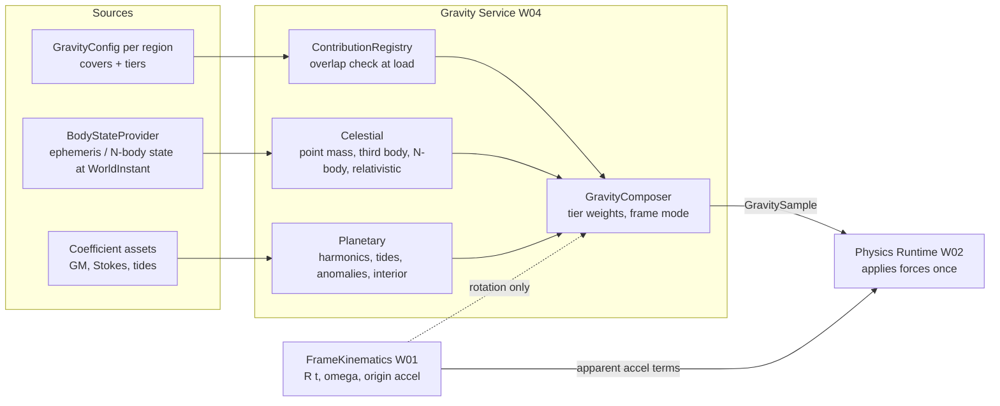
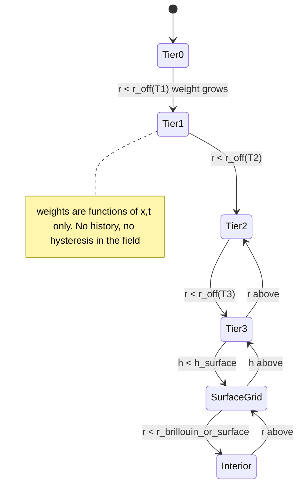
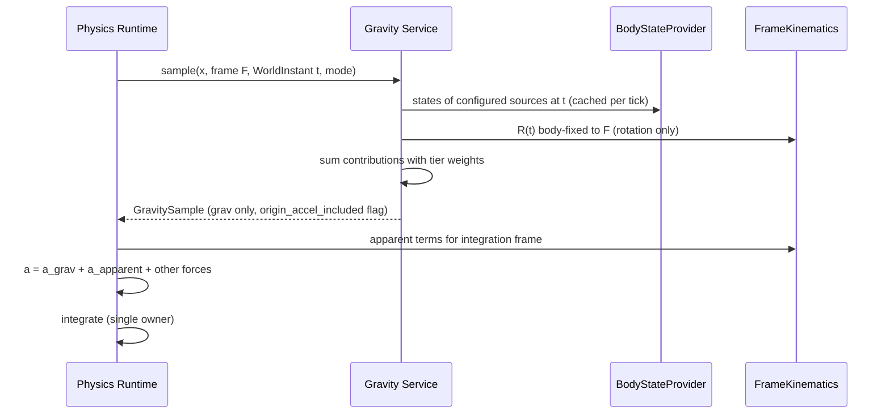

# W04 – Doplňující výzkum 01: Sjednocení gravitačních providerů

Fáze: architektonický výzkum, žádná implementace. Kód jen jako ilustrační datové struktury.
Vazby: CONFLICT-002, R02, ADR-003, VAL-005. Nové testy: VAL-4xx.
Metoda: původní w01–w04 prohledány grepem (řádky citovány), W10 §2 (CONFLICT-002), §4, §6, §9, §10, §11. Webem ověřeno 3 tvrzení (viz §9). Označení: **ověřeno** (primární zdroj nebo dohledáno), **návrh** (rozhodnutí architektury), **odhad** (řádový výpočet nebo neověřená hodnota z paměti, nutno potvrdit).

---

## 1. Shrnutí rozhodnutí

| ID | Rozhodnutí | Status |
| --- | --- | --- |
| G-01 | Jediný **Gravity Service** (vlastník W04) skládá gravitační pole ze **závazně deklarovaných příspěvků** (`GravityContribution`). Příspěvky nikdy neaplikují sílu; Physics Runtime (W02) je jediný, kdo aplikuje a integruje. | návrh |
| G-02 | Každý příspěvek deklaruje, co **pokrývá** (`covers`: těleso, druh členu, rozsah stupňů). Při načtení konfigurace se kontroluje překryv. Překryv = chyba konfigurace, ne varování. Toto je hlavní mechanismus proti R02. | návrh |
| G-03 | `GravitySample` nese **jen gravitační** zrychlení (vazba na hmotu), nikdy zdánlivé zrychlení. „Efektivní gravitace“ (g = gravitace + odstředivá) existuje jen jako diagnostická odvozená veličina s jiným typem; do integrátoru nesmí. | návrh |
| G-04 | Zdánlivé síly (Coriolis, odstředivá, Euler, zrychlení počátku rámce) **nejsou provider**. Dodává je `FrameKinematics` (W01, kinematika rámce), aplikuje je Physics Runtime podle toho, v jakém rámci integruje. W10 §2 zařazuje „rotující soustavy“ do Environmental Acceleration Provider – tady navrhuji tuto položku upřesnit (viz §2). | návrh, mění znění W10 |
| G-05 | Příspěvky třetích těles se v těleso-centrickém (neinerciálním) rámci počítají jako **přímý + nepřímý člen** (nebo jako diferenciální/slapový člen). Režim je v dotazu (`FrameForceMode`) a vzorek hlásí `origin_accel_included`. | návrh |
| G-06 | Přepínání přesnosti modelu je **inkrementální po vrstvách** (tier = přírůstek ΔT_k), váha vrstvy je funkcí **polohy a času, ne historie**. Žádná hystereze v poli samotném; hystereze patří do handoffu domén (W03). | návrh |
| G-07 | `GravitySample` = {zrychlení, potenciál, volitelný gradient (3×3 symetrický), platnost, odhad chyby, provenance, seznam příspěvků}. | návrh |
| G-08 | Pole se vyhodnocuje v rámci tělesa (body-fixed) a rotuje se do rámce dotazu; gradient se transformuje jako tenzor (R G Rᵀ). Singularity-free vyhodnocení harmonik v Rustu (Cartesian/Pines nebo Holmes–Featherstone). | návrh, metody ověřeny literaturou |
| G-09 | Výkon: tři třídy dotazu (orbitální, povrchová-lokální, interiérová), cache stavů zdrojů na `WorldInstant`, dávkové (batch) SoA API, povrchová vrstva = analytická normální gravitace + mřížka poruch. Žádná čísla výkonu nejsou měřena. | návrh + odhad |
| G-10 | Rozšířit w04 `GravityRequest`: volající **nevybírá zdroje** (`source_entities`), vybírá jen fidelity a toleranci. Sadu zdrojů určuje konfigurace oblasti. | návrh, mění w04 |

---

## 2. Řešené konflikty W10

### CONFLICT-002 – Kdo vlastní gravitaci

| Aspekt | Rozhodnutí | Odůvodnění |
| --- | --- | --- |
| Vlastnictví entity | Gravitace není vlastníkem entity ani síla aplikovaná providerem. Je to pole. | W10 §2; w03 §4.3 („entity gravitaci neimplementují“) |
| Kdo skládá pole | Gravity Service (W04) = Celestial + Planetary Gravity Provider pod jedním composerem. | w01 §Environment, w03 §4.3 a w04 §5.3 dnes popisují tři různé vlastníky (viz §7). |
| Kdo aplikuje | Physics Runtime (W02) – v kroku „force evaluation“ přičte `a_grav` jednou. | W10 baseline |
| Kde jsou zdánlivé síly | `FrameKinematics` (W01) → Physics Runtime podle integračního rámce. | w01 §2.5 a w03 §4.3 shodně; W10 §2 je pojmenovává jako Environmental Acceleration Provider. |
| Zdánlivé vs. gravitační | Dva různé typy (`GravitationalAcceleration` vs `ApparentAcceleration`), efektivní gravitace jen jako diagnostika. | zabrání R02 na úrovni typů |

Upřesnění k W10 „Environmental Acceleration Provider“. Doporučuji ho zúžit na **negravitační pole zrychlení závislá na poloze** (např. lokální gameplay pole, případně umělé zrychlení). Rotující-soustavové členy jsou kinematika rámce, ne pole prostředí. Pokud W10 ponechá jméno, nechť v textu stojí, že odstředivé a Coriolisovo zrychlení tento provider **negeneruje**, jen je zdokumentuje jako ověřovací referenci. Zdůvodnění: ω×(ω×r) závisí na rámci integrace, a ne na poloze samotné; provider by musel znát rámec integrátoru, a tím vzniká přesně ta vazba, která dnes způsobuje R02.

### R02 – Dvojí gravitační příspěvek

Dohledané konkrétní cesty ke dvojímu započtení:

1. **Odstředivá dvakrát**: provider vrátí „g“ podle WGS84 (obsahuje odstředivou) a integrátor v ECEF přidá ještě ω×(ω×r). **Ověřeno**: WGS84 udává normální gravitaci jako součet gravitace a odstředivé složky; GeographicLib odděluje gravitaci (`-G` přidá odstředivou) od modelu EGM, který popisuje jen gravitační pole.
2. **Monopól dvakrát**: bod-hmotný člen GM/r² plus harmonický model, jehož degree-0 člen je také GM.
3. **J2 dvakrát**: on-rails perturbace (J2 sekulární) plus plná harmonika při handoffu (rails↔full), nebo harmonika plus samostatný „oblateness“ člen z w04 §3.2D (`a_oblateness`).
4. **Nepřímý člen**: v inerciálním barycentrickém rámci není nepřímý člen potřeba; v rámci s počátkem v planetě se přidá, a když navíc použijeme „tělesově-centrický“ integrátor, který už zrychlení počátku odečetl, vznikne dvojí odečtení.
5. **Slapy dvakrát**: třetí těleso jako přímý člen i jako korekce koeficientů pevných slapů (u téhož tělesa, téhož účinku, jiná cesta – viz §3.3).
6. **Dva zdroje poloh**: ephemeris a N-body integrátor poskytují různé polohy téhož tělesa → gravitace počítaná z nekonzistentního stavu.
7. **Gravitace v krocích 3 i 4 u w02**: pořadí kroků w02 uvádí v kroku 3 „Resolve … gravity“ a v kroku 4 „Execute … gravity … force providers“ (grep w02 ř. 769, 772). Pokud krok 3 vyhodnotí a krok 4 znovu aplikuje, je to buď redundance, nebo duplikace. Rozhodnutí: krok 3 jen cacheuje `GravitySample` pro tick, krok 4 jej přičte právě jednou, s `contribution_ids` v diagnostice.

---

## 3. Kontrakty

### 3.1 Architektura



Čárkovaná šipka: composer používá z W01 jen rotaci/transformaci, ne zdánlivé síly.

### 3.2 Informační model (ilustrační)

```text
GravityContribution {
  id:            ContributionId          // "earth.central", "earth.harm.n2..n8", "moon.third", ...
  kind:          CentralMass | Harmonics | ThirdBody | Tide | Anomaly | Interior | Relativistic1PN
  covers: [ Cover { body: BodyId, term: TermKind, degree_range: Option<(u16,u16)> } ]
  exclusive_group: GroupId               // overlap in the same group = config error
  model_version: ModelVersion            // coefficient set + tide system
  frame_of_evaluation: FrameKind         // BodyFixed | Inertial
  validity: ValidityDomain               // r_min, r_max, time range
  cost_class: O1 | OL2 | ON
}

GravityTier {                             // per body, nested increments
  tier: u8
  delta: [ContributionId]                 // increment, NOT the full model
  r_on: f64                               // weight 0 -> 1 across [r_off, r_on]
  r_off: f64
  error_bound_at_r_off: f64               // m/s^2, must be <= tolerance (checked at load)
}

GravityRequest {
  position: Vec3 (in frame), frame: FrameRef, instant: WorldInstant,
  frame_force_mode: Inertial | BodyCentered,   // see G-05
  want_gradient: bool, want_potential: bool,
  fidelity: Fidelity, tolerance: Option<f64>   // NOT a list of sources
  exclude_entity: Option<EntityId>              // target is never its own source
}

GravitySample {
  acceleration: GravitationalAcceleration       // m/s^2, in `frame`
  potential:    Option<f64>                     // J/kg, convention: Phi -> 0 at infinity
  gradient:     Option<SymMat3>                 // 1/s^2, symmetric; trace=0 in free space
  frame: FrameRef, instant: WorldInstant
  origin_accel_included: bool                   // true if indirect term is in `acceleration`
  validity: Valid | Degraded(reason) | Invalid(reason)
  uncertainty: Option<Uncertainty>              // sigma of truncation + coefficient error
  provenance: [ (ContributionId, weight, model_version) ]
  world_revision: u64
}

EffectiveGravityDiag {                           // different type, test/UI only
  gravitational: GravitationalAcceleration
  centrifugal:   ApparentAcceleration
}
```

Poznámky k typům (**návrh**): `GravitationalAcceleration` a `ApparentAcceleration` jsou odlišné newtype, Physics Runtime přijímá oba, ale API nemá způsob, jak z jednoho vytvořit druhý bez explicitní funkce. Tím se R02 pro cestu 1 zachytí při překladu (navazuje na typovou kontrolu SI od W01).

### 3.3 Katalog příspěvků – kdo co dodává

| Příspěvek | Provider | Co zahrnuje | Co nesmí zahrnovat | Poznámka |
| --- | --- | --- | --- | --- |
| Centrální těleso (monopól) | Celestial | −GM·r/r³ z těžiště tělesa | harmoniky ≥ degree 1; atmosféru jako samostatnou hmotu (GM většiny modelů ji už obsahuje) | degree-0 a bod-hmotný model jsou stejné `covers` |
| J2 … Jn, tesserální členy (EGM) | Planetary | Stokesovy koeficienty od degree 2 | monopól, slapy | Evaluace v body-fixed rámci. Pro těleso bez dat (Mars, Měsíc) jen to, co dodá asset; chybějící data nejsou nula (w01 ř. 800) → `Degraded`. |
| Třetí tělesa | Celestial | přímé −GM_k(r−r_k)/|r−r_k|³ (+ nepřímý člen v neinerciálním rámci) | slapy téhož tělesa přes koeficienty (stejný fyzikální účinek) | zdroje vybírá konfigurace: Slunce, Měsíc, Jupiter pro Zemi; ostatní pod prahem relevance |
| Slapy (pevná Země) | Planetary | časově proměnná korekce Stokesových koeficientů z gravitačního působení Měsíce/Slunce | přímý člen třetího tělesa | **ověřeno**: IERS Conventions 2010 aplikují slapy jako korekci normalizovaných Stokesových koeficientů, ve dvou krocích (nominální Love čísla, pak frekvenčně závislé korekce). Pro hru stačí první krok. |
| Slapy (extended entity) | Gravity Service | gradientní tenzor G·r přes velké těleso | — | spotřebitel: entity mechanics velkých těl (stanice, loď); jen gradient, ne další příspěvek |
| Anomálie (mascony, lokální pole) | Planetary | explicitní gameplay/geologické odchylky Δg, kompaktní nosič, hladký | EGM obsah v dané oblasti (jinak dvojí započtení) | bod-hmotná varianta s Plummerovým změkčením a = GM·r/(r²+ε²)^{3/2}, spojitá |
| Interiér tělesa | Planetary | pole uvnitř Brillouinovy koule (radiální model) | harmoniky mimo jejich oblast platnosti | viz §4.4 |
| Relativistické korekce | Celestial | 1PN člen, výchozí vypnuto | — | zapnout jen pro kompaktní objekty/blízké dráhy (w04 §3.6) |
| Povrchová normální gravitace | Planetary (povrchový tier) | γ(φ,h) z elipsoidu **bez** odstředivé části | odstředivá část | viz §4.5 |

Závazné pravidlo `covers` (**návrh**): dvě aktivní příspěvky se stejným `(body, term, degree)` v téže `exclusive_group` jsou při načtení konfigurace odmítnuty. Kategorie `term`: `Monopole`, `Harmonic(n,m)`, `ThirdBodyDirect`, `ThirdBodyIndirect`, `TideStokes`, `Anomaly(region)`.

### 3.4 Typové skeletony konfigurace (ilustrační)

```text
GravityConfig(region R, body Earth) {
  tiers: [
    T0: central (GM)                                  // always on, r_on=0
    T1: + harmonics degree 2..4        r_off = 3.0e7 m, r_on = 2.0e7 m
    T2: + harmonics degree 5..36       r_off = 2.0e7 m, r_on = 1.2e7 m   // numbers: odhad, to tune
    T3: + harmonics degree 37..360     r_off = 1.5e7, r_on = 8.0e6        // numbers: odhad
    T4: + surface disturbance grid     (r < R_e + 1e5 m)                  // see 4.5
  ],
  third_bodies: [Moon, Sun, Jupiter],  frame_mode: BodyCentered(Earth)
  tides: nominal_k2 (step 1 only)
}
```

Hodnoty `r_on/r_off` jsou **odhad**; skutečné se spočítají z podmínky `error_bound_at_r_off ≤ tolerance` (§4.3) a ověří se proti nezávislým referencím (VAL-408).

---

## 4. Matematika, algoritmy, stavové automaty

### 4.1 Skládání pole

Pro cíl v pozici **x** a čase t, v rámci F:

```text
a_grav(x,t) = Σ_k w_k(x,t) · [ a_central + Σ_harm Δ_k + a_tide + a_anom + Σ_3rd(direct + indirect?) ]
```

Přesněji (**návrh**): monopól a třetí tělesa mají váhu 1 vždy; harmonické přírůstky ΔT_k mají váhu w_k ∈ [0,1]; zdánlivé členy se do tohoto výrazu **nikdy** nepřidávají.

Potenciál musí být konzistentní s příspěvky: Φ = −GM/r + Σ … Pokud je některý příspěvek nepotenciální (např. nehladká anomálie s váhou), `potential` se vrací jako `None` s důvodem, aby energetická diagnostika (VAL-4xx) netestovala neplatnou veličinu.

### 4.2 Rámce a zdánlivé síly (vazba W01, W02)

V rotujícím rámci s úhlovou rychlostí ω a počátkem O (podle w01 ř. ~232–248):

```text
a_R = a_I(R) − 2 ω × v_R − ω × (ω × r) − ω̇ × r − a_O
```

Rozdělení (**návrh**):

| Člen | Zdroj | Aplikuje |
| --- | --- | --- |
| a_I (gravitační) | Gravity Service | Physics Runtime |
| −2ω×v, −ω×(ω×r), −ω̇×r | FrameKinematics (ω, ω̇ z W01/W04) | Physics Runtime, pokud integruje v rotujícím rámci |
| −a_O | pokud je O těleso na rails, je a_O = gravitační zrychlení počátku → řeší composer jako nepřímý člen (G-05) | composer, ne Physics Runtime |

Invariant (**návrh**, testovatelný): pro integrační rámec F platí `origin_accel_included == (frame je neinerciální translačně)`. Physics Runtime odmítne vzorek, jehož příznak neodpovídá jeho rámci.

Pro Zemi: ω = 7,292115e-5 rad/s (**odhad z paměti**, ověřit proti NGA WGS84). Odstředivé zrychlení na rovníku ≈ ω²·a = 0,0339 m/s² (**odhad**, spočteno), tedy ≈ 0,35 % g. Rozdíl, který by dvojí započtení způsobilo, je tedy za sekundu pádu řádu centimetrů a v dlouhodobé simulaci kilometry – viditelné, ale ne okamžitě katastrofální. To zvyšuje riziko, že se chyba ukryje; proto kontrola na úrovni typů a VAL-404.

### 4.3 Výběr stupně a přepínání modelů bez skoků

Požadavky: žádný skok zrychlení při přechodu mezi tiery, žádná závislost na historii (determinismus, replay).

1. **Inkrementální vrstvy.** Nepřepínáme „model A → model B“, ale přičítáme přírůstek ΔT_k. Pak přechod nemá co nezachovat: bez ΔT_k pole zůstává `a_k−1`.
2. **Váha** `w_k = smoothstep((r_off − r)/(r_off − r_on))` na výšce/vzdálenosti; hladkost C¹. Váha je funkcí (x, t) – ne historie. Hystereze v poli by porušila determinismus a způsobila nespojitost při návratu.
3. **Odhad chyby odříznutí.** Člen stupně n klesá s (R/r)^n. Pro výběr stupně lze použít Kaulovo pravidlo (RMS koeficientů ≈ 10⁻⁵/n², **odhad, známá empirie, ověřit proti EGM2008 stupňovým rozptylům**) a z něj spočítat `error_bound_at_r_off`; podmínka ≤ tolerance se kontroluje při načtení.
4. **Neconzervativnost váhování.** Pokud je w_k prostorově proměnné, `a = w·∇Φ` není gradient potenciálu (rotace ∇w×∇Φ ≠ 0), takže oběh přes zónu váhování může energii měnit. Zmírnění: přírůstek v zóně váhování je pod tolerancí (bod 3), takže efekt je pod tolerancí. Alternativa bez tohoto problému: přepínat tiery na hranici, kde je ΔT_k < ε, bez váhy (skok < ε). **Návrh**: váhování s kontrolou chyby; VAL-406 měří drift energie.
5. **Rails ↔ full.** On-rails model (Kepler = jen monopól + sekulární J2) a plná fyzika mají odlišné dynamiky. Gravity Service nabídne `model_difference_estimate(x,t) = |a_full − a_rails|` jako vstup do handoff hystereze W03 (neřeší handoff sám). Závisí na W03.



### 4.4 Platnost: Brillouinova koule a interiér

Harmonická řada konverguje zaručeně vně nejmenší koule obsahující všechny hmoty (Brillouinova koule). U Země leží blízko povrchu (rádius koule je u povrchových hor; skutečné číslo **neověřeno**). Pod ní řada může divergovat. Rozhodnutí (**návrh**): `ValidityDomain.r_min` je povinná část příspěvku; vzorek mimo oblast vrací `Degraded` nebo přepíná na `Interior` příspěvek. Nikdy tiché `NaN` nebo divergentní číslo. Interiér: radiální model (homogenní koule ∝ r uvnitř, případně radiální hustotní tabulka); detailní podzemní pole se nepředpokládá a je otevřená otázka (§8).

### 4.5 Gravitace vs. gravity (WGS84)

- **Ověřeno**: EGM2008 popisuje gravitační pole (bez odstředivé), WGS84 normální gravitace γ obsahuje odstředivou složku a lze ji počítat uzavřeným vzorcem (Somigliana); poruchy δg = g − γ se definují vůči normálnímu poli.
- **Návrh** povrchový tier: `a_grav(x) = a_normal_grav(φ,h) + δg(λ,φ)`, kde `a_normal_grav` je gravitační (**bez odstředivé**) část normálního pole: γ minus odstředivý člen v témže bodě. Je-li γ použito přímo jako „g“ a Physics Runtime v ECEF přidá odstředivou, vzniká cesta 1 z §2.
- Pozor na nesoulad konstant (**odhad z paměti, ověřit u NGA TR8350.2 a EGM2008 dokumentace**): GM WGS84 (3,986004418e14) a GM v EGM2008 (3,986004415e14) se v literatuře liší v posledních číslicích a harmonická referenční poloměr a_EGM (≈ 6378136,3 m) se liší od a WGS84 (6378137 m). Při kombinaci normálního pole a harmonik se musí použít **jedna** konzistentní sada, jinak vzniká systematická chyba ~10⁻⁸ relativně u GM a nespojitost mezi tiery. Rozhodnutí: coefficient asset nese vlastní GM a a_ref a composer nesmí míchat konstanty z různých assetů.
- Geometrie (w01 geodetické) a gravitační reference jsou dvě různé věci: WGS84 elipsoid pro výšky a geodézii (W01), Stokesova referenční koule pro harmoniky (W04). Dnes w01 ř. 1553 uvádí „WGS84 vs ITRF“ a gravitační referenci nezmiňuje.

### 4.6 Třetí tělesa a nepřímý člen

V barycentrickém inertiálním rámci:

```text
a_3rd(x) = − Σ_k GM_k (x − x_k) / |x − x_k|³        (pouze těleso k ≠ target a ≠ centrální)
```

V rámci s počátkem v planetě P (neinerciální, zrychluje se vlivem třetích těles):

```text
a_3rd,P(x) = Σ_k GM_k [ (x_k − x)/|x_k − x|³ − x_k/|x_k|³ ]       // x relativně k P
```

Výraz ve hranaté závorce je diferenciální (slapový) člen. Numericky: v bodech blízko P dochází k odečtení dvou skoro stejných čísel (vzdálené těleso, malé x) → ztráta přesnosti. **Návrh**: počítat diferenciální tvar stabilně (např. přes formu s (1+q)^−3/2 − 1 pomocí log1p/expm1 nebo Taylor pro malé |x|/|x_k|), a pozice zdrojů brát relativně přes hierarchii W01, ne z absolutních f64 barycentrických souřadnic (**závisí na W01**).

Odhad velikosti (**odhad**, spočteno): slap Měsíce na povrchu Země ≈ 2·GM_M·R/d³ ≈ 1,1·10⁻⁶ m/s²; Slunce ≈ 5·10⁻⁷ m/s². Přímý tah Měsíce na satelit v GEO ≈ 4·10⁻⁵ m/s² proti g_GEO ≈ 0,22 m/s², tedy ≈ 2·10⁻⁴ relativně. J2 na LEO (400 km) ≈ 10⁻² m/s². Z toho plyne priorita: J2 ≫ Měsíc/Slunce (pro LEO) ≫ slapy pevné Země; slapy pevné Země do herní fyziky povrchu nepatří (Δ je pod čitelností), pro přesnost drah stačí volitelně.

### 4.7 Gradient

Pro bodový zdroj: G = GM/r³ (3 r̂r̂ᵀ − I), stopa 0 ve volném prostoru. Pro harmoniky odvodit analyticky z potenciálu (Hessián). Použití: (a) gravitační gradient moment na velké entitě, (b) slapové zatížení extended bodies, (c) lineární prediktor/Hermitovská interpolace při cache dotazů, (d) validace (stopa=0, symetrie). **Návrh**: gradient se počítá jen na požádání (`want_gradient`).

### 4.8 Vyhodnocení harmonik

- **Ověřeno** (literatura): ultra vysoké stupně a oblasti u pólů zlomí standardní rekurze normalizovaných Legendreových funkcí (rozsah mnoha řádů); Holmes–Featherstone (2002) forward-row je stabilní; Cunningham–Metris a Pines mají singularity-free formulaci, ale podle srovnání (Casotto–Fantino 2007) mírně ztrácejí relativní přesnost u rovníku; separátní rutiny se používají při stupních řádově 10³ a výše.
- **Návrh**: referenční implementace = Holmes–Featherstone ve sférických souřadnicích (jednoduchá, ověřitelná), s alternativním Pinesovým/Cartesian režimem pro polární oběžné dráhy; obojí musí odpovídat nezávislé referenci (GeographicLib, Python vrstva W-Python) – VAL-408.
- Složitost (**ověřeno z w01/w04 jako obecné**): počet členů ~(L+1)², tedy O(L²) na bod; jde o počet členů, ne naměřený čas.

### 4.9 Výkon dotazů

| Třída | Typický dotaz | Strategie | Odhad nákladu |
| --- | --- | --- | --- |
| Orbitální | satelit/loď, vzdálenost ≫ R | T0..T2 (degree ≤ ~36), 3rd body z cache stavů | stovky–tisíce FLOP na dotaz (**odhad**) |
| Povrchové/lokální | vozidla, hráči, tisíce entit | analytická normální gravitace + mřížka δg (bilineární/bikubická) | desítky FLOP na dotaz (**odhad**) |
| Interiérové | tunely, doly | radiální model | O(1) |
| Vědecké/offline | analýza, Python | plný stupeň 2190, batch | O(L²)=~4,8 mil. členů na bod (**odhad**: (2190+1)² ≈ 4,8·10⁶) |

Techniky (**návrh**):

1. **Cache stavů zdrojů** na `WorldInstant` (poloha těles pro tick regionu), sdílená všemi dotazy v ticku.
2. **Batch API** (SoA: x[], y[], z[]), společný průchod rekurzí pro více bodů ve stejné šířce; seřazení dotazů dle zeměpisné šířky.
3. **Prostorová cache vzorků** po buňkách (hierarchie W01 cell/anchor/local): v buňce uložit g a gradient v referenčním bodě a použít Taylor 1. řádu: g(x) ≈ g0 + G·Δx. Chyba ≈ ½|∇G|·Δx²; hranici buňky nastavit podle tolerance.
4. **Determinismus**: pevné pořadí sumace, f64, žádná redukce s nahodilým pořadím vláken (navazuje na CONFLICT-008: determinismus po doménách).
5. **Časová složka**: harmoniky jsou funkce polohy v rámci těleso-fixed; čas vstupuje přes rotaci, slapy a polohy 3. těles. Pro rychlý time warp na rails není nutné vyhodnotit pole na každý krok: stačí analytická propagace + sekulární perturbace (závisí na W03 a W01).

Stage 1: stačí T0–T2 pro Zemi a Měsíc, 3rd body Slunce+Měsíc, povrchový tier jako analytická normální gravitace bez mřížky, žádné slapy, žádný relativistický člen. Registr překryvů a typová separace gravitační/zdánlivé jsou **povinné už ve Stage 1** (R02 je Critical a levné ho zabránit tady).

### 4.10 Sekvence dotazu



---

## 5. Rozhraní na ostatní workery

| Worker | Závisí na | Rozhraní (návrh) |
| --- | --- | --- |
| W01 | `WorldInstant` → TDB konverze, transformace rámců R(t), ω(t), ω̇, hierarchické pozice, SI typy | `FrameKinematics.rotation(t)`, `.angular_velocity(t)`, `.origin_accel(t)` (poslední jen jako ověřovací reference; composer si ji spočítá z vlastních příspěvků). **Závisí na W01.** |
| W01 | Planetární geometrie | W04 nepřebírá geodézii; harmonická reference (a_ref, GM) je součást coefficient assetu. |
| W02 | Aplikace sil | Physics Runtime volá `sample()` max. jednou za entitu za substep, přičte `acceleration`, zdánlivé členy dle svého rámce; nesmí vytvářet vlastní gravitační příspěvek. Cache vzorku na tick (krok 3 w02), použití v kroku 4. **Závisí na W02.** |
| W03 | Handoff domén | `model_difference_estimate`, `GravitySample.uncertainty`, Hill/SOI jen pro výběr dominantního tělesa rails (nikoli silový model). Hystereze patří W03. **Závisí na W03.** |
| W05 | Distribuce | Konfigurace gravitace je součást `world_revision`; ownership regionu vlastní jen *odběr* polí, ne zdroje; zdroje jsou globálně deterministické (ephemeris) – žádná replikace sil. **Závisí na W05.** |
| W06 | Mutace | Změna terénu nemění gravitační pole (poznámka §8); jen explicitní `Anomaly` mutace, každá s `world_revision`. |
| W07 | Unity | Replikace nenese gravitační pole; klient predikce používá zjednodušený T0–T1 a `GravitySample.uncertainty` na rozpoznání divergence. **Závisí na W07.** |
| W08 | Environment | `EnvironmentSample` nezahrnuje gravitaci; vyhnout se dvojímu poskytnutí (W10 §6 uvádí `GravitySample` samostatně). |
| W09 | Distribuovaný čas | Dotaz bere `WorldInstant` regionu, ne wall clock; sousední region s jiným watermarkem dostane pole pro svůj instant. **Závisí na W09.** |

---

## 6. Validační testy (navazují na VAL-005)

VAL-005 (Gravity composition, žádné dvojí započítání) se rozpadá na VAL-401…VAL-407. Ostatní jsou nové.

| ID | Scénář | Kritérium | Poznámka |
| --- | --- | --- | --- |
| VAL-401 | Registr příspěvků: konfigurace s překryvem (monopól + harmonika degree 0; dvě sady harmonik téhož tělesa) | odmítnutí při načtení s identifikací příspěvků | statický test |
| VAL-402 | Bod-hmotný vs. harmonický model | pro n_max=0 a pro velkou vzdálenost se shodují na toleranci strojové přesnosti; rozdíl rostoucí s klesajícím r odpovídá odříznutým členům | |
| VAL-403 | Efektivní gravitace vs WGS84 | g = gravitation + centrifugal v 5 zeměpisných šířkách odpovídá Somiglianovu normálnímu poli v toleranci poruch (gravitační anomálie ~ řádu 10⁻³ m/s², odhad) | konstanty dle §4.5 |
| VAL-404 | Invariance rámce | volný pád a statické těleso integrované v inerciálním i ECEF rámci dávají totožnou trajektorii po transformaci (do tolerance); těleso v klidu na povrchu vyžaduje nosnou sílu odpovídající efektivní gravitaci (detekce dvojí odstředivé) | nejdůležitější test R02; spoluprací s VAL-002 |
| VAL-405 | Gradient | konečné diference vs analytika (relativní chyba < 10⁻⁶ v f64); stopa ≈ 0 vně hmot; symetrie | |
| VAL-406 | Spojitost tierů | průchod výškou 2×R → R; sup |Δa| mezi sousedními vzorky ≤ tolerance; drift energie na uzavřené dráze přes zónu váhování ≤ definovaná mez | |
| VAL-407 | Třetí tělesa a nepřímý člen | trajektorie družice v rámci centrovaném na Zemi (přímý+nepřímý) souhlasí s N-body v barycentrickém rámci na stejném intervalu | ověří G-05 |
| VAL-408 | Harmoniky vs nezávislá reference | stupně 2/36/360/2190 (kde asset existuje), body včetně pólů a rovníku, shoda s referenční implementací (GeographicLib / Python) | odhalí problémy rekurze |
| VAL-409 | Determinismus | batch vs scalar vs 2 běhy: shodné bity v rámci domény; stejné pořadí sumace | CONFLICT-008 |
| VAL-410 | Platnost | vzorek pod Brillouinovou koulí nebo mimo `ValidityDomain` nikdy nevrací NaN/Inf ani tichý divergentní výsledek | |
| VAL-411 | Rails vs full handoff podklady | `model_difference_estimate` odpovídá skutečnému |a_full − a_rails| v měřených bodech | W03 test závisí na tomto |
| VAL-412 | Výkon | benchmark povrchové a orbitální třídy, publikovat; kritérium se stanoví po prvním měření (nejsou naměřená čísla) | |
| VAL-413 | Slapy (volitelné) | zapnutí/vypnutí příspěvku slapů nemění odpověď o více než očekávaný řád a nezdvojuje přímý člen třetího tělesa | |
| VAL-414 | Konstanty | CI kontrola, že všechny příspěvky téhož tělesa sdílejí GM a a_ref z jednoho assetu | |

---

## 7. Nové rozpory mezi původními w01–w09, které W10 nemá

| # | Rozpor | Dohledáno | Navržené řešení |
| --- | --- | --- | --- |
| N-1 | **Tři různí vlastníci vyhodnocení gravitace**: w01 – provider v Environmentu; w03 §4.3 – „Worker 01 dodává pole, Worker 02 vyhodnocuje“; w04 §5.3 – gravitační solver s `evaluate_gravity` | w01 ř. 674–705; w03 ř. 417–431; w04 ř. 1101–1121 | Gravity Service (W04) skládá, Physics Runtime aplikuje, W01 dodává geometrii a rámce. |
| N-2 | **Gravitace dvakrát v pipeline w02** (krok 3 resolve + krok 4 force providers) | w02 ř. 769, 772 | Krok 3 = cache, krok 4 = jediná aplikace (§2 R02 bod 7). |
| N-3 | **w04 composable acceleration zahrnuje drag, radiation, outgassing** vedle gravitace; W10 definuje gravitaci jako samostatné pole | w04 ř. 229–248 | Rozlišit: `GravityComposer` skládá jen gravitaci. Nízká-úroveň „ForceProvider“ seznam (drag, SRP, outgassing) patří Physics Runtime (a W03 pro vozidla); w04 vzorec zůstává platný pro celestial/rails propagátor, ne pro gravity API. |
| N-4 | **`GravityRequest` s `source_entities`** (volající volí zdroje) vs. požadavek jednoho jednoznačného pole | w04 ř. 1105–1121 | Zdroje z konfigurace regionu; volající smí jen filtr `exclude_entity` a fidelity. |
| N-5 | **Oblateness jako samostatný člen** `a_oblateness` vs. harmonický model | w04 ř. 243–247 | Označit `a_oblateness` jako ekvivalent harmonického příspěvku (stejné `covers`), v registru exkluzivní. |
| N-6 | **Rotace tělesa nemá jednoho vlastníka**: w04 má rotační stav planety, w01 počítá ω a rámce, planetary environment modeluje orientaci | w04 ř. 138–155, w01 ř. ~232 | Vlastník orientace = W04 (efemeridy a IAU model); W01 ji publikuje v grafu rámců jako `R(t)`, ω, ω̇. Gravity Service je spotřebitel. **Žádá rozhodnutí.** |
| N-7 | **Časová škála**: w04 používá epochy TDB, W10 `WorldInstant` | w04 ř. 1060–1066 | Konverzi vlastní W01; gravitační dotaz bere `WorldInstant`, ephemeris dostává TDB od W01. |
| N-8 | **Dvě geometrické reference**: WGS84 elipsoid (w01, w03 ECEF/WGS84) vs. harmonická referenční koule/GM (EGM) | w01 ř. 693, 1553 | Odděleně, §4.5. |
| N-9 | **W10 „Environmental Acceleration Provider“ zahrnuje rotující soustavy**, ale w01 §2.5 a w03 §4.3 dávají zdánlivé zrychlení Physics Runtime/rámci | W10 §2 CONFLICT-002; w01 ř. 246–248; w03 ř. 431 | §2: zúžit provider; zdánlivé síly z kinematiky rámce. |
| N-10 | **Pozice zdrojů mají dva zdroje pravdy** (analytická ephemeris vs. N-body integrace téhož tělesa) | w04 §3 (hierarchie 0–3) | Každé těleso má v daném regionu právě jeden `state_source` (rails nebo N-body); composer čte jen přes `BodyStateProvider`. |

---

## 8. Otevřené otázky pro uživatele / ADR

1. **Které tělesa mají detailní gravitační model?** (w01 otázka 1576 je stále otevřená.) Návrh: Země (EGM-class, stupeň dle třídy přesnosti), Měsíc (GRGM-class), Mars volitelně, ostatní bod-hmotně + J2.
2. **Minimální přesnost podle herní třídy** (w01 ř. 1577): vozidla na povrchu vs. orbita vs. sci-fi. Rozhoduje r_on/r_off a velikost povrchové mřížky.
3. **Slapová soustava (tide system)**: tide-free / mean-tide / zero-tide u konstant EGM a u výškových referencí; rozhodnout už teď, protože mění C20 a tím i dráhy. (Konkrétní hodnoty: neověřeny.)
4. **Zapnout slapy pevné Země ve Stage 1?** Doporučení: ne (nepoužitelné pro hru), ano pro vědeckou vrstvu.
5. **Gravitační vliv entit** (velká stanice, loď) jako zdroje pole? Doporučení: ne ve Stage 1; entity jsou testovací částice vůči nebeským tělesům.
6. **Změny terénu a hydrologie → změna gravitace?** Doporučení: ne automaticky; jen explicitní `Anomaly` mutace.
7. **Interiér**: požadavek na gravitaci v podzemí/dolech u povrchu vs. hluboké tunely (radiální PREM-like tabulka)?
8. **Relativistické členy**: vypnuto, zapnout jen u kompaktních objektů? (w04 §3.6)
9. **ADR-003 upřesnění**: schválit G-01…G-10, zejména G-02 (registr překryvů jako tvrdá chyba) a G-04 (zúžení Environmental Acceleration Provider).
10. **Vlastník orientace těles** (N-6): W04 nebo W01?

---

## 9. Zdroje

Web (3 vyhledávání, standardní režim; sekundární agregace – primární dokumenty doporučuji dohledat před ADR):

- [Stochastic High Fidelity Autonomous Fixed Wing Aircraft Flight Simulator, arXiv 2305.02016](https://arxiv.org/pdf/2305.02016) – WGS84 dává uzavřený výraz pro celkovou gravitaci; gravitaci (bez odstředivé) lze získat odečtením odstředivé složky.
- [GeographicLib `gravity` utility](https://unix.com/man-page/debian/1/gravity/) – modely (EGM) popisují gravitační pole; `-G` přidává odstředivou složku; `-D` poruchu δ = g − γ; `wgs84` vrací normální gravitaci.
- [NOAA GRAV-D, Damiani AGU 2013](https://geodesy.noaa.gov/web/science_edu/presentations_archive/files/damiani_agu_2013_v1.pdf) – Somigliana–Pizzetti pro γ0 s přesností cca 1 µGal; definice poruchy gravitace.
- [Evaluation of methods for spherical harmonic synthesis of the gravitational potential and its gradients (Casotto–Fantino)](https://bvbvf1.bib-bvb.de/vufind/PrimoRecord/cdi_proquest_miscellaneous_20817715) – srovnání Cunningham–Metris, Pines, Clenshaw; ztráta relativní přesnosti u rovníku.
- [Holmes–Featherstone 2002 (core.ac.uk)](https://core.ac.uk/download/195653274.pdf) – stabilita rekurzí normalizovaných Legendreových funkcí při vysokém stupni a u pólů.
- [Accurate and Efficient Propagation of Satellite Orbits in the Terrestrial Gravity Field, arXiv 2007.02321](https://arxiv.org/pdf/2007.02321) – singularity-free formulace pro polární dráhy.
- [Relativistic modeling … Molniya case, arXiv 2104.01913](https://arxiv.org/pdf/2104.01913) – IERS doporučuje EGM2008 jako referenční geopotenciál; praktické rozdělení rekurzí podle stupně.
- [Determining parameters of Moon's orbital and rotational motion, arXiv 1606.08376](https://arxiv.org/pdf/1606.08376) – slapy aplikované jako změny normalizovaných Stokesových koeficientů ve dvou krocích (IERS 2010).
- [Kudryavtsev 2013, Journées](https://syrte.obspm.fr/jsr/journees2013/pdf/Kudryavtsev1.pdf) – frekvenčně závislé Loveho číslo, možné chyby v tabulce 6.5c (tvrzení jediné studie, neověřeno oficiálním erratem).
- [IERS TN36 PDF (dtic.mil)](https://apps.dtic.mil/sti/tr/pdf/ADA535671.pdf) – primární odkaz pro slapy; hodnoty Love čísel nepotvrzeny, zde se nepoužívají.

Neověřeno (z paměti, označeno v textu **odhad**): ω Země, GM WGS84 vs EGM2008, a_ref EGM2008, γ rovníková/pólová, Kaulovo pravidlo, poloměr Brillouinovy koule Země. Všechny je nutné potvrdit proti NGA TR8350.2 a EGM2008 dokumentaci před zafixováním ADR-003.

Interní zdroje: `audit/WORKER_10_REVIEW.md` §2 (CONFLICT-002), §4, §6, §9, §10 (R02), §11 (ADR-003); `research/worker-01/w01-original.md` ř. 232–250, 674–705, 800, 1553, 1576–1577; `research/worker-02/w02-original.md` ř. 764–775; `research/worker-03/w03-original.md` ř. 415–431; `research/worker-04/w04-original.md` ř. 229–248, 291–334, 1052–1121, 1137–1160.
