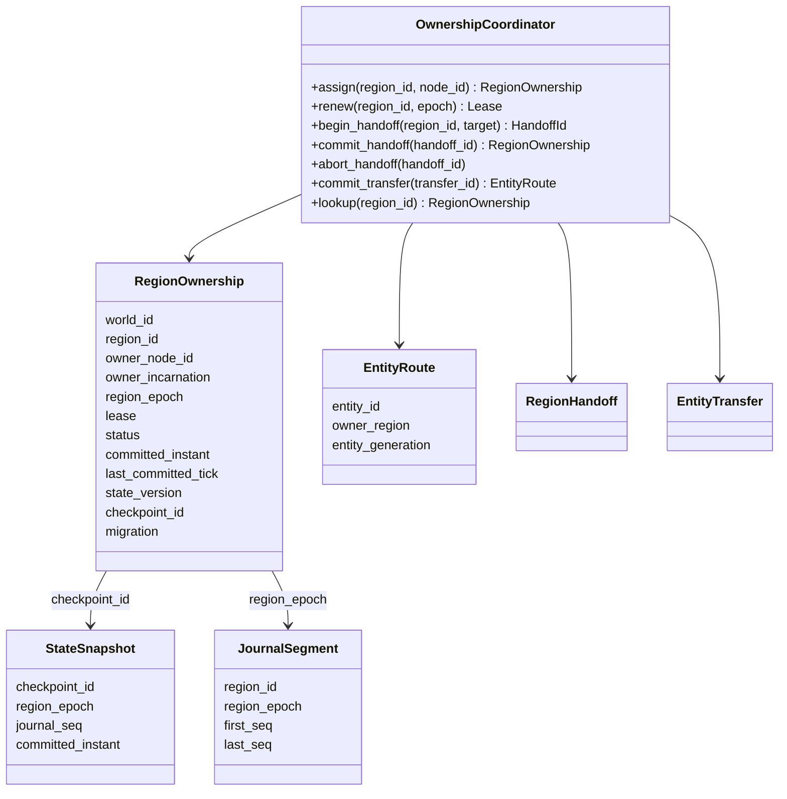
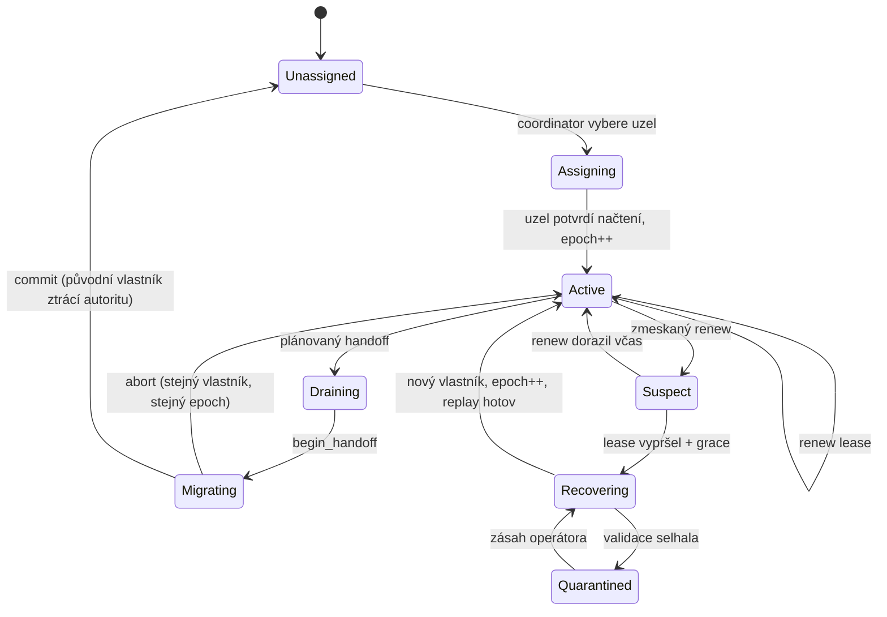
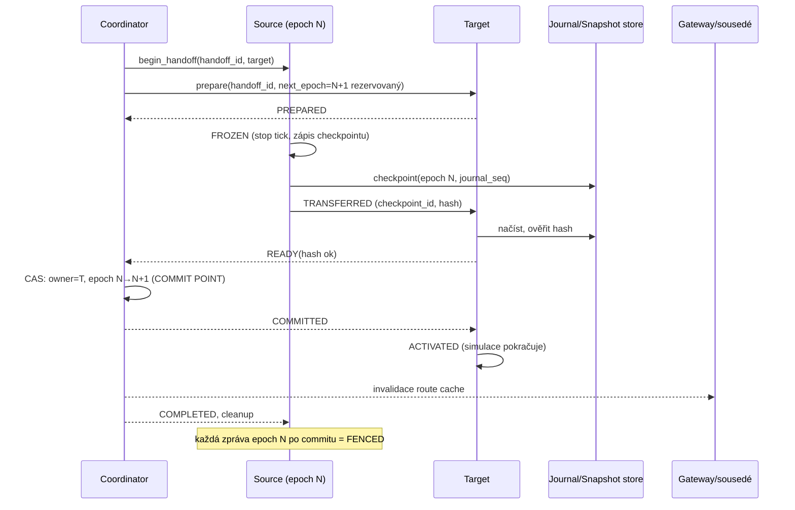
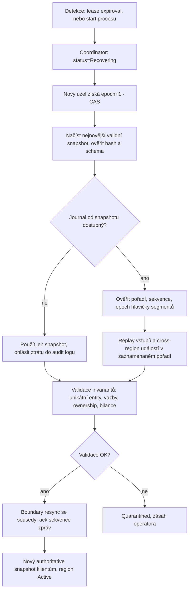

# W05 – Doplňující výzkum 01: Fencing, ownership a fault recovery

Autor: Worker 05. Fáze: architektonický výzkum, žádná implementace. Kód jen jako ilustrační datové struktury.
Vstupy: `audit/WORKER_10_REVIEW.md` (§2 CONFLICT-004, §6 Region Ownership, R05, ADR-008/009, VAL-008/010), `research/worker-05/w05-original.md` (§2.6, §6.2, §6.4, §7, §9.2–9.6), `research/worker-09/w09-original.md` (§5.1–5.5, §7.1–7.2, §11, §12.5–12.6). Ostatní původní výzkumy jen grepem na slova ownership/epoch.
Značení: **ověřeno** (primární/technický zdroj nebo doslova v původních výzkumech), **návrh** (rozhodnutí tohoto dokumentu), **odhad** (číslo bez měření, nutno ověřit benchmarkem).

---

## 1. Shrnutí rozhodnutí

| ID | Rozhodnutí | Status |
| --- | --- | --- |
| D-01 | Autorita se uděluje nad **ownership regionem** (ne nad hráčem, ne nad spatial regionem). Jednotka fencingu je `(world_id, ownership_region_id)`. | návrh |
| D-02 | Fencing token je dvouúrovňový: `region_epoch: u64` (vydává coordinator) a `entity_generation: u32` (zvyšuje se při každém převodu entity/islandu mezi regiony). Porovnává se lexikograficky. | návrh |
| D-03 | `owner_epoch` v `EntityPhysicalState` (W10 §6) = `region_epoch` regionu, který entitu naposledy převzal. Samostatné entity-epoch W09 se redukuje na `entity_generation`. | návrh |
| D-04 | **Ownership Coordinator** je samostatná logická služba nad linearizovatelným úložištěm. Není to Node.js control plane a není to Rust simulační proces. Node.js je jen klient (operátorské příkazy, plánování). | návrh |
| D-05 | Lease slouží k **dostupnosti** (detekce selhání), fencing k **bezpečnosti** (nikdy dva vlastníci). Bezpečnost nesmí záviset na hodinách. Kontrola tokenu se provádí na straně příjemce (journal, snapshot store, soused, gateway). | ověřeno princip (Kleppmann), návrh aplikace |
| D-06 | Lease a TTL se měří výhradně v `WallClock`/monotonním čase coordinatoru a uzlu. Nikdy ne ve `WorldInstant` (shoda s W10: WallClock = provozní čas). | návrh |
| D-07 | Rozlišujeme dvě operace: `RegionHandoff` (region mění proces/uzel, mění se `region_epoch`) a `EntityTransfer` (entita/island mění region, mění se `entity_generation`). W05 a W09 popisují každý jednu z nich a oba je nazývají „migrace“. | návrh |
| D-08 | Commit point migrace je jediná atomická operace (compare-and-swap) v coordinatoru. Před ní lze vždy provést rollback, po ní vždy roll-forward. | návrh |
| D-09 | Recovery pořadí: **nejdřív získat nový epoch, potom číst snapshot a replay**. (W05 §6.2 má „obnovit ownership“ až jako krok 6; W09 §7.2 má epoch v kroku 3. Přijímá se W09.) | návrh |
| D-10 | Persistence = hybrid journal + snapshot (ADR-008). Journal zaznamenává **vstupy a cross-region události v pořadí**, ne jen výsledky. Replay je obnova stavu, ne záruka bitové identity (CONFLICT-008). | návrh |
| D-11 | RPO/RTO se definují po třídách dat (§4.6). Stage 1 cíl: RPO ≤ 1 s wall času u fyziky, RPO = 0 u ekonomických transakcí; RTO ≤ 30 s. | odhad |
| D-12 | Už ve Stage 1 platí: epoch, exkluzivní zámek datového adresáře, podmíněný zápis journalu, stavový automat migrace mezi logickými regiony, crash-recovery test. Neplatí: externí consensus store, síťové leases. | návrh |

---

## 2. Řešené konflikty W10

| CONFLICT / riziko | Rozhodnutí | Odůvodnění |
| --- | --- | --- |
| CONFLICT-004 (ownership region vs physics island) – část ownership | Island má jednoho vlastníka = jeden `ownership_region`. Vlastník islandu je zapsán v registru a nese se v tokenu `(region_epoch, entity_generation)`. Soused dostává jen read-only ghosty označené tokenem. Podrobnosti o vzniku/merge/splitu islandu **závisí na W02**. | Převod islandu je jedna transakce `EntityTransfer` nad množinou entit (atomicky, viz §4.3). Samostatná migrace kola by rozdělila island (příklad W10). |
| R05 / VAL-008 (split-brain) | Tři vrstvy ochrany: (1) coordinator vydává monotónní epoch, (2) příjemci odmítají nižší token, (3) vlastník se sám „self-fencuje“, když mu hrozí vypršení leasu. | Samotný lease nestačí: proces se může zastavit (GC, swap, SIGSTOP, výpadek sítě) a po probuzení si myslet, že je vlastník. **ověřeno** (Kleppmann 2016). |
| ADR-009 (Ownership coordinator: fenced ownership s konzistentním registry) | Registry je linearizovatelné KV s CAS (etcd/Raft třída, nebo Postgres serializable jako alternativa). Epoch je hodnota v registru; nikdy se nesnižuje ani neresetuje. | Odpovídá W05 §6.4 („nezávislý konzistentní mechanismus“) a W09 §5.4 (strong consistency pro ownership). |
| ADR-008 (Persistence) | Journal + snapshot, každý zápis nese `(region_id, region_epoch, journal_seq)`. Úložiště odmítne zápis s epochou nižší než nejvyšší dosud viděnou. | Fencing na úložišti je poslední obrana, když zombie vlastník ještě píše. |
| CONFLICT-003 (Entity state) – ownership část | `EntityPhysicalState.authority` = `{owner_region, owner_node, owner_epoch}` + doplněno `entity_generation`. | Odpovídá W10 §6; pole navíc je nutné pro fencing převodů mezi regiony v rámci jednoho epoch. |
| CONFLICT-005/008 – dotek | Region nese `committed_instant: WorldInstant` a mapu `last_committed_tick[domain]`. Jedno pole `simulation_tick` (W05, W09) se ruší. | W10: DomainTick je lokální krok subsystému. Podrobnosti watermarků **závisí na W09**. |

---

## 3. Kontrakty

### 3.1 Informační model



### 3.2 Sloučený `RegionOwnership` (**návrh**)

Sjednocuje W05 §9.2, W09 §11.2 a W10 §6 (Region ID, Owner Node, Authority Epoch, Lease expiration, Committed WorldInstant, Last committed DomainTick, State version, Checkpoint ID, Migration status).

```rust
// Ilustrační struktura, ne implementace.
struct RegionOwnership {
    world_id: WorldId,
    region_id: OwnershipRegionId,        // ownership region, ne spatial region (W10 CONFLICT-004)

    owner_node_id: NodeId,                // W09/W10 "owner node" (stabilní identita uzlu)
    owner_incarnation: u64,               // W05 "owner_process_id": každý start procesu = nová inkarnace
    region_epoch: u64,                    // fencing token, monotónní, nikdy se nevrací

    lease: Lease,                         // viz níže
    status: RegionStatus,                 // viz §4.1

    committed_instant: WorldInstant,      // watermark: do tohoto okamžiku je stav regionu potvrzen (W01/W09)
    last_committed_tick: Map<DomainId, DomainTick>,  // nahrazuje jediný simulation_tick
    state_version: u64,                   // roste při každém commitu regionu

    checkpoint_id: CheckpointId,          // poslední validní snapshot
    journal_seq: u64,                     // poslední potvrzená pozice journalu

    migration: Option<MigrationRef>,      // aktivní RegionHandoff, jinak None
    schema_version: u32,
}

struct Lease {
    granted_at_coordinator: WallClockMono, // čas coordinatoru
    ttl_ms: u32,
    expires_at_coordinator: WallClockMono,
    renew_counter: u64,                    // diagnostika, není fencing token
}
```

Pravidla (**návrh**):

1. `region_epoch` se mění jen v coordinatoru, jen operacemi `assign`, `commit_handoff`, `recover`. Mění se vždy o +1.
2. `owner_incarnation` + `region_epoch` jsou odlišné. Restart procesu téhož uzlu na tomtéž regionu **vyžaduje nový epoch** (starý proces mohl být jen pozastaven).
3. `lease` se nikdy nezapisuje do journalu fyziky. Je to provozní stav registru.
4. `committed_instant` a `last_committed_tick` zapisuje vlastník do registru jen při checkpointu (ne každý tick). Registr není hot path.

### 3.3 `EntityRoute` a token entity (**návrh**)

```rust
struct FencingToken {            // porovnání: lexikograficky (region_epoch, entity_generation)
    region_epoch: u64,
    entity_generation: u32,
}

struct EntityAuthority {         // pole "authority" v EntityPhysicalState (W10 §6)
    owner_region: OwnershipRegionId,
    owner_node: NodeId,
    owner_epoch: u64,            // = region_epoch při posledním převzetí
    entity_generation: u32,      // +1 při každém EntityTransfer
}
```

Proč dvě úrovně: `EntityTransfer` mezi dvěma regiony téhož uzlu nemění `region_epoch` žádného z nich, ale stará strana nesmí po commitu entitu dál měnit. Kdyby se zvyšoval epoch regionu při každém příjmu entity, neplatily by tokeny ostatních entit v cílovém regionu.

### 3.4 `RegionHandoff` a `EntityTransfer` (**návrh**)

```rust
struct RegionHandoff {
    handoff_id: Uuid,
    world_id: WorldId,
    region_id: OwnershipRegionId,
    source: (NodeId, u64 /*incarnation*/),
    target: (NodeId, u64),
    previous_epoch: u64,
    next_epoch: u64,                 // rezervován coordinatorem při begin
    checkpoint_id: CheckpointId,
    checkpoint_hash: [u8; 32],
    journal_seq_at_freeze: u64,
    state: HandoffState,             // viz §4.2
    deadline_wall: WallClockMono,    // po něm automatický abort, pokud není COMMITTED
}

struct EntityTransfer {
    transfer_id: Uuid,
    entity_ids: Vec<EntityId>,       // celý island / složená entita najednou (W02, W03)
    source_region: OwnershipRegionId,
    target_region: OwnershipRegionId,
    source_generation: Vec<u32>,
    state_version: Vec<u64>,
    instant_of_transfer: WorldInstant, // okamžik přechodu, dohodnutý přes watermarky (závisí na W09)
    state: TransferState,
}
```

### 3.5 Pravidla příjemce (kontrola tokenu)

| Příjemce | Co kontroluje | Reakce na starý token |
| --- | --- | --- |
| Journal / snapshot store | `region_epoch >= max_seen[region_id]`; při vyšším zvedne `max_seen` | odmítnout zápis, vrátit `FENCED`, zaznamenat do auditu |
| Soused (boundary data, ghosty) | token zprávy odpovídá aktuálnímu `region_epoch` odesílatele v lokální kopii registru | zahodit, vyžádat nové `lookup` |
| Gateway / replikace | `RegionOwnership` z cache s krátkým TTL; zprávy klientovi nesou epoch | klient ignoruje nižší epoch |
| Příkaz hráče | **gateway** doplní `expected_owner_epoch` (viz rozpor N-08); vlastník odmítne nesouhlas a odpoví redirectem | `WRONG_OWNER` + nový route |
| Ekonomická transakce | idempotency key + epoch vlastníka v záznamu | duplicitní/zastaralé odmítnout |

Idempotency key (W05 §6) a fencing token jsou **dvě různé ochrany**: první brání dvojímu provedení téhož příkazu, druhý brání provedení příkazu nevlastníkem.

---

## 4. Algoritmy a stavové automaty

### 4.1 Stav regionu a lease



Stav `Suspect` je jen pohled coordinatoru. Vlastník sám při `remaining_lease < safety_margin` přechází do **self-fence**: přestane zapisovat do journalu a odesílat autoritativní zprávy, simulaci smí držet v paměti.

Lease parametry (**odhad**, ladit benchmarkem): `ttl = 10 s`, renew každé `ttl/3`, `safety_margin = 2 s`, `grace = 2 s`.

Bezpečný odhad konce leasu na straně vlastníka (měřeno lokálním monotonním časem, odeslání požadavku se bere jako začátek):

```
local_expiry = t_send_renew + ttl * (1 - rho)  - safety_margin
```

`rho` je horní odhad driftu monotonních hodin (např. 1e-3). Coordinator uzel prohlásí za mrtvý až po `ttl + grace`. Doba přepnutí po pádu:

```
T_failover ≈ ttl_remaining + grace + T_acquire + T_restore + T_replay
```

Podstatné: pokud odhad hodin selže, **fencing token stále brání dvojí autoritě**. Hodiny ovlivňují jen délku výpadku, ne korektnost (**ověřeno** princip: Kleppmann).

### 4.2 Protokol `RegionHandoff`

Spojuje W05 §2.6 (7 kroků, 7 stavů) a W09 §5.3 (6 kroků). Rozdíl: W09 nechává „ownership reservation“ na cílovém regionu; zde ji provádí coordinator (ADR-009).



Stavy (`HandoffState`): `PREPARING → FROZEN → TRANSFERRED → COMMITTED → ACTIVATED → COMPLETED`, plus `ABORTED`. Shodují se s W05 §9.5.

Přechodová tabulka (**návrh**; to, co W05 označil jako „je potřeba přesně definovat“):

| Stav | Událost | Další stav | Efekt |
| --- | --- | --- | --- |
| PREPARING | cíl `PREPARED` | FROZEN | zdroj zastaví tick, vyprázdní výstupní fronty |
| PREPARING | timeout / cíl selže | ABORTED | zdroj pokračuje, epoch beze změny |
| FROZEN | checkpoint zapsán | TRANSFERRED | zdroj stále vlastník (epoch N) |
| FROZEN | zdroj padl | ABORTED nebo recovery | viz tabulka selhání |
| TRANSFERRED | cíl `READY` | COMMITTED | **CAS v coordinatoru** |
| TRANSFERRED | hash nesedí / cíl padl | ABORTED | zdroj se rozmrazí, epoch N platí |
| COMMITTED | cíl `ACTIVATE` | ACTIVATED | zdroj už nesmí zapisovat |
| COMMITTED | cíl padl před aktivací | roll-forward do Recovering | cíl-nebo-jiný uzel obnoví z checkpointu + journalu, epoch++ |
| ACTIVATED | redirect hotov | COMPLETED | cleanup zdroje |

Selhání v každém kroku (požadavek W05 „definovaná obnova při pádu v každém kroku“):

| Selže | Ve stavu | Důsledek | Obnova |
| --- | --- | --- | --- |
| Zdroj | PREPARING/FROZEN | autorita stále u zdroje (epoch N) | lease vyprší; coordinator rozhodne: abort handoffu a recovery na zdroji, nebo dokončit handoff cílem z posledního checkpointu (ztráta ≤ RPO) |
| Zdroj | TRANSFERRED | totéž, checkpoint už existuje | preferovat dokončení handoffu cílem (checkpoint je čerstvý) |
| Zdroj | po COMMITTED | irelevantní, ztratil autoritu | cleanup později |
| Cíl | před COMMITTED | zdroj stále vlastník | ABORT, rozmrazit zdroj |
| Cíl | po COMMITTED, před ACTIVATED | nikdo neaktivní | coordinator zahájí `Recovering` s `epoch+1`, mezera = lease grace |
| Coordinator | kdykoli | registry bez většiny | simulace běží dál (autorita se jen neobnovuje); nová migrace/recovery nelze; po obnově coordinatoru se handoffy s propadlým `deadline` abortují |
| Síť (partition) zdroj↔coordinator | jakýkoli | zdroj nemůže renew | zdroj self-fenceuje, po expiraci jiný uzel převezme s `epoch+1`; zdroj po návratu dostane `FENCED` |
| Duplicitní zpráva | jakýkoli | idempotence | každý přechod nese `handoff_id` + sekvenci; opakování je no-op |

### 4.3 Protokol `EntityTransfer` (entita nebo island mezi regiony)

Používá se u přechodu vozidla přes hranici (W09 §5.3). Platí i v jednom procesu (Stage 1).

1. `Reserve`: cílový region potvrdí kapacitu a čas přechodu `instant_of_transfer` (dohodnutý přes watermarky; **závisí na W09**).
2. `Serialize`: zdroj zmrazí celou množinu entit islandu (**závisí na W02** pro určení množiny) a odešle kanonický stav včetně `state_version`.
3. `Commit`: v coordinatoru (nebo u Stage 1 v in-process registru) atomicky `owner_region := target`, `entity_generation += 1` pro všechny entity transakce. Jediná transakce, všechno nebo nic.
4. `Activate` na cíli, zdroj změní entity na read-only ghost s novým tokenem.
5. Zprávy se starým `entity_generation` jsou odmítnuty.

Pro Stage 3+: když zdroj i cíl patří témuž uzlu, může se `Commit` provést lokálně v registru uzlu, který coordinator deleguje (**návrh**). Pokud je island rozprostřen mezi dvěma uzly, musí se **nejdřív sloučit vlastnictví** (jeden region převezme celý island), teprve potom se fyzika počítá. Distribuované řešení obřích islandů mimo rozsah (závisí na W02).

### 4.4 Ownership coordinator

Komponenty (**návrh**):

| Komponenta | Úloha | Stage 1 | Stage 3+ |
| --- | --- | --- | --- |
| Registry | `RegionOwnership`, `EntityRoute` tabulky, epoch čítače | in-process struktura + WAL na disk | etcd/Raft cluster (3–5 členů) nebo Postgres serializable |
| Lease manager | vydává/obnovuje leases | zbytečný, jediný proces; lease = exkluzivní file lock | síťový, TTL, renew |
| Scheduler | rozhoduje, kdo co vlastní | statické přiřazení | dynamické podle zátěže (W09 §7.3) |
| Failure detector | `Suspect → Recovering` | watchdog nad procesem | lease expirace + heartbeats |
| Audit log | každá změna ownership | soubor | append-only tabulka |

Důležité rysy:

- **ověřeno** (dokumentace): etcd poskytuje transakce s porovnáním `mod_revision` a leases navázané na klíče; election API vrací `LeaderKey` s `rev` a `lease`. Kubernetes `Lease` používá `holderIdentity`, `renewTime`, `leaseDurationSeconds`, `leaseTransitions` a optimistické souběhy přes `resourceVersion`. Obojí je konceptuálně shodné s `RegionOwnership`. Vlastní systém by neměl kopírovat Kubernetes API (nutné je jen CAS + monotónní čítač).
- **ověřeno** (Kleppmann): token musí být monotónně rostoucí a kontrolovaný zdrojem; lease sám bez kontroly na zdroji nechrání proti pozastavenému klientovi. Redlock (bez monotónního tokenu) je nevhodný pro korektnost.
- **návrh**: `region_epoch` odvodit od vlastního čítače uloženého transakčně s ownership záznamem, ne ze systémové revize úložiště. Důvod: epoch nesmí záviset na implementaci KV (kompakce, restore ze zálohy).
- **návrh**: po ztrátě dat registru (disaster) se čítač znovu inicializuje na `max(epoch ve všech journalech) + 2^20` (skok), aby se nikdy neopakoval.
- Node.js control plane (W05 §6.4) smí být nedostupný: běžící regiony dál drží leases přímo u coordinatoru a Rust procesy se k němu připojují samy. Dostupnost coordinatoru je naopak závislost pro nové přidělení a failover (SPOF pro **změny**, ne pro **běh**).

### 4.5 Recovery ze snapshotu a journalu



Pravidla (**návrh**):

1. **Epoch před čtením** (D-09). Bez něj by zombie mohl psát do journalu během replaye.
2. Journal segment má hlavičku `(region_id, region_epoch, first_seq)`. Segment s epochou nižší než následující segment se nesmí „doplnit“ zápisem po ní. Úložiště odmítne `append` s `epoch < max_seen`.
3. Journal obsahuje: příkazy hráčů (s `command_id`), **přijaté** cross-region události s jejich pořadím a sekvencí odesílatele, `EntityTransfer` commity, `WorldMutation` commity (**závisí na W06**), změny časové škály. Ne každý tick stavu.
4. Replay je platný jen v rozsahu determinismu domény (W10 CONFLICT-008). W09 §7.1 správně upozorňuje, že události bez všech vstupů a pořadí nestačí. Proto: pokud doména není deterministická, recovery = snapshot + aplikace pouze **výsledkových** událostí (transakce, převody) a ztráta fyzikálních ticků se hlásí jako RPO.
5. **Konzistentní řez mezi regiony.** Region se obnovuje k vlastnímu watermarku `committed_instant`. Sousedé mohou být dále. Každý snapshot proto nese `sent_seq[neighbor]` a `recv_seq[neighbor]`; po obnově se sousedi dorovnají retransmisí od `recv_seq+1` a duplicitní zprávy se zahodí podle sekvence. Pokud soused už nemá zprávy v bufferu, nutný rollback souseda na starší checkpoint (kaskáda). **Závisí na W09** (boundary protokol, GVT). Pro zamezení kaskád: boundary data se do journalu odesílatele ukládají aspoň do dalšího checkpointu příjemce.
6. Klienti: po recovery dostanou nový autoritativní snapshot a `region_epoch`; reconciliation řeší W07.
7. Ekonomické operace: běží přes samostatnou transakční službu s idempotency key (W05 §6.3). Ztráta fyzikálních ticků nesmí zrušit potvrzenou transakci. Když vozidlo „koupené“ po posledním snapshotu v obnoveném stavu chybí, `EntityTransfer`/mutace se v recovery doplní z transakčního logu (reconcile krok před `Active`).

### 4.6 RPO a RTO

Třídy dat (**návrh**) a cíle (**odhad**, nutno ověřit benchmarkem W09 §12.6):

| Třída | Příklad | RPO | RTO Stage 1 | RTO Stage 3 |
| --- | --- | --- | --- | --- |
| A – transakční | peníze, vlastnictví vozidla, mutace světa | 0 (synchronní durable commit před potvrzením klientovi) | 30 s | `ttl + grace + restore` ≈ 20–40 s |
| B – řídící události | příkazy, převody entit, ownership | ≤ 1 s wall (group commit) | 30 s | 20–40 s |
| C – fyzikální stav | polohy, rychlosti | ≤ interval checkpointu (např. 5–30 s wall), žádný replay u nedeterministických domén | 30 s | 20–40 s |
| D – odvozená data | cache, statistika | neobnovuje se, přepočítá se | – | – |

Vzorce:

```
RPO_physics ≈ min(checkpoint_interval, journal_flush_interval)  [pokud journal vstupů + deterministická doména]
RPO_physics ≈ checkpoint_interval                               [bez replaye]
RTO ≈ T_detect + T_acquire + S/B_read + (J_since_checkpoint / R_replay) + T_validate + T_resync
```

kde `S` velikost snapshotu, `B_read` propustnost úložiště, `J` objem journalu, `R_replay` rychlost replaye. Z toho: zkrácení `checkpoint_interval` snižuje RTO i RPO, zvyšuje I/O. Checkpoint se musí zapisovat asynchronně mimo fyzikální tick (W09 §7.1), např. copy-on-write snapshot ECS.

Poznámka k časovým škálám: RPO se vyjadřuje ve **wall clock** sekundách, ne ve `WorldInstant`. Při 1000× akceleraci času 1 s wall = 1000 s světového času, a ztráta může být pro hráče viditelná; proto je interval checkpointu u regionů s `time_scale > 1` **kratší nebo adaptivní podle světového času** (**návrh**; závisí na W09/W07).

### 4.7 Co platí už ve Stage 1

Stage 1 = jeden Rust proces, logické regiony (shoda s W05 §7.1 a W10).

| Mechanismus | Stage 1 | Poznámka |
| --- | --- | --- |
| `RegionOwnership` struktura a `region_epoch` | ANO | epoch se zvyšuje při každém načtení regionu a každém restartu procesu |
| Exkluzivní file lock na datovém adresáři (+ PID/inkarnace) | ANO | brání dvěma procesům nad stejnými daty (nejpravděpodobnější „split-brain“ ve Stage 1: překryv starého a nového procesu při restartu/deployi) |
| Podmíněný zápis journalu podle epoch | ANO | levné, zachytí chyby v kódu a pozdní zápisy po „odebrání“ regionu |
| `EntityTransfer` mezi logickými regiony | ANO | stejná stavová logika jako později, transport in-process; token `entity_generation` |
| Handoff regionu na jiný proces | NE | simuluje se jen v testu (dva procesy, lokální) |
| Síťový lease, failure detector | NE | nahradí watchdog/supervizor procesu |
| Externí consensus store | NE | stačí lokální WAL registru |
| Journal + snapshot + recovery | ANO | včetně crash-injection testů |
| Boundary resync (`sent_seq/recv_seq`) | ČÁSTEČNĚ | sekvence ano, retransmise ne (jediný proces) |

Důvod nasazení už ve Stage 1: mnohem levnější je mít jediný kód přechodů a pouze měnit transport, než dodatečně vložit fencing do hotové simulace. **návrh**.

---

## 5. Rozhraní na ostatní workery

| Vazba | Dodávám já | Očekávám |
| --- | --- | --- |
| **závisí na W01** | – | typ `WorldInstant` (šířka, jednotka), serializace pro `committed_instant` a `instant_of_transfer`; 6D stav entity se při převodu přenáší ve společném rámci |
| **závisí na W02** | `EntityTransfer(entity_ids[])` atomický nad množinou; pravidlo „island má jednoho vlastníka“ | definice vzniku/merge/splitu islandu; seznam entit v islandu v okamžiku `Reserve`; hysteréze proti oscilaci vlastníka (nový převod nejdřív po `min_transfer_interval`) |
| **závisí na W03** | složené entity (postava ve vozidle) se převádějí jako jedna transakce | seznam komponent složené entity |
| **závisí na W06** | journal položka `MutationCommitted`; mutace přes hranici regionu má token `(region_epoch, entity_generation)` nebo ekvivalent pro region | stavový automat mutace, `world_revision`; mutace v recovery musí být idempotentní |
| **závisí na W07** | `ReplicationSnapshot` nese `region_epoch`; po recovery se pošle nový autoritativní snapshot | pravidla reconciliation při změně epoch (klient zahodí predikci pod starým epochem) |
| **závisí na W09** | `RegionOwnership.committed_instant`, `last_committed_tick`, `sent_seq/recv_seq` ve snapshotu | boundary protokol, watermark/GVT, pořadí cross-region událostí v journalu, politika zpožděných zpráv; dohoda, že `region_epoch` je součástí hlavičky každé boundary zprávy |
| **W10** | kontrakty §3, VAL-5xx | potvrzení D-02/D-03 a ADR-009 |

Rozhraní, které navrhuji pro W09 (hlavička každé zprávy mezi regiony/uzly):

```rust
struct MessageEnvelope {
    world_id: WorldId,
    source_region: OwnershipRegionId,
    source_epoch: u64,                 // fencing
    target_region: OwnershipRegionId,
    expected_target_epoch: Option<u64>,
    sender_seq: u64,                   // pořadí a idempotence (dedup)
    world_instant: WorldInstant,       // okamžik události
    payload_kind: u16,
}
```

---

## 6. Validační testy (VAL-5xx)

Navazují na VAL-008 (nikdy dva autoritativní vlastníci) a VAL-010 (snapshot + replay).

| ID | Scénář | Kritérium | Stage |
| --- | --- | --- | --- |
| VAL-501 | Dva procesy nad týmž datovým adresářem | druhý odmítne start; žádný zápis do journalu z druhého | 1 |
| VAL-502 | Restart procesu s „zombie“ vláknem píšícím starým epochem | zápis `FENCED`, journal obsahuje jen záznamy platného epochu | 1 |
| VAL-503 | Epoch monotonie po 1000 restartech a po ztrátě registru | epoch se nikdy neopakuje ani nesníží | 1 |
| VAL-504 | Pozastavení vlastníka (SIGSTOP) delší než `ttl`, pak probuzení | po probuzení self-fence nebo `FENCED`; ani jeden autoritativní zápis po výměně vlastníka (**VAL-008**) | 3 |
| VAL-505 | Síťová partition vlastník↔coordinator | vlastník přestane zapisovat před `expires_at`; jiný uzel převezme až po `ttl+grace`; nikdy dva zároveň | 3 |
| VAL-506 | Handoff regionu bez selhání | po COMPLETED 0 ztracených a 0 duplicitních entit; downtime změřen | 3 |
| VAL-507 | Handoff: pád zdroje v každém ze stavů PREPARING..COMPLETED (crash-injection) | konzistentní výsledek podle tabulky §4.2; entity právě jednou | 1 (in-process) / 3 |
| VAL-508 | Handoff: pád cíle v každém stavu | zdroj se rozmrazí nebo roll-forward; ≤ 1 vlastník | 1/3 |
| VAL-509 | Pád coordinatoru uprostřed handoffu | po obnově: abort po `deadline` nebo dokončení; žádný dvojí commit | 3 |
| VAL-510 | Duplicitní a zpožděné zprávy po commitu (epoch N) | všechny odmítnuty, `FENCED` metrika; stav beze změny | 1 |
| VAL-511 | `EntityTransfer` vozidla se 4 koly přes hranici | atomicky všech 5 entit, vazby zachovány, `entity_generation` +1 (**VAL-007** část ownership) | 1 |
| VAL-512 | `EntityTransfer` při pádu uprostřed commitu | buď celý island ve zdroji, nebo celý v cíli | 1 |
| VAL-513 | Recovery: snapshot + journal, náhodný pád v libovolném ticku | stav po obnově = stav z posledního durable bodu; invarianty OK (**VAL-010**) | 1 |
| VAL-514 | Recovery nedeterministické domény | ztráta ≤ RPO třídy C; hlášeno do audit logu; žádná „halucinovaná“ historie | 1 |
| VAL-515 | Poškozený poslední snapshot / zkrácený journal | fallback na starší snapshot, zjištěná ztráta, ne tichá chyba | 1 |
| VAL-516 | Recovery se souběžným během sousedního regionu | boundary resync podle `recv_seq`; nulové duplicitní/ztracené zprávy (součást **VAL-013**) | 3 |
| VAL-517 | Ekonomická transakce během failoveru (retry klienta) | provedena právě jednou (idempotency key), ani při změně vlastníka | 1 |
| VAL-518 | Změřit RPO a RTO podle tříd A–D | splnění cílů §4.6 nebo schválená změna cílů | 1/3 |
| VAL-519 | 1000 regionů, současných 50 handoffů | žádné deadlocky, ≤ 1 vlastník každého regionu, throughput změřen | 4 |
| VAL-520 | Hysteréze vlastníka islandu na hranici (oscilace vozidla) | počet převodů ≤ limit; žádný převod rychleji než `min_transfer_interval` | 1 |

---

## 7. Nové rozpory mezi původními w01–w09, které W10 nemá

| ID | Rozpor | Zdroje | Navržené řešení |
| --- | --- | --- | --- |
| N-01 | **Granularita epochu.** W05 má `owner_epoch` na regionu; W09 má na entitě (`Owner Epoch: 42` u entity i u regionu §11.2). W10 §6 má pole v entitě i v regionu a nerozlišuje. | W05 §9.2; W09 §5.3, §11.1–11.2 | Dvouúrovňový token (D-02). |
| N-02 | **Dvě různé „migrace“.** W05 migruje *region* mezi procesy; W09 migruje *entity* mezi regiony. Oba používají stejné slovo i stejnou epochu. | W05 §9.5; W09 §11.3 | `RegionHandoff` vs. `EntityTransfer` (D-07). |
| N-03 | **Kdo rozhoduje o ownership.** W05: coordinator atomicky mění vlastníka; W09: cílový region „potvrdí a rezervuje“, scheduler detekuje pád. | W05 §2.6 krok 4; W09 §5.3 krok 3, §7.2 | Coordinator (ADR-009); region a scheduler jsou jen účastníci. |
| N-04 | **Pořadí obnovy.** W05: obnova ownership je krok 6 z 7 (po replayi). W09: nový epoch je krok 3 (před načtením). | W05 §6.2 C; W09 §7.2 | W09 pořadí (D-09). |
| N-05 | **`simulation_tick` jediný vs. DomainTick.** W05, W09 mají jedno čítadlo regionu; W10 zavádí lokální DomainTick per subsystém. | W05 §9.2; W09 §11.2 | `last_committed_tick: Map<DomainId, DomainTick>` + `committed_instant`. |
| N-06 | **Identita vlastníka.** W05 `owner_process_id`, W09 `owner_node`, W10 `Owner Node`, W09 entity `owner_region`. Restart téhož uzlu není rozlišen. | W05 §9.2; W09 §11 | `owner_node_id` + `owner_incarnation`; restart = nový epoch. |
| N-07 | **Replay vs. determinismus.** W05 „načíst eventy a provést replay“ předpokládá, že replay obnoví stav. W09 §7.1 upozorňuje, že fyziku nelze vždy rekonstruovat z událostí. | W05 §6.2 C; W09 §7.1 | Journal zaznamenává vstupy a pořadí; replay jen pro deterministické domény; jinak RPO (D-10). |
| N-08 | **`expected_owner_epoch` v příkazu hráče.** W05 §9.3 ho dává do `PlayerCommand`, klient by tedy musel znát interní epoch. To je únik interního stavu a klient může lhát. | W05 §9.3 | Doplňuje gateway z route cache; klient posílá jen `entity_id` a `sequence_number`. |
| N-09 | **Konzistentní řez při recovery nikdo nepopisuje.** W05 obnovuje „region“, W09 popisuje boundary protokol, ale žádný nespecifikuje, co když se sousedé po obnově vracejí v čase. | W05 §6.2; W09 §5.5, §7.2 | `sent_seq/recv_seq` ve snapshotu, retransmise, případně kaskádní rollback (§4.5 bod 5). |
| N-10 | **RPO/RTO.** W09 §12.6 jen říká, že musí existovat. W05 je nedefinuje. | W09 §12.6 | Třídy A–D, cíle §4.6. |
| N-11 | **Co je vlastník: region nebo island?** W05 a W09 „automobil musí mít jednoho vlastníka“, ale vlastnictví drží region; W10 přidává island. Není definováno, zda island je zapsán v registru. | W05 §2.6; W09 §5.3; W10 CONFLICT-004 | Registr drží jen regiony a `EntityRoute`; island je odvozený (W02) a při převodu se transakčně vytvoří route pro všechny jeho entity. |
| N-12 | **Lease a čas.** W09 §5.5 má per-region `time_scale`; žádný dokument výslovně neříká, že lease se měří wall časem, ne světovým. Při akceleraci času by lease ve `WorldInstant` expiroval 1000× rychleji. | W09 §5.5; W10 CONFLICT-001 | D-06. |

---

## 8. Otevřené otázky pro uživatele / ADR

1. **Technologie coordinatoru ve Stage 3+** (ADR-009): etcd (Raft, hotové lease/CAS) vs. Postgres (už je v zásobníku pro persistenci, jednodušší provoz, pomalejší failure detection) vs. vlastní Raft v Rustu (vysoká cena). Návrh: etcd-kompatibilní rozhraní za traitem, ve Stage 1 lokální implementace. **Potřeba rozhodnutí.**
2. **Cíle RPO/RTO** (§4.6) jsou odhady; je přijatelné, aby hráč při pádu regionu ztratil až desítky sekund fyzikálního stavu? Jiná odpověď pro hru a pro vědeckou simulaci?
3. **Synchronní durable commit** pro třídu A: kde končí hranice transakční služby (W05 §6.3) a simulace (kdo je zdrojem pravdy o vlastnictví vozidla)?
4. **Ztráta journalu**: povolit provoz s degradovanou konzistencí (snapshot jen), nebo region zablokovat (`Quarantined`)? Návrh: u třídy A blokovat, u C povolit s auditem.
5. **Retence a důkaz auditu ownership** (kdo a kdy vlastnil region): jak dlouho archivovat? Souvisí s ADR-008.
6. **Epoch skok po disaster recovery** (`+2^20`): přijatelné, nebo vyžadovat externí zálohu čítače?
7. **Geo režim (Stage 5)**: lease přes datacentra má jiné TTL; per-region coordinator vs. globální? Mimo rozsah tohoto kola, ale tokeny `u64` a oddělení vrstev to nezakazují.
8. **Velikost ownership regionu**: kolik regionů ve světě (stovky vs. miliony)? Ovlivňuje zátěž registru (renew storm: N regionů × 1/(ttl/3) požadavků za sekundu; při 10 000 regionech ≈ 3 000 renew/s, lze batchovat leasy per uzel). **odhad**
9. Má se kontrola tokenu u příjemců pozdržet až do Stage 3? Doporučení: ne, journal a `EntityTransfer` ji mají od Stage 1 (§4.7).

---

## 9. Zdroje

Interní (**ověřeno** čtením):

- `audit/WORKER_10_REVIEW.md`: §2 CONFLICT-004, §6 Region Ownership, §9 VAL-008/010, §10 R05, §11 ADR-008/009.
- `research/worker-05/w05-original.md`: §2.6 (epoch, migrační protokol, ghosty), §6.2 (recovery), §6.4, §7.1–7.5 (stage), §9.2–9.6 (kontrakty, stavy migrace).
- `research/worker-09/w09-original.md`: §5.1–5.5 (ownership, migrace, konzistence, distributed time), §7.1–7.2 (journal, crash recovery), §11.1–11.3 (kontrakty), §12.5–12.6 (testy, RPO/RTO).

Webové (3 vyhledávání, jen snippety a výtahy, ne celé stránky):

- Martin Kleppmann, „How to do distributed locking“, https://martin.kleppmann.com/2016/02/08/how-to-do-distributed-locking.html. Plyne z něj: lease bez fencingu je nebezpečný pro korektnost (pozastavený klient po expiraci); fencing token je monotónně rostoucí číslo vydané při získání zámku a kontrolované úložištěm, které odmítne nižší hodnotu; Redlock nemá monotónní token. (Potvrzeno z výtahu; text příspěvku jsem v celku nečetl.)
- etcd API, https://etcd.io/docs/v3.5/learning/api/ a https://etcd.io/docs/v3.6/learning/api_guarantees/. Plyne z nich: transakce s porovnáním `mod_revision`, leases navázané na klíče, election služba (Campaign, Resign, Leader) s `LeaderKey{name,key,rev,lease}`; jedna transakce = jedna revize. **Nezjištěno**: oficiální popis semantiky `LeaseKeepAlive` a doporučená recepta na fencing přes `Txn` (nutno ověřit před ADR-009).
- Kubernetes Lease API, https://kubernetes.io/docs/reference/kubernetes-api/coordination/lease-v1/. Plyne z něj: pole `holderIdentity`, `acquireTime`, `renewTime`, `leaseDurationSeconds`, `leaseTransitions`; optimistický souběh přes `resourceVersion`; čekání `leaseDuration` + grace před převzetím. Použito jako referenční model polí, ne jako závislost.

Neověřeno webem (z původních výzkumů, bez nezávislé kontroly): Agones jako orchestrátor procesů (W05 §7.5), IEEE 1516-2025 HLA (W09 §5.4). Hodnoty TTL, grace, RPO/RTO a rychlosti replaye jsou **odhad**.
