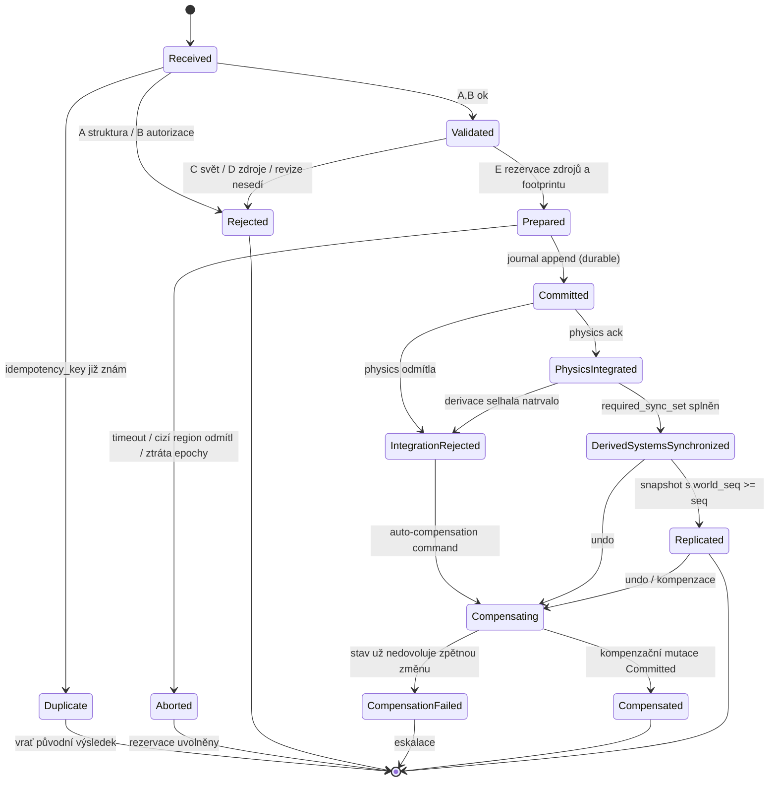
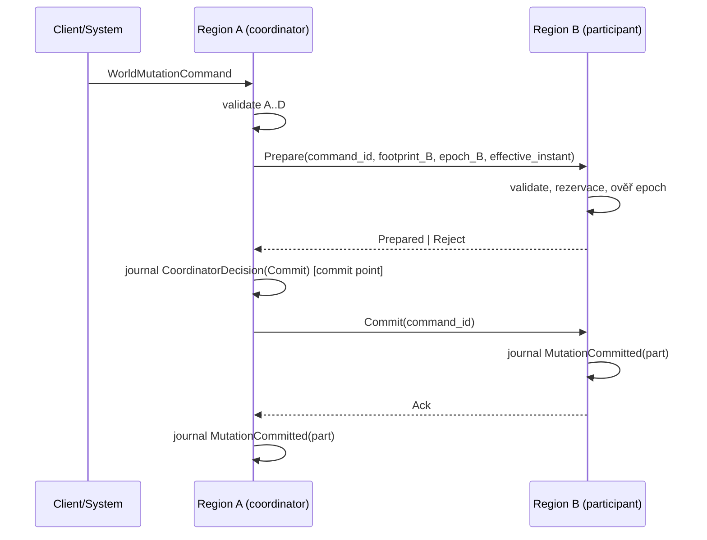
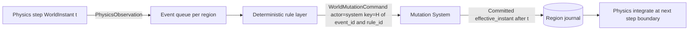

# W06 Supplement 01 – World Mutation lifecycle a revision consistency

Stav: návrh pro druhý audit Workeru 10. Fáze architektonického výzkumu, žádná implementace; kód jen ilustrační datové struktury. Značení: **ověřeno** (primární zdroj nebo původní výzkum), **návrh**, **odhad**.
Vazby: CONFLICT-006, R08, ADR-013, VAL-009. Nové testy: VAL-6xx.
Zdroje v repu: `audit/WORKER_10_REVIEW.md` §2 (CONFLICT-006), §6, §9, §10, §11; `research/worker-06/w06-original.md` §5, §7.6, §10.2, §10.3, §11; grepem w02 (queued mutation commands), w05 (journal, idempotency, expected_owner_epoch), w07 (state_revision), w01 (world_revision).

---

## 1. Shrnutí rozhodnutí

| ID | Rozhodnutí | Status |
| --- | --- | --- |
| D6-01 | Mutace má tři skupiny stavů: **rozhodovací** (Received → Validated → Prepared → Committed / Rejected / Aborted), **integrační** (Committed → PhysicsIntegrated → DerivedSystemsSynchronized → Replicated) a **kompenzační** (Compensating → Compensated / CompensationFailed). | návrh |
| D6-02 | `Committed` = durable zápis `MutationCommitted` do journalu vlastnické oblasti. Od té chvíle je to neměnný historický fakt; nelze ho rollbackovat, jen kompenzovat novou mutací. | návrh |
| D6-03 | Selhání integrace do fyziky po commitu se neřeší rollbackem: (a) prevence – Stage C volá read-only physics pre-check u vlastníka islandu, (b) když i tak selže, vzniká automaticky kompenzační příkaz. | návrh |
| D6-04 | `world_revision` není jeden globální čítač. Je to per-region monotónní sekvence `(region_id, owner_epoch, seq)`; „globální“ pohled je `RevisionVector`. | návrh |
| D6-05 | Atomicita = jedna vlastnická oblast (Ownership region) na transakci. Cross-region operace přes koordinátora (vlastník primárního cíle) a Prepare/Commit s rezervacemi; saga s kompenzacemi jen pro dlouhé/ekonomické workflow. Žádná globální DB transakce. | ověřeno (W06 §5.4) + návrh protokolu |
| D6-06 | Physics → event → Mutation: fyzika nikdy nemutuje svět přímo. Emituje `PhysicsObservation`; pravidlový systém vyrobí `WorldMutationCommand` s `actor_type=system`, `causation_id` a deterministickým `idempotency_key = H(event_id, rule_id)`. Aplikuje se na hranici kroku, ne uprostřed integrace. | návrh |
| D6-07 | Souběžné mutace: optimistická kontrola `expected` revizí + footprint (entity + prostorový konfliktní set); pořadí v regionu určuje jediný zapisovatel journalu, pořadí cross-region `(effective_instant, region_id, causation_depth, command_id)`. | návrh |
| D6-08 | Idempotence: `idempotency_key` + tabulka výsledků atomicky s journalem téže oblasti; opakované doručení vrací původní `MutationResult`. | návrh |
| D6-09 | Čas v příkazu: `simulation_time.tick` z W06 originálu se nahrazuje `requested_instant` / `effective_instant` typu `WorldInstant`. `DomainTick` v příkazu není. | návrh (závisí na W01) |
| D6-10 | Stage 1 (jeden Rust proces, logické regiony): Prepare/Commit degeneruje na jeden atomický append do společného journalu; koordinátor je in-process. Kontrakty se nemění. | návrh |
| D6-11 | Dva oddělené čítače u entity: `state_version` (mění Physics, W10 §6) a `structure_revision` (mění Mutation). Obě `u64`. | návrh |

---

## 2. Řešené konflikty W10

| Conflict | Rozhodnutí | Odůvodnění |
| --- | --- | --- |
| **CONFLICT-006** (mutation vs. fyzikální autorita) | Mutation System rozhoduje, zda a co se ve světě změní (autorizace, zdroje, přípustnost); Physics Runtime rozhoduje, jak se to fyzikálně chová, a geometrii převezme až po `Committed`. Hranice je stav `PhysicsIntegrated`. Fyzika může integraci odmítnout (`IntegrationRejected`), což spustí kompenzaci. | W10 požaduje čtyři oddělené stavy; W02 už povoluje externím systémům jen frontu příkazů a zakazuje přímou souběžnou mutaci – Mutation je jediný producent strukturálních příkazů. |
| **CONFLICT-006 – kdy je objekt plně aktivní** | Herně/fyzikálně použitelný je v `DerivedSystemsSynchronized` pro povinné derivace; plně aktivní pro klienty v `Replicated`. Každý typ mutace deklaruje `required_sync_set`. | W06 §11.2: engine musí definovat, které operace čekají na derivace; navigace může nový most dočasně ignorovat, kolize nikoli. |
| **R08** (mutation revision lag) | Revision vector + staleness budget per subsystém; dotazy nesou `min_revision`, dostanou data nebo `Stale`. | W06 §11.2 je základ; chyběla pravidla pro konzumenty. |
| **ADR-013** | Potvrzuji „Revision-based transakční model“ a upřesňuji: optimistická konkurence + single-writer region journal + 2PC-like/saga jen cross-region. | §3–4 |
| **CONFLICT-003 (okrajově)** | Fyzikální krok nesmí zvyšovat `structure_revision`; mutace nesmí měnit 6D stav kromě inicializace nové entity. | Dvě autority nezapisují týž čítač. |
| **CONFLICT-001/005 (okrajově)** | Vlastník regionu přiřadí `effective_instant` ≥ committed watermark regionu; mutace se nevkládá pod watermark. | D6-09; závisí na W01/W09. |

---

## 3. Kontrakty

### 3.1 WorldMutationCommand (návrh, ilustračně)

```
WorldMutationCommand {
  command_id:        uuid
  idempotency_key:   uuid | bytes32      // u system příkazů odvozený z causation
  command_type:      string              // PlaceBridge, ModifyTerrain, ...
  schema_version:    u32
  actor:             { actor_id, actor_type: player|system|ai|admin, permissions_context }
  target_region:     RegionId            // vlastnická oblast primárního cíle
  expected:          ExpectedRevisions
  requested_instant: WorldInstant        // NE tick
  causation_id:      uuid?               // event/command, který to vyvolal
  correlation_id:    uuid                // celý workflow
  footprint:         Footprint           // entity ids + AABB v ReferenceFrame
  payload:           bytes               // typed per command_type
  expected_owner_epoch: u64?             // fencing z W05
}

ExpectedRevisions {
  region_seq:  u64?
  entities:    map<EntityId, u64>        // structure_revision
  derived:     map<SubsystemId, u64>?    // jen pokud příkaz potřebuje čerstvou derivaci
}
```

Odchylky od W06 §5.2: `simulation_time.tick` → `requested_instant`; přidány `footprint`, `causation_id`, `correlation_id`, `expected_owner_epoch` (sloučení s W05 command kontraktem).

### 3.2 MutationRecord / MutationResult

```
MutationRecord {            // journal, neměnný
  mutation_id, command_id, idempotency_key
  region_id, owner_epoch, seq            // RevisionStamp (seq jen u Committed)
  journal_pos                            // každý záznam, i Rejected
  effective_instant: WorldInstant
  status_at_commit: Committed | Rejected
  reject_reason?: enum
  events: [WorldEvent]                   // envelope dle W06 §10.3
  affected_regions: [RegionId]
  affected_entities: map<EntityId, new_structure_revision>
  required_sync_set: [SubsystemId]
}

MutationResult {
  command_id, status: MutationStatus
  stamp: RevisionStamp
  integration: map<SubsystemId, { state: Pending|Done|Rejected|Failed, revision? }>
  compensation_of?: mutation_id
}
```

### 3.3 RevisionVector

```
RevisionVector {
  region_id
  world_seq:     u64
  per_subsystem: map<SubsystemId, u64>   // terrain, collision, navigation, economy, replication, environment
  watermark:     WorldInstant            // committed watermark regionu (W09)
}
// invariant: per_subsystem[s] <= world_seq
// lag[s] = world_seq - per_subsystem[s]  -> metrika R08
```

### 3.4 Mapování W06 `derived_updates` na W10 stavy

| W10 stav | Podmínka | Kdo potvrzuje |
| --- | --- | --- |
| Committed | journal append durable | Mutation System (vlastník regionu) |
| PhysicsIntegrated | kolizní geometrie a vlastnosti registrovány v islandu, `physics_revision ≥ seq` | Physics Runtime |
| DerivedSystemsSynchronized | všechny subsystémy z `required_sync_set` mají `rev ≥ seq` | Derived Sync Tracker |
| Replicated | `ReplicationSnapshot` s `world_seq ≥ seq` odeslán/ack podle interest managementu | Distributed Runtime (W07/W09) |

---

## 4. Algoritmy a stavové automaty

### 4.1 Stavový automat mutace



Pravidla:

- **Rejected** nikdy nevytváří úspěšnou událost (W06 §5.1). Do journalu se zapíše `MutationRecord{status=Rejected}` kvůli idempotenci a auditu; nezvyšuje `world_seq`, jen `journal_pos`.
- **Prepared → Committed** je jediný rozhodovací bod. Rezervace v Prepared mají TTL odvozený z `WorldInstant` a lease vlastníka (W05).
- **IntegrationRejected** není vrácení stavu; je to fakt „svět říká ano, fyzika říká ne“. Důsledek je kompenzační mutace.
- Integrační větev je per subsystém monotónní a může se překrývat; `DerivedSystemsSynchronized` je agregát nad `required_sync_set`. Návrh: fyzika vždy před ostatními (navigace čte kolizní geometrii).

### 4.2 Validační pipeline (W06 §5.3, rozšířeno)

| Stage | Kontrola | Nové oproti W06 |
| --- | --- | --- |
| A | struktura, jednotky (SI typová kontrola, W01), `ReferenceFrame` | `requested_instant` v rozsahu |
| B | autorizace | – |
| C | svět: cíl existuje, `expected` revize, physics pre-check | read-only dotaz do islandu: `Ok / WouldOverlap / Unstable` |
| D | zdroje | – |
| E | transakce: footprint konflikty, rezervace, epoch/lease | `owner_epoch` ověřen těsně před commitem (fencing) |

Physics pre-check je neautoritativní a může zastarat (TOCTOU), proto D6-03 počítá s `IntegrationRejected`. **Odhad:** při dobrém pre-checku bude vzácné; nezměřeno.

### 4.3 Commit pravidla a journal

```
RegionJournal (append-only, jediný zapisovatel = vlastník s platnou epochou)
  entry := { journal_pos, region_id, owner_epoch, seq?, effective_instant,
             kind: MutationCommitted | MutationRejected | IntegrationAck |
                   Compensation* | CoordinatorDecision | Checkpoint,
             payload, prev_hash? }
```

- **Fencing:** záznam s `owner_epoch` nižší než registrovaná úložiště odmítne. Mutace nezavádí vlastní fencing, jen jej používá. *Závisí na W05.*
- **Idempotency table** je součást téže durable jednotky jako journal: lookup `idempotency_key → MutationResult` je součástí atomického commitu (jinak crash mezi commitem a zápisem klíče vede k duplicitě). **Návrh.**
- **Transactional outbox** pro derivace: `MutationCommitted` je zároveň outbox zpráva; relay publikuje at-least-once, subsystémy musí být idempotentní (sledují `world_seq` nebo deduplikují event_id). **Ověřeno** (microservices.io: relay může publikovat opakovaně, spotřebitel musí být idempotentní).
- **Crash recovery:** replay journalu od posledního `Checkpoint`; mutace v `Prepared` bez rozhodnutí se zahodí (rezervace jsou odvozené), `Committed` bez integračních ack se znovu doručí derivacím. Odpovídá W05 recovery (snapshot + replay) a W06 testu „server crash during commit“.

### 4.4 `required_sync_set`

```
required_sync_set per command_type (ilustrace):
  PlaceBridge:       [physics, collision]            // navigation, economy, replication asynchronně
  ModifyTerrain:     [terrain, collision, environment]
  TransferOwnership: [economy]
  ProduceResource:   []
```

Konzument čekající na derivaci používá `min_revision`. Pravidlo: čtení nikdy neblokuje simulační krok; konzument dostane `Stale` a rozhodne se. **Návrh.** Klient (W07) predikuje stavbu až po `Replicated`, do té doby jen neautoritativní preview.

### 4.5 Kompenzace a undo

- Kompenzace je nový příkaz `CompensateMutation{ of: mutation_id, mode: Auto|User|Admin }` procházející celou pipeline.
- Inverze je součástí `command_type` (W06 §5.6: `BuildingPlaced → BuildingDemolished` není skutečný inverz). Kompenzace se vyhodnocuje proti aktuálnímu stavu, ne stavu při původním commitu.
- Po `IntegrationRejected` se svět typicky nezměnil, ale nelze to předpokládat. Existují-li závislé mutace (`causation_id` řetězec), kompenzace jde v obráceném pořadí závislostí, jinak `CompensationFailed` s eskalací.
- Kompenzace je idempotentní (klíč = H(mutation_id, "compensate")). Microsoft Compensating Transaction pattern výslovně uvádí, že kompenzační kroky mohou selhat a mají být opakovatelné. **Ověřeno** (Azure Architecture Center; z výsledku vyhledávání).
- Původní záznam se nikdy nemaže; historie je append-only.

### 4.6 Mutace přes hranici regionů

Tři třídy:

1. **Single-region** (většina): lokální atomický commit.
2. **Cross-region krátká** (stavba přes hranici, přesun vlastnictví): koordinátor = vlastník `target_region`.
3. **Cross-region dlouhá** (logistika, obchod): saga; každý krok lokální mutace s kompenzací.

Protokol třídy 2 (návrh):



Pravidla:

- Commit point = durable zápis rozhodnutí koordinátora; po něm je Commit povinný (participant se po recovery dotazuje koordinátora).
- Rezervace mají krátký TTL; blokování po výpadku koordinátora je známá slabina 2PC, proto jen třída 2. **Odhad:** latence ≈ 2 RTT mezi regiony.
- Změní-li se `owner_epoch` participanta mezi Prepare a Commit (migrace), Prepare je neplatné → Abort, koordinátor může opakovat. *Závisí na W05.*
- Každý region zapíše svou část s vlastním `seq`; společná identita je `(command_id, correlation_id)`. Mutace má `RevisionStamp[]`, ne jedno číslo (viz N-01).
- Koordinátor navrhuje `effective_instant ≥ max(watermarky)`. *Závisí na W09.*
- Ve Stage 1 je Prepare/Commit volání funkce nad jedním journalem; protokol se zachovává kvůli Stage 3+.

### 4.7 Cyklus Physics → event → Mutation



- Fyzika emituje jen pozorování (např. `StructuralFailureObserved{entity, instant}`), ne rozhodnutí. Pravidlový systém vytvoří `DemolishBuilding(cause=Failure)`.
- **Zákaz smyčky bez zpoždění:** mutace vyvolaná krokem `t` má `effective_instant > t`, jinak by fyzika při integraci emitovala pozorování ve stejném instantu. Navíc limit `causation_depth` (návrh 8) s alarmem.
- Determinismus (CONFLICT-008): idempotency_key z `event_id` zaručuje, že replay fyziky vytvoří týž příkaz.
- Rozhraní: Mutation produkuje `PhysicsCommand::ApplyStructuralChange(stamp, geometry_ref, props)` do fronty islandu; Physics je jediný, kdo ji aplikuje. *Závisí na W02.*

### 4.8 Souběžné mutace a pořadí

- V regionu: jediný zapisovatel journalu → totální pořadí `seq`. Paralelní je jen validace, commit je serializovaný.
- Konflikt = průnik `footprint` nebo nesoulad `expected`. První commit vyhrává; druhý dostane `Rejected{StaleRevision | FootprintConflict}` s aktuální revizí. Odpovídá OSM modelu (verze objektu, nesoulad → HTTP 409; **ověřeno** z OSM wiki, přes výsledek vyhledávání). Atomicitu diff uploadu v OSM jsem neověřil a nepoužívám ji jako argument.
- Příkazy bez konfliktu footprintů lze commitnout dávkou (jeden fsync). **Odhad:** výrazně snižuje cenu commitu; měřit.
- Pořadí v jednom instantu: `(effective_instant, region_id, causation_depth, command_id)`; `command_id` u system příkazů deterministický.
- CRDT jen pro neautoritativní draft/blueprint workspace (W06 §5.7); potvrzuji.

### 4.9 Revision consistency pravidla (R08)

1. Subsystém nepublikuje data s revizí > `world_seq`.
2. Každý derived artefakt (kolizní mesh, navmesh, replikační delta) nese `built_from: RevisionStamp`.
3. Konzument s `min_revision` > dostupné dostane `Stale`. Pro kolize je politika fail-closed: nová entita bez `PhysicsIntegrated` se chová jako neexistující (nikdy poloviční).
4. Metriky `lag_seq` a `lag_instant`; alarm při překročení budgetu.
5. Revize se při migraci vlastnictví nepřeměňují: nový vlastník pokračuje v `seq` posledního checkpointu s novou epochou; `(epoch, seq)` je lexikograficky monotónní. *Závisí na W05.*

---

## 5. Rozhraní na ostatní workery

| Worker | Potřebuji / dodávám |
| --- | --- |
| **W01** | Potřebuji: typ `WorldInstant`, pravidla pro `requested_instant` mimo rozsah, `FrameId`, Footprint v kotvě+cell, typovou kontrolu SI ve Stage A. Dodávám: `footprint` jako AABB v daném rámci + cell indexy. |
| **W02** | Potřebuji: `PhysicsPreCheck(footprint, geometry)` (read-only), frontu `ApplyStructuralChange`, rozhraní `PhysicsObservation`. Dodávám: potvrzené mutace s `RevisionStamp`. Vlastník islandu ≠ vlastník regionu mutace (CONFLICT-004). |
| **W05** | Potřebuji: fencing tokeny, lease, journal primitiva, checkpointy, RPO/RTO. Dodávám: idempotency table a Prepare/Commit stavy jako součást recovery. Vlastní vlastnictví nezavádím. |
| **W07** | Potřebuji: `ReplicationSnapshot` nese `world_seq`/RevisionVector. Dodávám: stav `Pending` pro UI preview před `Replicated`. |
| **W08** | Mutace terénu spouští hydrologii; W08 dodá, zda je změna konzervativně remapovatelná a kolik času potřebuje. |
| **W09** | Potřebuji: committed watermark, pravidlo `effective_instant` při cross-region commitu, deterministické pořadí cross-region událostí. Dodávám: `MutationCommitted` s `(effective_instant, region_id, command_id)`. |

---

## 6. Validační testy

Navazují na VAL-009 a W06 test group C.

| ID | Scénář | Kritérium |
| --- | --- | --- |
| VAL-601 | Duplicitní příkaz (stejný `idempotency_key`), i po restartu a po migraci vlastníka | Právě jedna mutace; druhý dotaz vrací identický `MutationResult`. |
| VAL-602 | Crash mezi Prepared a Committed, mezi Committed a odesláním derivací, mezi commitem a zápisem idempotency klíče | Po recovery žádná nebo kompletní mutace; derivace doručeny alespoň jednou a aplikovány právě jednou (idempotentně). |
| VAL-603 | Lifecycle mostu: Place → Committed → PhysicsIntegrated → Synced → Replicated | Vozidlo se nedostane na most před `PhysicsIntegrated`; nikdy poloviční kolizní geometrie. |
| VAL-604 | `IntegrationRejected` (pre-check prošel, fyzika odmítla) | Vznikne kompenzace; zdroje vráceny; `Compensated`; žádné osiřelé rezervace. |
| VAL-605 | Dvě souběžné mutace s překrývajícím footprintem | Právě jedna Committed, druhá `Rejected{FootprintConflict}`; výsledek nezávisí na pořadí doručení při stejném `effective_instant`. |
| VAL-606 | Stale `expected` revize | Odmítnuto se současnou revizí; po opravě klient uspěje. |
| VAL-607 | Cross-region stavba přes hranici, výpadek participanta po Prepare | Abort nebo Commit po recovery, nikdy poloviční stav; rezervace uvolněny po TTL. |
| VAL-608 | Cross-region commit při změně `owner_epoch` participanta | Prepare zneplatněno, žádné dvojí zapsání; navazuje na VAL-008. |
| VAL-609 | Physics → event → mutation: zřícení konstrukce | Mutace vznikne právě jednou i při replayi; `effective_instant` > instant události; limit `causation_depth` funguje. |
| VAL-610 | Revision vector invariant | `per_subsystem[s] ≤ world_seq` vždy; lag metriky odpovídají; `Stale` pro `min_revision`. |
| VAL-611 | Undo po nezávislých a po závislých pozdějších mutacích | První projde, druhý `CompensationFailed` s eskalací; historie nedotčena. |
| VAL-612 | Replay journalu vs. živý běh | Totožný `MutationRecord` stream a konečný `RevisionVector` (po doménách, CONFLICT-008). |
| VAL-613 | Zátěž N mutací/s přes M regionů | Měřit latenci Committed→Replicated a lag; kritérium stanovit po prototypu (**odhad**, bez čísel). |

---

## 7. Nové rozpory mezi původními w01–w09, které W10 nemá

| ID | Rozpor | Návrh řešení |
| --- | --- | --- |
| N-01 | Scalar `world_revision` (W06 příklad 120→121, W01 metadata) vs. regiony s více vlastníky (W05, W09): jeden čítač vyžaduje globální serializaci. | Per-region `(epoch, seq)` + `RevisionVector`. |
| N-02 | `simulation_time.tick` (W06 §5.2) a `simulation_tick` v journalu (W05) vs. W10 `WorldInstant`/`DomainTick`. | `effective_instant` (WorldInstant) v příkazu i journalu; `domain_tick` jen doplněk. |
| N-03 | Tři revizní pojmy: W07 `state_revision: uint32`, W06 entity revision, W10 `state_version`; `uint32` přeteče. | `state_version` (Physics) + `structure_revision` (Mutation), obě `u64`; W07 snapshot nese oba. |
| N-04 | Kdo vlastní ekonomické transakce: W05 chce samostatnou transakční gameplay službu s idempotency key, W06 tvrdí, že Mutation je jediná cesta (vč. rezervací zdrojů, Stage D). | Návrh: inventář/účty jsou agregáty uvnitř téhož region journalu. Pokud W05 trvá na externí DB, rezervace Stage D musí být saga s kompenzací. **Nutné rozhodnutí.** |
| N-05 | Dva kanály příkazů: W05 command (`expected_owner_epoch`, `sequence_number`) vs. W06 mutation command (`expected_revisions`, `idempotency_key`); obojí `command_id`. | Jeden `CommandEnvelope` (W05 transport) + typovaný payload; `WorldMutationCommand` je jeden z payloadů. |
| N-06 | Pořadí: W05 `sequence_number` vs. W06 idempotence bez pořadí. | Idempotence nahrazuje pořadí u jednorázových příkazů; pořadí zajišťuje region journal. |
| N-07 | Rozsah event sourcingu: W06 hybrid jen autoritativní mutace; W05 journal „významné změny“ se `simulation_tick`. Není definováno, co journal nezahrnuje. | Journal = mutace + migrace + checkpointy; kontinuální fyzika = snapshot + deterministický replay po doméně. |
| N-08 | Branch/What-If (W06 §8) vs. revize: větev potřebuje vlastní `seq` prostor. | `BranchId` jako prefix revize; merge = revalidace proti cílové větvi. Jen upozornění pro W10. |
| N-09 | Fyzikální vlastník ≠ vlastník mutace: island může přesahovat regiony, `target_region` je jediný. | Mutace míří na region, `ApplyStructuralChange` na vlastníka islandu; stamp nese obě identity. *Závisí na W02.* |
| N-10 | W02 „direct concurrent mutation prohibited“ vs. W06 „mutace mění svět“: kdo vytváří kolizní geometrii nové entity. | Mutation dodává popis (geometry_ref + props), Physics vytváří runtime objekty. |

---

## 8. Otevřené otázky pro uživatele / ADR

1. **ADR-013 upřesnění:** schválit tři skupiny stavů a že `Committed` je nevratný fakt (kompenzace místo rollbacku).
2. **Ekonomické transakce (N-04):** uvnitř region journalu, nebo samostatná DB služba? Ovlivní Stage 1–3.
3. **Fail-closed vs. fail-open** pro nový objekt bez `PhysicsIntegrated` (návrh: fail-closed pro kolize).
4. **Cross-region třída 2:** akceptovat 2PC-like protokol s blokováním po výpadku koordinátora, nebo omezit stavby tak, aby footprint nepřekračoval hranici regionu? Druhé by výrazně zjednodušilo Stage 1–3, ale omezuje herní design.
5. **Retence idempotency tabulky a journalu** (odhad dny až týdny; závisí na politice klientů a What-If větvích).
6. **Limit `causation_depth`** a politika při překročení (zahodit, odložit, alarm).
7. **`required_sync_set`:** statická tabulka typů příkazů, nebo deklarace v blueprintu?
8. **Měření:** latence commitu/derivací jsou odhad; doporučuji prototyp journalu v Rustu ve Stage 1 jako architektonický spike (VAL-613).

---

## 9. Zdroje

Interní:
- `audit/WORKER_10_REVIEW.md` §2 CONFLICT-006, §6 kontrakty, §9 VAL-001..014, §10 R08, §11 ADR-013.
- `research/worker-06/w06-original.md` §5.1–5.7, §7.6, §10.2–10.3, §11.1–11.2, §14.
- `research/worker-02/w02-original.md` (~ř. 862–880): externí systémy smějí jen fronty příkazů; přímá souběžná mutace zakázána.
- `research/worker-05/w05-original.md` (~ř. 795–812, 876–882, 1130–1142): journal, transakční gameplay služba, `expected_owner_epoch`.
- `research/worker-07/w07-original.md` (~ř. 1255–1266): `state_revision: uint32`.
- `research/worker-01/w01-original.md`: `world_revision` jako metadata.

Web (3 vyhledávání; použity jen výsledky vyhledávání, plné stránky nečteny):
- https://microservices.io/patterns/data/transactional-outbox – relay může publikovat opakovaně, spotřebitel musí být idempotentní (at-least-once). Ověřeno na úrovni výsledku.
- https://learn.microsoft.com/azure/architecture/patterns/saga – sekvence lokálních transakcí s kompenzacemi.
- https://learn.microsoft.com/azure/architecture/patterns/compensating-transaction – kompenzační kroky mohou selhat, mají být idempotentní.
- https://wiki.openstreetmap.org/wiki/API_v0.6 – optimistic locking přes verzi objektu, nesoulad → HTTP 409; atomicita diff uploadu neověřena.
- Neověřeno webem (označeno jako návrh): chování 2PC/cooperative termination, fencing v journalu, deterministické idempotency klíče.
