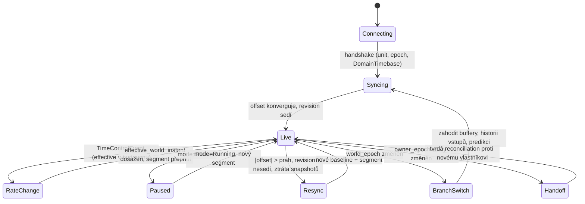
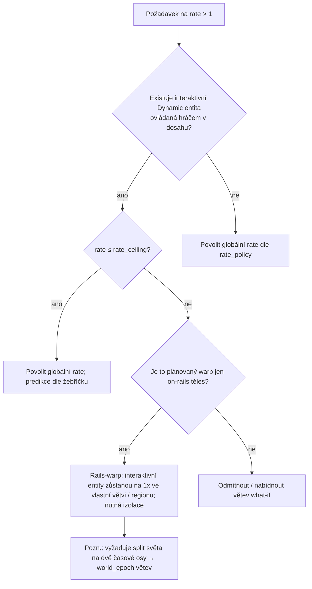

# Worker 07 – Supplement 01: Unity prediction při akcelerovaném čase

Stav: doplňující výzkum kola 1 pro druhý audit Workeru 10. Fáze architektonického výzkumu, žádná implementace; kód jen jako ilustrační datové struktury.
Značení: **ověřeno** (primární zdroj nebo text původních výzkumů), **návrh** (moje architektonické rozhodnutí), **odhad** (číslo bez měření, nutno validovat).
Metoda: `w07-original.md` §5.6, §5.7, §8, §11, §16 a `WORKER_10_REVIEW.md` §2 (CONFLICT-001/005), §6, §9 přečteno po sekcích. Cizí výzkumy (W01, W02, W04, W09) jen grepem. Webová vyhledávání: 4.

---

## 1. Shrnutí rozhodnutí

| # | Téma | Rozhodnutí | Status |
| --- | --- | --- | --- |
| D1 | Tři hodiny klienta | Klient udržuje oddělené: `WallClock` (RTT, timeouty, jitter), `ClientWorldClock` (odhad `WorldInstant` serveru) a `PresentationClock` (co se právě kreslí = odhad − interpolační zpoždění). Nic z toho není `Time.time`. | návrh |
| D2 | Time scale | `TimeControlState` je **stav serveru** (verzovaný, s `effective_world_instant`), ne parametr klienta. Klient ho nikdy nenastavuje, jen žádá (`TimeControlRequest`). Požadovaný rate je cíl pacingu scheduleru, klient pracuje s **dosaženým** rate ze snapshotů. | návrh |
| D3 | Multiplayer a warp | Jeden `WorldInstant` ⇒ jeden rate pro celý svět/větev. Per-player warp v téže časové ose neexistuje. Alternativy: (a) rate zamčený na 1 při přítomnosti interaktivních entit, (b) on-rails warp jen pro tělesa bez interaktivního ovladače, (c) samostatná **větev** (`world_epoch`) pro what-if/jednoho hráče. | návrh |
| D4 | Predikce vs. rate | Predikce je povolena jen dokud je predikční horizont v **simulačním čase** `H_sim = rate · H_wall` menší než platnost modelu entity. Nad prahem klient přechází na interpolaci/analytické vyhodnocení, ne na „rychlejší predikci“. | návrh, prahy odhad |
| D5 | Rate ladder | Rate se mění po schodech (1, 2, 5, 10, 60, …) s rampou naplánovanou na `WorldInstant`; klient nikdy neškáluje interpolační buffer ani timeouty rate. | návrh |
| D6 | Reprezentace entit | Každá replikovaná entita nese `representation_kind` ∈ {Dynamic, OnRails, Static, Kinematic}. OnRails se na klientu vyhodnocuje **analyticky v `WorldInstant`** (elementy + epocha), takže nezávisí na hustotě snapshotů při warpu. | návrh |
| D7 | Floating origin | Origin je čistě klientská věc v double; po drahu se nikdy nepřenáší na wire. Predikční historie a snapshot buffer se drží v (frame, anchor, cell, local) ve W10 tvaru, nikoli v Unity floatech. Rebase = přepočet transformů ze zdrojových souřadnic, ne akumulované odečítání. | návrh |
| D8 | Predikční model | Klient neběží Rust fyziku. Predikuje zjednodušeným kinematickým/dynamickým modelem, který je svázán s `model_version`; při nesouladu verzí se predikce vypíná. | návrh |
| D9 | `ReplicationSnapshot` | Nahrazuje W07 `SnapshotEnvelope.server_tick` (globální tick) strukturou s `world_instant`, `time_control_revision`, per-region `committed_watermark` a per-entity `domain_tick`. | návrh |
| D10 | Reconciliation | Fyzikální korekce a vizuální vyhlazení zůstávají oddělené (potvrzení W07 §5.6, odpovídá Gaffer). Reconciliation je rewind + replay vstupů v `DomainTick` entity; při změně `owner_epoch`, `world_epoch` nebo `time_control_revision` s přeskokem je tvrdý reset. | návrh |

---

## 2. Řešené konflikty W10

| CONFLICT | Rozhodnutí W07 | Odůvodnění |
| --- | --- | --- |
| CONFLICT-001 (globální čas vs. tick), strana klienta | Klient zná `WorldInstant` (celé číslo, jednotku a epochu oznámí handshake) a pro entity, které predikuje, `DomainTick` domény entity. Žádný „globální server tick“ na wire. Převod tick ↔ instant je `DomainTimebase { instants_per_tick: rational, tick0_instant }` poslaný při spawnu entity/domény. | W07 original (§8.1, §11.5) používá `server_tick: uint64` jako jediný čas; to odporuje W10 (žádný povinný globální tick) a W09 (`simulation_tick` regionální). |
| CONFLICT-005 (jedna osa vs. regionální osy), strana klienta | Klient renderuje v `render_instant ≤ min(committed_watermark relevantních regionů) − margin`. Entity z pomalejšího regionu se nenatahují za svůj watermark; buď se extrapolují (jen Kinematic/OnRails) nebo označí `stale`. | Bez toho by při regionálním skew vznikaly vizuální skoky na hranici regionů a pseudo-současnost nesouvisejících stavů (W10: „stavy nelze bez dalšího považovat za současné“). |
| CONFLICT-001, akcelerace | Akcelerace mění mapování WallClock → WorldInstant na scheduleru, nikdy neškáluje timestepy klienta. Predikce při rate > 1 je omezena viz §4.3. | W10: „akcelerace nesmí naslepo násobit timestepy“. W07 §8.2 správně odděluje wall a simulation time, ale nedefinuje, co se stane s predikcí. |
| CONFLICT-003 (stav entity), strana klienta | Wire stav entity = podmnožina `EntityPhysicalState` + `representation_kind`; transformuje se celý 6D stav, včetně ω×r při změně rámce na klientu (kamera v rotujícím rámci). Delta komprese podle `component_mask`. | W07 `EntitySnapshot` má jen `WorldPosition` + rychlosti, bez `frame/anchor/cell`, `domain_tick`, `owner_epoch`. |
| VAL-012 | Rozšířeno na VAL-701..712 (viz §6). | VAL-012 „Korektní reconciliation“ nepokrývá rate, pauzu, větve ani migraci vlastníka. |

---

## 3. Kontrakty

### 3.1 Tři hodiny a jejich vztah (návrh)

```mermaid
flowchart LR
  W[WallClock klienta<br/>RTT, jitter, timeouty] -->|odhad offsetu + rate segmentu| C[ClientWorldClock<br/>Ŵ(t_wall) v WorldInstant]
  C -->|minus D_interp · rate| P[PresentationClock<br/>render_instant]
  C -->|plus H_pred · rate| Q[PredictionClock<br/>input_target_instant]
  S[ReplicationSnapshot<br/>world_instant, achieved_rate,<br/>time_control_revision] --> C
  T[TimeControlEvent reliable] --> C
  P --> R[Render + interpolace + OnRails eval]
  Q --> M[Lokální predikce jen predikované entity]
```

Pravidla:

- Timeouty, RTT, keepalive, jitter filtr běží výhradně na `WallClock`. Při rate 1000 se žádný z nich nezkracuje (potvrzuje W07 §8.2).
- `ClientWorldClock` je po částech lineární: `Ŵ(t) = I_k + rate_k · (t − t_k)`, kde segment `k` začíná při příchodu `TimeControlEvent` nebo při resynchronizaci. Skutečný rate se průběžně odhaduje ze snapshotů (`achieved_rate`), aby server, který nestíhá, neměl za následek driftující klientské hodiny.
- Úpravu klientských hodin dělat plynulým doladěním rychlosti (slew), ne skokem. Unity Netcode for Entities dělá totéž: predikční tick i interpolační zpoždění se upravují postupně a nikdy nejdou zpět v čase (**ověřeno**, dokumentace Netcode for Entities „time synchronization“, „interpolation“). Tento balíček sám nepoužijeme (U07-06 custom protokol), ale přebíráme model dvou časových os: predikce předbíhá, interpolace zaostává.

### 3.2 `TimeControlState` a `TimeControlEvent` (ilustrační)

```text
TimeControlState                       // autoritativní, server, verzovaný
  world_id, world_epoch                // epocha = větev/časová linie (what-if, replay)
  revision: u32                        // monotónní, inkrement při každé změně
  mode: Running | Paused | Replay | Scrubbing
  requested_rate: Rational             // např. 60/1
  rate_ramp: { from, to, start_instant, end_instant } | none
  effective_world_instant: WorldInstant // od kdy platí; > max committed watermark + margin
  achieved_rate: f32                   // měřeno schedulerem (informativní)
  rate_policy: Locked1x | HostControlled | Voted | BranchLocal
  rate_ceiling: Rational               // min přes aktivní interaktivní entity a domény (viz §4.3)

TimeControlRequest                     // klient → control plane (Node.js) → Time Authority
  session_id, requested_rate, reason, request_seq

TimeControlEvent                       // reliable kanál, idempotentní podle revision
  state: TimeControlState
  baseline_world_instant               // pro klienty, co event dostanou pozdě
```

Zásadní bod: `effective_world_instant` musí být **v budoucnosti vůči všem committed watermarkům**, jinak by region, který už simuloval dál, musel vracet čas. Server proto vybírá `effective = max_r(watermark_r) + margin` a event rozešle před dosažením tohoto okamžiku (nebo okamžik ohlásí zpětně jako „platí od příštího snapshotu“). Klient, který event dostal po `effective_world_instant`, použije `baseline_world_instant` a přepočítá segment; kontrolní hodnotou je `time_control_revision` v každém snapshotu (viz §3.3).

### 3.3 `ReplicationSnapshot` (ilustrační, rozšiřuje W10 §6 a W07 §11.5)

```text
ReplicationSnapshot
  protocol_version: u16
  world_id, world_epoch: u64           // změna epochy = zahodit buffery
  time_control_revision: u32           // nesedí-li s klientem → resync časových hodin
  world_instant: WorldInstant          // okamžik, pro který je snapshot sestaven
  achieved_rate: f32
  snapshot_sequence: u32, baseline_id: u32
  groups[]:                            // 1 skupina = 1 vlastnící region/island
    owner_region, owner_epoch
    committed_watermark: WorldInstant  // dokdy je stav skupiny potvrzený
    entities[]:
      entity_id, state_version
      representation_kind: Dynamic | OnRails | Kinematic | Static
      domain_id, fidelity_level, model_version
      domain_tick: u64                 // lokální tick domény entity
      frame_id, anchor_id, cell, local_position   // W10 hierarchická pozice
      orientation (smallest-three), linear_velocity, angular_velocity (kvantizované dle typu)
      rails: { elements | polynomial, epoch_instant, valid_until } | none
      ack_input_sequence: u32 | none   // jen pro řízenou entitu příjemce
      component_mask, flags
```

Změny proti W07 §11.5: odstraněn globální `server_tick`; přidány `world_epoch`, `time_control_revision`, per-group watermark/owner_epoch, `representation_kind`, `rails`. Kvantizace zůstává dle W07 §7.3 (hierarchické kódování), ale „region/tile ID“ závisí na výsledku W01 supplementu (cube-sphere vs. H3/S2) – **závisí na W01**.

### 3.4 Vstup klienta

```text
InputCommand
  session_id, controlled_entity_id
  input_sequence: u32
  client_world_estimate: WorldInstant   // co si klient myslí, že je server teď
  target_domain_tick: u64               // tick domény řízené entity (ne globální)
  time_control_revision: u32            // vstup vznikl pod tímto rate; server může odmítnout stará revize
  input_schema_version: u16
  payload: bytes                        // záměr: řízení, plyn, brzda; ne poloha
```

Server vstup aplikuje na první `DomainTick ≥ target` po příchodu (s malým vstupním bufferem). Pozdní vstup se neodmítá, ale použije se na nejbližším ticku a ack to vrátí (`ack_input_sequence` + skutečný `domain_tick`), takže klient replayuje správně. **Návrh.**

---

## 4. Matematika, algoritmy, stavové automaty

### 4.1 Odhad času serveru (návrh, standardní postup)

Klient posílá `ping` s `t_send_wall`, server vrací `W_server`, `t_recv_server_wall`. Odhad offsetu `θ` s filtrem minimálního RTT z posledních N vzorků (NTP-like): `θ = W_server + RTT_min/2 − Ŵ_local`. Offset se uplatní slewem ≤ ±ε (např. ±2 % rate), při |θ| > prah (např. 250 ms wall) tvrdý resync. Rate segmentu se bere z `TimeControlEvent`, ne z měření offsetu; měření slouží jen k detekci rozdílu mezi `requested_rate` a `achieved_rate`.

Důležité: filtr offsetu pracuje ve **wall čase**. Při přepnutí rate se offset v `WorldInstant` nesmí interpretovat jako chyba (jinak klient po změně rate „koriguje“ legitimní změnu). Proto se segment (`I_k, t_k, rate_k`) mění atomicky s příchodem eventu a offset se počítá vůči novému segmentu.

### 4.2 Interpolační zpoždění

Gaffer On Games uvádí pro 10 snapshotů/s minimální interpolační zpoždění 100 ms a prakticky ≈150 ms s ohledem na jitter (**ověřeno**, Gaffer „State Synchronization“). Obecně (návrh):

`D_wall = max(2 · Δ_snap_wall, jitter_p95 + Δ_snap_wall)`

kde `Δ_snap_wall` je interval snapshotů ve wall čase. `D_wall` je **vždy ve wall čase**; v simulačním čase je `D_sim = rate · D_wall`. Důsledek: při rate 60 a 20 snapshotech/s je mezera mezi snapshoty 3 s simulačního času a interpolační zpoždění 9 s simulačního času. Lineární interpolace polohy po oběžné dráze nebo rotaci přes takovou mezeru je chybná (akord místo oblouku). Proto D6: pro OnRails entity klient nepoužívá snapshoty, ale `rails` parametry; pro Dynamic entity platí strop rate (§4.3).

### 4.3 Platnost predikce vs. rate

Označme `H_wall = RTT/2 + t_input_buffer + t_server_proc` (horizont, o který klient předbíhá server) a `H_sim = rate · H_wall`. Chyba predikce vyvolaná nemodelovaným vlivem (jiný hráč, náraz, vítr) roste přibližně úměrně `δa · H_sim²/2` (odhad pro konstantní nemodelované zrychlení `δa`); chyba v rychlosti `δv · H_sim`. Platnost predikce entity typu `T` je tedy omezena `H_sim ≤ H_valid(T)`, tj.

`rate_pred_max(T) = H_valid(T) / H_wall`.

Ilustrační čísla (**odhad**, nutno ověřit VAL-702): `H_wall = 0,10 s`; `H_valid(character) = 0,25 s`, `H_valid(car) = 0,30 s`, `H_valid(aircraft) = 0,50 s`. Pak `rate_pred_max` ≈ 2,5 / 3 / 5. Nad těmito hodnotami klient predikci pro daný typ vypne. Vzhledem k tomu, že interaktivní fyzika (W02: autoritativní interaktivní tick 60 Hz, vozidla s substeps) při rate ≫ 1 není stabilní bez snížení kroku, očekávám, že W03 stanoví `rate_ceiling` pro doménu Interaktivní na 1 až malé jednotky; W07 jen dodává `rate_pred_max` jako vstup do `rate_ceiling`. **Závisí na W03.**

Prediction ladder (návrh):

| Rate | Lokální hráč / vozidlo (Dynamic) | Vzdálené Dynamic | OnRails (loď, planeta, satelit) | Stavby, ekonomika, edit světa |
| --- | --- | --- | --- | --- |
| ≤ 1 | plná predikce + reconciliation | interpolace snapshotů | analytické vyhodnocení | beze změny |
| (1, `rate_pred_max`] | predikce, kratší história, vyšší práh korekce | interpolace, větší `D_wall` jen pokud jitter | analytické | optimistický náhled, server potvrdí |
| > `rate_pred_max` | **bez predikce**, input jen jako žádost; entita se kreslí z interpolace | interpolace s omezením (viz §4.2), jinak „rozmazání“ (stopa) | analytické, přesnost určuje server | beze změny |
| Pauza (0) | zmrazeno, vstupy držet ve frontě / zahodit dle domény | zmrazeno | zmrazeno | UI funguje, commit až po obnovení nebo v paused-editor módu |

### 4.4 Stavový automat klientských hodin



### 4.5 Reconciliation

Pro predikovanou entitu `e` s historií `H = [(seq, input, predicted_state)]`:

1. Snapshot nese `ack_input_sequence = a` a stav po zpracování vstupu `a`, s `domain_tick` a `world_instant`.
2. Vyřaď `H` do `a` včetně.
3. Porovnej `predicted_state(a)` s autoritativním stavem v prahové metrice (poloha, orientace, rychlost; práh závisí na typu a rate).
4. Je-li chyba pod prahem „tichá korekce“: nastav fyzikální stav na autoritativní a replayuj zbylé vstupy; vizuální rozdíl rozlož do dohlazovací vrstvy (offset klesající exponenciálně).
5. Je-li chyba nad prahem „snap“: tvrdý reset, bez dohlazování (zabraňuje klouzání skrz zdi).
6. Při `owner_epoch`, `world_epoch` nebo `model_version` změně: `H` zahodit a nepokračovat v replayi.

Vizuální dohlazení se **nikdy** nevrací do predikčního stavu (shodně s W07 §5.6). Replay se děje v `DomainTick` entity, nikoli v Unity FixedUpdate. Unity `fixedDeltaTime` a `Time.timeScale` se nepoužívají jako simulační hodiny: dokumentace uvádí, že při změně `timeScale` bez úpravy `fixedDeltaTime` zůstává fyzikální rate konstantní vůči herním hodinám, nikoli vůči real-time, a že `maximumDeltaTime` omezuje množství simulovaného fyzikálního času mezi snímky (**ověřeno**, Unity manuál TimeFrameManagement / `Time.timeScale`). Z toho plyne, že výchozí Unity smyčka by při velkém `timeScale` buď zahazovala čas, nebo se zahltila. Doporučení: simulation-time adapter (už v W07 §8.3) + lokální Unity fyzika jen pro vizuální proxy a v režimu manuálního kroku (vlastnost `Physics.simulationMode`; v této rešerši **neověřeno**, ověřit v ADR/spike).

### 4.6 Floating origin a časový warp

Klientský origin `O` (double, v rámci aktuálního `frame_id`/`anchor_id`):

`P_local = float(P_src − O)`, kde `P_src` je pozice z (cell, local) v double na klientovi, **nikdy** z již odečtené float hodnoty.

- Rebase při překročení prahu `R` (např. 2–5 km, **odhad**; float má při 5 km krok ≈ 0,5 mm, při 100 km ≈ 8 mm). Rebase mění jen `O`; transformy se přepočítají z `P_src`.
- Predikční historie `H` a snapshot buffer se ukládají v `P_src` (anchor-relative double). Důsledek: rebase nepotřebuje přepisovat historii a nevzniká driftová chyba z opakovaného odečítání (potvrzuje W07 §2.4 „don't repeatedly subtract“).
- Při rychlém pohybu (letadlo 250 m/s, orbitální těleso 7,8 km/s × rate) by kamera překročila práh `R` každý frame. Řešení: origin následuje kameru plynule per-frame (každý frame přepočet), ne po prazích, a velmi vzdálené objekty se kreslí kamera-relativně se samostatným škálováním (W07 §3.7 rendering – nepřebírám).
- Změna referenčního rámce kamery (z ECEF-rotujícího na inerciální při opuštění atmosféry): transformuje se 6D stav včetně ω×r; při přepnutí klient drží `PresentationClock` ve spojitosti, rámec mění jen reprezentaci. **Závisí na W01** (ReferenceFrameTransform) a **W03** (kdy se rámec mění).
- Multiplayer: každý klient má vlastní `O`; server o něm neví. Dva klienti vidí stejný `WorldInstant` a stejný autoritativní stav (shoda s W01 §multiplayer, řádek 336).

### 4.7 Multiplayer a time warp (rozhodovací strom)



Rozhodnutí (návrh): v jednom `world_epoch` platí jeden rate pro všechny. Chce-li jeden hráč warp, zatímco jiní hrají 1×, musí dostat vlastní **větev** (`world_epoch'` forknutý z aktuálního stavu), v níž ostatní hráči nejsou. Alternativa „on-rails warp“ (každý hráč má svůj projekt, loď na rails se posouvá rychleji než zbytek světa) porušuje jediný `WorldInstant` a W10 CONFLICT-005 ji dovoluje jen jako explicitní boundary synchronization s extrapolací. Doporučuji ji **nezavádět** v MVP. Otevřená otázka uživateli (§8, Q1).

### 4.8 Šířka pásma a události při warpu

Počet simulačních událostí za wall sekundu roste s rate (srážky, spawn, tranzity). Replikace musí škálovat podle wall času, nikoli simulačního: snapshoty mají konstantní wall frekvenci a při vyšším rate se mění jen jejich obsah. Události (W07 §11.6) se při `rate > r_event` agregují na digesty (např. „dopravní nehody v regionu za posledních 60 s“). Rozpočet pásma dle W07 §12.4 platí ve wall čase; **závisí na W08** (jak často se environmentální pole aktualizují při warpu) a **W09** (event bus).

---

## 5. Rozhraní na ostatní workery

| Závisí na | Co potřebuji | Navržené rozhraní |
| --- | --- | --- |
| W01 | Jednotka a šířka `WorldInstant`, epocha, konverze TAI/UTC; `ReferenceFrameTransform` pro klienta; schéma cell/anchor na wire (cube-sphere vs. H3/S2) | `handshake: {instant_unit, instant_epoch, frame_graph_version}`; klient má knihovnu pro transformaci 6D stavu (shodná testovací sada v Rustu a C#, W07 §14.6) |
| W02 | Pravidla `DomainTick` entity, hranice island/owner; chování při migraci vlastníka | `owner_epoch` + `Handoff` stav klienta (§4.4); server při migraci pošle plný baseline entity |
| W03 | `rate_ceiling` per doména, fidelity přechody (on-rails ↔ plná fyzika) viditelné pro klienta | `fidelity_level`, `representation_kind`; změna reprezentace je událost s `effective_world_instant`; klient se přepíná mezi analytickým vyhodnocením a interpolací bez skoku (kontinuita 6D stavu je povinnost serveru) |
| W04 | Kdo vlastní `set_time_scale` / `set_simulation_time` | W04 API `set_time_scale` volá **Time Authority**, ne klient; W07 posílá jen `TimeControlRequest` |
| W08 | Frekvence environmentálních aktualizací při warpu | Environment pole replikovat jako verzovaná pole s `world_revision`, ne per-frame |
| W09 | Event bus, ordering cross-region událostí, persistence replay | `world_epoch` a `time_control_revision` v log záznamech; replay klient = stejný protokol, rate řízen serverem |
| W10 | Rozhodnutí o ADR-011/012, kanonický `ReplicationSnapshot` | §3.3 jako návrh k schválení |

Já nepřebírám: matematiku frame transform (W01), physics island (W02), integrátory a handoff (W03), conservation coupling (W08).

---

## 6. Validační testy

Navazuje na VAL-012 „Korektní reconciliation“ a VAL-006 „Multirate: konzistentní WorldInstant“. Číslování VAL-7xx.

| ID | Scénář | Kritérium (hranice jsou odhad, nutno kalibrovat) |
| --- | --- | --- |
| VAL-701 | Odhad `ClientWorldClock` při jitteru 0–100 ms a ztrátě 0–5 % | po konvergenci |chyba| < 1 snapshot interval; žádný zpětný skok `render_instant` |
| VAL-702 | Predikce hráče a vozidla při rate 1, 2, 5, 10; RTT 20–200 ms | do `rate_pred_max` korekce pod prahem v 95 % ticků; nad prahem predikce vypnuta a nevzniká nekonečná rekonciliace |
| VAL-703 | Atomicita `TimeControlEvent`: 50 klientů, náhodná latence | všichni přepnou segment na stejný `effective_world_instant` (rozdíl v render instantu ≤ 1 snapshot interval), žádný region nemusí jít zpět |
| VAL-704 | Pauza a obnovení po 60 s wall | žádný timeout spojení, interpolační buffer nezaplaven, vstupy po obnovení správně zpracovány |
| VAL-705 | Změna rate 1→60→1 se zatíženým serverem (achieved < requested) | klient používá `achieved_rate`; offset nekmitá; žádný drift hodin > prahu |
| VAL-706 | 10^6 rebase cyklů floating origin při jízdě po ECEF povrchu | rozdíl `P_local` oproti jednorázovému výpočtu < 1 mm; historie predikce nepoškozena |
| VAL-707 | Migrace vlastníka během predikce (owner_epoch++) | žádné zdvojení entity, tvrdý reset bez teleportu větším než práh, žádné dva zdroje autority na klientu |
| VAL-708 | Přepnutí `world_epoch` (větev, replay scrub) | buffery a historie zahozeny, žádná entita ze staré epochy v nové scéně |
| VAL-709 | Regionální skew watermarků (A o 200 ms před B) | žádný vizuální skok na hranici; stale entity označeny |
| VAL-710 | OnRails analytický vs. serverová pravda při rate 1000 po 24 h simulačního času | odchylka < tolerance dané serverem (`rails.valid_until` respektováno) |
| VAL-711 | Ztráta a přeuspořádání `TimeControlEvent` a snapshotů (reliable vs. datagram) | klient detekuje nesoulad `time_control_revision` a provede Resync do ≤ N snapshotů |
| VAL-712 | Šířka pásma při rate 1, 10, 100 s 10⁴ entit v AOI | pásmo konstantní ve wall čase v rámci tolerance; události agregovány |

---

## 7. Nové rozpory mezi původními w01–w09, které W10 nemá

1. **W07 `server_tick` (§8.1, §11.3, §11.5) vs. W09 `simulation_tick` regionální vs. W10 bez globálního ticku.** W07 psal klientský protokol nad jednou tick osou; po CONFLICT-005 je třeba per-skupinový watermark a per-entity `domain_tick`. (ověřeno grepem w09 řádek 497 a W07 §8.1)
2. **W04 `set_time_scale` / „jedna univerzální osa“ vs. multiplayer.** W04 definuje příkaz bez pojmu *kdo smí* a bez dopadu na jiné hráče; W07 §8.2 nastavuje „time acceleration, pauses, replays, alternate what-if timelines“ jako cíl, ale nikoho nenapadlo, že rate ve sdíleném světě je kolektivní zdroj. Nutné rozhodnutí `rate_policy` (D3). (ověřeno W04 tabulka příkazů, W07 §8.2)
3. **W07 §8.3 lokální Unity fyzika vs. W02/W03 Rust integrace.** Predikce vyžaduje, aby klientský model odpovídal serverovému; W02 používá vlastní rozpočet tick/substeps a W03 různé integrátory. Bez `model_version` a sdíleného kinematického modelu (sdílené testovací vektory) predikce divergence. Nikdo nedefinuje parity model.
4. **W02 autoritativní interaktivní tick 60 Hz (řádek 159) vs. W07 prediction horizon v tickách.** W07 `target_server_tick` nerozlišuje domény; vozidlo 120 Hz (W10 příklad) a postava 60 Hz mají různé ticky.
5. **W07 `WorldPosition` (frame, body, region, double ECEF) vs. W10 hierarchická pozice (anchor, cell, local) vs. W05 H3/S2 vs. W01 cube-sphere.** Wire reprezentace tile ID je nerozhodnutá; ovlivňuje kvantizaci (W07 §7.3). Čeká na W01 supplement.
6. **W07 U07-05 „Evaluate QUIC“ vs. W10 ADR-011 „QUIC / datagramy podle typu provozu“.** W10 už rozhodl; W07 měl jen doporučení k prověření. QUIC datagramy (RFC 9221) jsou nespolehlivé, nefragmentují se a podléhají congestion control společně se spolehlivými streamy (**ověřeno**), což je pro `TimeControlEvent` (reliable stream) a snapshoty (datagram) vhodné, ale podpora v Unity klientovi a ve WebGL není ověřena (otevřeno).
7. **W01 řádek 336 „dva klienti mají různé origin“ vs. W07 §2.4** jsou kompatibilní, ale žádný z nich neřeší, jak origin interaguje s predikční historií (D7).

---

## 8. Otevřené otázky pro uživatele / ADR

- **Q1 (ADR):** Smí v jednom světě existovat per-player / per-region rate (extrapolace mezi časovými osami), nebo jen globální rate + větve? Moje doporučení: jen globální rate + větve pro MVP.
- **Q2 (ADR):** `rate_policy` pro sdílený svět: kdo smí měnit rate (host, hlasování, role)? Co dělá server, když rate nelze splnit (omezení výkonu)?
- **Q3:** Podporovat ve vozidlech/letadlech vůbec predikci nad 1× (H_valid čísla jsou odhad), nebo rate pro interaktivní entity zamknout na 1×? Potřeba měření spiku.
- **Q4:** Unity klientská fyzika: vypnout úplně (kinematický model + vlastní integrace) vs. manuální `Physics.simulationMode`? (neověřeno v této rešerši)
- **Q5:** Šířka a jednotka `WorldInstant` (W01): ovlivňuje velikost každého snapshotu; návrh – i64, jednotka dohodnuta v handshake.
- **Q6:** Přímé spojení klienta s Rust gateway vs. edge služba (W07 §16): ovlivňuje, kde se řeší `TimeControlRequest`.
- **Q7:** WebGL/mobilní klient a QUIC podpora: ADR-011 vyžaduje fallback (WebSocket/WebTransport?).
- **Q8:** Replay a what-if větve: sdílejí klienti jednu větev (observace) nebo se každý připojí k vlastní?

---

## 9. Zdroje

- Unity Netcode for Entities, time synchronization, prediction, interpolation (verze 1.x–6.5): https://docs.unity3d.com/Packages/com.unity.netcode@1.4/manual/time-synchronization.html , https://docs.unity3d.com/Packages/com.unity.netcode@1.6/manual/interpolation.html , https://docs.unity3d.com/Packages/com.unity.netcode@1.6/manual/prediction-n4e.html. Plyne: dvě časové osy klienta (predikční `ServerTick`, interpolační `InterpolationTick` vždy zaostávající), postupná úprava, žádný krok zpět v čase. Vztah `TimeScale` k nim výsledky neřekly (neověřeno).
- Gaffer On Games, State Synchronization: https://new.gafferongames.com/post/state_synchronization/ . Plyne: approximate/lossy; minimální interpolační zpoždění 100 ms při 10 snapshotech/s, prakticky ≈150 ms; nutnost posílat i nevizuální stav (úhlová rychlost).
- RFC 9221, An Unreliable Datagram Extension to QUIC: https://www.rfc-editor.org/info/rfc9221 . Plyne: nespolehlivé datagramy, bez retransmisí, bez fragmentace, sdílí congestion control, vyjednání `max_datagram_frame_size`.
- Unity Manual, Time and frame rate management, `Time.timeScale`: https://docs.unity3d.com/Manual/time-handling-variations.html , https://docs.unity.com/en-us/engine/6000.3/script-reference/unityengine/time/timescale . Plyne: `timeScale` nemění `fixedDeltaTime` automaticky; `timeScale = 0` zastaví FixedUpdate; `maximumDeltaTime` omezuje simulovaný fyzikální čas na snímek. `Physics.simulationMode` nepotvrzeno.
- Interní: `research/worker-07/w07-original.md` §2.4, §5.6, §5.7, §8, §11, §16; `audit/WORKER_10_REVIEW.md` §2 (CONFLICT-001, 005), §6, §9; `research/worker-01/w01-original.md` ř. 336, 349; `research/worker-02/w02-original.md` ř. 159–168; `research/worker-04/w04-original.md` tabulka příkazů; `research/worker-09/w09-original.md` ř. 497.
