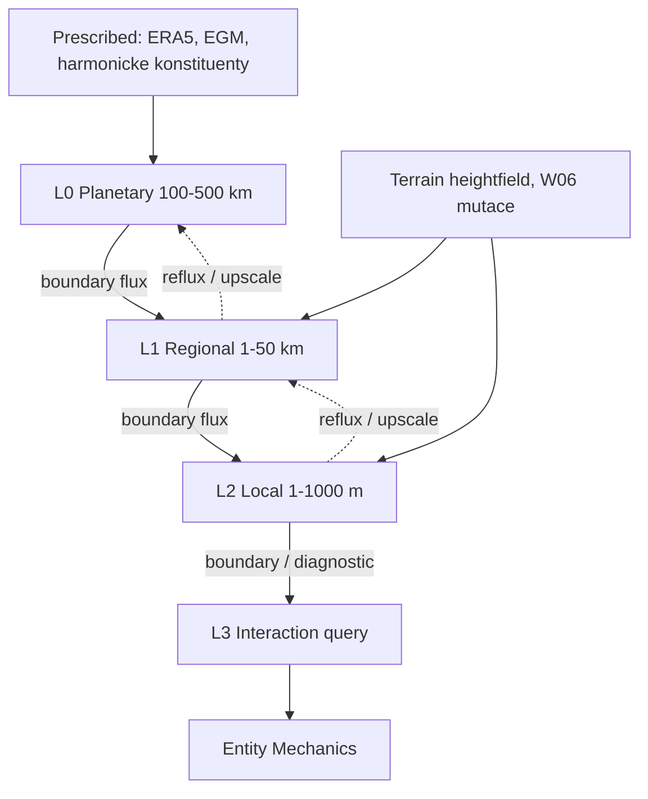
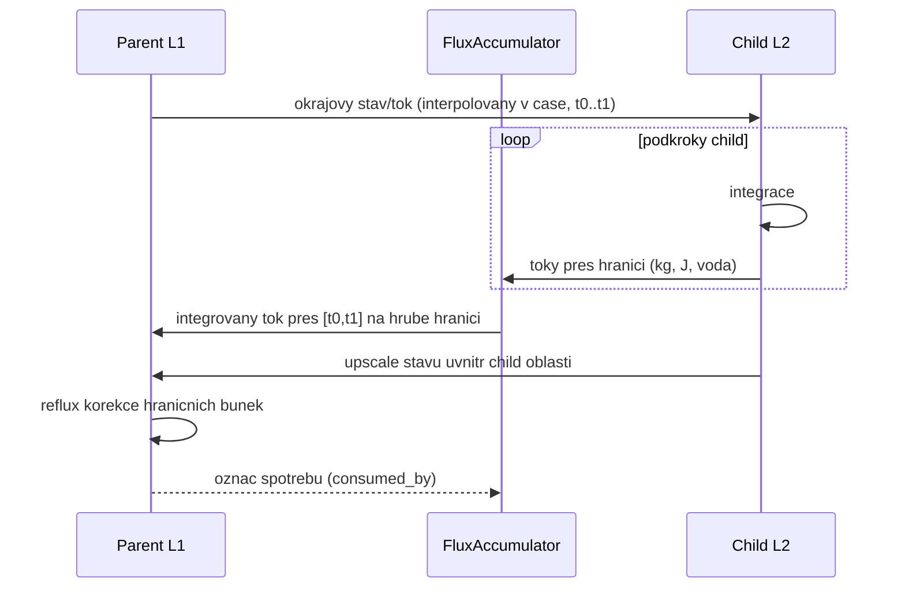
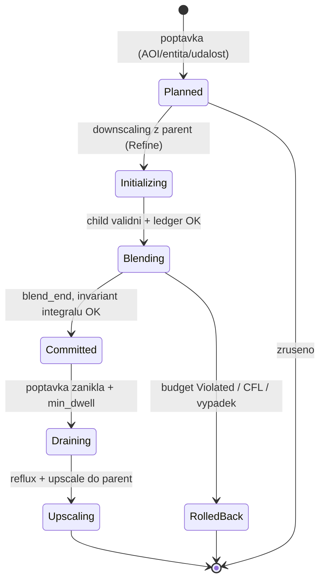
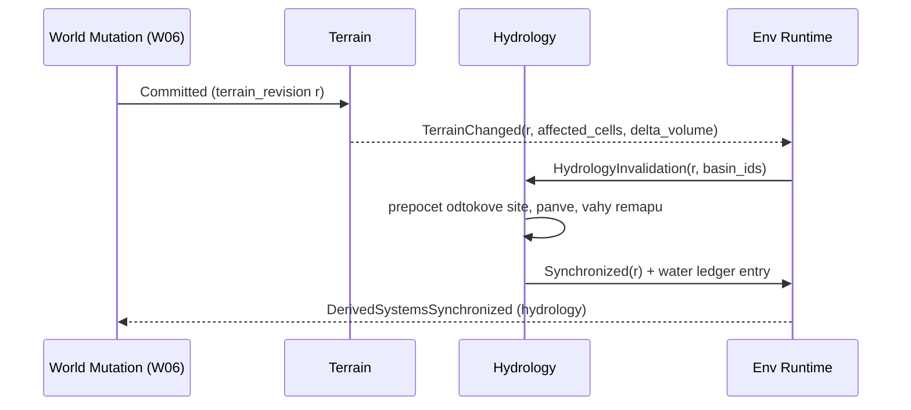

# W08 Supplement 01: Conservation-aware LOD coupling

Autor: Worker 08. Fáze: architektonický výzkum, bez implementace (kód jen jako ilustrační datové struktury). Zdroj zadání: `audit/SUPPLEMENT_BRIEF.md` řádek 08. Navazuje na CONFLICT-007, R07/R11, ADR-007/014, VAL-004/011. Číslování nových testů: VAL-8xx.

Značení důvěryhodnosti: **ověřeno** (primární zdroj nebo text W10/původních výzkumů), **návrh** (rozhodnutí tohoto dokumentu), **odhad** (nezměřená hodnota, k ověření prototypem).

---

## 1. Shrnutí rozhodnutí

| ID | Rozhodnutí | Status |
| --- | --- | --- |
| S08-01 | Každá environmentální veličina má **třídu modelu**: `Conservative` (prognostická, s bilancí), `Diagnostic` (odvozená z prognostických), `Visual` (bez vlivu na fyziku). Jen `Conservative` se účastní coupling budgetů. | návrh |
| S08-02 | **Jediná autorita pro každou prognostickou veličinu v dané buňce a čase** (single-writer per field per region+level). Vyšší LOD buď *nahrazuje* (Replace), nebo *zjemňuje* (Refine) nižší, nikdy je nesčítá nezávisle. | návrh |
| S08-03 | Přenos mezi mřížkami probíhá **výhradně přes `RemapOperator`** (předpočtené řídké váhy, first-order conservative jako výchozí, second-order pro hladká pole). Bilineární interpolace jen pro `Diagnostic` stavové veličiny, nikdy pro toky. | návrh, opřeno o Jones 1999 |
| S08-04 | Dvousměrné vnořování (two-way nesting) je **flux-based**: hrubá úroveň dostává od jemné součet toků přes společnou hranici (refluxing), ne jen průměr stavu. | návrh, literatura částečně ověřena |
| S08-05 | Coupling je řízen **akumulátory toků** (`FluxAccumulator`) v intervalech `WorldInstant`; příjemce dostává integrál toku za svůj krok, ne okamžitou hodnotu. | návrh |
| S08-06 | Čtyři rozpočty: **mass, momentum, energy, water** (W08 originál §12.2). Tracery (sůl, aerosol, popel) odloženy. Každý rozpočet má `residual` a toleranci. | návrh |
| S08-07 | Přechody LOD bez skoků: **blend zóna + časový cross-fade s uchováním integrálu**; hystereze podle důvodu zájmu (AOI, entita), ne podle samotné vzdálenosti. | návrh |
| S08-08 | Mutace terénu → hydrologie: `TerrainChanged` → `HydrologyInvalidation` s explicitním objemovým zúčtováním. Voda se nikdy nevytváří ani neztrácí přemístěním terénu. | návrh |
| S08-09 | `EnvironmentSample` se rozšiřuje o blok `quality` a `budget_status`; hodnota bez metadat je chyba, neznámá hodnota je `Unknown`, ne 0. | návrh, vychází z W10 §6 |
| S08-10 | Dotazy mají **tři cesty** (Hot: L3 analytické + cache; Warm: časová dlaždice; Cold: on-demand pole). Latence je vázána na třídu dotazu. | odhad |
| S08-11 | Stage 1: jeden proces, L1 + L3, bez nestingu, ale s `SourceId`, `BudgetLedger` a metadaty už v kontraktu. Testy VAL-8xx platí od Stage 1 pro to, co existuje. | návrh |

---

## 2. Řešené konflikty W10

### CONFLICT-007: Environmentální LOD a fyzikální konzistence

| Aspekt | Rozhodnutí | Odůvodnění |
| --- | --- | --- |
| Požadavek W10 | Hlavička vzorku (provider, model_version, rozlišení, validity, interpolace, nejistota, revize, frame, SI) + conservation-aware coupling pro hmotnost, hybnost, energii, vodu | W10 §2 CONFLICT-007 (ověřeno) |
| Prevence protichůdných hodnot vrstev | Pravidlo single-writer: každé prognostické pole má v dané oblasti právě jednoho autora; ostatní úrovně jsou *odvozeny* (downscaling) nebo *zpětně agregovány* (upscaling) | Nezávislé vrstvy produkují rozpor z definice; potřebují hierarchii autorit |
| Význam „conservation-aware" | Veličina přenášená mezi úrovněmi jako tok nebo integrál má v `BudgetLedger` rovnici `ΔStorage = Σflux_in − Σflux_out + sources − sinks` a reziduum pod tolerancí | Standardní finite-volume pohled |
| Co se nepožaduje | Bitová konzervace v plovoucí řádové čárce; požaduje se reziduum pod relativní tolerancí (§4.6) | Realistické; W10 CONFLICT-008 také nechce globální bitový determinismus |
| Falešná přesnost (R11) | Povinný `quality` blok; `effective_resolution_m` je rozlišení *zdrojového* pole, ne mřížky interpolace | W08 originál §12.1 (ověřeno) |

### Doplňky k tématům jiných workerů (jen rozhraní)

- CONFLICT-002 (gravitace): gravitace je v `EnvironmentSample.values.gravity`, ale dodává ji provider z W04; W08 ji jen přeposílá s metadaty. Environment gravitaci nikdy nepočítá. Závisí na W04.
- CONFLICT-006 (mutace): hydrologie je odvozený systém ve stavu `DerivedSystemsSynchronized`. Závisí na W06 (§4.8).
- CONFLICT-001/005 (čas): všechny časy v kontraktu jsou `WorldInstant`; coupling intervaly jsou celočíselné rozsahy `WorldInstant`. Závisí na W01/W09.

---

## 3. Kontrakty

### 3.1 Klasifikace modelů

W08 originál používá slovo „model" pro vše od klimatu po vizuální vlny. Pro conservation je rozhodující, co se s veličinou smí dělat.

| Třída | Definice | Interpolace | Účast v budgetu | Příklady |
| --- | --- | --- | --- | --- |
| `Conservative` | Prognostická veličina se zachovávaným integrálem (extenzivní: hmotnost, hybnost, energie, voda) | Jen konzervativní remap | Ano | hmotnost vzduchu v buňce, objem vody, vnitřní energie, hybnost proudění |
| `Diagnostic` | Funkce prognostického stavu, počítaná na požádání | Ano (bi/trilineárně), pokud je funkce hladká | Ne (odvozena z budgetu) | teplota z energie, tlak z hustoty a T, vítr v bodě, relativní vlhkost |
| `Visual` | Jen pro klienta, bez zpětné vazby do fyziky | Ano | Ne | vlnky, částice deště, volumetrické mraky, decal mokrého povrchu |
| `Boundary` | Okrajová podmínka dodaná vyšší úrovní | Dle zdroje | Ano (jako tok přes hranici) | tok na boční hranici regionálního modelu |
| `Prescribed` | Daná datasetem nebo procedurou, bez dynamiky | Dle datasetu | Ne (v ledgeru jako `external`) | klimatologie ERA5, harmonické konstituenty přílivu |

```text
FieldDescriptor   (ilustrační)
  field_id            : "air_mass" | "water_depth" | ...
  model_class         : Conservative | Diagnostic | Visual | Boundary | Prescribed
  extensivity         : Extensive | Intensive
  conservation_group  : Mass | Momentum | Energy | Water | None
  unit                : "kg"             (SI, typová kontrola z W01)
  remap_policy        : ConservativeFirstOrder | ConservativeSecondOrder
                        | BilinearDiagnostic | NearestCategorical
  positivity          : bool             (hustota, hloubka vody nesmí být záporná)
  reconstruct_from    : [field_id]       (pro Diagnostic)
```

Poznámka (návrh): prognostický stav atmosféry je **hmotnost vzduchu v buňce** (a energie, hybnost); hustota je z ní diagnostická.

### 3.2 Zdroj, autorita a pole

```text
LevelId : L0_Planetary | L1_Regional | L2_Local | L3_Interaction   (W08 originál §8.1)

FieldAuthority
  field_id
  region_id           (spatial region; NE ownership region, CONFLICT-004)
  level_of_record     : LevelId       // která úroveň je autoritou prognostického stavu
  mode                : Replace | Refine | Passive
  valid_range         : [WorldInstant, WorldInstant)
  world_revision      : u64
```

- `Replace`: vyšší LOD přebírá pole; nižší úroveň je v oblasti `Passive` (nesimuluje, jen dostává agregované toky zpět).
- `Refine`: nižší úroveň zůstává autoritou; vyšší dodává jen sub-grid detail s nulovou čistou změnou integrálu.
- `Passive`: pouze čte okrajové podmínky.

### 3.3 Rozšíření `EnvironmentSample` (nad W10 §6)

```text
EnvironmentSample   (W10 hlavička + rozšíření W08)
  query_id, world_instant, reference_frame_id, world_revision      // W10
  provider_id, model_version, spatial_resolution, temporal_resolution
  validity_interval, interpolation_method, uncertainty             // W10
  values: { gravity, atmosphere, wind, water, surface, materials } // W10

  // rozšíření W08 (návrh)
  quality
    effective_resolution_m : f32      // rozlišení ZDROJOVÉHO pole
    age_s                  : f32      // stáří vůči world_instant (rozdíl WorldInstant, SI)
    source_level           : LevelId
    blend_weight           : f32 0..1 // vzorek vznikl prolnutím LOD
    confidence             : f32 0..1 // heuristické, ne statistický interval
    flags                  : { Extrapolated, Fallback, Stale, Unknown, Vacuum }
  budget_status
    group_ok               : { Mass, Momentum, Energy, Water } -> OK | Warn | Violated
  per_value
    unit, frame_axes, nullability   // Unknown != 0
```

Pravidla (ověřeno z W08 §9.4 a W10 §6): SI jednotky, explicitní osy vektorů, neznámá hodnota se nezaměňuje za nulu, simulační čas místo systémového UTC.

### 3.4 Remap operátor

```text
RemapOperator
  op_id
  source_grid_id, dest_grid_id
  grid_revision_pair : (u64, u64)       // platnost vůči změně mřížky/terénu
  method             : ConservativeFirstOrder | ConservativeSecondOrder | Bilinear | Nearest
  weights            : sparse matrix (řádek = cílová buňka, sloupec = zdrojová)
  dest_area_fraction : [f32]            // podíl cílové buňky pokrytý zdrojem
  normalization      : DestArea | FracArea | None
  mask_policy        : ZeroOutside | RenormalizeOverlap
```

- **Ověřeno:** konzervativní remapping prvního řádu (SCRIP, Jones 1999) vychází z poměrů překrytí ploch buněk a lépe zachovává toky a integrály než bilineární interpolace. ESMF jej nabízí jako area-averaged metodu.
- **Návrh:** váhy se počítají offline při změně topologie (nest vytvořen/zrušen, změna pobřežní masky) a cachují v Rust runtime. Na hranách cubed-sphere stěn jsou nutné geometricky přesné překryvy (GECoRe), ne planární aproximace.

### 3.5 Flux accumulator a budget ledger

```text
FluxAccumulator
  accumulator_id
  interface_id          : hranice mezi regiony / úrovněmi / doménami
  field_group           : Mass | Momentum | Energy | Water
  interval              : [WorldInstant start, WorldInstant end)   // celočíselné
  integrated_flux       : f64 (SI: kg, kg m s-1, J, kg vody)
  n_substeps            : u32
  producer_step_ids     : [StepId]          // auditovatelnost
  consumed_by           : Option<StepId>    // idempotence

BudgetLedger   (per region x conservation_group)
  storage_start, storage_end : f64
  flux_in, flux_out          : f64      (ze akumulátorů)
  sources, sinks             : f64      (deklarované: srážky, výpar, tání, entity, terrain_edit)
  residual                   : f64 = (storage_end - storage_start) - (flux_in - flux_out + sources - sinks)
  tolerance                  : { rel, abs }
  status                     : OK | Warn | Violated
  notes                      : e.g. one_way_nest: conservation_not_enforced
```

Idempotence: opakované doručení akumulátoru (distribuovaný režim, závisí na W09/W06) nesmí tok započítat dvakrát; hlídá `consumed_by`. **Návrh.**

### 3.6 LOD přechodový záznam

```text
LodTransition
  transition_id, region_id, field_group
  from_level, to_level
  reason     : EntityInterest | PlayerAoi | ScientificEvent | Budget
  state      : Planned | Initializing | Blending | Committed | Draining | Upscaling | RolledBack
  blend_start, blend_end : WorldInstant
  integral_before, integral_after : f64     // invariant |after - before| <= tol
  hysteresis : { enter_threshold, exit_threshold, min_dwell }
```

---

## 4. Matematika, algoritmy, stavové automaty

### 4.1 Hierarchie modelů a vlastnictví veličin



Čtyři úrovně a jejich rozsahy jsou z W08 originálu §8.1 (ověřeno, autor je označuje za návrhové rozsahy, ne pevné hodnoty); zde jsou doplněny směry toků a autorit.

### 4.2 Downscaling (hrubá → jemná)

Cíl: jemné pole `f_h` konzistentní s hrubým `F_H`. Pro každou hrubou buňku `C` s podbuňkami `c`:

```
Σ_{c in C} f_h(c) · V(c) = F_H(C) · V(C)       (extenzivní veličiny)
```

Algoritmus pro extenzivní pole (návrh):

1. Zvol hladký tvar `g(c) >= 0` (orografie, bathymetrie, výška terénu).
2. Normalizuj: `f_h(c) = F_H(C) · g(c)V(c) / Σ_{c'} g(c')V(c')`.
3. Pozitivita plyne z `g >= 0`.

Intenzivní a diagnostická pole (teplota, tlak) se korigují fyzikálně (lapse rate podle výšky terénu, hydrostatická korekce tlaku); poté se extenzivní pole přepočte a zbytek se rozdělí reziduální normalizací, aby součet seděl.

Downscaling nepřidává informaci: výsledek nese `effective_resolution_m` hrubého pole (R11), i když mřížka je jemnější. Po lapse-rate korekci roste `uncertainty`, neklesá.

### 4.3 Upscaling (jemná → hrubá)

- **Stav:** objemově vážený průměr extenzivních hodnot, `F_H(C) = Σ f_h(c)V(c) / V(C)`; integrál se zachovává triviálně.
- **Toky přes hranici hrubé buňky:** součet jemných toků na plochách tvořících hrubou plochu (refluxing). Prostý průměr stavu tok nezachová, je-li tok nelineární funkcí stavu.
- **Sub-grid statistika:** pro turbulenci a vlny se hrubé úrovni předává parametrizace (efektivní drsnost, disipace), ne jemný stav.

Literatura (ověřeno částečně): porovnání AMR technik pro numerické předpovědi uvádí, že refluxing řeší nesoulad toků u dvousměrného nestingu a že u jednosměrného konzervace není zajištěna; oceánské modely používají flux correction pro objem a tracery; WRF popisuje zpětnou vazbu jako průměrování a remapování fine→coarse. **Nepodařilo se ověřit**, zda WRF korigue toky na hranici, proto z WRF žádnou záruku konzervace neodvozuji.

### 4.4 Two-way nesting



Pravidla (návrh):

1. Child nikdy nemění parent buňky mimo svou doménu. Uvnitř se parent stav přepíše upscalovaným childem; rozdíl integrálu se zapíše do ledgeru jako `nest_feedback_delta`.
2. Hranice: child dostává stav z parent interpolovaný v čase a relaxační zónu o `n_relax` buňkách (odhad 4 až 8), kde se rozdíl proti parent tlumí.
3. Reflux: `Δ = Σ(F_child_fine) − F_parent_coarse`; rozdíl se přičte k hraniční buňce parent.
4. Vznik nestu = `Refine` nad existujícím parent polem; zánik = upscale + reflux, nikdy zahození stavu.
5. Jednosměrný nesting je povolen pro `Diagnostic`/`Visual` a pro lokální simulace bez významné zpětné vazby (vlny v přístavu); ledger nese poznámku `conservation_not_enforced`.

### 4.5 Časový coupling a akumulace toků

Úrovně běží s různými kroky (W08 §9.3: global 1/60 až 1/3600 Hz, regional 0,1 až 1 Hz, local wind 1 až 20 Hz, local water 5 až 30 Hz, interaction 30 až 120 Hz; autor je označuje za počáteční rozpočty).

Pravidlo (návrh): výměna probíhá na *coupling intervalech* `Δt_c`, což jsou celočíselné rozsahy `WorldInstant` pokrývající celý počet kroků pomalejší strany; rychlejší strana akumuluje.

```
integrated_flux(t0,t1) = Σ_k F_k · Δt_k
```

Příjemce aplikuje `integrated_flux / (t1 − t0)` jako konstantní tok po svůj krok, nebo časově interpolovaný průběh se stejným integrálem.

Literatura (ověřeno částečně): klimatické kopléry (OASIS3-MCT, CESM/E3SM) mají časové průměrování/akumulaci pro případ nesouladu frekvencí; toky se mapují konzervativně (CESM: second-order conservative), stavy bilineárně. Přesné pořadí „průměr v čase, pak remap" v těchto systémech ověřeno nebylo. Návrh předepisuje: nejprve akumulace v čase na zdrojové mřížce, pak jedno konzervativní namapování na cíl.

Time warp (závisí na W01/W09): při akceleraci roste interval ve `WorldInstant`, ne krok modelu. Coupling interval smí růst jen do limitu stability (CFL a fyzikální časové škály). Při překročení se provede sub-cycling, nebo se přepne na nižší LOD s parametrizací. Odpovídá W10 „akcelerace času nesmí naslepo násobit timestepy". L2/L3 se při vysokém warpu pozastavují a nahrazují L1 statistikou; po návratu se reinicializují downscalingem z L1.

### 4.6 Rozpočty a tolerance

Pro oblast Ω, skupinu g a interval [t0,t1]:

```
S_g(t1) − S_g(t0) = ∫flux_in − ∫flux_out + Σ sources − Σ sinks + r_g
OK  <=>  |r_g| <= max(abs_tol_g, rel_tol_g · max(|S_g|, Σ|toky|))
```

| Skupina | Typické zdroje/propady | Poznámka |
| --- | --- | --- |
| Mass | odpar/kondenzace jsou přesun mezi vzduchem a vodou | Celková hmotnost vody + vzduchu v uzavřené oblasti se zachovává |
| Water | srážky, výpar, odtok, infiltrace, sníh/led, tání, `terrain_edit` | Samostatný ledger, protože je pro hráče viditelná (záplavy) |
| Energy | sluneční vstup, dlouhovlnné záření, latentní teplo, disipace, práce na entitách | Disipace kinetické energie na teplo musí být zaúčtována |
| Momentum | tlakový gradient, Coriolis (nulová práce), tření o terén, síla na entity | Zpětná vazba entity na vzduch se ve Stage 1 zanedbává a eviduje jako `declared_sink` |

Odhad tolerancí (k ověření prototypem): relativní reziduum hmoty a vody v uzavřené doméně < 1e-6 za simulovaný den při double; energie < 1e-4 (kvůli parametrizacím); hybnost jen diagnostika, protože tření a okrajové podmínky ji legitimně mění. Tvrdé limity jen pro vodu a hmotu; Energy a Momentum zatím `Warn`.

### 4.7 Stavový automat LOD přechodu bez skoků



Blend (návrh): během `[blend_start, blend_end)` je `s = (1−w(t))·s_parent + w(t)·s_child`, `w` hladká funkce času (smoothstep). U `Conservative` polí se blend aplikuje na toky a přírůstky, ne na stav, aby integrál nebyl porušen; u `Diagnostic` na hodnotu v bodě.

Hystereze: `enter_threshold` a `exit_threshold` se liší (např. vznik do R, zánik nad 1,5 R a po `min_dwell`; odhad). Závisí na typu zájmu, ne jen na vizuální vzdálenosti.

Atmosféra → vakuum (VAL-004): `air_density` jde spojitě k 0, pod `rho_min` se model přepíná na `Prescribed(vacuum)` a vzorek nese příznak `Vacuum`, ne nulu z `Unknown`. Spojitost samotné síly (drag) je věcí W03. Závisí na W03.

Voda ↔ vzduch: hladina je diskontinuita hustoty. Jediný zdroj výšky hladiny je vodní model; atmosféra dostává jen okrajové podmínky (wind stress, tepelný tok). Obě hustoty a normála hladiny se dodávají se stejnou revizí; chování napůl ponořené entity řeší W03.

### 4.8 Mutace terénu → hydrologie



Pravidla (návrh):

1. Terén má jedinou autoritativní revizi (ověřeno W06 §4.4: jeden autoritativní commit, odvozené systémy aktualizují asynchronně a hlásí, kterou revizi zpracovaly).
2. Hydrologie vlastní `processed_terrain_revision`. Dotaz během zpoždění vrací `Stale` a `world_revision` hydrologie, ne terénu. Klient nesmí předpokládat aktuálnost (W06).
3. Vodní bilance: změna terénu mění kapacitu buňky, ne množství vody. Násyp do vody vytlačí vodu do sousedních buněk (tok), výkop pod hladinou ji nechá natéct. V ledgeru je to záznam `terrain_edit` se součtem nula.
4. `RemapOperator` mezi terénem a hydrologickou mřížkou se invaliduje jen pro dotčené dlaždice (`grid_revision_pair`) a váhy se přepočítají lokálně.
5. Mutace přes hranici regionů: invaliduje se obě strana; soused dostává `BoundaryFlux` až po potvrzení své revize (závisí na W06/W09).
6. Rychlé destruktivní události (zřícení přehrady): L2 dostane `Pulse` (objem vody, energie) jako zdroj; L1 dostane agregovaný tok po upscale.

### 4.9 Výkon dotazů

Cíle jsou **odhad** (neměřeno); W08 §9.3 uvádí frekvenci interakčních dotazů 30 až 120 Hz.

| Třída | Volající | Cesta | Cíl latence |
| --- | --- | --- | --- |
| `Hot` | letadlo/auto v každém physics ticku | L3 analytické + cache sloupcového profilu | jednotky µs |
| `Warm` | AOI, NPC, AI | časová dlaždice v cache (bilineárně v prostoru, lineárně v čase) | desítky µs |
| `Cold` | mapy, plánování, scénáře | on-demand integrace z L0/L1 | ms |

Techniky (návrh): per-entity cache profilu sloupce (výška → ρ, p, T, vítr) klíčovaná `(cell, world_revision, instant_bucket)`; dávkové dotazy (SoA) pro entity ve stejné buňce; žádné alokace v `Hot` cestě; předpočtené `RemapOperator`y; aktualizace ledgeru po krocích modelu, ne po dotazech.

Paměť (ověřeno výpočtem v W08 §8.3): pole 0,25° s 10 proměnnými float32 je ~39,5 MB na vrstvu a ~1,46 GB při 37 hladinách. Proto jsou odděleny simulační mřížka, cache a historie; globální L0 nemusí být celé v jednom procesu (Stage 3+).

### 4.10 `required_accuracy`

Z W08 §9.4: dotaz uvádí nejmenší přijatelnou kvalitu, odpověď nese skutečnou. Nelze-li ji splnit, vrací se nejlepší dostupná s `Fallback`; odmítnutí jen když neexistuje ani L0 pro daný `WorldInstant`.

---

## 5. Rozhraní na ostatní workery

| Worker | Co potřebuji | Co dodávám |
| --- | --- | --- |
| W01 | `WorldInstant`, rozdíly v SI, typová kontrola jednotek; rámce; hierarchie buněk (cube-sphere/S2/H3), mapování environmentální mřížky na buňky | `EnvGridId`, `RemapOperator` mezi environmentální mřížkou a buněčnou hierarchií W01 |
| W02 | Pravidla physics islandů; síla z atmosféry se aplikuje právě jednou | `EnvironmentSample` jako vstup síly (aplikuje Physics Runtime) |
| W03 | Požadavky domén na spojitost hustoty, dragu, vztlaku | Spojité `air_density`, `water_density`, příznak `Vacuum`, hladina s normálou |
| W04 | `GravitySample` (hodnota, gradient, validita) | Jen pass-through; žádný vlastní výpočet |
| W05 | Pravidla ownership/replikace environment regionů; fencing | `FieldAuthority` vázán na `owner_epoch` (rozhraní) |
| W06 | Stavový automat mutace, `TerrainChanged`, revision vector | `DerivedSystemsSynchronized` pro hydrologii, `processed_terrain_revision` |
| W07 | Co smí klient interpolovat | Pole klasifikovaná `Visual` + `quality` pro predikci |
| W09 | Watermark/GVT pro coupling přes hranice, pořadí událostí, zpožděné zprávy | `FluxAccumulator` jako zpráva s intervalem `WorldInstant`; idempotence `consumed_by` |

Závisí na: W01 (čas, jednotky, mřížka), W04 (gravitace), W06 (mutace), W09 (synchronizace přes hranice). Fyziku integrace entit ani ownership protokol neřeším.

---

## 6. Validační testy

Nové testy VAL-8xx; navazují na VAL-004 (atmosféra → vakuum bez skoku) a VAL-011 (zachování definovaných bilancí při LOD přechodu).

| ID | Test | Kritérium | Stage |
| --- | --- | --- | --- |
| VAL-801 | Konzervativní remap L0→L1 konstantního pole | Integrál před/po v toleranci double (rel < 1e-12) | 1 |
| VAL-802 | Remap nehladkého pole (peak v jedné buňce) | Integrál zachován; pozitivita | 1 |
| VAL-803 | Remap přes hranu cubed-sphere stěny | Bez anomálie na hraně; integrál zachován | 1 |
| VAL-804 | Downscaling extenzivního pole | `Σ f_h·V = F_H·V` pro každou hrubou buňku; pozitivita | 1 |
| VAL-805 | Round trip down → up | Hrubé pole identické; jemné se liší jen sub-grid | 1 |
| VAL-806 | Uzavřená doména, 24 h simulovaného času | Hmota a voda pod tolerancí; Energy/Momentum jen `Warn` | 1 |
| VAL-807 | Two-way nest se zdrojem toku přes hranici | Součet toků child = tok parent po refluxingu | 2 |
| VAL-808 | One-way nest | Ledger označen `conservation_not_enforced`, žádný tichý úspěch | 2 |
| VAL-809 | Nesoulad kroků (7:1) | Integrál toku nezávisí na poměru kroků (v toleranci) | 1 |
| VAL-810 | Time warp 1000x s couplingem | Sub-cycling nebo přepnutí LOD; žádné zvětšení kroku nad limit, žádný NaN | 2 |
| VAL-811 | LOD blend při průletu | Žádný skok hustoty/větru nad práh; integrál invariantní | 2 |
| VAL-812 | Entita osciluje na hranici AOI | Nejvýše jeden vznik/zánik nestu za `min_dwell` | 2 |
| VAL-813 | Výkop pod hladinou | Voda před = voda po; objem v jámě odpovídá ledgeru | 1 |
| VAL-814 | Násyp do vody | Vytlačená voda v sousedních buňkách; Σ vody stálá | 1 |
| VAL-815 | Dotaz během zpoždění hydrologie | `Stale` a `world_revision` hydrologie | 2 |
| VAL-816 | `Unknown` vs 0 | Dotaz mimo pokrytí vrací `Unknown`, nikdy 0 | 1 |
| VAL-817 | Falešná přesnost | `effective_resolution_m` odpovídá zdrojové úrovni | 1 |
| VAL-818 | Jednotky | Typová kontrola odmítne záporné hustoty a jednotky mimo SI | 1 |
| VAL-819 | Výkon `Hot` dotazu | Měřit; práh určí benchmark (§4.9 není závazný) | 1 |
| VAL-820 | Reprodukovatelnost domény | Stejné vstupy a verze = stejný výsledek na stejném HW; napříč HW tolerance | 1 |
| VAL-821 | Idempotence akumulátoru | Duplicitní doručení nezmění ledger | 3 |
| VAL-822 | Atmosféra → vakuum | Spojitá `air_density`; příznak `Vacuum`; žádný NaN | 1 |

Vědecká validace (Python vrstva): uzavřená nádrž (voda), analytické řešení advekce pro remap, idealizovaný běh pro energii (návrh, relevanci nutno ověřit).

---

## 7. Nové rozpory mezi původními w01 až w09

Zjištěno grepem; nejde o rozpory, které W10 už zná (CONFLICT-001 až 008).

| ID | Rozpor | Dotčení | Navržené řešení |
| --- | --- | --- | --- |
| NEW-801 | **Tři mřížky**: W01 cube-sphere quadtree pro povrch, W05 S2/H3 pro indexaci, W08 cubed-sphere/hybrid pro environment (ENV-ADR-01) a curvilinear pro oceán. Bez dohody vznikají převody v každém dotazu. | W01, W05, W08 | Environment mřížky odvodit jako shluky buněk W01; oceánská curvilinear je výjimka s `RemapOperator`. S2/H3 jen index a AOI (W05). Řeší W01 supplement. |
| NEW-802 | **Gravitace** v `EnvironmentSample.values.gravity` (W10) a v API W08 (`gravity_enu_m_s2`) vs. W04 jako vlastník. Hrozí zdvojení a nekonzistence (odstředivá složka). | W04, W08, W10 | Environment `gravity` je pass-through z W04 s jeho `provider_id`. |
| NEW-803 | **Časová vazba dotazu**: W08 uvádí dotazy 30 až 120 Hz; W02 má integer/racionální tick. Neurčeno, na který `WorldInstant` se dotaz vztahuje. | W02, W08, W01 | Dotaz používá `world_instant` kroku, v němž se síla aplikuje; vzorek platí přes `validity_interval`. |
| NEW-804 | **Autorita vody po mutaci terénu**: W06 uvádí `HydrologyUpdate` jako odvozený krok, W08 vodu vlastní jako prognostickou. | W06, W08 | Voda je prognostická v W08; W06 jen invaliduje (§4.8). |
| NEW-805 | **Zpětná vazba entity na atmosféru** (rotor, výbuch, požár) nestanoví žádný dokument. | W03, W08, W02 | Stage 1 jednosměrně; vliv entity jako `declared_sink`. Stage 3+ explicitní `EnvironmentImpulse`. Otevřená otázka. |
| NEW-806 | **Determinismus**: W08 §10.4 rozlišuje autoritativní a vědeckou reprodukovatelnost; W10 CONFLICT-008 chce determinismus po doménách. Není řečeno, zda je environment doména s vlastním replay logem. | W08, W09, W10 | Environment je doména; jeho výstupy pro jiné domény jsou zaznamenané vstupy (replay čte zaznamenaný `EnvironmentSample`, nepřepočítává). |
| NEW-807 | **Nest přes hranici ownership regionu**: environment pole je prostorové, ownership po regionech; nest přes dvě hranice nemá jediného autora. | W05, W08, W09 | Nest se smí rozšířit jen v rámci jednoho ownership regionu; přesahující se rozdělí na dva s akumulátorem na hranici. Řeší W05/W09. |

---

## 8. Otevřené otázky pro uživatele / ADR

1. **ADR-007 (grid):** potvrdit, že environment mřížky se odvozují z hierarchie W01 (NEW-801). Cena: omezení atmosférického rozlišení stěnami cube-sphere.
2. **ADR-014 (fidelity):** tvrdá konzervace vody a hmoty (reflux) už ve Stage 2, nebo jen měření a `Warn`? Doporučení: vodu a hmotu tvrdě, energii a hybnost zatím měřit.
3. **Ambice meteorologie** (W08 ADR-02): procedurální / regionální konzistentní / plný numerický model. Určuje, zda je třída `Conservative` nutná pro vzduch, nebo jen pro vodu.
4. **Zpětná vazba entit na prostředí** (NEW-805): smí hráč měnit atmosféru? Rozhoduje o Stage 3+.
5. **Tracery** (sůl, aerosol, popel): odloženo; potřebuje-li je gameplay, musí do ledgeru.
6. **Tolerance** (§4.6) jsou odhad: kdo schvaluje prahy a co je důsledek `Violated` (rollback LOD přechodu, jen log, zastavení)? Doporučení: rollback LOD přechodu, nikdy zastavení světa.
7. **Rozsah time warpu** pro L2/L3 (§4.5): závisí na W07/W09.
8. **Datové zdroje** (ERA5 aj.): licence a objem; `Prescribed` vrstvy musí mít `dataset_version`.
9. **Replay:** stačí tolerance, nebo je vyžadován bitový replay vybraných událostí (W09)?

---

## 9. Zdroje

| Zdroj | URL | Co z něj plyne |
| --- | --- | --- |
| Jones (1999), First- and Second-Order Conservative Remapping Schemes for Grids in Spherical Coordinates, MWR 127, 2204 | https://typeset.io/pdf/first-and-second-order-conservative-remapping-schemes-for-3pr7y5d852.pdf | Konzervativní remap 1. a 2. řádu na sférických mřížkách, základ SCRIP; váhy z překryvu ploch; při konstantním toku v buňce plyne area-weighted schéma. Ověřeno jen z výpisu vyhledávače. |
| ESMF reference manual | https://www.earthsystemmodeling.org/docs/nightly/DWesl-patch-1/ESMF_refdoc.pdf | ESMF nabízí first-order area-averaged conservative regridding. Kapitola o konzervaci nebyla čtena. |
| Ullrich et al., GECoRe | https://www2.cgd.ucar.edu/cms/pel/papers/ULJ2008MWR.pdf | Geometricky přesný konzervativní remap pro lat-lon a cubed-sphere; podklad pro požadavek přesných překryvů na hranách stěn. Jen z výpisu; nutno ověřit. |
| Comparison of AMR techniques for NWP | https://arxiv.org/pdf/2404.16648 | Reflux řeší nesoulad toků u two-way nestingu; u one-way konzervace není zajištěna. |
| WRF ARW nesting tutorial | https://www2.mmm.ucar.edu/wrf/users/tutorial/attic/200707/ARWNesting.pdf | Feedback je fine-to-coarse průměrování po proměnných; korekce toků neověřena. |
| Debreu et al. (2012), two-way nesting in split-explicit ocean models | https://www.brest.ird.fr/personnel/ppenven/publications/debreu_omod2012.pdf | Flux correction pro objem a tracery u two-way nestingu. Jen z výpisu. |
| OASIS3-MCT user guide | https://cerfacs.fr/wp-content/uploads/2025/12/oasis3mct_UserGuide-1.pdf | Mapování a časové transformace (průměrování/akumulace) v kopléru; pořadí operací neověřeno. |
| CESM cpl6 user guide | https://www2.cesm.ucar.edu/models/ccsm3.0/cpl6/users_guide/node20.html | Stavy bilineárně, toky second-order conservative (SCRIP). |
| Interní: `research/worker-08/w08-original.md` §7.1, §8.1 až 8.4, §9.3, §9.4, §10.4, §12.1/12.2, §13 | lokální | Coupling matrix, úrovně, frekvence, API, budgets, ENV-ADR. |
| Interní: `audit/WORKER_10_REVIEW.md` §2 CONFLICT-007, §6 EnvironmentSample, §9 až 11 | lokální | Závazná hlavička vzorku a conservation-aware coupling; VAL-004/011, R07/R11, ADR-007/014. |
| Interní: `research/worker-06/w06-original.md` §4.4 | lokální | Řetěz TerrainChanged → HydrologyUpdate; jeden autoritativní commit. |
| Interní: `research/worker-01/w01-original.md`, `research/worker-05/w05-original.md` | lokální | Cube-sphere quadtree vs. S2/H3 (NEW-801). |

Omezení: web search použit 3x (limit ~6); výsledky jsou výpisy vyhledávače, ne celé články. Tvrzení označená „ověřeno částečně" je třeba před přijetím ADR potvrdit čtením primárního textu.
