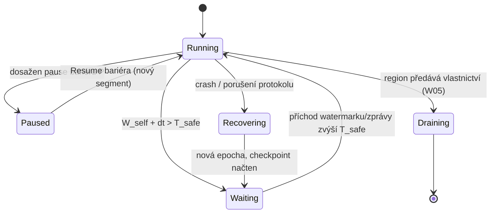
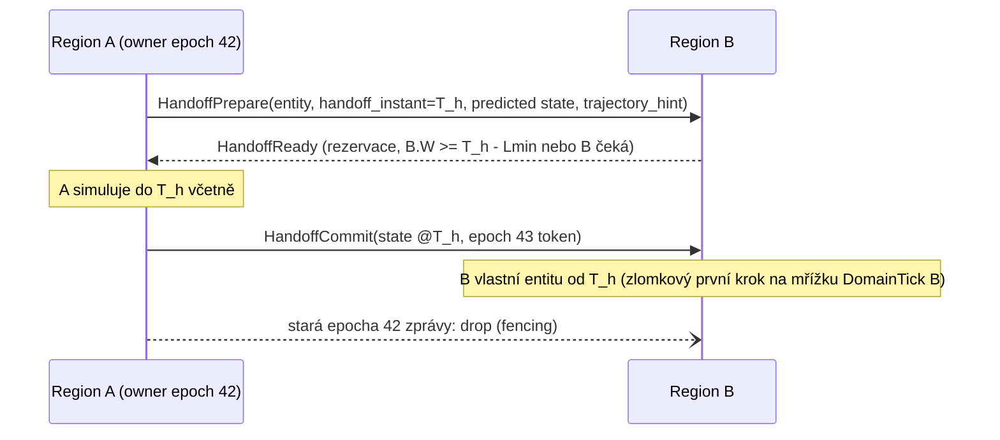

# Worker 09 – Supplement 01: Distributed time a boundary synchronization

Fáze: architektonický výzkum, žádná implementace. Kód níže jsou jen ilustrační datové struktury.
Vstupy: `audit/WORKER_10_REVIEW.md` (§2 CONFLICT-001/003/005/008, §6, R06, ADR-010, VAL-006/013), `research/worker-09/w09-original.md` (§5.3–5.5, §8.1, §11.1), vybrané řádky w01/w02/w04/w07 (grep).
Značení: **ověřeno** (primární/sekundární zdroj, viz §9), **návrh** (rozhodnutí tohoto dokumentu), **odhad** (řádový odhad, nutno změřit).

---

## 1. Shrnutí rozhodnutí

| # | Rozhodnutí | Status | Kde |
| --- | --- | --- | --- |
| D1 | Autoritativní cross-region interakce používají **konzervativní synchronizaci s lookahead** (okno bounded lag), ne optimistický Time Warp s rollbackem autoritativního stavu. | návrh | §4.1 |
| D2 | Optimistické techniky jen **nonautoritativně**: extrapolace ghostů, klientská predikce (W07), spekulativní preview. Nikdy nemění committed stav. | návrh | §4.1 |
| D3 | Každý region publikuje **`RegionWatermark`** (data plane, peer-to-peer, vysoká frekvence), oddělený od **`RegionOwnership`** (control plane, W05, nízká frekvence). W10 §6 je v seznamu polí smíchává; doporučuji rozdělit. | návrh | §3.2 |
| D4 | **GVT = min(watermarky regionů, časová razítka zpráv na cestě).** Slouží k fossil collection (journal, snapshoty, ghost buffery), k bezpečnému commitu cross-region událostí a ke změnám globálního stavu času. Nenutí lockstep. | návrh (algoritmus z literatury, **ověřeno** pojmově) | §4.3 |
| D5 | Lookahead hranice A→B je odvozen z geometrie a max. rychlosti: `L_AB = max(L_min, (d_AB − margin) / v_max)`. Šířka halo/ghost zóny: `h ≥ v_max·(Δt_B + skew_max)`. | návrh | §4.2 |
| D6 | Boundary zpráva nese `effective_instant` (WorldInstant), `src_epoch`, `channel_seq`. Řazení cross-region událostí: `(effective_instant, src_region, channel_seq, event_seq)`. Stará epocha = drop (fencing). | návrh | §3.3, §4.5 |
| D7 | Pozdní zpráva (`effective_instant < committed_instant` příjemce) je u fyzikální třídy **porušení protokolu** (alarm, ne tichá aplikace). U negameplay třídy se aplikuje s kompenzací dle politiky třídy. | návrh | §4.4 |
| D8 | **Jeden globální `TimeScale`** (řízený Time Authority), změny jen přes **bariéru v budoucím WorldInstant**; pauza je bariéra v `WorldInstant`, ne ve wall-clock. Per-region `time_scale` z w09 §5.5 se **ruší** (viz R-1). | návrh | §4.6 |
| D9 | Efektivní akcelerace je **omezena synchronizační kapacitou**: `s_eff = min(s_req, L_min / (t_win))`, kde `t_win` je čas jednoho synchronizačního okna (RTT + výpočet). Vysoký warp je povolen jen pro oblasti/entity v on-rails doméně s velkým lookahead (závisí na W03). | návrh + odhad | §4.6 |
| D10 | Přechod entity přes hranici je naplánován na **budoucí `handoff_instant`**; A vlastní stav do T_h včetně, B od T_h. Příchozí entita dělá v B zlomkový první krok na mřížku `DomainTick` regionu B. | návrh | §4.7 |
| D11 | Rychlé objekty: **swept-volume zpráva** `[t0,t1]` s předrezervací koridoru v cílovém regionu; zásah rozhoduje nejdřívější `t_hit`, tie-break deterministický. | návrh | §4.8 |
| D12 | Determinismus: doména replayuje z **`CrossRegionEventLog`** (zaznamenané pořadí potvrzených zpráv). Exactly-once efekt = at-least-once doručení + dedupe `(src_region, channel, seq)`. | návrh | §4.5, §4.9 |
| D13 | `EntityPhysicalState` rozšířen o W09 položky (`fidelity_level`, `provenance`, `valid_until`, `state_hash`) a **replikační pohled** `BoundaryEntityView`. Vše navazuje na W10 §6. | návrh | §3.1 |
| D14 | Recovery regionu **nesmí** přetočit watermark pod již spotřebované výstupy sousedů: buď deterministický re-emit s dedupe a hash kontrolou, nebo output-commit na durable watermark. Doporučení: re-emit + hash (Stage 3+). | návrh, otevřené | §4.9 |

---

## 2. Řešené konflikty W10

### CONFLICT-005 – jeden globální čas vs. regionální časové osy

- **Rozhodnutí:** Platí W10 baseline: jediný `WorldInstant`, regiony mají vlastní `DomainTick` a **committed watermark**. Doplňuji operační definici „současnosti“ dvou stavů:
  stavy regionů A a B lze porovnávat/interagovat jen v instantu `t ≤ min(W_A, W_B)` (oba committed), nebo v `t` v okně extrapolace s uvedenou nejistotou (§4.4).
- **Odůvodnění:** Konzervativní synchronizace s lookahead dovoluje regionům postupovat různou rychlostí, dokud se neporuší kauzalita; pomalý region zdržuje jen ty sousedy, kterým může poslat událost dřív, než stihne postoupit (ne celý vesmír). To přesně odpovídá w09 §5.4 („pomalejší region nesmí zpomalovat celý vesmír“) a W10 ADR-010.
- **Doplnění k W10 požadavkům:** W10 vyjmenoval šest oblastí (boundary sync, inter/extrapolace, max. rozdíl, zpožděné zprávy, rychlé objekty, pauza/akcelerace). Mapování: §4.2/§4.4 (první čtyři), §4.8 (rychlé objekty), §4.6 (pauza/akcelerace). Max. přípustný časový rozdíl = `skew_max` na dvojici regionů (§4.2).

### CONFLICT-003 – entity state (část W09)

- **Rozhodnutí:** w09 §11.1 kontrakt (`frame_id, x,y,z, orientation, velocities, simulation_tick, owner_region, owner_epoch, state_version`) je **podmnožina** W10 `EntityPhysicalState`. Přijímám W10 strukturu a zachovávám z W09 jen to, co W10 nemá (`simulation_level` → `fidelity_level`, provenance, platnost). Plná podoba v §3.1.
- **Odůvodnění:** `x,y,z` + jeden `frame_id` nezvládne hierarchii cell/anchor/local ani přepočet 6D stavu mezi rotujícím a inerciálním rámcem (závisí na W01). `simulation_tick` bez `WorldInstant` je bez významu mezi regiony s různým tick rate.
- Zbytek (6D transformace, přesná reprezentace pozice) **závisí na W01**; já definuji jen, že hranice přenáší stav **v rámci společného pro oba regiony** (`boundary_frame`), a konverze proběhne u odesílatele.

### CONFLICT-008 – determinismus (část W09)

- **Rozhodnutí:** Potvrzuji W10: determinismus po doménách. Pro distribuci navíc: (a) `CrossRegionEventLog` s totálním pořadím, (b) kanonické tie-break klíče, (c) hash stavu na hranicích watermarku, (d) žádná závislost na pořadí příchodu zpráv v síti.
- **Odůvodnění:** Pořadí příchodu je nedeterministické; deterministické musí být pořadí **aplikace**, odvozené z `(effective_instant, src_region, channel_seq, event_seq)`. Pro konzervativní protokol je pořadí aplikace zaručeno tím, že příjemce aplikuje zprávu až když `T_safe ≥ effective_instant`.

### R06 (Boundary time divergence) a ADR-010

- ADR-010 „Globální čas + regionální committed watermark“ potvrzuji a doplňuji o: lookahead, GVT, bariéry změn času (§4.3, §4.6). R06 mitigace: `skew_max`, backpressure, watermark heartbeat (null-message ekvivalent), alarm při porušení.

---

## 3. Kontrakty

### 3.1 Entity kontrakt (rozšíření dle CONFLICT-003)

Informační model (návrh); základ je W10 §6, přidané položky označeny `+W09`.

```
EntityPhysicalState                       // autoritativní, drží vlastník
├── world_id, entity_id, entity_type, state_version
├── timestamp
│   ├── world_instant                     // kanonický; reprezentace dle W01
│   └── domain_tick                       // lokální krok vlastníka
├── spatial_state                         // dle W01: frame, anchor, cell, local_position
│   ├── reference_frame_id, anchor_id, cell_coordinates, local_position
│   └── orientation, linear_velocity, angular_velocity
├── physical_state { mass, inertia, forces, constraints }
├── simulation
│   ├── domain_id
│   ├── fidelity_level                    // +W09: L0..L3 z w09 §3.1 (pozor na název, viz R-7)
│   ├── model_version, solver_state_version
│   └── valid_until_instant               // +W09: do kdy je stav platný bez další aktualizace (on-rails, ballistic)
├── authority { owner_region, owner_node, owner_epoch }
└── integrity
    └── state_hash                        // +W09: hash kanonického stavu pro detekci divergence (w09 §8.1)

BoundaryEntityView                        // read-only pohled v sousedním regionu (ghost/proxy)
├── entity_id, source_region, source_epoch, source_state_version
├── sample_instant                        // WorldInstant, ke kterému vzorek platí
├── kinematics                            // 6D stav v boundary_frame (už přetransformováno odesílatelem)
├── provenance { Committed | Interpolated | Extrapolated }   // +W09
├── uncertainty                           // roste s (t_query − sample_instant) při extrapolaci
├── trajectory_hint                       // volitelně: polynom/Keplerova dráha do valid_until
└── role { Ghost | Proxy | SweptCorridor }  // ghost vs. proxy detailně W02
```

Pravidlo: `BoundaryEntityView` **nikdy** neslouží jako zdroj pravdy; ostatní regiony ho nesmějí persistovat ani přeposílat dál (zakazuje řetězení zastaralých dat).

### 3.2 Časové kontrakty

```
RegionWatermark                           // data plane, peer-to-peer, heartbeat
├── region_id, owner_epoch                // epocha pro fencing (W05)
├── committed_instant                     // W_r: všechny události <= tento instant jsou finální
├── committed_domain_tick
├── lookahead_to[neighbor_id]             // L_rn: slib: nepošlu událost s effective_instant < W_r + L_rn
├── promised_until[neighbor_id]           // = W_r + L_rn; to je „null message“
├── time_state                            // Running | Waiting(on: region_id) | Paused(at) | Recovering | Draining
└── seq                                   // monotónní v rámci epochy

TimeControlState                          // control plane, vlastní Time Authority
├── world_id, segment_id                  // segment = úsek s konstantním TimeScale
├── time_scale                            // racionální číslo (ne float); 0 = pauza
├── effective_instant                     // od kdy segment platí (bariéra)
├── announced_at_instant                  // kdy byla změna oznámena; musí být <= effective_instant − guard
└── max_scale_granted                     // aktuální strop dle §4.6

BoundaryMessage
├── msg_id, channel_id (src,dst), channel_seq
├── src_region, src_epoch, dst_region
├── send_instant                          // W_src v okamžiku odeslání
├── effective_instant                     // >= send_instant + L (jinak odmítnout u zdroje)
├── class                                 // Physical | Gameplay | Mutation | Control (různá pozdní politika)
├── causal_deps[]                         // volitelně id předchozích událostí
└── payload                               // BoundaryEntityView / ContactEvent / SweptQuery / Handoff* / MutationNotice

CrossRegionEventRecord                    // zaznamenává se pro replay a audit
├── event_id, order_key(effective_instant, src_region, channel_seq, event_seq)
├── src_region, src_epoch, dst_region, dst_epoch
├── applied_at_domain_tick                // kdy ji dst skutečně aplikoval
└── payload_hash
```

`RegionWatermark` ukládat do coordinatoru (W05) **ne každý tick**; coordinator dostává jen checkpoint watermark (při commitu checkpointu) a změny `time_state`. Důvod: jinak se řídicí rovina stane úzkým hrdlem při 1000 regionech (viz §6, VAL-901).

### 3.3 Klasifikace zpráv a pozdní politika

| Třída | Příklad | Pozdní zpráva | Duplicita |
| --- | --- | --- | --- |
| Physical | kontakt, impuls, síla přes hranici | **porušení protokolu**: alarm, region přejde do `Recovering` nebo se dotyčná interakce označí `Compensated` (W06) | dedupe `(src,channel,seq)` |
| Gameplay | zásah, interakce hráče | aplikovat v `committed+ε` s příznakem `late`, zapsat do logu | dedupe |
| Mutation | změna terénu/objektu | `effective_instant` musí být ≥ watermarku všech dotčených regionů; jinak žádost vrácena (**závisí na W06**) | idempotence klíčem mutace |
| Control | pause, time scale, ownership | vždy přes bariéru v budoucnu; pozdní = odmítnout | idempotence |

---

## 4. Algoritmy, matematika, stavové automaty

### 4.1 Konzervativní vs. optimistická synchronizace (volba)

**Ověřeno (literatura):** konzervativní metody (Chandy–Misra–Bryant, null messages) nikdy nenechají proces zpracovat událost, dokud není zaručeno, že nepřijde starší; výkon závisí na lookahead a při jeho nedostatku hrozí deadlock/stagnace. Optimistické (Jefferson, Time Warp) provádějí událost spekulativně a při porušení lokální kauzality provedou rollback (anti-zprávy); GVT je minimum časových razítek nezpracovaných zpráv a anti-zpráv a určuje, před jaký čas už se nikdy nevrací (fossil collection).

| Kritérium | Konzervativní + lookahead | Optimistická (Time Warp) |
| --- | --- | --- |
| Autoritativní stav hráčů/ekonomiky | bezpečný, žádný vizuální rollback | vyžaduje rollback autoritativního stavu, nutné držet historii stavů |
| Fyzika s velkým stavem (islandy, terén) | stav není nutné verzovat | ukládání stavu per event je drahé (stovky MB při 1000 regionech, **odhad**) |
| Externí efekty (síť, DB, replikace) | bezpečné | nutné odkládat do GVT (output commit) |
| Determinismus (CONFLICT-008) | pořadí aplikace je definované | rollback komplikuje replay a hash |
| Výkon při malém lookahead | stagnace, sync okna | může být rychlejší |
| Složitost | nižší | vysoká (anti-zprávy, kaskádní rollback) |

**Rozhodnutí (návrh):** hybrid „konzervativní jádro + omezená optimistika“:
1. Autoritativní stav = konzervativně (D1).
2. Ghost extrapolace a klientská predikce = optimisticky, ale jen nad nonautoritativními daty (D2). Oprava = nahrazení ghostu příchozím vzorkem; žádné anti-zprávy.
3. Pokud se v budoucnu ukáže, že lookahead je příliš malý v hustých oblastech, zvažte Time Warp **uvnitř jednoho procesu** (Stage 2) pro uzavřené podsystémy bez externích efektů. To by byl samostatný ADR; zde jen jako možnost.

### 4.2 Lookahead, halo a skew

Pro hranici mezi A a B nechť `d_AB` je minimální vzdálenost mezi jakoukoli entitou A a hranicí B (nebo dosah interakce), `v_max` strop rychlosti entit/projektilů v okolí hranice (per třída objektů v regionu), `margin` bezpečnostní rezerva.

```
L_AB = max( L_min,  (d_AB − margin) / v_max )        // lookahead, WorldInstant jednotky
```

Region A tak slibuje: „do `W_A + L_AB` nepošlu B žádnou událost“. Pak B smí postoupit do

```
T_safe(B) = min over neighbors A of ( W_A + L_AB )     // a také ≤ pause bariéra a ≤ time-control bariéra
```

Šířka halo zóny (ghost vrstva uvnitř sousedního regionu) musí zajistit, že objekt neprojde z A do hloubky B mezi dvěma synchronizacemi:

```
h ≥ v_max · ( Δt_B + skew_max ) + r_obj
```

- `Δt_B` krok regionu B v sim. čase, `skew_max` = max. povolený rozdíl watermarků dvojice (A,B), `r_obj` poloměr objektu.
- Příklad (odhad, řádový): auto 50 m/s, Δt = 1/60 s, skew_max = 0,1 s → h ≥ 50·0,117 ≈ 6 m. Projektil 1000 m/s, stejné parametry → h ≥ 117 m (proto swept-volume, §4.8, místo velkého halo).
- Příklad lookahead: auto 50 m/s, 20 m od hranice, margin 2 m → L = 0,36 s sim. času.

**Skew_max a backpressure:** pokud `W_B − W_A > skew_max`, B čeká (`Waiting(on: A)`). Řetěz čekání může propagovat zpomalení po sousedech (jen po topologii hranic, ne globálně). Mitigace: (a) heartbeat s `promised_until` posílat i když není co říct (null message ekvivalent, **ověřeno** v CMB), (b) adaptivní velikost kroku regionu (zde zasahuje W02/W03), (c) detekce „pomalého vlastníka“ a migrace (**závisí na W05**).

### 4.3 Watermark a GVT

- `W_r` je **monotónní**, tj. neklesá (kromě recovery, viz §4.9).
- Definice (návrh, podle literatury): `GVT(t_wall) = min( min_r W_r , min_{m in flight} effective_instant(m) )`, kde „in flight“ jsou odeslané a nepotvrzené zprávy.
- Výpočet: hierarchická agregace (region → node → control plane) s „barevnou“ značkou zpráv (Mattern/Samadi styl, **návrh**, nutné ověřit v ADR) kvůli zprávám na cestě. Protože W_r jen roste, **zastaralá hodnota GVT je bezpečná dolní mez**; netřeba synchronní snapshot.
- Použití GVT: (1) smazání journalů/ghost bufferů/snapshotů starších než `GVT − retention`; (2) potvrzení `CrossRegionEventRecord` jako finálních; (3) zveřejnění do Replication (Unity vidí jen stav ≤ GVT jako „potvrzený“, ostatní jako „preview“, závisí na W07); (4) výběr `effective_instant` bariér pro globální změny (§4.6): `effective ≥ max_r W_r + guard`.
- Frekvence (odhad): 1–10 Hz wall-clock. Vyšší nemá smysl, GVT neřídí simulaci, jen úklid a commit.

### 4.4 Boundary protokol: interpolace, extrapolace, zpožděné zprávy

Stavový automat regionu vůči jednomu sousedovi (zjednodušeně):



**Čtení stavu souseda v čase t_q:**

1. Mám dva vzorky `S_k, S_{k+1}` s instantem `t_k ≤ t_q ≤ t_{k+1}` → **kubická Hermitova interpolace** polohy z (x, v) (rychlost je součástí stavu); orientace slerp s úhlovou rychlostí. Provenance `Interpolated`.
2. Znám jen `S_k` a `t_q > t_k` → **extrapolace** `x(t_q) = x_k + v_k·Δ + ½·a_k·Δ²`, Δ ≤ `Δ_extrap_max(třída)`. Nejistota roste: `σ(Δ) = σ_k + ½·a_max·Δ²`. Provenance `Extrapolated`. Při Δ > `Δ_extrap_max` → čekat (`Waiting`), neodhadovat.
3. Extrapolovaný ghost smí ovlivnit jen **nonautoritativní** výpočet (viz D2); autoritativní kontakt na hranici čeká na `T_safe`.

Tabulka `Δ_extrap_max` (návrh, odhad hodnot, ladit měřením):

| Třída | Δ_extrap_max | Důvod |
| --- | --- | --- |
| Pěší/postava | 100–200 ms | nízká rychlost |
| Vozidlo | 50–100 ms | manévry |
| Letadlo | 100 ms | plynulá dráha |
| Projektil | 0 (jen swept) | rychlost, nepředvídatelný zásah |
| On-rails těleso (Kepler) | do `valid_until` | analytická dráha, bez extrapolačního limitu v čase, jen v platnosti modelu |

**Zpožděné zprávy** (viz §3.3). Detekce: `effective_instant < committed_instant(dst)`. U konzervativního protokolu je to chyba: buď nedodržený slib lookahead (zdroj), nebo chyba doručení. Reakce dle třídy; všechny případy zalogovat s `src_epoch`.

### 4.5 Pořadí cross-region událostí (determinismus)

Příjemce aplikuje zprávy z fronty v pořadí `order_key = (effective_instant, src_region_id, channel_seq, event_seq)`; aplikuje je až když `effective_instant ≤ T_safe`. Tie-break `src_region_id` je stabilní (číselné ID, ne hash ukazatele ani pořadí příchodu). Do `CrossRegionEventLog` se zapisuje `order_key` a `payload_hash`; replay přehrává podle logu.

Důsledek: simulace jedné domény je reprodukovatelná při stejných vstupech, stejné verzi modelů a stejném logu cross-region událostí (naplňuje W10 CONFLICT-008). Bitová shoda mezi platformami se nepožaduje.

### 4.6 Pauza a akcelerace času

**Ověřeno z w07 a w04:** `t_sim = t_0 + ∫ s(t) dt_wall`, pauza je `s = 0`, plus offline catch-up.

**Návrh – model segmentů:**

```
segment i:  platí od effective_instant_i, s_i je racionální (např. 1/1, 60/1, 0/1)
WorldInstant(wall) se odvozuje z posledního segmentu; Time Authority je jediný zdroj
Změna: oznámena jako TimeControlState, platí od effective_instant >= max_r W_r + guard
```

Všechny regiony přepnou měřítko u **stejného WorldInstantu**, ne ve stejný wall-clock okamžik, takže žádný region nevidí „změnu uprostřed kroku“. Tím se vyřeší nebezpečí, které W10 uvádí: akcelerace nesmí naslepo násobit timestepy.

**Pauza:** bariéra v `P`. Region postupuje do `P`, publikuje `W = P`, `Paused`. Po resume začne nový segment s `effective_instant = P`. Protože P je WorldInstant, všechny regiony se zastaví v **konzistentním** stavu bez ohledu na rychlost jednotlivých regionů. Pauza a resume jsou idempotentní příkazy (kontrola `segment_id`).

**Omezení akcelerace synchronizační kapacitou (odhad):**
Počet synchronizačních oken za 1 s wall-clock je `f_sync ≈ 1 / t_win`, `t_win = RTT_eff + t_compute_window`. Jedno okno pokryje nejvýš `L_min` sim. času. Proto

```
s_max ≈ L_min · f_sync = L_min / t_win
```

Příklady (odhad, nutno změřit): auto u hranice `L = 0,36 s`, `t_win = 4 ms` (LAN) → `s_max ≈ 90×`. Přes WAN (`t_win = 40 ms`) → `s_max ≈ 9×`. On-rails dráha (LEO) s `L = 60 s` při `t_win = 40 ms` → `s_max ≈ 1500×`.

Důsledky (návrh):
1. Pro vysoký warp musí entity/oblasti přejít do on-rails domény s velkým lookahead (**závisí na W03**: přechod a kontinuita).
2. Plný 60 Hz kontakt přes hranici při warpu > `s_max` **není podporován**; Time Authority sníží `max_scale_granted`, nebo přepne dotčené entity na hrubší fidelity, nebo dotčený region pozastaví jejich interakce (politika v ADR).
3. Kroky: `Δt_region(s)` smí růst jen do `Δt_max(domain)` dané stabilitou integrátoru (W03/W04); jinak sníží se `s_eff`, ne přesnost.
4. Multiplayer: všichni hráči sdílejí jeden WorldInstant, tedy jeden `TimeScale`. Individuální warp hráče je možný jen jako **oddělená časová linie/instance** (what-if větev) nebo lokální vizuální přetáčení (závisí na W07, otevřená otázka O-2).

**Časově nezávislé („free-running“) regiony:** pokud region nemá žádnou cestu interakce ke zbytku (lookahead k sousedům = ∞, např. izolovaný vzdálený sektor), smí běžet před ostatními, dokud nepřijde zpráva. Je to přirozený důsledek lookahead, ne zvláštní režim.

### 4.7 Přechod entity přes hranici (časová část)

Protokol migrace entity je ve W05 (fencing, lease). Časová část (návrh):



Pravidla:
1. `T_h` volí A tak, aby `T_h ≥ W_A + L_AB` (dost času na prepare) a podle prediktivní trajektorie (swept čas překročení).
2. Do T_h včetně je vlastníkem A, po T_h B. Stav v T_h je jediný platný přenos; **žádný** region nesmí posunout entitu přes T_h bez změny epochy.
3. B vloží entitu v T_h. Pokud B má mřížku ticků nezarovnanou na T_h, B aplikuje **zlomkový krok** `δ = t_tick_next − T_h` (entity se integruje jen zlomkovým `δ` samostatně) a pak následuje v běžném tiku.
4. Závislosti (připojené objekty, vazby, island): **závisí na W02** (island musí migrovat atomicky; tady jen: handoff_instant je společný pro celý island).
5. Selhání mezi Prepare a Commit: entita zůstává u A (epocha 42), `HandoffReady` vyprší. Atomicitu a idempotenci zajišťuje W05.

### 4.8 Rychlé objekty a kolize přes hranici

Problém: objekt se může mezi dvěma kroky ocitnout za halo (viz výpočet `h` výše) nebo tunelovat.

Řešení (návrh):
1. Rychlý objekt (rychlost > `v_fast`) vysílá `SweptQuery` s kapslí/segmentem trajektorie `[t0, t1]` všem regionům, jejichž prostor trajektorie protíná (BVH dotaz, w09 §5.2). Příjemce vrátí `t_hit` nebo „bez zásahu“.
2. Příjemce pro koridor drží **předrezervaci** (corridor reservation): nové statické/dynamické změny uvnitř koridoru v `[t0,t1]` musí zohlednit rezervaci, jinak by zásah byl nekonzistentní.
3. Zásah rozhoduje **nejdřívější `t_hit`**; remíza → nižší `entity_id`, pak nižší `src_region`. Výsledek je `CrossRegionEventRecord` (žádný dvojí zásah díky dedupe).
4. Vlastník projektilu zůstává ten, kdo ho vystřelil, dokud nepřekročí `handoff_instant` (projektil je lehký a má analytickou dráhu `valid_until`, není nutné ho migrovat po tikách).
5. CCD uvnitř ostrovů/regionů je **věc W02**; zde jen mezi-regionální swept dotaz. W01 (grep: swept-volume dotazy přes partition boundary) a W02 (CCD) to rozdělují; viz R-4.

### 4.9 Výpadek, recovery a časový watermark

Konflikt: W05 recovery načte checkpoint (starší instant) a replayuje journal; po restartu je `W_r` **nižší** než hodnota, kterou sousedé už viděli. Pokud mezitím sousedé spotřebovali výstupy za tímto instantem, vzniká nekonzistence a GVT by klesl (porušení monotonie).

Možnosti:

| Možnost | Princip | Náklady | Rizika |
| --- | --- | --- | --- |
| A. Output commit | sousedé smějí spotřebovat výstup jen do `D_r` (durable watermark, po flush journalu) | latence ≈ doba flushe, snižuje lookahead | jednoduché a robustní, ale zvyšuje `t_win` |
| B. Deterministický re-emit | po recovery region znovu vygeneruje stejné zprávy (D1 determinismus domény), sousedé deduplikují `(src, channel, seq)` a porovnají `payload_hash` | žádná latence v běžném provozu | vyžaduje determinismus domény a logování **vstupů** (včetně přijatých zpráv); při neshodě hash eskalace |
| C. Kaskádní rollback sousedů | optimistika | – | zamítnuto (D1) |

**Doporučení (návrh):** Stage 1–2 (jeden proces) nevzniká problém, journal a stav jsou v jedné rodině selhání. Stage 3+: B jako výchozí, A pro zprávy třídy Mutation/Gameplay (nevratné externí efekty). Hodnota GVT se pro recovery chová takto: region ve stavu `Recovering` je z výpočtu GVT **vyloučen** po dobu recovery a GVT se drží na posledním publikovaném minimu (nesmí vzrůst přes jeho checkpoint). Detail s W05, viz O-3.

### 4.10 Vztah vlastníka stavu a konzistenčních úrovní (w09 §5.4)

W09 měl tři úrovně (strong, bounded, eventual). Doplňuji čtvrtou, kterou W10 vyžaduje: **causal/ordered** pro cross-region události: pořadí `order_key` + dedupe. Strong zůstává pro ownership a ekonomiku (W05/W06), bounded pro fyzikální boundary (skew_max), eventual pro agregace.

---

## 5. Rozhraní na ostatní workery

| Závisí na | Co potřebuji / dodávám | Navržené rozhraní |
| --- | --- | --- |
| **W01** | reprezentace `WorldInstant` (jednotka, šířka), mřížka kompatibilní s různými `DomainTick` (60 Hz, 50 Hz, racionální) | `WorldInstant` celé číslo, základní jednotka dělitelná všemi `dt` domén; `to_instant(domain_tick)` a `to_tick_floor(instant)` bez floatů. Přestupné sekundy nejsou v sim. čase (jen konverze UTC). |
| **W01** | 6D transformace a `boundary_frame` | `transform_state(state, from_frame, to_frame, instant)`; já volám u odesílatele před zprávou |
| **W02** | island přes hranici, ghost/proxy, CCD, atomická migrace islandu | já dodávám `handoff_instant`, lookahead, swept dotaz; W02 rozhoduje o členství islandu |
| **W03** | přechody domén při warpu, kontinuita, `Δt_max(domain)`, on-rails ↔ plná fyzika | já žádám `lookahead_hint(domain, entity)` a signál `scale_exceeds_capacity` |
| **W04** | gravitační pole přes hranice, časová osa TDB | gravitace není synchronizována zprávami; každý region vzorkuje providera lokálně v `WorldInstant` |
| **W05** | ownership, fencing, lease, checkpointy, journal | já využívám `owner_epoch` v každé zprávě; W05 odebírá checkpoint watermark; viz §4.9 |
| **W06** | mutace přes hranici, effective instant, kompenzace | `Mutation.effective_instant ≥ max W` dotčených regionů + guard; late = vrátit žádost |
| **W07** | klientský čas, prediction, `ReplicationSnapshot` | já dodávám `GVT` a `provenance` (Committed vs. Preview), W07 mapuje na klientský čas a řeší individuální warp |
| **W08** | časový coupling environmentu (akumulace toků přes hranici) | toky se přenášejí jako zprávy třídy Physical s intervalem `[t0,t1]` a celkovou hmotou/energií (konzervace), ne jako okamžitá hodnota |
| **W10** | schválit D1, D3, D8, D9 jako ADR-010 doplnění | – |

---

## 6. Validační testy

Navazují na W10 VAL-006 a VAL-013, nové mají prefix VAL-9xx.

| ID | Scénář | Kritérium (měřitelné) |
| --- | --- | --- |
| VAL-006 (rozpis) | Multirate: region A 60 Hz, B 30 Hz, C 50 Hz, společné objekty přes hranice | v libovolném čase `t ≤ GVT` jsou stavy kauzálně konzistentní; žádná událost s `effective_instant < W` nebyla aplikována dodatečně; rozdíl watermarků ≤ `skew_max` |
| VAL-013 (rozpis) | 1 000 hranic, 10⁶ zpráv, náhodné zpoždění, duplikace, přeuspořádání | 0 ztracených, 0 duplicitních aplikací (dedupe), identický `CrossRegionEventLog` při opakování se stejným seedem sítě |
| VAL-901 | Watermark/GVT overhead při 1 000 regionech | GVT monotónní; zátěž control plane bez per-tick zápisu; agregace < 1 % CPU regionu (odhad cíle) |
| VAL-902 | Pomalý region (5× pomalejší) uprostřed mřížky | zpomalení šíří jen na sousedy v poloměru lookahead; vzdálené regiony nezpomaleny (měřit) |
| VAL-903 | Lookahead porušení (zdroj pošle zprávu s `effective < W+L`) | zdroj odmítne odeslání; kdyby prošla, příjemce alarmuje a neaplikuje |
| VAL-904 | Pozdní/zastaralá zpráva se `src_epoch` nižší | vždy zahozena (fencing), bez změny stavu |
| VAL-905 | Přechod vozidla přes hranici (handoff) při různých tick rate | kontinuita polohy a rychlosti v T_h na přesnost integrátoru; hybnost zachována; jediný vlastník v každém instantu |
| VAL-906 | Projektil 1000 m/s přes dvě hranice | zásah právě jednou, na nejdřívějším `t_hit`; bez tunelování; reprodukovatelný |
| VAL-907 | Pauza uprostřed handoffu a uprostřed swept dotazu | po resume se výsledek rovná běhu bez pauzy (bit-compare v rámci domény, D1) |
| VAL-908 | Změna `TimeScale` ze 1× na 60× | všechny regiony přepnou u stejného `WorldInstant`; žádný skok stavu; integrátory v mezích `Δt_max` |
| VAL-909 | Warp nad `s_max` | Time Authority sníží `s_eff` nebo přepne fidelity; žádný region neprovede krok větší než `Δt_max` |
| VAL-910 | Crash regionu uprostřed boundary konverzace | po recovery (re-emit) sousedé nevidí duplikáty ani chybějící události; hash re-emitu = původní hash |
| VAL-911 | Replay z `CrossRegionEventLog` | stejný `state_hash` domény po N krocích při stejném logu (per-domain determinismus) |
| VAL-912 | Extrapolace ghostu | chyba extrapolace ≤ deklarovaná `σ(Δ)`; autoritativní kontakt neproběhl na extrapolovaném vzorku |
| VAL-913 | Entity kontrakt round trip | `EntityPhysicalState` → `BoundaryEntityView` → zpět bez ztráty polí W10 §6; zpětná kompatibilita s w09 §11.1 polem po polích |
| VAL-914 | Síťový oddíl 2 sousedů | oba přejdou do `Waiting`, neprobíhá split-brain (fencing), po obnově pokračují bez ztráty |

---

## 7. Nové rozpory mezi původními w01–w09, které W10 nemá

| ID | Rozpor | Doporučení |
| --- | --- | --- |
| R-1 | **w09 §5.5** dává regionu vlastní `time_scale`, **w04** (`set_time_scale`, universal time) a **w07** (`s(t)` jako globální rychlost) předpokládají jedno měřítko. W10 CONFLICT-005 to řeší jen u osy, ne u měřítka. | Jedno globální `TimeScale` řízené Time Authority (D8); lokální rychlosti = jen kapacita výpočtu, ne jiný čas. |
| R-2 | **w02** (celočíselný tick + racionální timestep, 60 Hz default) vs. regiony s jiným rate a **w04** TDB: kroky domén nemusí být komenzurabilní (60 vs. 50 Hz, racionální dt). Interakce přes hranici potřebují společné `t`. | W01 musí zvolit základní jednotku `WorldInstant` dělitelnou všemi `dt`; domény smějí volit jen `dt` jako násobek základu. |
| R-3 | **w05** snapshot+journal recovery vs. monotonie watermarku/GVT: recovery posune region do minulosti. W10 to nezmiňuje (VAL-010 řeší jen obnovitelnost). | §4.9 (re-emit + hash nebo output commit); koordinace s W05. |
| R-4 | **w01** (≈ř. 978) žádá swept-volume dotazy přes partition boundary, **w02** řeší CCD jen lokálně. Nikdo nevlastní **mezi-regionální CCD**. | Rozdělení: W02 CCD uvnitř regionu/islandu, W09 swept dotaz přes hranici (§4.8). |
| R-5 | **w07** vychází z Netcode-for-Entities modelu (predikce+rollback na fixním kroku, „same simulation on client and server“), zatímco server W09 je konzervativní a může měnit/zastavit `TimeScale`. Klient musí rozlišit **server tick** vs. **WorldInstant**. | W07 definuje mapování; já dodávám `TimeControlState` a GVT v replikaci. |
| R-6 | **w09** má tři úrovně konzistence, ale cross-region události (kontakty, mutace) nezapadají do žádné (nejsou ani „strong“ ani čistě „bounded“). | Přidat úroveň causal/ordered (§4.10). |
| R-7 | **w09** `simulation_level` L0–L3 (§3.1), **w03** „fidelity“/domény, **w08** „LOD“ prostředí a **w01** LOD hierarchie používají překrývající se pojmy. | Terminologie: `fidelity_level` (entita), `LOD` (prostředí/rendering), `domain` (integrátor). Ať W10 sjednotí glosář. |
| R-8 | **w06** mutace platí „teď“, ale distribuovaně musí mít `effective_instant`. W10 CONFLICT-006 neřeší časovou stránku. | `effective_instant ≥ max W` dotčených regionů + guard (§3.3). |
| R-9 | **w09 §5.5** používá HLA jako inspiraci; HLA time management předpokládá regulating/constrained federáty s LBTS, což je jiná abstrakce (federace) než můj model regionů. | Mapování: region = regulating i constrained federát; `W_r` ~ granted time; `T_safe` ~ LBTS/GALT. Nezavazuje k implementaci RTI. |

---

## 8. Otevřené otázky (pro uživatele / ADR)

| ID | Otázka | Možnosti | Doporučení |
| --- | --- | --- | --- |
| O-1 | Jaký je **cílový maximální warp v multiplayeru** a na jakých vzdálenostech (LAN/WAN)? | 1× / 10× / 100× / 1000× | Rozhodnout dle §4.6; implikuje, zda je potřeba on-rails domény už ve Stage 3. |
| O-2 | Smí hráč měnit čas jen sobě (oddělená větev) nebo celému světu? | globální / větev (what-if) / jen preview | Globální `TimeScale` + větve jako samostatné světy (W06/W07). |
| O-3 | Politika recovery vůči sousedům: re-emit s hash kontrolou, nebo output commit? | B / A / hybrid | Hybrid (viz §4.9); potřebuje společný ADR s W05. |
| O-4 | Povolit Time Warp uvnitř procesu pro uzavřené podsystémy? | ano / ne | Ne ve Stage 1–2; revize po měření. |
| O-5 | Kdo vlastní `Δt_max(domain)` a stabilitu integrátoru při zrychlení? | W03 / W04 / Time Authority | Doména (W03) publikuje, Time Authority čte a omezuje `s_eff`. |
| O-6 | Je `WorldInstant` v nanosekundách (i64: ±292 let) nebo širší (i128 / dvojice)? Dlouhé časové osy (stovky tisíc let) a zlomky ticků. | i64 ns / i128 / (sekundy,zlomek) | Závisí na W01; já požaduji jen celočíselnost a dělitelnost. |
| O-7 | Jak dlouho držet `CrossRegionEventLog` (replay vs. úložný náklad)? | do GVT / do posledního snapshotu / trvale | Do posledního stabilního snapshotu + retention. |

---

## 9. Zdroje

Rešerše: 3 webová vyhledávání, převážně sekundární (výsledky nepřinesly primární články 1979/1985). Tvrzení označená jako **ověřeno** jsou tedy ověřena na úrovni konceptu v těchto zdrojích; jemnosti algoritmů (Mattern/Samadi, přesné sémantika HLA) je třeba před ADR ověřit v primárních textech.

| Téma | Zdroj | Co z něj plyne |
| --- | --- | --- |
| Time Warp, GVT, konzervativní vs. optimistické | Fujimoto, přednáška „Time Warp Local Control“: https://sigsim.acm.org/conf/mskr/Courseware/Fujimoto/Slides/FujimotoSlides-11-TimeWarpLocalControl.pdf | Definice GVT (min. razítko nezpracovaných zpráv a anti-zpráv), rollback při porušení lokální kauzality, CMB null messages jako první generace konzervativních metod. |
| Lookahead, vztah konzervativní/optimistické | Jefferson & Barnes, Virtual Time III / UVT (v nálezu WSC/INFORMS): https://www.informs-sim.org/wsc04papers/048.pdf (a související zdroje z téhož vyhledávání) | Konzervativní simulace bez lookahead výkonově selhává/deadlockuje; rámec sjednocující obě techniky. |
| HLA time management (LBTS/GALT, lookahead, regulating/constrained, TAR, TSO) | MAK VR-Link / WebLVC dokumentace: https://docs.mak.com/api/makWebLVC1.7/time_mgmt_hla_broker.html ; NASA TrickHLA: https://deepwiki.com/nasa/TrickHLA/3.2-hla-time-management | Timestamp ≥ granted + lookahead; GALT závisí na grantech a lookaheadech ostatních; TSO doručení před posunem času. Normativní text IEEE 1516.1 nebyl ověřen. |
| Hybridní/logické hodiny, commit wait | Google Spanner TrueTime: https://docs.cloud.google.com/spanner-omni/true-time-external-consistency ; HybridTime tech report: https://users.ece.utexas.edu/~garg/pdslab/david/hybrid-time-tech-report-01.pdf | Referenční technika pro dohodu o čase v distribuovaných DB (relevantní pro control plane/Time Authority; **není** použita pro fyzikální synchronizaci). Kulkarni HLC paper nebyl nalezen, neověřeno. |
| Rapier determinismus (převzato z w09 §8.1) | viz `research/worker-09/w09-original.md` | Lokální determinismus za podmínek; cross-platform vyžaduje další podmínky. Nebylo znovu ověřováno. |
| IEEE 1516-2025 | viz w09 §5.4 | Odkaz převzat z originálu, neověřen znovu. |

Poznámka k využití zdrojů: konzervativní vs. optimistická volba (D1) není přímo dána literaturou, je to **návrhové rozhodnutí** na základě požadavků projektu (autoritativní stav, externí efekty, replay, CONFLICT-008). Číselné příklady lookahead, `s_max` a `h` jsou **odhady** pro porovnání řádů, nikoliv měření.
